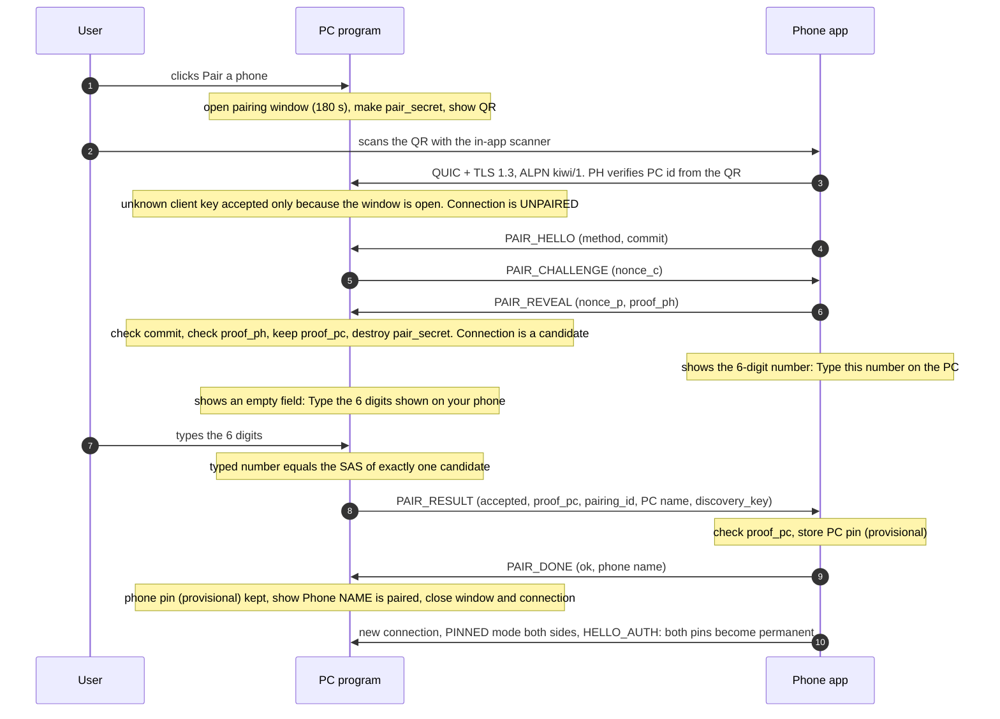
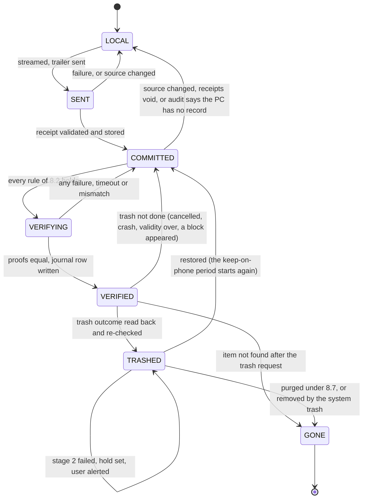

# Kiwi Transfer protocol specification: `kiwi/1`

Status: Draft 2, 2026-11-19, for Kiwi Transfer 1.0. Licence: Apache-2.0.
Companion documents: `docs/SPIKE-REPORT.md` (measurements this design relies on), `docs/THREAT-MODEL.md`,
`docs/REVIEW-PROTOCOL-1.md` (independent review of Draft 1; its findings are named `KT-nn` here) and
`docs/CHANGES-DRAFT-2.md` (what changed since Draft 1, finding by finding).

Scope: an Android phone app and a Windows PC program that copy files between each other over a local link
(Wi-Fi LAN, phone hotspot, USB tethering). No cloud, no account, no telemetry, **no internet mode**: the two
devices only ever talk to each other directly, on the same IP link. One PC serves several phones; each phone
has its own pairing, folder, settings, quota and weekly code.

Contents: 0 Conventions - 1 Identities and transport security - 2 Pairing - 3 Weekly re-confirmation -
4 Discovery and networks - 5 Session and streams - 6 File transfer - 7 Durable commit on the PC - 8 Final move
(8.12 keep-on-phone period, 8.13 second copy) - 9 Other features (9.1 sending, 9.6 data backup beyond media,
9.7 plain files on the PC) - 10 Update check, problem report, endpoint list, release signing - 11 Versioning
and test vectors - 12 Decisions - 13 Open questions - Appendix A constants - Appendix B context strings.

---

## 0. Conventions

**Requirement words.** MUST, MUST NOT, SHOULD, SHOULD NOT, MAY are used as in RFC 2119 / RFC 8174.

**Roles.** `PH` is the phone (always the QUIC client). `PC` is the Windows program (always the QUIC server).
A **link** is one paired (PH, PC) couple. In a file transfer, the **sender** and the **receiver** are roles
that either device can take.

**Namespace.** The **namespace** of a link is everything the PC stores for that one phone: its backup
folder (one directory that no other link uses), the ledger records made for it, its "sent files" folder, and
any namespace the PC user explicitly handed over to it (9.4). Every request of a phone is answered from its
own namespace only. No message lets a phone read, list, verify against, or learn of the existence of, a file
in another phone's namespace.

**Core and platform.** The **core** is the shared Rust library (`kiwi_core`, exposed through UniFFI). It
implements everything in this document that is not marked *(platform)*. The core MUST NOT assume Android or
Windows: it reaches the operating system only through adapter interfaces (key wrapping, media source, trash,
discovery results, clocks, durable storage). This keeps a later iOS client possible (see 11.4). The **store**
is the PC storage engine (`core/kiwi-store`): it implements section 7, the PC half of section 8 and 8.13.

**Notation.**

| Notation | Meaning |
|---|---|
| `a \|\| b` | Byte-string concatenation. |
| `u8`, `u16be`, `u32be`, `u64be` | Unsigned integers, big-endian. |
| `BLAKE3(m)` | BLAKE3 hash, default mode, 32-byte output. |
| `KDF(ctx, m)` | BLAKE3 `derive_key` mode: context string `ctx` (ASCII, exactly as written, no terminator), key material `m`, 32-byte output. |
| `MAC(k, m)` | BLAKE3 `keyed_hash` mode with a 32-byte key `k`, 32-byte output. |
| `SIG(sk, m)` | Ed25519 signature (RFC 8032, pure Ed25519, no prehash, no context), 64 bytes. |
| `ct_eq(a, b)` | Constant-time comparison. All comparisons of MACs, proofs, commitments and typed codes MUST use it. |
| `RAND(n)` | `n` bytes from the operating system CSPRNG. |

**Ed25519 verification is strict** everywhere in this document (TLS `CertificateVerify`, `HELLO_AUTH`,
release manifests): a verifier MUST reject a signature whose `S` is not canonical (`S >= L`), a public key or
`R` that is not a canonical encoding, and a public key of small order. Two implementations must never
disagree on whether a signature is valid (KT-05). In Rust: `ed25519-dalek` `verify_strict`, or an equivalent.

**Arithmetic.** Every addition, subtraction and multiplication on a value that came from the peer, from a
file, or from a clock is checked or saturating. No protocol value is ever allowed to wrap. The value ranges
are in 5.7; a value outside its range is handled as that table says, before it is used for anything.

All context strings are listed in Appendix B. All named constants (`CHUNK`, `FM_DELAY`, ...) are in Appendix A.

**Time.** Wall-clock times on the wire are signed integers: milliseconds since 1970-01-01T00:00:00Z. A
wall-clock value is never sufficient to *permit* a deletion; it may be used to *refuse* one (8.6) and to
apply the user's keep-on-phone period (8.12), always together with the *link clock* of 3.2.

---

## 1. Identities and transport security

### 1.1 Device identity key

1. Each installation has exactly one long-term **Ed25519** key pair, generated by the core with `RAND(32)` as
   the seed, on first start. It is never exported, never synchronised, never backed up.
2. `SPKI` is the DER encoding of the SubjectPublicKeyInfo for that key (RFC 8410). It is always exactly these
   44 bytes: `30 2a 30 05 06 03 2b 65 70 03 21 00 || public_key(32)`.
3. The **device id** is `ID = BLAKE3(SPKI)` (32 bytes). It is the value shown to users as a fingerprint
   (lowercase hex, groups of 4) and the value carried in the pairing QR.
4. A **pin** is the stored full `SPKI` (44 bytes) of a paired peer, with its `ID`. Pinning compares the full
   `SPKI`, not only the hash.
5. If the identity key cannot be loaded (blob missing, unwrap fails, see 1.6), the device MUST generate a
   new identity, MUST treat every existing pairing as void, and MUST tell the user that pairing is needed
   again. It MUST NOT silently keep old pins with a new key.
6. **Reset this device's identity** (KT-20). Both programs offer this action in their settings. It generates
   a new key pair, destroys the old seed, and voids every pairing exactly as rule 5 does; for final move each
   former link is handled as unpaired (8.10). Unpairing and pairing again does *not* change the key, so it
   does not help after a key was copied; the guidance shown after a malware clean-up, a restored system
   image or a suspected clone therefore says "reset the identity, then pair again".

### 1.2 Certificate

TLS carries the key in a self-signed X.509 v3 certificate (decision D1: raw public keys, RFC 7250, are not
used in `kiwi/1`).

| Field | Value |
|---|---|
| Signature algorithm | Ed25519 (`1.3.101.112`), self-signed with the identity key. |
| Subject = Issuer | `CN=kiwi` (constant; MUST NOT contain a device or user name). |
| Serial number | Any positive integer up to 20 bytes. |
| Validity | `notBefore` at or before `20200101000000Z`; `notAfter` = `99991231235959Z`. |
| Extensions | None required. A `subjectAltName` MAY be present; it is ignored. |
| Size | At most 1024 bytes DER. |

The certificate MAY be regenerated at any time from the same key; only `SPKI` is meaningful. The chain sent in
TLS MUST contain exactly one certificate.

### 1.3 QUIC and TLS profile

| Item | Requirement |
|---|---|
| Transport | QUIC version 1 (RFC 9000) only, with TLS 1.3 (RFC 9001, RFC 8446). |
| ALPN | Exactly one protocol: `kiwi/1` (bytes `6b 69 77 69 2f 31`). No other value is offered or accepted. If ALPN does not match, the handshake MUST fail (`no_application_protocol`). There is no fallback of any kind (no TCP, no HTTP, no older protocol). |
| Authentication | Mutual. The server MUST request and require a client certificate. The server's `CertificateRequest` carries no CA names. |
| Signature scheme | `ed25519` (0x0807) only, for both `CertificateVerify` messages. |
| Key exchange | `x25519` MUST be supported and offered. Other groups offered by the TLS library MAY stay enabled. |
| Cipher suites | `TLS_AES_256_GCM_SHA384`, `TLS_AES_128_GCM_SHA256`, `TLS_CHACHA20_POLY1305_SHA256` (the ring provider's TLS 1.3 set). |
| 0-RTT | Disabled. The server MUST set its early-data limit to 0 and MUST reject early data. The client MUST NOT send early data. |
| Resumption | Disabled on both sides, **by explicit configuration** (the library defaults enable it; see below). The server MUST NOT send `NewSessionTicket` and MUST NOT accept a PSK; the client MUST NOT store a ticket and MUST NOT offer a PSK. Every connection performs a full certificate handshake, so that unpairing takes effect at once (decision D12). |
| Address-validation tokens | The server MUST NOT send QUIC `NEW_TOKEN` frames; the client MUST NOT store or send such tokens. Only Retry tokens exist (5.9). |
| SNI | The client MUST NOT send the `server_name` extension. The server MUST ignore SNI if a client sends it. |
| QUIC datagrams | Not used. |
| Idle timeout | `max_idle_timeout` = 30 000 ms on both sides. |
| Keep-alive | While a session is in use, each side sends a QUIC PING after 10 s without sending. |
| Hop limit | IP TTL / IPv6 hop limit of every QUIC socket is 1 (4.4). |
| Exporters | RFC 8446 section 7.5 exporter, 32 bytes, empty context, labels `EXPORTER-kiwi-1-pairing` and `EXPORTER-kiwi-1-session`. |

**Normative library configuration (KT-04).** The reference implementation uses rustls 0.23 and quinn. Their
defaults do not give the profile above, so these settings are part of the specification. An implementation
on another stack MUST reach the same observable behaviour.

| Where | Setting | Why |
|---|---|---|
| rustls `ServerConfig` | `send_tls13_tickets = 0`; `session_storage = Arc::new(NoServerSessionStorage {})`; no `ticketer`; `max_early_data_size = 0`; `send_half_rtt_data = false` | The default sends 2 tickets and keeps an in-memory session store. |
| rustls `ClientConfig` | `resumption = Resumption::disabled()`; `enable_early_data = false`; `enable_sni = false` | The default caches tickets by server name; with one constant name a ticket from one PC would be offered to another and would be readable in the Initial packet. |
| quinn server | Built from the rustls configuration above, **not** from a convenience constructor (those set `max_early_data_size = u32::MAX`). The number of validation tokens sent is 0 where the pinned quinn version has that setting. Every incoming connection for which `remote_address_validated()` is false is answered with `retry()`. | No `NEW_TOKEN`, Retry always (decision D13). |
| quinn client | Built from the rustls configuration above; no token store. | |
| Both | The verifier objects of 1.4 are installed with `dangerous().with_custom_certificate_verifier` / `with_client_cert_verifier`; no root store is loaded. | |

Because a library change could re-enable one of these silently, the negative tests (f), (g) and (h) of 1.4
are release gates, and `HELLO_AUTH` (5.3) never relies on the TLS layer's idea of the peer alone.

### 1.4 Verifier obligations (normative)

Both sides install a custom certificate verifier (rustls `ServerCertVerifier` on PH, `ClientCertVerifier` on
PC). A verifier works in one of these modes, fixed before the handshake starts:

- **PINNED mode** (every normal connection): the expected peer `SPKI` set is known in advance.
  PH expects exactly one `SPKI` (the PC it is dialling). PC expects any `SPKI` in its pin store, or in its
  tombstone list (2.7): a tombstoned key completes the handshake only so that the PC can close the connection
  with code `3`; it never reaches `HELLO`.
- **PAIRING mode** (only as allowed in section 2): any well-formed Ed25519 `SPKI` is accepted. Nothing is
  pinned and **nothing is remembered** by the verifier.

**The verifier keeps no state across connections (KT-05).** The verifier object is shared by every
handshake; it MUST NOT store a "candidate", a "last seen key" or any other per-connection value. Whenever a
later step needs the peer's key (to compute `ID_ph`, to check a proof, to compare a typed number, to write a
pin), it MUST take the `SPKI` from the certificate of **that same connection object** (in quinn:
`Connection::peer_identity()`), the connection on which the verified `PAIR_REVEAL` or `HELLO` arrived.

In every mode the verifier MUST do all of the following, and MUST fail the handshake if any step fails:

1. **Certificate step** (`verify_server_cert` / `verify_client_cert`):
   a. The chain has exactly one certificate, at most 1024 bytes, and it parses as X.509.
   b. Its `SPKI` is exactly 44 bytes with the prefix in 1.1 (algorithm Ed25519, no parameters), and the
      public key passes the strict checks of section 0 (canonical, not of small order).
   c. PINNED mode: `SPKI` equals a pinned `SPKI` byte for byte or, on the PC only, `BLAKE3(SPKI)` is in
      the tombstone list. (Only during QR pairing the phone knows the PC by its id alone; the check is then
      `BLAKE3(SPKI) == pc_id`.) PAIRING mode: no further check.
   d. Names, validity dates, extensions, key usage and the certificate's self-signature are NOT evaluated
      (clocks on phones are unreliable and a self-signed validity period proves nothing).
2. **Handshake signature step** (`verify_tls13_signature`): verify the TLS 1.3 `CertificateVerify` signature
   over the handshake transcript with the public key from that same certificate, accepting only the scheme
   `ed25519`, with strict verification (section 0). This is the proof that the peer holds the private key.
   **The method MUST perform a real signature verification. It MUST NOT return success unconditionally,
   MUST NOT be a stub, and MUST NOT accept any other scheme.** A verifier that checks the pin but skips this
   step lets anyone who has seen the certificate impersonate the device.
3. `verify_tls12_signature` MUST always return an error. `supported_verify_schemes` MUST return exactly
   `[ED25519]`.
4. PC only: `client_auth_mandatory` is true. A connection without a client certificate MUST fail.
5. On failure the handshake is aborted with a fatal TLS alert. The alert code is not specified; peers MUST NOT
   depend on it.

Defence in depth: after the handshake, both sides also sign a session transcript bound to the TLS exporter
with the identity key (5.3). A verifier bug that skipped step 2 is therefore caught at the application layer.
For that reason `HELLO_AUTH` MUST look the peer's `SPKI` (taken from the connection object) up in the pin
store **again** and verify the signature with the pinned key; it MUST NOT accept "the TLS layer said this
peer is authenticated" as a fact.

Required negative tests (11.2), each a release gate:

| | Test | Must |
|---|---|---|
| a | Correct pinned certificate, `CertificateVerify` signed with a different key | fail |
| b | Unknown key in PINNED mode | fail |
| c | RSA or ECDSA certificate | fail |
| d | Two-certificate chain | fail |
| e | ALPN `kiwi/2` or `h3` | fail |
| f | A client that offers a PSK (a ticket from an earlier connection, or a forged one) | get a full certificate handshake or fail; never a resumed one |
| g | A complete session, observed from the client | contain no `NewSessionTicket` and no `NEW_TOKEN` frame |
| h | A phone that was unpaired, holding a ticket or token from before | be refused (close code `3` through the tombstone, or handshake failure) |
| i | A signature with non-canonical `S`, and a small-order public key | fail in the handshake and in `HELLO_AUTH` |
| j | Two pairing connections interleaved message by message (2.4) | each proof, typed number and pin is bound to its own connection; the key of connection A is never pinned on the evidence of connection B |
| k | An Initial packet without a Retry token | be answered by Retry only, with no connection state |

### 1.5 Order of authentication

In TLS 1.3 the server authenticates first. PH MUST verify the PC pin before it sends its own certificate
(this is the normal TLS 1.3 flight order; the client aborts on a pin mismatch and its identity is not
revealed to a wrong server). The PC certificate is visible to any host on the link that starts a handshake;
see the threat model, residual risk R7. In pairing method `SAS` the phone has no pin yet, so its certificate
is shown to whichever host answered (2.4; threat model C2).

### 1.6 Key storage

**Android** *(platform; the Android Keystore cannot hold Ed25519 keys before API 33 and minSdk is 24)*:

1. The Ed25519 seed is generated and used by the core. At rest it is stored only as a wrapped blob.
2. Wrapping key: an AES-256-GCM key in the Android Keystore, alias `kiwi_identity_wrap_v1`, purposes
   encrypt+decrypt, `setRandomizedEncryptionRequired(true)`, no user-authentication requirement (backup must
   run in the background). StrongBox is requested where present, with fallback to the TEE-backed Keystore.
3. Blob: `"KWK1" || iv(12) || ciphertext_and_tag`, with additional authenticated data
   `kiwi/1 identity seed` (ASCII). The IV is the one produced by the Keystore cipher.
4. Location: `Context.getNoBackupFilesDir()`. The manifest MUST set `android:allowBackup="false"` and MUST
   ship `dataExtractionRules` (API 31+) and `fullBackupContent` (API 30 and lower) that exclude every domain
   for both cloud backup and device-to-device transfer. The pin store and the phone ledger live in app-private
   storage under the same exclusion. Storage is credential-encrypted (the app is not direct-boot aware).
5. The unwrapped seed lives only in core memory, in a zeroize-on-drop buffer.
6. Stated limits: hardware backing protects the blob against offline extraction and against cloning through a
   backup or a copied data directory. It does not protect against code running inside the app's process or a
   rooted/compromised device, which can use or read the unwrapped seed. On devices without a hardware-backed
   Keystore the wrapping key is software-protected; the app records the security level
   (`KeyInfo`) in its diagnostic screen. Uninstalling the app destroys the wrapping key: the identity is gone
   and re-pairing is required.

**Windows** *(platform)*:

1. The seed is protected with DPAPI: `CryptProtectData`, CurrentUser scope (never
   `CRYPTPROTECT_LOCAL_MACHINE`), `CRYPTPROTECT_UI_FORBIDDEN`, optional-entropy = `kiwi/1 identity seed`
   (domain separation only; it is not a secret).
2. Location: `%LOCALAPPDATA%\FastKiwi\KiwiTransfer\` (the non-roaming profile), with the default per-user ACL.
3. Stated limits of DPAPI CurrentUser:
   - Any program running as the same Windows user can call `CryptUnprotectData` and obtain the seed. DPAPI has
     no per-application isolation.
   - Administrators, SYSTEM, and on domain-joined machines the domain DPAPI backup key, can recover it.
   - The DPAPI master key is derived from the user's logon credential: an account with an empty or weak
     password gives little protection against offline disk access unless the disk is encrypted (BitLocker).
   - There is no hardware binding and no user-presence check.
   - A local password reset by an administrator, a new Windows profile, or a Windows reinstall makes the blob
     undecryptable. Then rule 1.1(5) applies: new identity, re-pair.
   - A system image or profile backup contains the blob: restoring it restores the identity together with an
     older ledger. That case is detected as a ledger rollback (8.10), not here.
4. This protection covers the **identity seed only**. The files the PC stores for a phone are plain files
   with no password, no encryption and no lock of the program's own (9.7, owner decision).

---

## 2. Pairing (first link)

Pairing creates the two pins of a link. It is always started by a person at the PC. There is **no standing
pairing listener**: unknown keys are accepted only while a user-opened pairing window is open. A PC pairs any
number of phones (up to its limit, 2.6), one at a time; each pairing creates an independent link with its
own namespace.

There are two methods. Both run the same message sequence, and in both **the person at the PC types the
6-digit number that the phone shows** (decision D6, KT-06). The PC never displays that number and never
offers an "Allow" button: a click can be given to the wrong device, a typed number cannot.

| Method | Authentication comes from | When | Networks (4.4) |
|---|---|---|---|
| `QR` (1) | The PC device id and a one-time secret carried in the QR, **and** the typed number. | Default. | Private, and Public networks the PC user has enabled. |
| `SAS` (2) | The typed number alone, protected by a commitment, plus a confirmation on the phone. | When the camera cannot be used. | Private networks only. |

There is no typed short-code PAKE in `kiwi/1` (no audited PAKE crate exists; spike section 5, decision D5).

### 2.1 Pairing window (PC)

1. The user clicks "Pair a phone". The PC opens a window of `PAIR_WINDOW` (default 180 s; configurable only
   within 120-300 s), measured with a monotonic clock. Only one window can be open at a time. A window can
   be opened only while at least one interface is eligible (4.4).
2. The PC generates `pair_secret = RAND(16)` (128 bits) and shows the QR (2.2). By default only method `QR`
   is accepted. If the user chooses "I can't scan", the window also accepts method `SAS` **on Private
   interfaces only**, and the PC advertises `pm=1` in mDNS on those interfaces (section 4) until the window
   closes. A `PAIR_HELLO` with method 2 that arrives on a Public interface, or while method 2 is not
   enabled, is refused (`E_NOT_PERMITTED`).
3. While the window is open, the PC verifier runs in PAIRING mode **for unknown keys only**: a client whose
   `SPKI` is pinned gets a normal session; a tombstoned key is closed with code `3` (2.7); a client whose
   `SPKI` is unknown gets an **UNPAIRED** connection. When no window is open, unknown keys fail the handshake.
4. A **candidate** is an UNPAIRED connection whose `PAIR_REVEAL` has passed every check of 2.4 rule 4. At
   most 2 UNPAIRED connections exist at a time, so at most 2 candidates; with method `QR` at most one,
   because the secret is single use. A further unknown-key connection is given `ERROR(E_BUSY)` in answer to
   its `PAIR_HELLO` and closed.
5. A **failed attempt** is: a bad proof, a bad commitment, a protocol error on an UNPAIRED connection, a
   `PAIR_REVEAL` that arrives after the secret was consumed, or a typed number that matches no candidate.
   The window allows `PAIR_ATTEMPTS` (3) failed attempts.
6. The window closes, and `pair_secret` is destroyed, at the first of: timeout; user cancel; a typed number
   that matches (success); the third failed attempt; program exit. The secret is also destroyed at the first
   valid `PAIR_REVEAL` proof (single use), whatever happens afterwards. "Closes" means that no further
   unknown key is accepted; if a candidate exists when the time runs out, the number can still be typed for
   at most `PAIR_ENTRY_TIME` (120 s) after that candidate was verified.
7. If no device is paired and no window is open, the PC MUST NOT bind any UDP socket and MUST NOT advertise.

An UNPAIRED connection is restricted: one bidirectional stream; only the messages `PAIR_*`, `ERROR`;
frames of at most `MAX_FRAME_UNPAIRED` (4096 bytes); no unidirectional streams; `PAIR_HELLO` within 10 s of
the handshake; `PAIR_REVEAL` within 10 s of `PAIR_CHALLENGE`. An UNPAIRED connection is never upgraded:
after pairing, both sides close it and PH opens a new, normal connection. No device name travels on an
UNPAIRED connection before the typed number has matched (KT-23).

### 2.2 QR code

Text content: the ASCII prefix `KIWI1:` followed by the RFC 4648 Base32 encoding (alphabet `A-Z2-7`,
upper case, no padding) of this payload. All characters fit the QR alphanumeric mode.

| Offset | Size | Field | Value |
|---|---|---|---|
| 0 | 1 | `qr_version` | `0x01` |
| 1 | 1 | `flags` | bit 0: `1` = the window also accepts method SAS. Other bits 0; a reader MUST reject unknown bits. |
| 2 | 32 | `pc_id` | `ID` of the PC. |
| 34 | 16 | `pair_secret` | One-time secret. |
| 50 | 2 | `port` | UDP port, `u16be`. |
| 52 | 1 | `n` | Number of addresses, 1 to 6. |
| 53 | ... | `addr[n]` | Each: `family` (`0x04` or `0x06`) then 4 or 16 address bytes. |

Rules:

- Addresses are the PC's unicast addresses on eligible interfaces only (4.4), IPv4 first. IPv6 link-local
  addresses are not put in the QR (no scope id can be carried).
- The QR carries no expiry time: the PC enforces the window with its own monotonic clock.
- A typical payload (two IPv4 addresses) is 63 bytes, 101 Base32 characters, 107 characters with the prefix: QR version 5 at level M.
- PH MUST accept this content **only from its in-app scanner**. The app MUST NOT register a URI scheme,
  app link or intent filter that starts pairing, and MUST NOT accept a pairing payload from the clipboard,
  a file or another app. (A link on a web page must not be able to pair the phone with an attacker's PC.)
- PH applies the address filter of 4.4 to the QR addresses before dialling.
- The QR is shown only inside the PC program's own window, and is removed from the screen as soon as a
  candidate exists or the window closes.

### 2.3 Derived values

Both sides compute, for the pairing connection they are on:

```
E_pair   = TLS exporter, label "EXPORTER-kiwi-1-pairing", empty context, 32 bytes
ID_ph    = BLAKE3(SPKI of the phone)      ID_pc = BLAKE3(SPKI of the PC)
           (own SPKI from the own key; peer SPKI from the certificate of THIS connection object, 1.4)
commit   = KDF("kiwi/1 pairing commit",     E_pair || ID_ph || ID_pc || nonce_p)
TH       = KDF("kiwi/1 pairing transcript", E_pair || ID_ph || ID_pc || BLAKE3(m1) || BLAKE3(m2) || nonce_p)
SAS      = u64be( KDF("kiwi/1 pairing sas", TH)[0..8] ) mod 1000000      (shown as 6 digits, "482 913")
K_pair   = KDF("kiwi/1 pairing key", pair_secret)                        (method QR only)
proof_ph = MAC(K_pair, 0x01 || TH)                                       (method QR only)
proof_pc = MAC(K_pair, 0x02 || TH)                                       (method QR only)
```

`m1` is the exact payload bytes of the `PAIR_HELLO` frame and `m2` the exact payload bytes of the
`PAIR_CHALLENGE` frame (the CBOR envelope, without the 4-byte length prefix; see 5.1). `nonce_p = RAND(32)`
is chosen by PH; `nonce_c = RAND(32)` is chosen by PC and is inside `m2`. All inputs have fixed lengths.

The PC computes `proof_pc` at the moment it verifies `PAIR_REVEAL`, keeps only that 32-byte value for the
candidate, and destroys `pair_secret` and `K_pair` then (KT-22). The SAS of a candidate is kept in memory
only, for comparison with the typed number; it is never rendered, logged or sent.

### 2.4 Message sequence



Method SAS differs in three places (ASCII view):

```
PH                                              PC
 |  finds a PC with pm=1 (mDNS) or typed addr    |   window open, "I can't scan" chosen, Private network
 |== TLS: both verifiers in PAIRING mode =======>|   (signatures verified, nothing pinned yet)
 |-- PAIR_HELLO (method=2, commit) ------------->|
 |<------------------- PAIR_CHALLENGE (nonce_c) -|
 |-- PAIR_REVEAL (nonce_p) --------------------->|   check commit; connection is a candidate
 |  shows the number: "Type this on the PC"      |   shows the field "Type the 6 digits shown on your phone"
 |                                               |   user types; equal to this candidate's SAS
 |                                               |   shows "Number correct. Now confirm on your phone."
 |<-- PAIR_RESULT (accepted, id, name, key) -----|   PC pins (provisional)
 |  asks "Did the PC say the number was correct?"|
 |-- PAIR_DONE (ok = the user's answer, name) -->|   ok=false: PC deletes the provisional pin and warns
 |  PH pins (provisional) only on Yes            |
```

Processing rules:

1. **PH, start.** Method QR: PH dials the QR addresses with the verifier in PINNED mode for `pc_id`
   (the handshake fails unless the server key hashes to `pc_id`). Method SAS: PH dials with the verifier in
   PAIRING mode. In both cases PH then sends `PAIR_HELLO` with `commit`. It sends no name.
2. **PC, on `PAIR_HELLO`.** Reject (`E_NOT_PERMITTED`) if the method is not allowed by the window or by the
   network the connection arrived on (2.1 rule 2). Reply `PAIR_CHALLENGE` with a fresh `nonce_c`.
3. **PH, on `PAIR_CHALLENGE`.** Send `PAIR_REVEAL` with `nonce_p` and, for method QR, `proof_ph`. Then show
   the SAS with the text "Type this number on the PC". PH MUST NOT show the SAS before it has sent
   `PAIR_REVEAL`.
4. **PC, on `PAIR_REVEAL`.** All values are computed from the connection object the message arrived on.
   Recompute `commit` from `nonce_p`; if `ct_eq` fails, abort (`E_VERIFY`, a failed attempt). Method QR:
   recompute `proof_ph`; if `ct_eq` fails, or the secret was already consumed, abort (`E_VERIFY`, a failed
   attempt; a wrong proof does not consume the secret) and, if the secret had been consumed, show "A second
   device tried to use this QR code". On success the secret is consumed now, `proof_pc` is kept, and the
   connection becomes a candidate. The PC then shows the field **"Type the 6 digits shown on your phone"**.
   It MUST NOT show the SAS, a device name, or an Allow button.
5. **PC, on a typed number** (6 digits; spaces ignored). Compare it with the SAS of each candidate using
   `ct_eq`.
   - Exactly one candidate matches: that candidate is accepted. The PC stores the provisional pin for the
     `SPKI` **of that connection object**, creates the link state (2.6), sends `PAIR_RESULT(accepted)` on
     it, and closes every other UNPAIRED connection with `PAIR_RESULT(declined, E_DECLINED)`.
   - No candidate matches: a failed attempt. The candidates stay; the PC shows "That number does not match.
     Check your phone and type it again." After the third failed attempt every candidate gets
     `PAIR_RESULT(declined, E_ATTEMPTS)`, the window closes, and the PC shows "Pairing was stopped. If you
     did not mistype, another device may be trying to pair."
   - Both candidates match (probability 10^-6): decline both, a failed attempt.
6. **PH, on `PAIR_RESULT(accepted)`.** Method QR: verify `proof_pc` (`ct_eq`); on failure send
   `PAIR_DONE(ok=false)` and pin nothing. Method SAS: ask the user **"Did the PC say the number was
   correct?"**; only "Yes" continues, "No" sends `PAIR_DONE(ok=false)` and warns that someone on the network
   may be interfering. Then store the PC pin, `pairing_id` and `discovery_key` as **provisional**, send
   `PAIR_DONE(ok=true)` with the phone's display name, close, and reconnect normally.
7. **PC, on `PAIR_DONE`.** `ok=true`: sanitise the phone name (5.8), show "Phone <name> is now paired",
   close the window. `ok=false`, or no `PAIR_DONE` within 120 s: delete the provisional pin and the link
   state, and show that pairing did not finish.
8. **Both pins are provisional** until the first normal session of the link passes `HELLO_AUTH` (5.3). A
   provisional pin allows the handshake and `HELLO`/`HELLO_AUTH` only. If that session does not happen
   within `PROVISIONAL_PIN_LIFETIME` (600 s; PC: monotonic clock; PH: link clock), the device MUST delete
   its provisional pin and tell its user that pairing did not finish. The PC then keeps a tombstone for
   that key (2.7), so that the phone learns it by an authenticated close code instead of a bare failure.
9. Each device pins **only after its own user-facing condition is met**: PC after the typed number matched;
   PH after the QR proof (method QR) or the local "Yes" (method SAS). A confirmation received from the
   network is never a substitute for the local one.
10. **PH, on `ERROR(E_BUSY)`**: show "Another device is pairing with this PC right now. On the PC, type
    only a number that your own phone is showing." On `E_VERIFY` after a QR scan: "This QR code was already
    used. Someone else may have scanned it. Open a new pairing window on the PC."

### 2.5 Why the number cannot be ground, and why it is typed

A man in the middle (M) holds two TLS connections, PH-M and M-PC, with different exporters and keys, and
wants the number PH shows to be the SAS of the M-PC connection. The SAS depends on `nonce_p` and `nonce_c`:

- Towards PC, M must send a `commit` (binding: it fixes M's `nonce_p'`) **before** it learns PC's `nonce_c`.
- Towards PH, M must send its `nonce_c'` **before** PH reveals `nonce_p` (hiding: `commit` reveals nothing
  about the 256-bit `nonce_p`).

Whatever the order, one of the two SAS values still depends on a random value M has not seen when M makes
its last choice. M therefore gets one guess per candidate: success probability 10^-6. A window holds at
most 2 candidates and allows 3 typed numbers. Requirements that make this hold: `nonce_p` and `nonce_c` are
fresh `RAND(32)` per attempt; PC MUST NOT send `nonce_c` before it has `commit`; PH MUST NOT send `nonce_p`
before it has `nonce_c`; PC MUST verify `commit`; PH does not show the SAS before `PAIR_REVEAL` is sent.

Why typing closes the human gap (KT-06): the number travels only from the phone's screen, through the
user's eyes and hands, into the PC. A device that is not the user's own phone (a bystander who photographed
the QR, an attacker who answered first) is a candidate too, but its SAS is not the number on the user's
phone, so the typed number selects the right connection or none. The user never has to notice that
"something is different"; doing nothing wrong is enough. What remains is an attacker who can read the
attacker's own number **and** type it on the PC keyboard (threat model R10).

### 2.6 State created by pairing

Both sides store for the link: peer `SPKI` and `ID`, peer display name, `pairing_id` (16 random bytes chosen
by PC, sent in `PAIR_RESULT`), `discovery_key` (32 random bytes chosen by PC for this link, 4.2),
`confirm_epoch = 1`, confirmation age 0 with `need_confirm = false` (pairing counts as the first weekly
confirmation), `last_session_seq = 0`.

The PC also creates, per link: the namespace folder (one new directory under the chosen destination, used
by no other link), the per-phone settings (folder layout, quota (5.10), "Allow this phone to free up space
using this PC" = **off** (8.2), shared folders = none (9.3)), and registers the phone with the store.

Limits, enforced at pairing with `PAIR_RESULT(declined, E_LIMIT)`: a PC accepts at most `MAX_PHONES` (8)
paired phones, a phone at most `MAX_PCS` (4) paired PCs. These are local policy, not wire limits.

### 2.7 Unpairing

- Either side can unpair at any time, without the other being present. The local effect is immediate:
  delete the pin, the `discovery_key` and the session state of the link (confirmation state, challenge,
  session counters), and close any connection with QUIC application code `3` (unpaired).
- **Unpairing never deletes a file or a ledger record on either device** (KT-07). On the PC the namespace of
  that phone becomes **unlinked**: its records stay in the ledger, its files stay where they are, they are
  still scanned (8.9), still mirrored (8.13), still marked and shown as "only copy" where they are, and the
  PC keeps warning about their trash expiry (8.10). An unlinked namespace is removed from the PC program
  only by an explicit action of the PC user, on a screen that first lists how many of its files are sole
  copies. On the phone the effect on trashed items is defined in 8.10 (purges stop; items stay in the trash
  until the user decides).
- If a session is open, the side that unpairs first sends `UNPAIR`; the peer answers `UNPAIR_ACK`, shows
  "unpaired by the other device", and deletes its pin.
- **Tombstone (PC).** When the PC unpairs a phone, or deletes an expired provisional pin, it keeps the `ID`
  of that phone's key in a tombstone list for `TOMBSTONE_LIFETIME` (90 days; at most 64 entries, oldest
  dropped first). A connection from a tombstoned key completes the TLS handshake and is then closed with
  code `3` at once; no stream is read. Because the handshake authenticated the PC to the phone, this close
  code is an authenticated statement "you are unpaired": the phone treats it exactly like `UNPAIR`.
- **Farewell (phone).** When the phone unpairs while the PC is not connected, it SHOULD keep the PC pin in a
  state `UNPAIRING` for up to 90 days, in which the only thing it does with it is: when that PC is next
  found, connect, complete `HELLO`/`HELLO_AUTH`, send `UNPAIR`, and delete the pin. No other message is sent
  or accepted in that state.
- A handshake that merely fails proves nothing. A device MUST NOT delete a pin automatically because a
  handshake failed (that could be a network attacker or a transient fault). It marks the link "cannot
  reach, or not accepted by, the other device" and lets the user remove it.
- Pairing the same two devices again creates a new link with a new `pairing_id`. No state is inherited by
  the protocol; the PC user may hand the unlinked namespace over to the new link (9.4).

---

## 3. Weekly session re-confirmation

Owner requirement: every 7 days a link must be re-confirmed with a 2-digit code shown in the PC program and
typed on the phone. The check is **per phone**: each link has its own state, its own code and its own
expiry. Its scope is **narrow** (owner decision, 3.5): an expired check never stops backup copying; it
pauses the things that remove data from the phone or give data out of the PC.

### 3.1 What it is, and what it is not

- It is a **presence and consent check**: it shows that a person holding the phone can also see the PC
  program's window, and it makes the user look at the PC program (where integrity alerts are shown) at
  least once a week.
- It is **not a secret and not authentication**. The channel is already mutually authenticated (section 1).
  A 2-digit code has 100 values; its strength comes only from the attempt limits and from the fact that a
  code exists only while it is displayed on the PC (3.4).
- It limits how long a stolen phone, or a copied phone identity, can make the phone-side of final move run,
  read the phone's namespace on the PC, or receive files from the PC, without access to the PC screen.

### 3.2 Link clock (rollback-resistant time)

Each device keeps, per installation, a persistent non-decreasing counter `LC` in seconds (the **link clock**):

1. While the process runs, `LC` advances with a monotonic clock that keeps counting during sleep
   *(platform: Android `SystemClock.elapsedRealtime`; Windows `QueryInterruptTime`/`GetTickCount64`)*.
2. A checkpoint `(LC, wall_time, boot_id, monotonic_reading)` is written durably at least every 5 minutes
   while running and at clean shutdown.
3. At start, with the last checkpoint:
   - same boot: `boot_id` is unchanged **and** `monotonic_now >= monotonic_reading`. Then
     `LC += monotonic_now - monotonic_reading`.
   - otherwise `gap = wall_now - wall_time`. If `gap >= 0`: `LC += gap`. If `-CLOCK_TOLERANCE <= gap < 0`
     (`CLOCK_TOLERANCE` = 300 s; a routine time correction after a quick restart): `LC` is left unchanged.
     If `gap < -CLOCK_TOLERANCE` (the wall clock went backwards): `LC` is left unchanged and the device
     sets `clock_anomaly` on **every** link it has (KT-30).
   - `boot_id` MUST NOT be derived from the wall clock *(platform: Android `Settings.Global.BOOT_COUNT`;
     Windows: a random marker kept in a volatile registry key, which the system discards at shutdown; never
     "boot time", which is wall clock minus uptime and moves whenever the time service steps the clock)*.
     A marker that is lost more often than at a restart (for example at sign-out) only sends the device
     down the wall-clock branch, which is the safe one.
4. A wall clock set forward makes `LC` jump forward: weekly checks come due early (fail closed). It does
   **not** make anything safe to delete early: the delay rules of section 8 also use the other device's
   clock, and 8.6 refuses to trash while the two wall clocks disagree (KT-11). A wall clock set back is
   either detected (`clock_anomaly`) or, at worst, hides the time the device was off; rule 3.3(4) then
   corrects it from the other device.
5. `LC` values are local. Only **differences** of `LC` are ever sent or compared. `LC` saturates at 2^53.

Each side also keeps, **per link**, durably:

| Value | Range | Meaning |
|---|---|---|
| `confirm_epoch` | 1 .. 2^53 | Number of the last confirmation this side knows. |
| `age_base` | 0 .. `AGE_CAP` (2^32) | Confirmation age in seconds at the moment `age_lc` was written. |
| `age_lc` | an `LC` value | This side's own `LC` when `age_base` was written. |
| `need_confirm` | bool | Set whenever this side found the link `REQUIRED` for any reason. **Cleared only by a successful code exchange (3.4)** or by the adoption rule 3.3(1). |
| `clock_anomaly` | bool | Set by rule 3 above. Cleared only by a successful code exchange. |

```
confirm_age = min(AGE_CAP, age_base + (LC - age_lc))        saturating; never negative
              if LC < age_lc (damaged state): confirm_age = AGE_CAP and need_confirm = true
```

There is no stored value that is ever moved backwards and no subtraction that can go below zero (KT-01).

### 3.3 Confirmation state (computed at every session start, 5.3)

Both sides send `confirm_epoch`, `confirm_age`, `clock_anomaly` and `need_confirm` in `HELLO`. A
`confirm_epoch` above 2^53 or equal to 0 closes the connection with code `1`. A received `confirm_age`
above `AGE_CAP` is read as `AGE_CAP`. Then, identically on both sides, with `x_ph` and `x_pc` the two
sides' values:

1. **Missed result.** If `epoch_pc > epoch_ph` and `epoch_pc - epoch_ph == 1` and `need_confirm_pc` is
   false and `clock_anomaly_ph` is false: the phone missed the last `RECONFIRM_RESULT`. PH adopts, durably:
   `confirm_epoch = epoch_pc`, `age_base = confirm_age_pc`, `age_lc = LC`, `need_confirm = false`. Both
   sides continue with the adopted values in place of the phone's.
2. **Epoch agreement.** If the epochs still differ (one side lost or restored state): `REQUIRED`.
3. **Flags.** If either side reports `clock_anomaly` or `need_confirm`: `REQUIRED`.
4. **Age.** `age = max(confirm_age_ph, confirm_age_pc)`, at most `AGE_CAP`. Each side stores
   `age_base = age`, `age_lc = LC` (ages never decrease by talking to the peer; a side that was switched
   off or had its clock set back is corrected by the other).
5. The link is `CONFIRMED` if rules 2 and 3 pass and `age < CONFIRM_PERIOD` (604 800 s); otherwise
   `REQUIRED`.
6. **Durable.** Whenever the result is `REQUIRED`, each side sets its `need_confirm = true` before it does
   anything else. From then on no value received from the peer, and no later arithmetic, can make the link
   `CONFIRMED` again; only 3.4 can.

During a long session each side re-evaluates `confirm_age` with its own `LC` before every request of a
paused class (3.5); when it reaches `CONFIRM_PERIOD` it applies rule 6, and the PC pushes `STATUS`. A
wall-clock timestamp is never an input to this decision.

What a holder of a copied phone key can do to this state: send any epoch, age or flag. Sending a larger
epoch or age, or a set flag, gives `REQUIRED`. Sending a smaller age changes nothing (`max`). Nothing it
can send clears the PC's `need_confirm`.

### 3.4 Code exchange

Runs on the control stream of a normal session. The code never travels from PC to PH.

1. PH sends `RECONFIRM_BEGIN` (allowed at any time, also before expiry).
2. PC creates a challenge: `code` uniform in `00..99` (CSPRNG with rejection sampling), `challenge_id`,
   3 attempts. PC replies `RECONFIRM_CHALLENGE(state = waiting)`.
3. **Arming.** The PC accepts answers only while the challenge is *armed*. A challenge becomes armed only
   when a person at the PC clicks **"Show the weekly number for <phone>"** inside the PC program's own
   window, in an interactive, unlocked user session. Opening the program does not arm anything and shows no
   number (KT-30). The code MUST NOT appear in a notification, a tooltip, a log or the lock screen. Arming
   starts a `RECONFIRM_TTL` (300 s, monotonic) timer. PC pushes `RECONFIRM_STATE` to PH when the challenge
   becomes armed or dies.
4. The user types the two digits on the phone. PH sends `RECONFIRM_ANSWER(challenge_id, code)`.
5. PC, if armed and not expired, compares with `ct_eq`.
   - Match: `new_epoch = max(epoch_pc, epoch_ph) + 1`, where `epoch_ph` is the value from this session's
     `HELLO` (KT-08: the result is larger than both, also when the PC was restored to an older state). The
     PC durably stores `confirm_epoch = new_epoch`, `age_base = 0`, `age_lc = LC`, `need_confirm = false`,
     `clock_anomaly = false`, and then replies `RECONFIRM_RESULT(ok, new_epoch)`.
   - PH, on `ok`: it requires `new_epoch > confirm_epoch` and `new_epoch <= 2^53` (otherwise it ignores the
     result and stays `REQUIRED`), then durably **sets** `confirm_epoch = new_epoch` (it does not increment
     its own), `age_base = 0`, `age_lc = LC`, `need_confirm = false`, `clock_anomaly = false`, and then
     sends `RECONFIRM_ACK(new_epoch)`. If the result is lost on the way, rule 3.3(1) repairs it at the next
     session.
   - Mismatch: `attempts_left -= 1`, reply `RECONFIRM_RESULT(not ok, attempts_left)`.
6. Limits: 3 attempts per challenge. After the third wrong answer, or TTL expiry, the challenge is dead.
   A **new challenge after a failed one requires a click on the PC** ("Show a new number"), and the PC
   shows "A wrong number was entered 3 times from phone <name>". After 3 dead challenges in a row the link
   is locked for 15 minutes (PC monotonic time), doubling up to 24 hours; a success resets this.
   Answers to an unarmed, expired or unknown challenge are rejected (`E_STATE`) and consume nothing.
7. Honest strength statement: a person with the phone but without sight of the PC screen has at most 3
   guesses (3 %) per challenge that somebody at the PC armed, and each failure is displayed at the PC.

### 3.5 Effect of `REQUIRED` (narrow scope)

While a link is `REQUIRED`, **copying to the PC goes on**; everything that removes data from the phone or
hands data out of the PC waits for the code. This applies to that one phone only.

| Area | Behaviour while `REQUIRED` |
|---|---|
| **Backup copying, phone to PC** | **Continues.** `OFFER` with purpose 1 (backup), 5 (repair) and purpose 2 from the phone ("Send to PC"), their data streams, `ITEM_RESULT`, `XFER_CANCEL`, `XFER_END`, `AUDIT`, `REPAIR_REQUEST`. Receipts of every level are issued as usual. |
| **State reporting** | **Continues.** `STATUS`, `PHONE_STATUS`, `FM_STATE` (the phone must still be able to tell the PC that Android emptied its trash), `PING`, `RECONFIRM_*`, `UNPAIR`, `BYE`, `ERROR`. |
| **Final move** | **Paused.** `FM_VERIFY` (both stages) is refused with `E_CONFIRM_REQUIRED`: no second verification, no trashing (8.8). |
| **Trash purges** (Android 7-10) | **Suspended**, not cancelled: retention keeps counting, deletion waits (8.7). |
| **Browse and restore** | **Paused.** `BROWSE`, `THUMB`, `FETCH`, and `OFFER` with purpose 3 or 4 are refused with `E_CONFIRM_REQUIRED`. |
| **PC-to-phone delivery** | **Paused.** The PC sends no `OFFER` with purpose 2; its outbox keeps the items queued (9.1). |
| **Clipboard** | **Paused** in both directions (`CLIP` refused). |
| **PC-only work** | Continues: integrity scan (8.9), second copy (8.13). They need no phone. |
| **Deletion** | **Nothing is deleted** on either device because a link expired. No file, ledger entry, pin or partial transfer is removed. |
| Transfers of a paused class already running | An item whose data stream is already open may finish and commit; no new item of that class starts. |
| After re-confirmation | Everything resumes from where it stopped. No re-pairing is needed. |

Why copying may continue: a thief, or a holder of a copied phone key, gains nothing by uploading files
into that phone's own folder within its quota, while a paused backup creates exactly the loss the product
exists to prevent.

Limit that cannot be removed: on Android 11+ the *system* trash deletes its items on its own schedule
(8.6). The app cannot suspend that; 8.6 defines the warning the app must give instead, and names the due
weekly check as the reason.

### 3.6 Several paired devices

- Confirmation state, epoch, flags, challenge and lockout are **per link**. Confirming one phone does
  nothing for another phone; a PC with three phones lists three phones, each with its own "Show the weekly
  number" button, and never shows two numbers under one label.
- A code is bound to its link: an answer is checked only against the challenge of the link it arrives on.
- A phone paired with two PCs confirms each PC separately; one PC being expired does not pause the other.
- Final move for a folder targets exactly one PC (8.1); only that link's state matters for that folder.

---

## 4. Discovery and networks

Discovery only produces **candidate addresses**. A candidate is never trusted: every candidate passes the
address filter (4.4) and then the TLS pin (1.4). A wrong or forged answer can only cause a failed attempt.

### 4.1 Service

| Item | Value |
|---|---|
| Mechanism | mDNS / DNS-SD (RFC 6762, RFC 6763). The PC advertises; the phone browses. The phone never advertises and never listens. |
| Service type | `_kiwixfer._udp.local.` |
| Instance name | 16 lowercase hex characters from `RAND(8)`. MUST NOT contain a device, user or host name. |
| SRV target | `k<same 16 hex>.local.` MUST NOT be the Windows host name. |
| SRV port | The PC's QUIC UDP port. |
| Rotation | A new random instance name at every program start, at every network change, and at least every 24 h. |
| Advertised when | The program runs and (at least one phone is paired, or a pairing window with SAS is open), **and only on eligible interfaces** (4.4, 4.5 rule 4). |

### 4.2 TXT record

| Key | Value | Meaning |
|---|---|---|
| `v` | `1` | Protocol major version(s) supported, comma-separated decimal. |
| `h` | 128 lowercase hex characters | `HINT_SLOTS` (8) hints of 8 bytes each, concatenated. Lets a paired phone recognise its PC without trial handshakes. |
| `pm` | `1` | Present only while a pairing window that accepts method SAS is open, and only in answers sent on **Private** interfaces. |

The hint of one link, for the current instance name (KT-24):

```
K_hint = KDF("kiwi/1 discovery hint", discovery_key)          discovery_key: 32 random bytes per link (2.6)
hint   = MAC(K_hint, instance_name_ascii)[0..8]
```

The PC fills the 8 slots with the hints of its paired phones in a random order and fills the unused slots
with `RAND(8)`, so the record always has the same size and does not show how many phones are paired. A
phone recognises its PC when any slot equals its own expected hint. The key is a per-link secret that only
the two paired devices hold, so:

- a host that merely probed the PC (and so knows its public key, R7) cannot link two advertisements;
- a phone that was unpaired can no longer recognise the PC: its slot is random from then on;
- on a Public network this record is all the PC says about itself: a random name, a port and a keyed hint.

No other key is sent. Readers MUST ignore unknown keys. A phone that gets no TXT data (resolver quirk) MAY
still try the candidate. What stays linkable on one link regardless of rotation: the PC's MAC address and
its stable UDP port (threat model R7).

### 4.3 Phone behaviour

1. *(platform)* Android browses with `NsdManager`, only while it needs a PC (app in foreground, or a
   backup attempt is running), and passes results (instance name, addresses, port, TXT) to the core.
2. Candidate order for a paired PC: (a) the last address and port that worked, if still on-link;
   (b) mDNS instances with a hint slot that matches that PC; (c) mDNS instances without a usable `h`.
3. At most 3 addresses per instance are tried, 2 s each, IPv4 first. At most 8 instances per browse.
4. Candidates may also come from a pairing QR. All sources are treated the same.
5. *(platform)* The socket MUST be bound to the local (non-cellular, non-VPN) network that owns the on-link
   prefix. If the system would route the packet through a VPN or mobile data, the attempt MUST fail closed.
   Tethering interfaces (the phone's own hotspot, USB tethering) have no Android `Network` object: for
   those the core binds the socket to the interface's own address and checks, after `connect`, that the
   chosen source address belongs to that interface; otherwise the attempt fails closed.
6. **Fallback browse on tethering interfaces.** `NsdManager` is not known to browse on the phone's own
   tethering interfaces. When such an interface is up and rule 2(a) gave nothing, the core runs its own
   mDNS query for the service type on that interface only (multicast lock held for the duration), with the
   same result handling. The QR remains a candidate source in every case.
7. On a network where no paired PC answered, the phone SHOULD probe again no more often than after 15
   minutes, 1 hour, then every 6 hours, and at once when the app is opened: a probe tells the local
   network that this phone uses Kiwi Transfer.

### 4.4 Address filter and eligible networks (both sides)

An address is acceptable only if it is **on-link**: it lies inside a connected prefix (address + prefix
length) of a local interface that is eligible. This is the rule that makes "no internet mode" a property of
the protocol and not only of the user interface.

**Eligible interface on the phone** *(platform)*: Wi-Fi, Ethernet, USB tethering, the phone's own hotspot
interface. Never cellular, never VPN.

**Eligible interface on the PC** *(platform)*, by the Windows network category of the network the
interface is connected to (`INetworkListManager`):

| Category | Eligible | Pairing allowed |
|---|---|---|
| Private | Yes. | QR and SAS. |
| Public | **Only after the PC user has enabled Kiwi Transfer for that network**: one click in the PC program ("Use Kiwi Transfer on this network"), no administrator rights, remembered per network by its Network List Manager network id, and revocable in the same place. Default: not eligible. | QR only (with the typed number). Never SAS, never `pm=1`. |
| Domain | Never. | None. |
| Unidentified, or category unknown | Treated as Public. | As Public. |

The program never changes a network's category and never asks the user to. (Asking users to set a network
to Private also opens Windows file sharing and network discovery on it, which is a larger exposure than
this protocol's listener; see the review's answer to Q1 and decision D29.) The program shows, for every
network it is used on, its Windows category and whether it was enabled by hand. The authentication of
`kiwi/1` does not depend on the category; what a Public network adds is reach to the pre-authentication
surface (5.9) and to the PC's certificate (R7).

**Rules for every address:**

- Always rejected: loopback, unspecified, multicast, broadcast, and any address outside every eligible
  on-link prefix. IPv6 link-local addresses are acceptable only with the scope of the interface they were
  learned on. Global IPv6 addresses are acceptable when on-link.
- **Wide prefixes are narrowed (KT-25).** An on-link attacker can announce an absurdly wide prefix (a forged
  IPv6 Router Advertisement with `::/0`, a rogue DHCP mask of `0.0.0.0`), which would make remote addresses
  look on-link. For this filter a connected IPv6 prefix shorter than /64 is replaced by the /64 that
  contains the interface's own address, and a connected IPv4 prefix shorter than /16 by the /16 that
  contains the interface's own address. (Draft 1's reviewer proposed to ignore such prefixes; narrowing is
  used instead so that a home network configured as `10.0.0.0/8` keeps working for devices in the same
  /16.)
- The PC applies the same rule to the **source address** of every incoming packet before any other
  processing: a packet whose source is not on-link for the interface it arrived on is dropped silently
  (this also defeats a router port-forward).
- **Hop limit 1 is a MUST.** Both sides set the IP TTL / IPv6 hop limit of their QUIC sockets to 1. Every
  peer this filter accepts is one hop away, so the rule breaks nothing that is allowed, and no packet of
  this protocol can be forwarded by a router even if another rule is implemented wrongly or a prefix was
  forged. There is no setting to change it.

### 4.5 PC listener *(platform)*

1. One UDP socket per eligible unicast address (never `0.0.0.0` or `::`), re-evaluated on every network
   change notification. If no interface is eligible, the PC listens nowhere and tells the user why
   ("This network is Public. Use Kiwi Transfer on this network?" with the one-click choice of 4.4, or
   "Work (domain) networks are not supported").
2. Port: chosen once at installation (preferred `47474`; if busy, an OS-assigned port), stored, and reused.
   The phone always learns the port from the QR, mDNS or its cache; it never assumes it.
3. **Firewall rule.** The installer, running elevated once, adds exactly one Windows Firewall rule:
   inbound, allow, protocol UDP, **this program** (full path), **local port = the stored port**, remote
   address `LocalSubnet`, profiles **Private and Public** (not Domain), edge traversal off. The rule
   exists whether or not a Public network was ever enabled; what makes a Public network usable is the
   program's own per-network switch (it does not bind a socket there otherwise), so the click needs no
   administrator rights. The uninstaller removes the rule.
4. **mDNS runs only on eligible interfaces (KT-18).** The responder is given an explicit per-interface
   enable list, re-evaluated on every network change; it sends nothing on any other interface (Domain
   networks, Public networks that are not enabled, VPN and virtual adapters), and it stops entirely when no
   interface is eligible. An answer sent on an interface contains only that interface's addresses. The
   built-in Windows mDNS firewall rules are used as they are (spike section 4); the installer does not add
   or change any.
5. **Per-user installation.** If the program was installed without elevation, no rule could be added and
   Windows shows its own firewall prompt at the first bind. "Cancel" there creates a *block* rule that
   overrides any allow rule. The program MUST detect a block rule for its path (and the absence of an allow
   rule), explain it in plain words, and offer the elevated repair step; it MUST NOT silently appear to
   work.
6. One program instance owns the port. If another Windows user's session already runs the program, the
   second instance says so and does not listen.

### 4.6 Hotspot and USB tethering

When the PC joins the phone's hotspot, or the phone shares its connection over USB, the two devices are on
one IP link and everything above applies unchanged: same discovery, same filter, same TLS. Transfers on that
link do not use mobile data. Windows classifies such a new network as Public; the PC program then offers
the one-click choice of 4.4 (some tethering connections get a new network id every time and need the click
again). Browsing on the phone's own tethering interfaces uses 4.3 rule 6; the cached address and the QR
remain available as candidate sources.

### 4.7 Android local-network permission *(platform)*

The app declares `INTERNET`, `ACCESS_NETWORK_STATE`, `ACCESS_WIFI_STATE`, `CHANGE_WIFI_MULTICAST_STATE`,
and the local-network permission introduced for Android 17 (`ACCESS_LOCAL_NETWORK`, nearby-devices group).
On systems that enforce it, it is requested as a runtime permission, in context, with an explanation,
before the first browse or dial; if it is refused, discovery and transfer are unavailable and the app says
so (it MUST NOT fall back to any other path). The exact name and behaviour are fixed when the target SDK is
fixed, before the beta, and tested on that level (open item V3 in section 13).

### 4.8 "Home"

The phone needs to know when it is "at home" (to start an automatic backup, to say "connect at home").
It does not read Wi-Fi names and does not ask for the location permission (decision D30):

- **Home, for a link, means: that paired PC answers on the network the phone is on now**, that is, a
  candidate passed the address filter and the TLS pin. Nothing else is a sign of home.
- There is no list of "allowed Wi-Fi networks" on the phone in 1.0. Where the PC may be used is decided on
  the PC, per network (4.4).
- The PC's local policy is keyed by the Network List Manager network id; the phone's by the pin.

---

## 5. Session and streams

### 5.1 Framing

Every protocol message is one **frame**:

```
frame   = u32be(length) || payload          length = number of payload bytes, 1 .. MAX_FRAME
payload = one CBOR data item: the envelope  [ type, id, body ]
            type : unsigned integer   message type code (5.11)
            id   : unsigned integer   request correlation; 0 for notifications
            body : map with unsigned-integer keys
```

A frame longer than the limit that applies (`MAX_FRAME` = 262 144 bytes; `MAX_FRAME_UNPAIRED` = 4096 bytes on
UNPAIRED connections) is a protocol violation: the receiver closes the connection with code `6` without
reading the payload. Bytes after the CBOR item inside a payload are a violation (`E_MALFORMED`).

### 5.2 Encoding: CBOR, deterministic profile

Chosen encoding: **CBOR (RFC 8949)** with integer map keys (decision D7). Reasons: it is an IETF standard
with small independent implementations for Rust, Kotlin and Swift (needed for independent implementers and a
later iOS client); it has native byte strings (hashes, ids, proofs) and 64-bit integers; it has a defined
deterministic form, which hashed and signed transcripts need; it needs no code generator and no schema
compiler in the build (F-Droid reproducibility); unknown map keys can be skipped, which gives forward
compatibility. Rejected: Protocol Buffers (no canonical serialisation, code generation), JSON (no binary,
ambiguous numbers, larger), postcard/bincode (Rust-specific, not self-describing), MessagePack (no
standardised deterministic form).

Profile (normative):

1. Allowed: unsigned integers, negative integers, byte strings, text strings (valid UTF-8), arrays, maps
   whose keys are unsigned integers, and the simple values `false`, `true`, `null`.
2. Forbidden: floating point, tags, indefinite-length items, any other simple value, non-integer map keys,
   duplicate map keys, nesting deeper than 8.
3. Senders MUST use deterministic encoding (RFC 8949 section 4.2.1): shortest integer and length forms, map
   keys in ascending order.
4. Receivers MUST reject (`E_MALFORMED`) anything in rule 2, any invalid UTF-8, **any integer or length that
   is not in its shortest form, and any map whose keys are not in ascending order** (KT-19: the canonical
   form is enforced, not merely recommended; the negative vectors of 11.2 test it).
5. **Hashes and signatures are always computed over the bytes as received**, never over a re-encoding.
6. Unknown map keys in a known message MUST be ignored. A missing required key is `E_MALFORMED`.
7. Optional fields are omitted when absent; `null` is not used as "absent".
8. **No allocation from a declared size.** A decoder MUST check every declared array or map count, and
   every byte-string or text-string length, against the number of bytes that remain in the frame *before*
   it allocates or reserves anything; a count or length that cannot fit is `E_MALFORMED`. (A CBOR header
   can announce 2^64 elements in 9 bytes.)
9. Every integer is checked against its range in 5.7 before it is used.

Common field types used in 5.11:

| Type | Encoding |
|---|---|
| `Hash`, `DeviceId`, `Nonce`, `Proof`, `Key32` | Byte string, exactly 32 bytes. |
| `Id16` | Byte string, exactly 16 bytes. |
| `ItemKey` | `Id16` chosen by the sender of an item; opaque to the receiver (6.2). |
| `Time` | Integer, milliseconds since the Unix epoch (may be negative); range in 5.7. |
| `Path` | Array of 0 to 32 text strings (path components, 6.8). Never a string with separators. |
| `Name` | Text string, 1 to 1024 bytes of UTF-8. |

### 5.3 Session establishment

A normal connection (both verifiers in PINNED mode) carries exactly one session.

```
PH                                                         PC
 |== QUIC + TLS 1.3, ALPN kiwi/1, mutual pins ============>|
 |-- stream 0 (bidirectional, control) --------------------|
 |-- HELLO (h_ph) ---------------------------------------->|
 |<---------------------------------------- HELLO (h_pc) --|
 |-- HELLO_AUTH (sig_ph) --------------------------------->|   PC verifies sig_ph
 |<---------------------------------- HELLO_AUTH (sig_pc) -|   PH verifies sig_pc
 |<----------------------------------------------- STATUS -|   only after sig_ph verified
 |-- PHONE_STATUS ---------------------------------------->|   only after sig_pc verified
 |                 session established                     |
```

1. PH opens the first client-initiated bidirectional stream. It is the **control stream** and stays open for
   the life of the connection. PH sends `HELLO`; PC answers `HELLO`. `HELLO` carries protocol and link
   counters only: no device name, no folder labels, no status (KT-26).
2. Both compute, with `h_ph` and `h_pc` the exact payload bytes of the two `HELLO` frames:

   ```
   E_sess  = TLS exporter, label "EXPORTER-kiwi-1-session", empty context, 32 bytes
   TH_sess = KDF("kiwi/1 session transcript",
                 E_sess || ID_ph || ID_pc || u32be(len(h_ph)) || h_ph || u32be(len(h_pc)) || h_pc)
   sig_ph  = SIG(sk_ph, "kiwi/1 session auth" || 0x01 || TH_sess)
   sig_pc  = SIG(sk_pc, "kiwi/1 session auth" || 0x02 || TH_sess)
   ```

   The signed message starts with the ASCII bytes `kiwi/1 session auth`, so it can never be confused with a
   TLS 1.3 `CertificateVerify` input (which starts with 64 bytes `0x20`).
3. PH sends `HELLO_AUTH(sig_ph)`. PC takes the peer `SPKI` from the connection object, **looks it up in its
   pin store again**, verifies the signature (strict, section 0) with that pinned key, then sends
   `HELLO_AUTH(sig_pc)`. PH does the same with the pinned PC key. A failed lookup or verification closes
   the connection with code `2`. This is the **signed transcript**: it covers the protocol version, the
   capability lists and every link counter in both `HELLO` messages, and binds them to this TLS connection.
   A provisional pin (2.4) becomes permanent at this point.
4. Checks after authentication, in this order:
   a. `pairing_id` equal on both sides; otherwise close with code `3` (stale pairing).
   b. Version: `minor = min(minor_ph, minor_pc)` (11.1).
   c. Capabilities: the active set is the intersection of both `caps` lists. Capability `1` is mandatory.
   d. Session number: both `last_session_seq` values must be at most 2^53 - 1 (otherwise close with code
      `1` and store nothing). `session_seq = max(last_session_seq_ph, last_session_seq_pc) + 1`. Both sides
      store it durably **before** sending any data-plane request.
   e. Confirmation state (3.3).
   f. Each side compares the peer's `ledger_id` with the one it stored last time (8.10).
5. The PC then sends `STATUS` and the phone `PHONE_STATUS`. The session is **established** when each side
   has received the other's. The phone then compares `STATUS.commit_hwm` with its own records and the PC
   compares `PHONE_STATUS.receipt_hwm` with its own (ledger rollback, 8.10). No data-plane request is sent
   before the session is established.
6. Deadlines: `HELLO` within 5 s of handshake completion; steps 1-5 within 10 s; else close code `1`.
7. Before step 3 has succeeded, only `HELLO`, `HELLO_AUTH`, `ERROR` and `BYE` are accepted, and neither side
   may open a file, start a database transaction, accept a unidirectional stream, or show UI for the peer.

**What a "session" is.** For every rule of section 8 that says "a later session", a session is one
established connection of one link, identified by that link's `session_seq`. It begins at step 4(d). The
PC program is a long-running tray application: starting the process, opening the store, or another phone
connecting is **not** a new session for this phone. The store is told explicitly (`new_session` for this
phone) at step 4(d), and only there.

Capabilities:

| Id | Name | Meaning |
|---|---|---|
| 1 | `xfer` | Offers, data streams, receipts, `AUDIT` (section 6). Mandatory. |
| 2 | `send` | Ad-hoc sending in both directions (9.1). |
| 3 | `clipboard` | `CLIP` (9.2). |
| 4 | `browse` | `BROWSE`, `THUMB`, `FETCH` (9.3). |
| 5 | `restore` | `FETCH` with purpose restore (9.4). |
| 6 | `final_move` | `FM_*` (section 8). |
| 7 | `repair` | `REPAIR_REQUEST` (8.9). |
| 8 | `data` | Item kinds 3 to 7: contacts, calendar, app list, APK files, app backup files (9.6). |

A request for a capability that is not active is answered with `E_UNSUPPORTED`.

### 5.4 Requests, responses, notifications, errors

- Both sides may send requests on the control stream. A request has `id > 0`, unique and increasing per
  sender per connection. The response carries the same `id` and the response type listed in 5.11, or `ERROR`.
- A notification has `id = 0` and gets no response.
- At most 32 requests may be outstanding per direction; more is `E_LIMIT`.
- **Responses in parts (KT-27).** `FM_VERIFY_RESULT` and `AUDIT_RESULT` may be sent in several frames with
  the same `id`. The request stays outstanding, and counts towards the limit of 32, until the part with
  `more = false` has arrived. While it works on such a request the responder MUST send a part at least every
  30 s (a part may carry zero results); the requester treats 60 s without a part as a failure of every item
  not yet answered.
- Every other request fails if no response arrives within `REQUEST_TIMEOUT` (60 s). A failed or timed-out
  request never counts as a positive answer.
- An unknown message type with `id > 0` is answered with `ERROR(E_UNSUPPORTED)`; with `id = 0` it is ignored.
- A message that is not allowed in the current state is answered with `ERROR(E_STATE)`.

Error codes (`ERROR.code`, and every `code` field):

| Code | Name | Meaning |
|---|---|---|
| 1 | `E_UNSUPPORTED` | Unknown message, unknown item kind, or capability not active. |
| 2 | `E_MALFORMED` | Violates 5.1 / 5.2, a field rule, or a range of 5.7. |
| 3 | `E_LIMIT` | A limit of 5.7 was exceeded. |
| 4 | `E_BUSY` | Try again later (`retry_after`). |
| 5 | `E_CONFIRM_REQUIRED` | The link needs the weekly check and this request is of a paused class (3.5). |
| 6 | `E_NOT_PERMITTED` | Not allowed by local settings, by the network, or by the user. |
| 7 | `E_QUOTA` | Per-phone quota reached (5.10). |
| 8 | `E_NO_SPACE` | Not enough free space. |
| 9 | `E_NAME` | A name or path cannot be accepted (6.8). |
| 10 | `E_VERIFY` | A hash, proof or commitment did not match. |
| 11 | `E_CHANGED` | The source changed while it was read. |
| 12 | `E_IO` | Local input/output error. |
| 13 | `E_CANCELLED` | Cancelled by a user or by the peer. |
| 14 | `E_DECLINED` | The user declined. |
| 15 | `E_NOT_FOUND` | Unknown id, key, handle or challenge. |
| 16 | `E_INTEGRITY_BLOCK` | Final moves are blocked by an integrity alert (8.9). |
| 17 | `E_FM_NOT_CAPABLE` | The destination does not qualify for final move (8.2). |
| 18 | `E_TOO_EARLY` | The final-move delay has not passed (8.5). |
| 19 | `E_STATE` | Message not valid in this state. |
| 20 | `E_RATE` | Rate limit (`retry_after`). |
| 21 | `E_EXPIRED` | Pairing window or challenge expired. |
| 22 | `E_ATTEMPTS` | No attempts left. |
| 23 | `E_INTERNAL` | Anything else. |

QUIC application close codes: `0` normal, `1` protocol violation, range violation in `HELLO`, or deadline,
`2` session authentication failed, `3` unpaired or stale pairing (also sent to a tombstoned key, 2.7), `4`
superseded by a newer connection from the same device, `5` shutting down, `6` limit exceeded, `7` pairing
finished.

### 5.5 Streams

| Stream | Opened by | Use |
|---|---|---|
| Bidirectional stream 0 | PH | Control stream. The only bidirectional stream. A second one is a violation (code `6`). |
| Unidirectional streams | The sender of a file | One file body per stream (6.4). At most `MAX_DATA_STREAMS` (4) open at a time per direction. |

No other stream type exists in `kiwi/1`. Small request/response data (listings, thumbnails, clipboard) travels
on the control stream.

### 5.6 Keep-alive and closing

- Transport keep-alive and idle timeout: 1.3. `PING`/`PONG` on the control stream are optional (liveness and
  round-trip display); a `PING` MUST be answered within 10 s.
- Orderly close: send `BYE(reason)`, finish or reset open data streams, close with code `0`.
- QUIC connection migration (the phone changing Wi-Fi access point) is allowed; the new path's addresses must
  pass 4.4, otherwise the connection is closed.

### 5.7 Limits and value ranges

| Limit | Value |
|---|---|
| Control frame (`MAX_FRAME`) | 262 144 bytes |
| Frame on an UNPAIRED connection | 4 096 bytes |
| Bidirectional streams per connection | 1 |
| Open data streams per direction (`MAX_DATA_STREAMS`) | 4 |
| Connections per paired device | 1 (a new authenticated one supersedes the old one, close code `4`) |
| Sessions on a PC at one time | One per paired phone (at most `MAX_PHONES`, 8) |
| Outstanding requests per direction | 32 |
| Items per `OFFER`, `FM_VERIFY`, `FM_STATE`, `FETCH`, `REPAIR_REQUEST`, `AUDIT` | 500, and the message must still fit `MAX_FRAME` (senders split) |
| Open (unfinished) transfers per direction | 8 |
| Entries per `BROWSE_REPLY` | 200 |
| Outstanding `THUMB` requests | 8 |
| Thumbnail | 320 px longest edge, 65 536 bytes |
| Clipboard text | 65 536 bytes of UTF-8 |
| Display name of a device | 64 bytes of UTF-8 |
| `Name` / path component on the wire | 1 024 bytes; path depth 32 |
| Rates (per session) | `BROWSE` 20/s, `THUMB` 50/s, `CLIP` 1/s, `OFFER` 10/s, `FM_VERIFY` 2/s, `AUDIT` 2/s, `PHONE_STATUS` and `STATUS` 1 per 10 s; excess is `E_RATE` |
| `REPAIR_REQUEST` (enforced by the phone) | 1 request per minute, 2 000 items per hour |

**Value ranges (KT-19, KT-01).** Every unsigned integer on the wire is a CBOR `uint` (up to 2^64 - 1 in the
encoding); the protocol accepts less. A receiver applies this table before it uses a value; all arithmetic
on these values is checked (section 0).

| Value | Accepted range | A value outside the range |
|---|---|---|
| File sizes: `Item.size`, `Receipt.size`, `STREAM_*.size`, `FmItem.size`, `Entry.size` | 0 .. `MAX_FILE_SIZE` (2^42 bytes, 4 TiB) | In an `OFFER`: that item is `declined` with `E_LIMIT`. Anywhere else: `E_MALFORMED`. |
| Offsets: `STREAM_HEADER.offset`, `OfferResult.resume_offset` | 0 .. `size`, and a multiple of `CHUNK` | Receiver of a header: reset the stream, `E_STATE`. Sender that is granted a bad `resume_offset`: ignore it and send from 0 (6.7). |
| Counters and ids: `commit_seq`, `commit_hwm`, `receipt_hwm`, `session_seq`, `confirm_epoch`, `scan_seq`, `xfer_id`, `batch_id`, `challenge_id`, the envelope `id`, `root_id`, `media_id`, `generation`, every item count | 0 .. 2^53 (`last_session_seq`: 0 .. 2^53 - 1; `confirm_epoch`: 1 .. 2^53) | `E_MALFORMED`. In `HELLO`: close code `1`, and nothing from that `HELLO` is stored. |
| Durations in seconds: `confirm_age`, `scan_age`, `retry_after`, `ttl`, `lock_remaining`, `min_age`, `keep_period`, `trash_retention`, `mirror_seen_age` | 0 .. 2^32 | Read as 2^32 (saturating). Never an error, never a wrap. |
| `Time` | -2^53 .. 2^53 ms | "Unknown": the value is stored as absent and is not applied to a file. Never an error. A `Time` that the file system cannot represent (before 1601 on NTFS) is also "unknown". |
| `total_items`, `total_bytes`, `free_bytes`, `quota_left`, `pending_bytes`, the fields of `Counts` and `Copies` | 0 .. 2^63 - 1 | Display only: read as the maximum. |
| Array counts; byte-string and text-string lengths | The limit of the field, and never more than the bytes left in the frame (5.2 rule 8) | `E_MALFORMED`, before any allocation. |
| Number of `path` components | 0 .. 32 on the wire; the receiver's own limit is in 6.8 | Over 32: `E_MALFORMED`. Over the receiver's limit: that item is `declined` with `E_NAME` (never truncated). |
| Enumerations | The values listed | 11.1 rule 3. |

### 5.8 Peer-supplied text

Every string that comes from the peer (device names, file names, clipboard text, error details) is untrusted
data. Before display it is NFC-normalised and stripped of control characters (U+0000-U+001F, U+007F-U+009F)
and of bidirectional controls (U+061C, U+200E, U+200F, U+202A-U+202E, U+2066-U+2069); device names are cut
to 64 bytes at a character boundary. User interfaces MUST render such strings as plain text only (in the
WebView2 UI: `textContent`, never HTML). `ERROR.detail` is for logs only and MUST NOT contain file names,
paths, addresses or device names.

### 5.9 Denial-of-service protections (PC listener)

1. **Source filter first**: packets from addresses that are not on-link are dropped before parsing (4.4).
2. **QUIC Retry**: the PC answers every Initial packet that has no valid Retry token with a Retry packet and
   keeps no connection state for it. Handshake state is created only for a validated source address. There
   are no `NEW_TOKEN` tokens that could skip this (1.3).
3. **Handshake limits**: at most 16 handshakes in progress in total and 4 per source address; a token bucket
   of 8 handshakes, refilled at 1 per 5 s, per source address; handshake deadline 10 s.
4. **Unknown keys**: when no pairing window is open, an unknown client key is rejected inside the handshake
   at the certificate step, before any application object exists. After 5 such failures from one address in
   10 minutes, that address is ignored for 10 minutes.
5. **Nothing is allocated for a peer before its key is confirmed pinned**: until the handshake has completed
   with a pinned client key and `HELLO_AUTH` has verified, the PC holds only bounded QUIC/TLS state: no
   application buffers, file handles, database work or UI, and it has sent nothing about itself beyond the
   counters in `HELLO`. RECOMMENDED implementation: initial transport parameters allow one bidirectional
   stream, zero unidirectional streams and a 64 KiB connection window; the PC raises them (4 unidirectional
   streams, larger windows) only after `HELLO_AUTH`.
6. **UNPAIRED connections** exist only inside a user-opened pairing window and are bounded by 2.1.
7. **Authenticated peers** are bounded by 5.7 and by the quota of 5.10.
8. The phone has no listener, so it has no inbound attack surface; it applies the same frame, item and rate
   limits to what a PC sends.
9. On a Public network (4.4) rules 1-5 are the whole exposure: no pairing by SAS, no `pm=1`, no name.

### 5.10 Per-phone disk quota

1. The PC accounts, **per paired phone**, all bytes it stores in that phone's namespace on the primary
   destination: committed files plus unfinished temporary files. Second copies (8.13) are not counted.
2. Two limits apply; the smaller wins:
   - **Reserve** (always on): the PC refuses data that would bring the free space of the destination volume
     below `max(10 GiB, 5 % of the volume)`.
   - **Per-phone quota** (set by the PC user for each phone; default: none).
3. The limits are checked when an `OFFER` arrives, using the declared sizes (items that do not fit are
   answered `declined` with `E_QUOTA` or `E_NO_SPACE`), and again while data arrives. A stream that delivers
   more bytes than the declared size is reset (`E_LIMIT`).
4. Unfinished temporary files that have not progressed for 7 days are deleted and their bytes released, under
   the rule of section 7 that says which files the PC may delete at all (KT-13).
5. `STATUS.roots[].free_bytes` and `quota_left` tell the phone what is left, so that it can stop offering.
6. The phone, when it receives, keeps at least 1 GiB of free space and answers `E_NO_SPACE` otherwise.

### 5.11 Message catalogue

Direction: `PH>PC`, `PC>PH`, or `both`. Kind: `req` (request), `resp` (response to the request named),
`note` (notification, `id = 0`), `stream` (first or last frame of a data stream). `R` = required,
`O` = optional.

| Code | Name | Direction | Kind |
|---|---|---|---|
| 0x01 | `HELLO` | both | note |
| 0x02 | `HELLO_AUTH` | both | note |
| 0x03 | `STATUS` | PC>PH | note |
| 0x04 | `PING` | both | req |
| 0x05 | `PONG` | both | resp to `PING` |
| 0x06 | `ERROR` | both | resp to any request, or note |
| 0x07 | `BYE` | both | note |
| 0x08 | `UNPAIR` | both | req |
| 0x09 | `UNPAIR_ACK` | both | resp to `UNPAIR` |
| 0x0A | `PHONE_STATUS` | PH>PC | note |
| 0x10 | `PAIR_HELLO` | PH>PC | note (UNPAIRED only) |
| 0x11 | `PAIR_CHALLENGE` | PC>PH | note (UNPAIRED only) |
| 0x12 | `PAIR_REVEAL` | PH>PC | note (UNPAIRED only) |
| 0x14 | `PAIR_RESULT` | PC>PH | note (UNPAIRED only) |
| 0x15 | `PAIR_DONE` | PH>PC | note (UNPAIRED only) |
| 0x20 | `RECONFIRM_BEGIN` | PH>PC | req |
| 0x21 | `RECONFIRM_CHALLENGE` | PC>PH | resp to `RECONFIRM_BEGIN` |
| 0x22 | `RECONFIRM_ANSWER` | PH>PC | req |
| 0x23 | `RECONFIRM_RESULT` | PC>PH | resp to `RECONFIRM_ANSWER` |
| 0x24 | `RECONFIRM_ACK` | PH>PC | note |
| 0x25 | `RECONFIRM_STATE` | PC>PH | note |
| 0x30 | `OFFER` | both | req |
| 0x31 | `OFFER_REPLY` | both | resp to `OFFER` |
| 0x32 | `ITEM_RESULT` | both | note |
| 0x33 | `XFER_CANCEL` | both | note |
| 0x34 | `XFER_END` | both | req |
| 0x35 | `XFER_END_ACK` | both | resp to `XFER_END` |
| 0x38 | `STREAM_HEADER` | both | stream |
| 0x39 | `STREAM_TRAILER` | both | stream |
| 0x40 | `FM_VERIFY` | PH>PC | req |
| 0x41 | `FM_VERIFY_RESULT` | PC>PH | resp to `FM_VERIFY` (one or more parts) |
| 0x42 | `FM_STATE` | PH>PC | req |
| 0x43 | `FM_STATE_ACK` | PC>PH | resp to `FM_STATE` |
| 0x44 | `REPAIR_REQUEST` | PC>PH | req |
| 0x45 | `REPAIR_REPLY` | PH>PC | resp to `REPAIR_REQUEST` |
| 0x46 | `AUDIT` | PH>PC | req |
| 0x47 | `AUDIT_RESULT` | PC>PH | resp to `AUDIT` (one or more parts) |
| 0x50 | `BROWSE` | PH>PC | req |
| 0x51 | `BROWSE_REPLY` | PC>PH | resp to `BROWSE` |
| 0x52 | `THUMB` | PH>PC | req |
| 0x53 | `THUMB_REPLY` | PC>PH | resp to `THUMB` |
| 0x54 | `FETCH` | PH>PC | req |
| 0x55 | `FETCH_REPLY` | PC>PH | resp to `FETCH` |
| 0x60 | `CLIP` | both | req |
| 0x61 | `CLIP_ACK` | both | resp to `CLIP` |

Codes not listed are reserved. `0x13` was `PAIR_CONFIRM` in Draft 1; it is not used and MUST NOT be
reassigned. Field tables follow; the first column is the map key. Map keys marked "not used" were assigned
in Draft 1 and MUST NOT be reassigned.

**`HELLO` (0x01)**

| Key | Field | Type | R/O | Notes |
|---|---|---|---|---|
| 0 | `minor` | uint | R | Highest protocol minor version supported. `0` in this document. |
| 1 | `app_version` | text | R | SemVer of the program, at most 32 bytes. Informational. |
| 2 | `platform` | uint | R | 1 Android, 2 Windows, 3 iOS (reserved). |
| 3 | `caps` | array of uint | R | Supported capability ids, ascending. |
| 4 | - | | | Not used (was `device_name`; now in `STATUS` / `PHONE_STATUS`). |
| 5 | `pairing_id` | Id16 | R | From `PAIR_RESULT`. |
| 6 | `confirm_epoch` | uint | R | 3.2. Range 1 .. 2^53. |
| 7 | `confirm_age` | uint | R | Seconds on the sender's link clock since its last confirmation; the sender caps it at `AGE_CAP` (2^32), the receiver reads anything larger as `AGE_CAP` (3.3). |
| 8 | `clock_anomaly` | bool | R | 3.2. |
| 9 | `last_session_seq` | uint | R | Highest session number this side has stored for the link. Range 0 .. 2^53 - 1. |
| 10 | `ledger_id` | Id16 | R | Random id of this side's ledger database, created with the database (8.10). |
| 11 | `wall_time` | Time | R | The sender's wall clock. Used for display and to **refuse** trashing when the two clocks disagree (8.6). Never sufficient to permit anything. |
| 12 | - | | | Not used (was `status`). |
| 13 | - | | | Not used (was `fm_in_use`; now in `PHONE_STATUS`). |
| 14 | `need_confirm` | bool | R | 3.2: this side's durable "weekly check required" flag for the link. |

**`Status`** (the body of `STATUS` (0x03)). Sent by the PC after it has verified `sig_ph`, and again
whenever a value changes.

| Key | Field | Type | R/O | Notes |
|---|---|---|---|---|
| 0 | `integrity_block` | bool | R | 8.9. |
| 1 | `scan_seq` | uint | R | Number of completed full integrity scans. |
| 2 | `scan_age` | uint | R | Seconds (PC link clock) since the last completed full scan; if none has completed yet, since the first file was committed (`0` for an empty ledger). |
| 3 | `roots` | array of Root | R | Roots this phone may use. At most 16. |
| 4 | `outbox` | uint | R | Number of items the PC is waiting to send to this phone (9.1). |
| 5 | `confirm_state` | uint | R | PC's view: 1 `CONFIRMED`, 2 `REQUIRED`. |
| 6 | `lock_remaining` | uint | O | Seconds of weekly-check lockout left (3.4). |
| 7 | `commit_hwm` | uint | R | The highest `commit_seq` the PC has ever issued for this link under its current `ledger_id`; 0 if none. Durable; never decreases while the `ledger_id` is the same (8.10). |
| 8 | `device_name` | text | R | The PC's display name, at most 64 bytes. |
| 9 | `copies` | Copies | R | How many of this phone's files have one or two verified copies (8.13). |
| 10 | `block_reason` | uint | O | With `integrity_block`: 1 file changed, 2 file missing, 3 link or junction found, 4 many files changed at once, 5 ledger damaged or reset, 6 ledger rollback suspected, 7 destination marker lost, 8 a disk reports errors, 9 set by the PC user. |
| 11 | `sole_copies` | uint | R | Number of files the PC records as `SOLE_COPY` for this phone (8.3). |
| 12 | `fm_allowed` | bool | R | The PC user's per-phone switch "Allow this phone to free up space using this PC" (8.2). |

**`Copies`**

| Key | Field | Type | R/O | Notes |
|---|---|---|---|---|
| 0 | `mirror` | uint | R | State of the second copy for this phone's files: 0 no second disk configured, 1 up to date, 2 catching up, 3 no second disk connected, 4 problem (a disk is failing or a copy is damaged). |
| 1 | `one_copy` | uint | R | Committed files of this phone that have one verified copy (on the primary destination only). |
| 2 | `two_copies` | uint | R | Committed files of this phone that also have a verified copy on at least one second disk. |
| 3 | `sole_one_copy` | uint | R | Of the files counted in `Status.sole_copies`, how many are in `one_copy`: files that are no longer in place on the phone **and** exist on one disk only. |
| 4 | `mirror_seen_age` | uint | O | Seconds (PC link clock) since a second disk was last connected and verified. Absent when `mirror` is 0. |
| 5 | `pending_bytes` | uint | O | Bytes of this phone's files still to be copied to a second disk. |

**`Root`**

| Key | Field | Type | R/O | Notes |
|---|---|---|---|---|
| 0 | `root_id` | uint | R | Stable per link. |
| 1 | `kind` | uint | R | 1 backup destination: this phone's own namespace. 2 shared folder (read-only, 9.3). 3 inherited backup: the namespace of a replaced phone that the PC user handed over to this link (read-only, 9.4). |
| 2 | `label` | text | R | Display name chosen on the PC (not a path). |
| 3 | `fm_capable` | bool | R | Kind 1 only: final move is possible with this root now (8.2). |
| 4 | `fm_reason` | uint | O | Why not: 1 external, removable or hot-pluggable disk, 2 network location, 3 file system, 4 cloud-synchronised folder, 5 unbuffered verify unavailable, 6 unknown disk type, 7 folder writable by other Windows accounts, 8 managed or temporary location (Downloads, temp, Recycle Bin, Storage Sense), 9 volume changed or rebuild in progress: a full scan must pass first, 10 not allowed for this phone by the PC user. |
| 5 | `free_bytes` | uint | O | Kind 1: free space minus reserve. |
| 6 | `quota_left` | uint | O | Kind 1: bytes left in the per-phone quota, if one is set. |
| 7 | `sync_warning` | bool | O | Kind 1: the folder is inside a cloud-synchronised folder; copying works, the phone shows a lasting warning (8.2). |

**`HELLO_AUTH` (0x02)**: `0 sig` (byte string, 64 bytes, R).

**`PING` (0x04) / `PONG` (0x05)**: `0 nonce` (uint, R); `PONG` echoes it.

**`ERROR` (0x06)**: `0 code` (uint, R); `1 detail` (text, at most 256 bytes, O); `2 retry_after` (uint
seconds, O).

**`BYE` (0x07)**: `0 reason` (uint, R: 0 user closed, 1 going to background, 2 shutting down, 3 superseded).

**`UNPAIR` (0x08)**: empty body. **`UNPAIR_ACK` (0x09)**: empty body.

**`PHONE_STATUS` (0x0A)**. Sent by the phone after it has verified `sig_pc`, and again whenever a value
changes. Everything in it is for display and for reminders on the PC; **the PC MUST NOT use any of it to
confirm a deletion**, with one exception that can only make the PC more careful: `receipt_hwm`.

| Key | Field | Type | R/O | Notes |
|---|---|---|---|---|
| 0 | `device_name` | text | R | The phone's display name, at most 64 bytes. |
| 1 | `fm_in_use` | bool | R | At least one folder uses final move with this PC. The PC then shows a permanent notice. |
| 2 | `receipt_hwm` | uint | R | The highest `commit_seq` for which the phone holds a receipt under the PC's current `ledger_id`; 0 if none (8.10). |
| 3 | `keep_period` | uint | O | Seconds: the phone's default keep-on-phone period (8.12). R when `fm_in_use`. |
| 4 | `keep_overrides` | uint | O | Number of folders with a period of their own. |
| 5 | `trash` | uint | R | 0 final move never used, 1 system trash (Android 11+), 2 app trash folder (Android 7-10). |
| 6 | `trash_retention` | uint | O | Seconds: the trash period. With `trash = 2` the user's setting; with `trash = 1` the system's period (normally 30 days). |
| 7 | `counts` | Counts | O | Items of this link by state. |
| 8 | `auto_accept` | bool | R | The phone accepts files sent from this PC without asking each time (9.1). |
| 9 | `free_bytes` | uint | O | Free space on the phone. |
| 10 | `fm_block` | uint | O | The phone's own final-move block (8.8): 1 integrity alert from the PC, 2 ledger changed or rolled back, 3 media permission, 4 clocks disagree, 5 proof mismatch seen, 6 another reason. |

**`Counts`**: `0 local` (uint), `1 committed` (uint), `2 waiting` (uint: verified, keep-on-phone period not
over), `3 kept` (uint: favourites and items marked "keep on phone"), `4 trashed` (uint), `5 gone` (uint).
All optional.

**`PAIR_HELLO` (0x10)**

| Key | Field | Type | R/O | Notes |
|---|---|---|---|---|
| 0 | `pair_version` | uint | R | `1`. |
| 1 | `method` | uint | R | 1 QR, 2 SAS. |
| 2 | - | | | Not used (was `device_name`; names are sent after the number matched, KT-23). |
| 3 | `platform` | uint | R | As in `HELLO`. |
| 4 | `commit` | Hash | R | 2.3. |

**`PAIR_CHALLENGE` (0x11)**: `0 nonce_c` (Nonce, R). Key 1 is not used (was `device_name`).

**`PAIR_REVEAL` (0x12)**: `0 nonce_p` (Nonce, R); `1 proof_ph` (Proof; R for method 1, absent for method 2).

**`PAIR_RESULT` (0x14)**

| Key | Field | Type | R/O | Notes |
|---|---|---|---|---|
| 0 | `accepted` | bool | R | True only after the typed number matched this connection (2.4). |
| 1 | `code` | uint | O | When not accepted: `E_DECLINED`, `E_EXPIRED`, `E_ATTEMPTS`, `E_VERIFY`, `E_LIMIT` (too many paired devices), `E_NOT_PERMITTED`. |
| 2 | `proof_pc` | Proof | O | R when accepted with method 1. |
| 3 | `pairing_id` | Id16 | O | R when accepted. |
| 4 | `device_name` | text | O | The PC's display name, at most 64 bytes. R when accepted. |
| 5 | `discovery_key` | Key32 | O | 4.2. R when accepted. |

**`PAIR_DONE` (0x15)**: `0 ok` (bool, R: the phone stored its provisional pin); `1 device_name` (text, at
most 64 bytes; R when `ok`).

**`RECONFIRM_BEGIN` (0x20)**: empty body.

**`RECONFIRM_CHALLENGE` (0x21)** and **`RECONFIRM_STATE` (0x25)** (same body)

| Key | Field | Type | R/O | Notes |
|---|---|---|---|---|
| 0 | `challenge_id` | uint | R | |
| 1 | `state` | uint | R | 1 waiting for a person at the PC, 2 armed, 3 dead (attempts or time), 4 locked. |
| 2 | `attempts_left` | uint | R | |
| 3 | `ttl` | uint | O | Seconds left while armed. |
| 4 | `lock_remaining` | uint | O | Seconds, when locked. |

The code itself is never in any message from the PC.

**`RECONFIRM_ANSWER` (0x22)**: `0 challenge_id` (uint, R); `1 code` (uint 0..99, R).

**`RECONFIRM_RESULT` (0x23)**: `0 ok` (bool, R); `1 attempts_left` (uint, R); `2 new_epoch` (uint, R when ok:
the value both sides store, 3.4); `3 code` (uint, O: `E_ATTEMPTS`, `E_EXPIRED`, `E_STATE`, `E_NOT_FOUND`).

**`RECONFIRM_ACK` (0x24)**: `0 epoch` (uint, R: the `new_epoch` the phone stored).

**`OFFER` (0x30)**

| Key | Field | Type | R/O | Notes |
|---|---|---|---|---|
| 0 | `xfer_id` | uint | R | Chosen by the offering side; unique per connection and per offering side. |
| 1 | `purpose` | uint | R | 1 backup (PH>PC), 2 send (both), 3 fetch (PC>PH), 4 restore (PC>PH), 5 repair (PH>PC). |
| 2 | `items` | array of Item | R | 1 to 500. |
| 3 | `root_id` | uint | O | Purpose 1 and 5: destination root (kind 1). Default: the phone's first kind-1 root. |
| 4 | `total_items` | uint | O | For progress display when a job is split over several offers. |
| 5 | `total_bytes` | uint | O | Same. |

**`Item`**

| Key | Field | Type | R/O | Notes |
|---|---|---|---|---|
| 0 | `key` | ItemKey | R | 6.2. |
| 1 | `name` | Name | R | File name as the sender knows it (for a versioned item: with the snapshot time, 9.6). Untrusted; 6.8. |
| 2 | `path` | Path | O | Relative folder as components (album / folder). Untrusted; 6.8. |
| 3 | `size` | uint | R | Bytes. |
| 4 | `mtime` | Time | R | Last-modified time of the source. |
| 5 | `hash` | Hash | O | `BLAKE3` of the content, if the sender already knows it for exactly this version. |
| 6 | `mime` | text | O | At most 127 bytes. A hint only. |
| 7 | `media` | Media | O | Android MediaStore identity. |
| 8 | `flags` | uint | O | Bit 0 `redacted` (6.2); bit 1 `from_trash` (the bytes come from the phone's trash, purpose 5). Other bits 0. |
| 9 | `kind` | uint | R | Item kind (9.6): 1 media, 2 file, 3 contacts, 4 calendar, 5 app list, 6 APK file, 7 app backup file. An unknown kind is `declined` with `E_UNSUPPORTED`. |
| 10 | `orig_name` | Name | O | The name at the source, when `name` was changed by the sender (versioned items, 9.6). Stored in the ledger; used to restore the original name. |
| 11 | `snapshot_time` | Time | O | Kinds 3, 4, 5 and versioned kind-7 items: when the snapshot was taken. |

**`Media`**

| Key | Field | Type | R/O | Notes |
|---|---|---|---|---|
| 0 | `volume` | text | R | MediaStore volume name (`external_primary`, or an SD-card volume id). At most 64 bytes. |
| 1 | `media_id` | uint | R | MediaStore `_ID`. |
| 2 | `generation` | uint | O | `GENERATION_MODIFIED` (API 30+). Informational: it changes on any metadata update and is never compared for a decision (KT-10). |
| 3 | `date_taken` | Time | O | Capture time. |
| 4 | `relative_path` | text | O | As reported by MediaStore. Informational; never used as a path by the receiver. At most 1 024 bytes. |
| 5 | `bucket` | text | O | Album display name. At most 1 024 bytes. |
| 6 | `date_added` | Time | O | When the item appeared on this phone (8.12). |

**`OFFER_REPLY` (0x31)**: `0 xfer_id` (uint, R); `1 results` (array of OfferResult, R, same length and order
as `items`).

**`OfferResult`**

| Key | Field | Type | R/O | Notes |
|---|---|---|---|---|
| 0 | `action` | uint | R | 1 `send`, 2 `have`, 3 `need_hash`, 4 `declined`. |
| 1 | `resume_offset` | uint | O | Action 1: multiple of `CHUNK`, at most `size`; default 0. |
| 2 | `prefix_hash` | Hash | O | R when `resume_offset > 0` (6.7). |
| 3 | `receipt` | Receipt | O | R for action 2. |
| 4 | `code` | uint | O | R for action 4. |

**`Receipt`**

| Key | Field | Type | R/O | Notes |
|---|---|---|---|---|
| 0 | `hash` | Hash | R | Content hash the receiver vouches for. |
| 1 | `size` | uint | R | |
| 2 | `verify_level` | uint | R | 0 ledger entry plus existence check only; 1 buffered re-read after flush; 2 unbuffered re-read after flush on a volume that qualifies for final move (section 7). |
| 3 | `commit_seq` | uint | O | PC: strictly increasing commit number of this link. R for PC receipts. |
| 4 | `session_seq` | uint | O | PC: session in which this receipt (at this level) was produced. R for PC receipts. |
| 5 | `ledger_id` | Id16 | O | PC ledger that holds the record. R for PC receipts. |
| 6 | `root_id` | uint | O | PC: root that holds the file. R for PC receipts. |

**`ITEM_RESULT` (0x32)**: `0 xfer_id` (uint, R); `1 key` (ItemKey, R); `2 committed` (bool, R);
`3 receipt` (Receipt, R when committed); `4 code` (uint, R when not committed). The PC also uses it, with the
original `xfer_id` or with `xfer_id = 0`, to upgrade an earlier receipt to a higher `verify_level` (6.3).
The receiver of a receipt validates it (6.5 rule 6).

**`XFER_CANCEL` (0x33)**: `0 xfer_id` (uint, R); `1 key` (ItemKey, O: absent = the whole transfer);
`2 code` (uint, R).

**`XFER_END` (0x34)**: `0 xfer_id` (uint, R). Sent by the offering side when it has nothing more to send for
this transfer. **`XFER_END_ACK` (0x35)**: `0 xfer_id` (uint, R); `1 committed` (uint, R); `2 failed` (uint, R).
The ack is sent after every item of the transfer has had its `ITEM_RESULT`.

**`STREAM_HEADER` (0x38)** (first frame of a data stream; `id = 0`)

| Key | Field | Type | R/O | Notes |
|---|---|---|---|---|
| 0 | `xfer_id` | uint | R | |
| 1 | `key` | ItemKey | R | |
| 2 | `offset` | uint | R | Byte offset of the first record: 0, or the `resume_offset` granted. |
| 3 | `size` | uint | R | Total size the sender is about to deliver (must equal the offered size). |

**`STREAM_TRAILER` (0x39)** (last frame of a data stream; `id = 0`)

| Key | Field | Type | R/O | Notes |
|---|---|---|---|---|
| 0 | `size` | uint | R | Total bytes of the file as read in this pass. |
| 1 | `hash` | Hash | R | `BLAKE3` of the whole file as read in this pass (6.5). |
| 2 | `changed` | bool | R | True if the sender saw the source change (6.5). The receiver then discards the item. |

**`FM_VERIFY` (0x40)**

| Key | Field | Type | R/O | Notes |
|---|---|---|---|---|
| 0 | `batch_id` | uint | R | |
| 1 | `stage` | uint | R | 1 before trashing, 2 before purging / pre-expiry check. |
| 2 | `nonce` | Nonce | R | Fresh `RAND(32)` per batch. |
| 3 | `items` | array of FmItem | R | 1 to 500. |
| 4 | `min_age` | uint | O | Stage 2 before a purge: seconds that must have passed on the PC's link clock since the PC recorded these items as trashed; otherwise status 5 (8.7). |

**`FmItem`**: `0 key` (ItemKey, R); `1 hash` (Hash, R); `2 size` (uint, R); `3 commit_seq` (uint; R in
stage 1; in stage 2 it MAY be absent, which asks the PC to re-anchor the item, 8.7).

**`FM_VERIFY_RESULT` (0x41)**

| Key | Field | Type | R/O | Notes |
|---|---|---|---|---|
| 0 | `batch_id` | uint | R | |
| 1 | `results` | array of FmResult | R | Any subset of the batch (possibly empty), any order; each item appears exactly once over all parts. |
| 2 | `more` | bool | R | True if another part with the same `id` follows (5.4). |
| 3 | `ledger_id` | Id16 | R | |
| 4 | `integrity_block` | bool | R | The PC's flag at the moment this part was sent. |

**`FmResult`**

| Key | Field | Type | R/O | Notes |
|---|---|---|---|---|
| 0 | `key` | ItemKey | R | |
| 1 | `status` | uint | R | 1 ok, 2 missing, 3 mismatch, 4 not capable, 5 too early, 6 unknown item, 7 read error, 8 blocked, 9 scan overdue, 10 removed by the PC user. |
| 2 | `proof` | Proof | O | R when status 1. |
| 3 | `copies` | uint | O | With status 1: number of verified copies the PC holds of this file, 1 or 2 (8.13). |
| 4 | `receipt` | Receipt | O | Stage 2 re-anchor only: the fresh record the PC created (8.7). |

**`FM_STATE` (0x42)**: `0 events` (array of FmEvent, R, 1 to 500). **`FM_STATE_ACK` (0x43)**: `0 count`
(uint, R).

**`FmEvent`**

| Key | Field | Type | R/O | Notes |
|---|---|---|---|---|
| 0 | `key` | ItemKey | R | |
| 1 | `hash` | Hash | R | |
| 2 | `state` | uint | R | 1 trashed, 2 restored to its place on the phone, 3 gone from the phone. |
| 3 | `session_seq` | uint | R | Session in which it happened (or in which the phone found out). |
| 4 | `expires` | Time | O | State 1: when the trash is expected to delete it. The PC uses it only for display and for its own warnings (8.10). |
| 5 | `cause` | uint | O | State 3: 1 purged by the app after the trash period (Android 7-10), 2 removed by the system trash at expiry, 3 not found: removed outside the app or never reached the trash. |

**`REPAIR_REQUEST` (0x44)**: `0 items` (array of `{0 key (ItemKey, R), 1 hash (Hash, R), 2 size (uint, R)}`,
R, 1 to 500). **`REPAIR_REPLY` (0x45)**: `0 results` (array of `{0 key (ItemKey, R), 1 available (bool, R)}`,
R, same length and order). `available` is true only under the rule of 8.9(5): the phone's own ledger for
this link has exactly this (`key`, `hash`) pair and the phone still holds that content. The phone then sends
the available items in an `OFFER` with purpose 5.

**`AUDIT` (0x46)**: `0 items` (array of `{0 key (ItemKey, R), 1 hash (Hash, R), 2 size (uint, R),
3 commit_seq (uint, R)}`, R, 1 to 500). **`AUDIT_RESULT` (0x47)**: `0 results` (array of
`{0 key (ItemKey, R), 1 status (uint, R)}`, R; any subset, each item exactly once over all parts);
`1 more` (bool, R); `2 ledger_id` (Id16, R). Status: 1 present (a record of this link with this `key`,
`hash`, `size` and `commit_seq` exists, and the file is at its recorded path with the recorded size and
modification time; nothing is read), 2 file missing or changed in size or time, 6 no such record, 10 removed
by the PC user (8.10).

**`BROWSE` (0x50)**

| Key | Field | Type | R/O | Notes |
|---|---|---|---|---|
| 0 | `root_id` | uint | R | A root from `STATUS` (any kind). |
| 1 | `dir` | Id16 | O | Entry handle of a directory from an earlier reply in this session; absent = top of the root. |
| 2 | `cursor` | byte string | O | Opaque, from `next_cursor`; at most 64 bytes. |
| 3 | `limit` | uint | O | 1 to 200; default 200. |

**`BROWSE_REPLY` (0x51)**: `0 entries` (array of Entry, R); `1 next_cursor` (byte string, O).

**`Entry`**

| Key | Field | Type | R/O | Notes |
|---|---|---|---|---|
| 0 | `entry` | Id16 | R | Opaque handle, valid for this session only (9.3). |
| 1 | `name` | Name | R | Display name: for a file the ledger knows, the name it had on the phone (not a neutralised stored name, 6.8). Untrusted on the phone. |
| 2 | `kind` | uint | R | 1 directory, 2 file. |
| 3 | `size` | uint | O | Files. |
| 4 | `mtime` | Time | O | |
| 5 | `mime` | text | O | |
| 6 | `thumb` | bool | O | A thumbnail can be requested. |
| 7 | `hash` | Hash | O | Present for files the ledger knows (lets the phone skip files it already has). |
| 8 | `item_kind` | uint | O | For files the ledger knows: the `Item.kind` they were stored with. |
| 9 | `snapshot_time` | Time | O | For snapshots (kinds 3, 4, 5). |

**`THUMB` (0x52)**: `0 entry` (Id16, R); `1 max_px` (uint, R, at most 320).
**`THUMB_REPLY` (0x53)**: `0 jpeg` (byte string, at most 65 536 bytes, R); `1 width` (uint, R);
`2 height` (uint, R).

**`FETCH` (0x54)**: `0 entries` (array of Id16, R, 1 to 500; files, or directories meaning "everything
below"); `1 purpose` (uint, R: 3 fetch, 4 restore). **`FETCH_REPLY` (0x55)**: `0 accepted` (bool, R);
`1 code` (uint, O); `2 total_items` (uint, O); `3 total_bytes` (uint, O). The PC then sends one or more
`OFFER`s with that purpose.

**`CLIP` (0x60)**: `0 kind` (uint, R: 1 text, 2 link); `1 text` (text, R, at most 65 536 bytes);
`2 sensitive` (bool, R). **`CLIP_ACK` (0x61)**: `0 shown` (bool, R: true = delivered to the receiver's UI).

---

## 6. File transfer

### 6.1 Flow

```
sender                                               receiver
  |-- OFFER (xfer_id, purpose, items) --------------->|   check names, space, quota, duplicates
  |<------------------- OFFER_REPLY (one per item) ---|   send / have / need_hash / declined
  |  for each item answered "send":                   |
  |== data stream: HEADER, records, end, TRAILER ====>|   verify every chunk; then commit
  |<-------------------------- ITEM_RESULT (receipt) -|   PC: section 7. Phone: 9.1
  |-- XFER_END -------------------------------------->|
  |<---------------------------------- XFER_END_ACK --|
```

The same flow is used in both directions, for every purpose and for every item kind (9.6). Only the
purpose, the destination and the consent rule differ (9.1). **Copying is immediate for everything the user
selected for backup**: no rule of final move (keep-on-phone period, delays, weekly check) delays a copy.

### 6.2 Items and metadata

**Version.** A source file has a new **version** when its size, its modification time or its content hash
differs from the values the sender recorded. Nothing else makes a new version. In particular the MediaStore
`GENERATION_MODIFIED` value does not: it increases on any metadata update (trashing, a favourite flag, a
media rescan). A changed generation is only a **trigger**: the phone drops its cached hash and hashes the
file again; the item is a new version only if that hash, the size or the modification time differ (KT-10).

**Item key.** `key` identifies one version of one source file for this link. The sender MUST use the same
key for the same version in every session (resume depends on it) and MUST use a different key for a
different version. RECOMMENDED construction: the first 16 bytes of
`KDF("kiwi/1 item key", volume || media_id || u64be(version_no))`, where `version_no` is a counter in the
phone ledger that is increased each time a new version of that file is found. The receiver treats the key
as opaque.

**Metadata carried** (all inside `Item`):

| Metadata | Field | What the receiver does with it |
|---|---|---|
| File name | `name`, `orig_name` | `name` is sanitised (6.8), then used as the stored name. Both are kept in the ledger. |
| Folder / album | `path`, `media.bucket` | Sanitised components; used only if the receiver's folder layout uses them. |
| Kind | `kind` | Decides the sub-folder inside the phone's namespace and the restore behaviour (9.6). Never decides how a file is opened. |
| Size | `size` | Checked against the bytes received; quota. |
| Modification time | `mtime` | Stored in the ledger; set as the file's last-write time before the final flush (PC), best effort on the phone. Out of range (5.7): not applied. |
| MediaStore identity | `media.volume`, `media.media_id`, `media.generation` | Stored in the ledger only. Lets the phone match the item later and lets a restore recreate albums. Never used as a path, never compared for a decision. |
| Capture time, date added | `media.date_taken`, `media.date_added` | Ledger; capture time may drive a year/month folder layout. The keep-on-phone period (8.12) is computed by the phone, not from these copies. |
| MIME type | `mime` | Hint for display only. The receiver never chooses how to open a file from it. |

**Content is opaque: EXIF and every other byte are untouched.** Neither side parses, edits, re-encodes,
strips, re-orders or "fixes" file content. The stored file is byte-identical to what the sender read, which
is what the hashes prove. Thumbnails (9.3) are separate, derived data and never replace a file.

**Original bytes on Android** *(platform)*: from API 29, Android removes location metadata from media bytes
unless the app holds `ACCESS_MEDIA_LOCATION` and opens the item with `MediaStore.setRequireOriginal`. The
sender MUST do both. If the permission is not granted, each affected item MUST carry the flag `redacted`.
A redacted item is a copy the user accepted, but it is not the original: it is never eligible for final
move (8.2), and the PC records the flag.

**Items the sender skips** *(platform, Android)*: `IS_PENDING = 1`; `IS_TRASHED = 1`; items modified less
than `SETTLE_TIME` (120 s) ago (still being written). They are picked up in a later round.

### 6.3 Offer, reply, deduplication

The receiver answers each item with one action:

| Action | Meaning | Rules |
|---|---|---|
| `send` | Send the content. | May grant a resume point (6.7). |
| `have` | The receiver already holds this content for this link. | Only if `hash` was offered, and the receiver has a ledger record **of this link** with the same `hash` and `size`, and the file is present now at the recorded path, inside this link's namespace, with the recorded size and modification time (a metadata check, no read). The receipt has `verify_level = 0`. |
| `need_hash` | A duplicate is likely. | Only if no `hash` was offered and the ledger **of this link** has a record of the same `size`. The sender hashes the file and offers it again, with `hash`, in a later `OFFER`. |
| `declined` | Not accepted. | With a code: `E_QUOTA`, `E_NO_SPACE`, `E_NAME`, `E_DECLINED`, `E_NOT_PERMITTED`, `E_LIMIT`, `E_UNSUPPORTED`. |

Rules:

1. **Deduplication is by content hash and is scoped to one link** (decision D10). Every answer to an offer
   is computed from that link's records only. The PC MUST NOT answer `have` or `need_hash`, grant a resume
   point, or behave in any other observable way differently because **another** phone has stored the same
   content: one phone must not be able to find out what another phone holds.
2. **One record, one file, one namespace.** Every ledger record names exactly one file, and that file lies
   inside the namespace of the record's link. Two records never name the same path. The PC MUST NOT create
   a hard link between files of two namespaces (an in-place change through one name would change the other
   phone's file). So that each phone's proof is over a file recorded for that phone (8.5), `kiwi/1` stores
   every phone's copy as its own file; saving disk space between phones (for example by block cloning on
   ReFS, which keeps files independent) is left to a later minor version and would change no message.
3. A sender MAY cache hashes in its own ledger, keyed by the version (6.2). A cached hash MUST be dropped
   when the size, the modification time or the generation changes. If an item was offered with `hash`
   and the streamed content hashes differently, the receiver treats it as `E_CHANGED`.
4. **The ledger is never trusted for deletion.** A `have` answer, or any receipt below level 2, only saves
   a re-send. It never makes an item eligible for final move. To upgrade, the PC re-reads the stored file
   from disk as in section 7, step 6; if the hash matches it sends `ITEM_RESULT` with a receipt of the level
   that section 7 allows for that volume (new `commit_seq`, current `session_seq`); if it does not match,
   that is an integrity alert (8.9) and the next offer of the item is answered `send`.
5. A level-2 receipt is only ever issued in the session in which the PC has just read those bytes back
   from the disk, unbuffered.
6. Consent: the PC accepts purposes 1 and 5, and purpose 2 from the phone, from any paired phone without a
   prompt, also while the link is `REQUIRED` (3.5). The phone shows an accept dialog for purpose 2 unless
   its user chose "always accept from this PC" (9.1); purposes 3 and 4 were requested by the phone's own
   user. Purposes 2 (from the PC), 3 and 4 need a `CONFIRMED` link.

### 6.4 Data stream format

One unidirectional stream per item, opened by the sender after `OFFER_REPLY`:

```
stream  = frame(STREAM_HEADER)  record*  end  frame(STREAM_TRAILER)  FIN
record  = u32be(n) || data (n bytes) || BLAKE3(data) (32 bytes)
            1 <= n <= CHUNK;  n == CHUNK for every record except the last one of the file
end     = u32be(0)
```

- `CHUNK` = 4 194 304 bytes (4 MiB), fixed in `kiwi/1`. Chunk `i` covers file bytes
  `[i * CHUNK, min((i + 1) * CHUNK, size))`. Records are in order, starting at chunk `offset / CHUNK`.
  With `MAX_FILE_SIZE` = 2^42 a file has at most 2^20 chunks, so no product in this section can overflow.
- **Hashes.** `chunk_hash[i] = BLAKE3(chunk i)`. `file_hash = BLAKE3(whole file)`. Both are plain BLAKE3
  hashes; the per-chunk hashes are independent and are not nodes of the file hash's internal tree
  (verified streaming in the Bao style is deferred, decision D8).
- An empty file has no record: header, end marker, trailer with `size = 0` and
  `hash = BLAKE3("")`.
- Cancelling: the sender resets the stream (`RESET_STREAM`, application error = an error code of 5.4) or
  sends `XFER_CANCEL`; the receiver uses `STOP_SENDING` and reports `ITEM_RESULT(committed=false)`.

### 6.5 Sender rules

1. Before opening the source, record its `size`, `mtime` and (Android, API 30+) `generation`.
2. Open the source once and read it sequentially, once. Every buffer that is read is handed, as the same
   bytes in memory, to three consumers: the stream, the chunk hasher and the file hasher.
   **The sender hashes exactly the bytes it streams.** It MUST NOT hash from a second read, a cached copy or
   a different file handle.
3. With a granted `resume_offset = R > 0`: the sender first checks that `R <= size` and that `R` is a
   multiple of `CHUNK`; otherwise it ignores the grant and sends from byte 0. The same single pass then
   reads `[0, R)`, feeding the file hasher and computing those chunk hashes, and checks them against
   `prefix_hash` (6.7). If the check fails, the sender starts a new pass from byte 0 with `offset = 0`.
4. After the last byte, and before sending the trailer, the sender re-checks the source: bytes read ==
   recorded `size`; the open handle's current size and modification time, and a fresh MediaStore query
   (`size`, `mtime`, `generation`, not pending, not trashed), all equal the values of rule 1. Any difference
   sets `changed = true`. (Inside one read pass a changed generation is treated as a change: the cost is one
   re-send. Between sessions it is only a trigger, 6.2.)
5. The trailer carries the `file_hash` of that pass. The sender stores `(key, file_hash)` in its ledger
   when the receipt arrives, not before.
6. **Receipts are validated (KT-28).** A receipt, in `OFFER_REPLY` (`have`) or in `ITEM_RESULT`, is stored
   only if all of these hold: it names an item this side offered in this session (`xfer_id` and `key`), or,
   for an upgrade with `xfer_id = 0`, a `key` for which this side already holds a receipt of this link;
   `receipt.hash` and `receipt.size` equal this side's own values (the trailer it sent, or the `hash` it
   offered); for PC receipts: `ledger_id` equals the `ledger_id` of the PC's `HELLO`, `root_id` is a kind-1
   root of the current `STATUS`, `session_seq` equals the current session, `commit_seq` is in range (5.7),
   and `verify_level` is 0, 1 or 2. The phone keeps, per link and `ledger_id`, the highest `commit_seq` of
   the receipts it stored (`receipt_hwm`, 8.10). A receipt that fails is ignored and reported in the diagnostic log; the
   item stays `SENT` and is offered again.

### 6.6 Receiver rules

1. Check `STREAM_HEADER` against the offer and the reply (`xfer_id`, `key`, `size`, `offset` equal to 0 or
   to the granted resume point). Anything else: reset, `E_STATE`.
2. Verify each record's hash before the chunk counts as received. On a mismatch: stop the stream,
   discard that chunk, `ITEM_RESULT(E_VERIFY)`.
3. Never accept more than `size` bytes, a short non-final record, or a record after the final one.
4. At the trailer: if `changed`, or the sizes disagree, discard the item and its temporary file entirely
   (`E_CHANGED`); it is not resumable.
5. Then commit: the PC follows section 7; the phone follows 9.1. The receipt is sent only after the commit.
6. A receiver never executes, opens, previews with an external program, or installs what it received.
   Because Windows Explorer itself parses some file types when a folder is merely displayed, the Windows
   receiver also stores those types under a neutralised name (6.8 rule 9).

### 6.7 Resume

Resume is an optimisation the receiver MAY offer. A receiver that keeps no partial state always answers
`send` with offset 0 (the PC store as built does this); nothing else in the protocol depends on resume.

1. A receiver that supports resume keeps unfinished temporary files across connections, keyed by
   `(link, key, size)`, with the list of chunk hashes it has verified, in its ledger.
2. When the same key is offered again, the receiver determines the valid prefix by **reading the partial
   file back from disk** and comparing each whole chunk with the recorded chunk hash (after a crash, written
   data may never have reached the disk). The valid prefix is the longest run of matching whole chunks.
3. It answers `send` with `resume_offset = k * CHUNK` and
   `prefix_hash = BLAKE3(chunk_hash[0] || chunk_hash[1] || ... || chunk_hash[k-1])`.
4. The sender applies 6.5(3). The final protection is unchanged: the whole stored file is hashed after the
   transfer and must equal the sender's `file_hash` (section 7, step 7).
5. A partial file is discarded when its key is offered with a different size, when the trailer says
   `changed`, when verification fails, or after 7 days without progress.

### 6.8 Name sanitisation

Names and paths from the peer are hostile input in both directions. The receiver, and only the receiver,
decides the stored name. `path` is an array of components, so no separator is ever interpreted. The Windows
rules below are the rules of the store's sanitiser (`core/kiwi-store`), which is the reference for the
`names-windows` test vectors.

**Step A, reject** (the item is answered `declined` with `E_NAME`): a component (of `path`, or `name`) that
is empty, is `.` or `..`, contains U+0000, `/` or `\`, or consists only of dots, white space, control
characters and invisible formatting characters (Windows would read such a name as `.`, `..` or nothing).

**Step B, clean each component** (common to both platforms, in this order):

1. Normalise to Unicode NFC.
2. Replace with `_`: each of `< > : " | ? *`; every control character (U+0001-U+001F, U+007F-U+009F);
   the invisible formatting characters U+202A-U+202E, U+2066-U+2069, U+200B, U+2060, U+FEFF, U+2028,
   U+2029, U+FFF9-U+FFFB; and Unicode noncharacters. (The colon rule removes NTFS alternate data stream
   syntax: `photo.jpg:x` becomes `photo.jpg_x`. The direction marks U+200E, U+200F and U+061C and the
   joiners U+200C, U+200D are kept: Arabic, Hebrew and emoji names need them.)
3. Remove trailing spaces and dots (repeat until none is left).
4. If nothing is left, the component becomes `_`.
5. Apply the platform's prefix and suffix rules (7 to 9, or 15 and 16), then shorten to the platform limit
   by cutting the stem (the part before the last `.`) and keeping the extension when the extension, with
   its dot, is at most 32 units long; never cut inside a code point or surrogate pair. If shortening exposes
   a name that rule 7 or 8 matches, apply that rule again. **The limit applies to the finished component,
   with every prefix and suffix this section adds (KT-29).**

**Windows receiver, in addition:**

6. Limit for rule 5: 240 UTF-16 code units per component, and that includes the collision suffix ` (n)`
   of 6.9 (the stem is shortened again to make room for it). At most 32 `path` components from the peer;
   the whole relative path below the root, with the folders the PC's own layout adds, at most 64
   components. More is `E_NAME`; a path is never truncated.
7. Reserved device names: take the component up to its first `.`, drop trailing spaces, compare without
   regard to case with `CON`, `PRN`, `AUX`, `NUL`, `COM0`-`COM9`, `COM¹`, `COM²`, `COM³`, `LPT0`-`LPT9`,
   `LPT¹`, `LPT²`, `LPT³`, `CONIN$`, `CONOUT$`, `CLOCK$`. On a match, prefix the component with `_`
   (`nul.tar.gz` becomes `_nul.tar.gz`).
8. **The engine's own names (KT-13).** A component that begins with `.kiwi-` (compared without regard to
   case, after rules 1-4) is prefixed with `_`. The store's temporary files (`.kiwi-tmp-...part`), its
   marker directory (`.kiwi-store`) and anything else it creates all begin with `.kiwi-`, so no name that
   comes from a peer, at any depth, can ever be, or lie inside, one of the store's own objects.
9. **Shell-active names are neutralised (KT-17).** Windows Explorer reads some files when it merely lists a
   folder (to draw an icon or resolve a target), and for these types that can make the PC contact a remote
   server and disclose the user's Windows credentials hash, or run a handler. A component is shell-active
   if, compared without regard to case after rules 1-4:
   - its last extension is one of `.lnk`, `.pif`, `.url`, `.website`, `.scf`, `.library-ms`,
     `.searchconnector-ms`, `.search-ms`, `.appref-ms`, `.settingcontent-ms`, `.theme`, `.themepack`,
     `.deskthemepack`; or
   - the whole name is `desktop.ini`, `autorun.inf` or `thumbs.db`; or
   - its last extension has the form `.{` + 36 characters of a GUID + `}` (a folder or file with such a
     name is shown by Explorer as a shell object, for example the Recycle Bin).

   The receiver appends the **neutralised suffix** `.kiwi-blocked` (constant `NEUTRAL_SUFFIX`): `x.url`
   is stored as `x.url.kiwi-blocked`, `desktop.ini` as `desktop.ini.kiwi-blocked`. The rule applies to
   every purpose (backup, send, repair), to files and to directory names, on the primary destination and
   on every second copy. The content is untouched and the hash is that of the original bytes. The ledger
   keeps the name the phone sent; `BROWSE` shows that original name and a fetch or restore gives the file
   back to the phone under it. The PC program MUST NOT register any handler, icon or association for
   `.kiwi-blocked`, and never renames such a file back by itself. The list may grow in a later minor
   version (11.1 rule 6); a file stored before it grew is not renamed.
10. Long paths: every file-system call uses an absolute extended-length path (`\\?\` prefix) built by the
    receiver from its canonical root and the cleaned components. No peer string is ever passed to an API
    that interprets `.`, `..`, separators, drive letters or device namespaces. The PC SHOULD tell the user
    when a stored path is longer than 259 characters (older programs cannot open it).
11. Case: NTFS and ReFS compare names without regard to case; two source names that differ only in case, or
    only in Unicode normalisation, collide and are handled by 6.9.
12. Junctions and symbolic links at the destination: the canonical root is resolved once when the user
    chooses it and is stored in one normalised form (`\\?\Volume{GUID}\...`). Below the root, every
    existing directory on the way to the file, and any existing object with the target name, is opened with
    `FILE_FLAG_OPEN_REPARSE_POINT` and inspected; a reparse point of any kind (junction, symbolic link,
    mount point, cloud placeholder) is never followed. Directories are created one level at a time. Before
    the final rename, and again for the finished file, the resolved path (`GetFinalPathNameByHandle`,
    converted to the same normalised form) must equal the expected path **component by component**; a
    string-prefix test is not sufficient (`D:\Backup2` is not inside `D:\Backup`). A violation fails the
    item with `E_NAME` and is reported to the PC user (somebody placed a link inside the destination
    folder).
13. Attributes and marks: the program never sets the System or Read-only attribute on a directory it
    creates (Explorer honours a `desktop.ini` only in such a directory). Every file received with
    purpose 2 from a phone gets a `Zone.Identifier` stream with `ZoneId=3` (Mark-of-the-Web), written
    before the final rename; backup files (purposes 1 and 5) get none.

**Android receiver, in addition** *(platform)*:

14. Limit for rule 5: 200 bytes of UTF-8 per component. At most 8 components in `path`; more is `E_NAME`.
15. A component that starts with `.` gets the prefix `_` (no hidden files, and `.nomedia` cannot be planted
    to hide a folder from the gallery).
16. A component whose last extension is `.apk`, `.apks`, `.xapk` or `.apkm` is stored as it is, but 9.1
    rule 7 applies: the app never asks the system to install it.
17. The destination base folder is chosen by the phone, never by the peer (9.1 rule 5, 9.4, 9.6). `path`
    only adds sub-folders below that base.
18. API 29+: files are created through MediaStore with a relative path built from the cleaned components
    (`IS_PENDING = 1` until committed). MediaStore may itself change the name on a conflict, so after the
    insert the app reads back `DISPLAY_NAME` and `RELATIVE_PATH` and records those. API 24-28: files are
    created by path with create-exclusive and no-follow flags.

### 6.9 Collision policy: never overwrite

1. A receiver never opens an existing file for writing, never replaces one, and never deletes or renames
   an existing file to make room. No message of `kiwi/1` can make the peer overwrite, rename or delete a
   stored file.
2. Final names are created with create-new semantics only (PC: `MoveFileExW` without
   `MOVEFILE_REPLACE_EXISTING`; Android API 24-28: `O_EXCL`; Android API 29+: a MediaStore insert, which
   never replaces and may pick a free name itself, 6.8 rule 18). On the PC "already exists" is decided by
   the file system at that moment, so there is no check-then-write gap.
3. If the name exists, the receiver tries `stem (2).ext`, `stem (3).ext`, ... up to `(999)`, then fails
   with `E_NAME`.
4. PC, before using a suffix, two cases save a duplicate; both are decided **by reading the existing file
   from disk**, never from the ledger alone:
   a. The ledger of this link already has a record with the same `hash` and `size`: the PC re-reads that
      existing file unbuffered. If it matches, the new temporary file is discarded and the receipt refers
      to the existing file (at the level section 7 allows for that volume). If it does not match or is
      missing, that is an integrity alert (8.9) and the new file is kept under the next free name (this
      repairs the damage).
   b. A file with identical content already sits at the target path **inside this link's namespace** (the
      user copied it there by hand, or a crash happened between the rename and the ledger record): the PC
      reads it unbuffered; if it equals the verified bytes, the PC records that file instead of creating
      ` (2)`. This is what makes a retry idempotent.
5. The folder layout on the PC (year/month, kept phone folders, custom) is a PC setting, per phone. The PC
   builds the folder from its own template and the item's metadata; the sender cannot choose a location.
   Every layout places a phone's files **below that phone's own folder**; the name of that folder is fixed
   when the phone is paired and is never derived again from a name the phone sends later.

---

## 7. Durable commit on the PC

Purpose: when the phone receives a receipt, the bytes are on the PC's disk, were read back from the disk
and matched, and the ledger knows them, even if the power fails one millisecond later. Measured on NTFS in
the spike (section 3): all four primitives work; the flush dominates the cost. This section describes the
store (`core/kiwi-store`) as built, plus the changes Draft 2 requires of it (listed in
`docs/CHANGES-DRAFT-2.md`).

All paths are on the destination volume. A temporary file is created **in the directory of its final
file** (same volume, so the final rename is atomic) and is named `.kiwi-tmp-<tag>-<unique>.part`, where
`<tag>` identifies one run of the store and is written durably to the ledger before the first temporary
file with that tag is created. Peer names can never begin with `.kiwi-` (6.8 rule 8).

| Step | Action | Must hold before continuing |
|---|---|---|
| 1 | Check space and quota (5.10). Build the destination directory from the phone's folder, the layout and the cleaned `path`; create missing directories one level at a time with the reparse checks (6.8 rule 12). Create the temporary file with `CREATE_NEW`, no sharing, and confirm from its handle that it is where it was meant to be. | Created, inside the phone's namespace. |
| 2 | Receive records, verify each chunk hash (6.6), write, and feed a running `BLAKE3` of everything received. | Every chunk verified. |
| 3 | At the trailer: bytes written == offered `size` == `trailer.size`, and `changed` is false. | Else discard (`E_CHANGED`). |
| 4 | Set the last-write time to the item's `mtime` (`SetFileTime`), if it is in range (5.7). | |
| 5 | `FlushFileBuffers(handle)`, then close. | Returned success. A failure is `E_IO`; nothing is renamed. |
| 6 | Reopen read-only with `FILE_FLAG_NO_BUFFERING` (and `FILE_FLAG_SEQUENTIAL_SCAN`), read the whole file with a sector-aligned buffer (4 MiB), compute `disk_hash` and `disk_size`. | Read completed. |
| 7 | Compare three hashes: the running hash of what arrived, `disk_hash`, and `trailer.hash` (and `Item.hash` if one was offered); and `disk_size == size`. | All equal. Else delete the temporary file, `ITEM_RESULT(E_VERIFY)`. If the running hash equals `trailer.hash` but `disk_hash` differs, the disk returned different bytes than were written: raise an integrity alert (8.9). |
| 8 | Choose the final name (6.8, 6.9), including the duplicate cases of 6.9 rule 4. | |
| 9 | `MoveFileExW(temp, final, MOVEFILE_WRITE_THROUGH)`. The flags are exactly `MOVEFILE_WRITE_THROUGH`: no `MOVEFILE_REPLACE_EXISTING` (never overwrite), no `MOVEFILE_COPY_ALLOWED` (a cross-volume copy would not be atomic). | Success. "Already exists": next name, back to step 8. |
| 9a | **Make the new name durable (KT-13).** `MOVEFILE_WRITE_THROUGH` guarantees a flush only for a move done as copy-and-delete; a rename inside one volume can still be undone by a power failure. So: open the final file and call `FlushFileBuffers`; open its parent directory (`FILE_FLAG_BACKUP_SEMANTICS`) and call `FlushFileBuffers`; and confirm from the file's handle that its resolved path is the expected one, component by component (6.8 rule 12). | All three succeeded. A failure is `E_IO`: no record, no receipt; the file stays where it is and is adopted by a retry (6.9 rule 4b). |
| 10 | Ledger transaction: insert the file record (and delete the item's resume state, if any). | `COMMIT` returned success with `synchronous = FULL`. |
| 11 | Send `ITEM_RESULT(committed, receipt)`. | Never before step 10. |

**Batching.** The ledger commit of step 10 MAY cover several files that have all passed step 9a (a group
commit); the receipts of all of them are sent only after that `COMMIT` has returned. Nothing that confirms
a final move is ever batched: 8.5 requires its own durable commit per item, before the answer is sent.

**Receipt level.** `verify_level = 2` if step 6 really ran with `FILE_FLAG_NO_BUFFERING` and the volume
passes destination rules 1 to 8 of 8.2 at that moment. If unbuffered access is not available (some file
systems), the PC re-reads through the cache and issues level 1; level 1 is never enough for final move.

**The only files the PC program ever deletes by itself (KT-13)** are its own temporary files, and only
when **all** of these hold: the name matches `.kiwi-tmp-<tag>-<unique>.part` exactly; `<tag>` is a tag
recorded in this ledger; the object is a regular file, not a reparse point, inside the root; it does not
belong to a transfer in progress; and no committed record of the same size is currently without its file.
In that last case the temporary file is first read and hashed: if it equals the record's hash it **is**
that file (its rename was lost) and it is given its final name again, create-new, with step 9a; only a
temporary file that is not a lost committed file may be deleted. A file that looks like a temporary file
but whose tag is unknown is left alone and reported as an unexpected file. A file under a final name is
never deleted, renamed or modified by the program (8.1 I7).

**Ledger** *(PC)*: SQLite with `journal_mode = WAL` and `synchronous = FULL`, stored in
`%LOCALAPPDATA%\FastKiwi\KiwiTransfer\` (decision D26). A marker file `<root>\.kiwi-store\id` ties the
destination folder to its ledger, and a lock file there allows one store per destination. A file record
holds at least: link, `key`, `hash`, `size`, `mtime`, item `kind`, the name the phone sent (`name`,
`orig_name`), root and stored relative path, `commit_seq`, `session_seq`, `verify_level`, the PC link clock
and wall clock when the record reached its level, item flags, `Media` identity, final-move state (8.3),
the sequence number of the last scan that verified it, the second-copy records of 8.13, and a checksum
over these fields. The database has a random `ledger_id` (Id16) created with it, and per link the durable
`commit_hwm`. At start the PC runs an integrity check on the database; a failure is handled as ledger loss
(8.10), and the damaged file is kept aside, not deleted. **A ledger that is restored from any copy
(a backup on a second disk, a system image) is a different ledger: it MUST be given a new `ledger_id`
whenever the program can tell; when it cannot, 8.10 "ledger rollback" detects it.**

**Crash recovery** (at program start, before the listener opens):

| Crash happened | Found at restart | Action |
|---|---|---|
| Before step 9 | A temporary file; no record | A store that supports resume keeps it with its resume state (6.7); otherwise it is deleted under the rule above. No receipt was sent. |
| Between steps 9 and 10 | A file under its final name without a record; or, if the rename did not survive, the temporary file again | The temporary file is looked at **first** and handled by the row above. A file under a final name is left alone: the phone has no receipt and offers the item again; if the content at the target path equals the bytes received, 6.9 rule 4b records that file; if a different file sits there, it is simply somebody else's file and the new one gets the next free name. Neither case is an integrity alert. |
| After step 10, before the phone has the receipt | Committed record | Nothing. The phone offers the item again and gets `have` (level 0), then a level-2 receipt after the unbuffered re-read of 6.3(4). |
| After step 10, the rename was lost anyway (a drive that acknowledged a flush it had not done) | A committed record without its file, and a temporary file | The deletion rule above: the temporary file is hashed, recognised and renamed again. If no such file exists, the record is `DAMAGED` (8.9). |

**Limits, stated plainly.** `FILE_FLAG_NO_BUFFERING` bypasses the Windows cache, not the drive's own cache.
`FlushFileBuffers` asks the drive to flush; a drive that acknowledges a flush it has not done can still
lose the data on power failure. This is one reason final move waits at least 24 hours and then makes the
PC read the file from the disk again (8.5).

---

## 8. Final move

Final move frees space on the phone by removing items whose copy on the PC has been verified. It is the
only feature that removes user data and it is **off by default**, on the phone (per folder) and on the PC
(per phone).

### 8.1 Principles and invariants

- It is off for every folder until the user turns it on for that folder on the phone, after the
  explanation screen and the acknowledgement checkbox. The phone reports `PHONE_STATUS.fm_in_use`; the PC
  then shows a permanent notice that it holds the only copy of some of that phone's files.
- The PC user must also allow it for that phone: a per-phone switch in the PC program, **"Allow this phone
  to free up space using this PC"**, off by default (`STATUS.fm_allowed`). The PC becomes the store of
  sole copies; its user has to agree.
- Two triggers, one state machine, no shortcut: (a) a folder in "Final move" mode (automatic), and
  (b) "Free up space" on items already backed up from "Copy" folders (the user confirms a count).
- Copying is immediate for everything. Only the removal from the phone waits: for the user's
  **keep-on-phone period** (8.12), then for every rule below.
- Final move applies to **media items (kind 1) only**. Files of other kinds are copy-only; contacts and
  calendar entries are never deleted from the phone by this app in any circumstances (9.6).
- A folder has exactly one final-move target PC. Other paired PCs play no part.
- Final move does **not** wait for the PC's second copy (8.13). During the time a file exists on one PC
  disk only, the phone's trash is the safety net, and 8.13 defines the warnings.

Invariants (normative; every rule below serves them):

| | Invariant |
|---|---|
| I1 | The phone never permanently deletes an item directly. An item leaves its place only by going to a trash. |
| I2 | Before an item goes to the trash, the PC copy has been verified twice from the disk: at commit (level-2 receipt) and again at least `FM_DELAY` (24 h) later, in a later session. |
| I3 | The second verification proves that the bytes the PC holds **now** equal the bytes the phone holds **now** (keyed proof with a fresh nonce). A ledger entry, a cached hash or an old receipt proves nothing. |
| I4 | Every doubt resolves to "do not delete": any error, timeout, mismatch, missing precondition, unknown state or crash leaves the item where it is. |
| I5 | An action is journaled durably before it is taken, and its real outcome is read back from the system afterwards, never assumed. |
| I6 | No message from the PC deletes anything on the phone. The phone decides from its own computation. |
| I7 | The PC program never deletes, renames or modifies a committed file, neither by itself nor because a peer asked: `kiwi/1` has no message that asks it to. A repair writes a new file and leaves the damaged one alone. Stored files are removed only by the PC user: in Explorer, or by an explicit action in the PC program that first lists the sole copies involved. |
| I8 | **Per device.** A copy stored by one phone never confirms a deletion on another phone. Every proof the PC gives a phone is computed by reading a file that a ledger record **of that phone's link** names, inside that phone's namespace. |

### 8.2 Eligibility

**Destination** (decided by the PC, reported as `Root.fm_capable`, re-evaluated at every session start and
before every verification). All must hold:

1. `GetDriveType` is `DRIVE_FIXED`. Not a network share, UNC path, mapped or substituted drive
   (`fm_reason` 2).
2. The storage bus (`IOCTL_STORAGE_QUERY_PROPERTY`) is on this **allow-list**: SATA, ATA, NVMe, SAS, SCSI,
   RAID, Storage Spaces. Every other bus (USB, IEEE 1394, SD, MMC, iSCSI, file-backed virtual disk, RAM
   disk) and an **unknown** bus is not capable (`fm_reason` 1 or 6). The device does not report removable
   media, and it is **not flagged hot-pluggable** (eSATA, hot-swap bays, internal ports with hot plug
   enabled in the firmware): such a disk cannot be told from an external one and is copy-only
   (`fm_reason` 1).
3. The file system is `NTFS` or `ReFS` (`fm_reason` 3).
4. The root is not inside a cloud-synchronised folder (OneDrive, Dropbox, Google Drive and similar: a
   cloud-files sync root, or cloud reparse/placeholder attributes). A sync client may replace local files
   with online-only placeholders or delete them, and it uploads them to a cloud (`fm_reason` 4). **Such a
   folder may be used for copying, with a lasting warning** on the PC and on the phone
   (`Root.sync_warning`); final move with it is refused; and the PC program never proposes such a folder as
   the default destination.
5. Unbuffered reads (`FILE_FLAG_NO_BUFFERING`) work on the volume (`fm_reason` 5).
6. The volume identity (volume GUID) and the destination marker (`.kiwi-store\id`) are the ones recorded
   when the files were committed. If the root was moved, the volume replaced, or the files rebuilt from a
   second copy (8.13), final move stays off until a full integrity scan (8.9) has passed there
   (`fm_reason` 9).
7. The root is not in a place that Windows or another program empties: not under any user's `Downloads`
   folder, not under a temporary directory (`%TEMP%`, `%TMP%`, `%WINDIR%\Temp`), not under `$Recycle.Bin`,
   and not in a folder that Storage Sense is configured to clean (`fm_reason` 8). (KT-14)
8. **Only this Windows account, SYSTEM and Administrators can change the folder** (`fm_reason` 7). When
   the program creates the root it sets a protected DACL (owner: full control; SYSTEM; Administrators; no
   inheritance from the parent). When the user picks an existing folder, the program does not change its
   permissions silently: it checks the effective DACL, and if any other non-administrator principal
   (Users, Authenticated Users, Everyone, another account) has write, delete or change-permission rights,
   the root is not capable and the program offers "Make this folder private to my account". The check is
   repeated at every evaluation. (On a second internal drive Windows gives Authenticated Users "Modify" by
   default: another family member's account could delete sole copies.)
9. The PC user has switched on "Allow this phone to free up space using this PC" for this phone
   (`fm_reason` 10).

A destination that fails any rule is copy-only: backups work as usual, final move is refused
(`fm_reason`, `E_FM_NOT_CAPABLE`). Rules 1 to 8 are properties of the folder and decide `verify_level` 2
(section 7); rule 9 is consent and does not.

**Item** (decided by the phone). All must hold:

1. The item is of kind 1 (media), is on the primary shared storage volume, and is accessed through
   MediaStore with **full** media permission.
2. It is not in a copy-only class: anything reached through the Storage Access Framework; anything on a
   removable volume (SD card, USB storage); app-owned media folders (`Android/media/<package>/...`, which
   includes WhatsApp) and the legacy `WhatsApp/` tree; every item of kind 2 to 7. For these the phone UI
   offers "Copy" only.
3. It is not flagged `redacted`, not pending, not trashed.
4. The phone holds a level-2 receipt for it from the target PC; the receipt's `ledger_id` is the PC's
   current `ledger_id`; the receipt's `commit_seq` is not above the PC's `STATUS.commit_hwm` (8.10, ledger
   rollback); the receipt's root is `fm_capable` now.
5. The source is unchanged since that backup: `size` and `mtime` equal the values stored with the receipt.
   The generation is **not** compared (KT-10); the read pass of 8.5 proves the content. (A changed item is
   a new version: it goes back to `LOCAL` and is backed up again.)
6. Delay, "by sequence, not by wall clock": the current `session_seq` is greater than the receipt's
   `session_seq`, **and** at least `FM_DELAY` has passed on the phone's link clock since the phone stored
   the receipt. (The PC applies the same test with its own clocks in 8.5.)
7. The link is `CONFIRMED` (section 3); the PC reports `integrity_block = false`,
   `scan_age <= SCAN_MAX_AGE` (14 days) and `fm_allowed = true`; the phone has no final-move block of its
   own (8.8).
8. The **keep-on-phone period** of the item's folder has passed, and the item is neither a favourite nor
   marked "keep on phone" (8.12).

### 8.3 States

Phone, per item version:



| State | Where the bytes are on the phone | Meaning |
|---|---|---|
| `LOCAL` | Original place | No usable receipt. |
| `SENT` | Original place | Streamed, receipt not yet stored. |
| `COMMITTED` | Original place | Receipt stored (any level). **Final state for "Copy" mode and for every item of kind 2 to 7.** Only a level-2 receipt lets a media item go further (8.2 item 4). |
| `VERIFYING` | Original place | Second verification running. |
| `VERIFIED` | Original place | Second verification passed in this process, at most `FM_VERIFY_VALIDITY` (900 s) ago. |
| `TRASHED` | Trash (system trash, or the app trash folder) | Recoverable by the user. Carries a per-item flag **`hold`** ("never purge automatically", 8.7). |
| `GONE` | Nowhere | The PC holds the only copy. Recorded with a cause: purged by the app, expired in the system trash, or not found. (Draft 1 called this state `PURGED`.) |

PC, per stored file:

| State | Entered when | Notes |
|---|---|---|
| `COMMITTED` | Section 7, step 10 | With its `verify_level`. |
| `REVERIFIED` | A stage-1 `FM_VERIFY` returned status 1 for it | Records session and PC clocks. **Shown as "may be the only copy"** and scanned first: the phone may trash the item at any moment and its `FM_STATE` report can be lost (KT-07). Returns to `COMMITTED` when a later `AUDIT` or `OFFER` from the phone names the item as still in place. |
| `SOLE_COPY` | `FM_STATE(trashed)` or `(gone)` received | Scanned first; shown as "only copy" in the PC program, with the trash expiry if known. Goes back to `COMMITTED` on `FM_STATE(restored)`. |
| `DAMAGED` | Missing, changed or unreadable (8.9) | Raises the integrity block. The file, if present, is left untouched. |
| `USER_REMOVED` | The PC user acknowledged a missing or changed file | Closes the alert for that file; later questions about it get status 10. |

Every state survives unpairing: the files of an **unlinked** namespace keep their state and their marks
(2.7, 8.10).

### 8.4 Step 1: verified copy

This is the normal backup of sections 6 and 7. For final move it must end in a level-2 receipt (directly, or
by the upgrade of 6.3(4)). The phone stores, durably, with the receipt: `key`, `hash`, `size`, `mtime`,
`commit_seq`, `session_seq`, `ledger_id`, `root_id`, its own link clock value and its own wall-clock time.

### 8.5 Step 2: delayed second verification

```
PH                                                              PC
 |-- FM_VERIFY (stage 1, nonce, items) ------------------------>|
 |  for each item, one read pass over the local file:           |  for each item, checks, then one unbuffered
 |    local_hash  = BLAKE3(content)                             |  read pass over the stored file:
 |    local_proof = MAC(K_v, content)                           |    disk_hash = BLAKE3(content)
 |                                                              |    proof     = MAC(K_v, content)
 |<------------------ FM_VERIFY_RESULT (status, proof) parts ---|
 |  per item: ct_eq(local_proof, proof)                         |
```

```
K_v = KDF("kiwi/1 fm verify", nonce || ID_ph || ID_pc || u8(stage) || hash || u64be(size))
```

**PC, per item, in this order** (the first failing check gives the status):

| Check | Status if it fails |
|---|---|
| The link is `CONFIRMED` | Whole request: `ERROR(E_CONFIRM_REQUIRED)` |
| No integrity block | 8 blocked |
| `scan_age <= SCAN_MAX_AGE` | 9 scan overdue |
| A ledger record **of this link** exists with this `key`, `hash`, `size` and `commit_seq`, and `commit_seq` is not above the link's `commit_hwm`. Records of other links are never looked at (I8). | 6 unknown item. A `commit_seq` above `commit_hwm` also raises the integrity block: the ledger was rolled back (8.10). |
| The record is not `USER_REMOVED` | 10 removed by the PC user |
| Stage 1 only: the record is level 2 and its root is `fm_capable` now (rules 1 to 9 of 8.2) | 4 not capable |
| Stage 1 only: the current `session_seq` of this link is greater than the record's `session_seq`; at least `FM_DELAY` has passed on the PC link clock since the record reached level 2; and the store's own rule holds (committed before this session began, at least 24 hours ago by its clock, and its clock has not gone backwards) | 5 too early |
| Stage 2 with `min_age`: at least `min_age` on the PC link clock since the PC recorded the item as trashed | 5 too early |
| The path the record names lies inside this link's namespace, with no reparse point on the way; the file opens (unbuffered) and reads to the end | 2 missing / 7 read error |
| `disk_hash == hash` and the size matches | 3 mismatch |
| Stage 1: the record is durably marked `REVERIFIED`, in a transaction of its own that has returned from `COMMIT` | 7 read error (`E_IO`); nothing is confirmed |
| (all passed) | 1 ok, with `proof` and `copies` |

The PC MUST compute `proof` from the bytes of that read pass. It MUST NOT answer from the ledger, from a
cache, from an earlier result, from a second copy, or from a file of another link, even one with the same
hash. Statuses 2, 3 and 7 raise the integrity block (8.9). **A confirmation is never batched** (section 7):
each status 1 is preceded by its own durable ledger commit.

**Phone, per item:**

1. Re-check every rule of 8.2 for the item and the latest `STATUS`.
2. One read pass: `local_hash` and `local_proof`. Re-check `size` and `mtime` again after the pass.
3. Require `local_hash == hash` of the receipt. If not, the item is a new version: `LOCAL`.
4. Require PC status 1 and `ct_eq(local_proof, proof)`.
5. Only then: write a journal row (`key`, `hash`, batch, link clock, `session_seq`) with a durable commit,
   and enter `VERIFIED`.
6. Anything else: back to `COMMITTED`. If the PC returned status 2, 3 or 7, or status 6 for an item whose
   receipt carries the PC's current `ledger_id` (the PC has lost a record it issued: treated as status 2,
   KT-02), or returned status 1 with a proof that does not match while `local_hash` is correct, the phone
   sets its own final-move block for the link and alerts the user (8.8). Status 10: no block; the phone
   tells the user that the PC user removed that file from the PC, and the item goes back to `LOCAL`.

`VERIFIED` expires after `FM_VERIFY_VALIDITY` (900 s, monotonic) and does not survive the process: a
`VERIFIED` row found at start is resolved by reading the real state of the item (if it is in the trash:
`TRASHED` after the re-check of 8.6; otherwise `COMMITTED`, and the verification must be done again).

### 8.6 Step 3: move to the trash

Common rules:

1. **Every block is checked again immediately before each trash call (KT-27)**: all rows of 8.8, using
   the latest `STATUS` and the `integrity_block` of the latest `FM_VERIFY_RESULT` part. Any block drops
   the whole batch: the items return to `COMMITTED`.
2. **The clocks must agree (KT-11).** A trash has an expiry that runs on the phone's wall clock, and the
   keep-on-phone period is a wall-clock age. Before trashing, on every Android version, the phone
   requires: (a) its wall clock is within `CLOCK_AGREE` (3 600 s) of the PC's `HELLO.wall_time` advanced by
   the monotonic time since that `HELLO`; and (b) for each item, the wall-clock time since its receipt was
   stored and the link-clock time since then differ by at most `CLOCK_AGREE`. If either fails, trashing is
   blocked (`fm_block` 4) and the user is told to check the date and time on both devices. This rule can
   only refuse; a wall clock never permits a deletion by itself.
3. Immediately before the trash call, re-check each item's metadata once more (size, mtime, not pending,
   not already trashed, not a favourite, not marked "keep on phone"). A changed item is dropped from the
   batch.
4. Order: journal "trashing batch B" durably, call the system, read the outcome back per item, journal the
   result per item. Only an item that really is in the trash, with the verified content, becomes `TRASHED`.
5. Batches hold at most `FM_BATCH` (100) items: one system dialog never covers more (a local constant, to
   be raised only after tests on several manufacturers).
6. The phone reports `FM_STATE(trashed)` with `expires` to the PC, in this session or the next. The PC
   marks `SOLE_COPY`. `FM_STATE` is also sent while the link is `REQUIRED`.
7. The final-move path contains no call that permanently deletes media before step 4 (8.7). On API 30+
   the app never calls `createDeleteRequest` and never asks for `MANAGE_MEDIA`.

**Android 11 and later (API 30+)** *(platform)*:

1. `MediaStore.createTrashRequest(resolver, uris, true)`, one request per batch. Android shows **its own
   dialog for each batch**; the user can refuse, or answer minutes later. `FM_VERIFY_VALIDITY` is therefore
   checked **when the dialog is launched** (a batch whose verification is older is verified again first),
   and what happens while the dialog is open is caught by rule 2. Refusal or dismissal: nothing happens,
   items return to `COMMITTED`.
2. **Re-check after `RESULT_OK` (KT-09).** The app queries every item of the batch, trashed ones included:
   - Found with `IS_TRASHED = 1`: its size and `DATE_MODIFIED` must equal the values of the verification
     and, where Android lets the app read the trashed item, one read pass must give the receipt's `hash`.
     Then it is `TRASHED`, recorded with the system's `DATE_EXPIRES`. If any of these differ, the item in
     the trash is **not** the content that was backed up (it was edited while the dialog was open): the app
     asks at once to restore it (`createTrashRequest(..., false)`), alerts the user, and excludes it from
     final move; restored, it is a new version (`LOCAL`); if the user refuses the restore it stays
     `TRASHED` with `hold`, and the alert says that this item is not on the PC in its current form.
   - Found with `IS_TRASHED = 0`: it stays `COMMITTED`.
   - **Not found at all** (a device without a trash, or another app deleted it meanwhile): state `GONE`
     with cause "not found", `FM_STATE(gone, cause 3)`, and an alert. It is never recorded as still in
     place.
   - Where a trashed item cannot be read, only the metadata are compared; that item's later stage-2 checks
     decide warnings only (8.7).
3. Restore from the app: `createTrashRequest(..., false)` (system dialog), then `FM_STATE(restored)`.
4. **The trash period is Android's: fixed, 30 days** unless the system or the manufacturer uses another
   value; the app reads each item's `DATE_EXPIRES` and never assumes 30. The app cannot extend, suspend or
   shorten it, and the system deletes expired items by itself. **The "trash period" setting does not exist
   on Android 11+**; the screen says "Android keeps removed items for 30 days".
5. **Pre-expiry check and warnings.** For every item in the system trash the app tries a stage-2
   verification (8.7) from `PRE_EXPIRY_CHECK` (10 days) before its expiry onwards. If, **7 days** before
   the expiry, and again **2 days** before, no stage-2 verification has succeeded since the item was
   trashed (PC unreachable, weekly check due, integrity block, mismatch), the app MUST notify the user that
   Android will remove the items on that date and that the PC copy could not be checked, naming the reason,
   with a one-tap restore. The expiry used for this schedule is the **earlier** of `DATE_EXPIRES` and
   "trashing time on the phone's link clock plus the system's period": a wall clock that jumped forward
   must not let the warnings come too late (KT-11, KT-34). The one-copy warning of 8.13 uses the same two
   dates.
6. When an expired item has disappeared, the app records `GONE` (cause 2) and reports `FM_STATE(gone)`.

**Android 7 to 10 (API 24-29)** *(platform)*: a visible trash folder on shared storage, with path access
(`WRITE_EXTERNAL_STORAGE` on API 24-28; legacy external storage on API 29; if legacy storage turns out not
to work on Android 10 devices, Android 10 is copy-only: open item V4 in section 13).

1. Location: `Kiwi Transfer Trash/` at the top of primary shared storage, visible in any file manager,
   containing `.nomedia` (so that trashed items leave the gallery) and a plain-text index
   (`kiwi-trash.json`: original path, hash, size, date) rewritten atomically after each batch. The index is
   for people and for a reinstalled app to *list* items. **It is untrusted input** (any app with storage
   access can rewrite it, KT-32): it is never an authority for deleting, and a restore that uses it writes
   only to a cleaned relative path under primary shared storage (6.8 rules, absolute paths and `..`
   refused), create-new only.
2. Each batch gets a new sub-directory, created with a create-exclusive `mkdir`; items keep their original
   relative path below it. The move is a single `rename` on the same file system. It MUST NOT fall back to
   copy-and-delete, and MUST NOT replace an existing file: the target is checked not to exist immediately
   before, and `renameat2(RENAME_NOREPLACE)` is used where the file system supports it.
3. Outcome read-back: the target exists with the expected size and the source path no longer exists; the
   same three outcomes as API 30+ rule 2 apply (in the trash and unchanged; still in place; not found).
   Then the media scanner is asked to re-scan both paths. `ContentResolver.delete` is never used in this
   flow (on these versions it deletes the underlying file).
4. Each `TRASHED` record stores: trash path, original path, `hash`, `size`, the `session_seq`, the phone
   link clock and the wall-clock time of trashing.
5. Restore: `rename` back to the original path if it is free, otherwise to `name (restored n).ext`;
   re-scan; `FM_STATE(restored)`.
6. **Trash period**: the user's setting `TRASH_RETENTION`, default 30 days, minimum 7 days. This setting
   exists on Android 7 to 10 only. It is enforced by 8.7.

### 8.7 Step 4: purge (API 24-29), and the stage-2 check (all versions)

Stage 2 is the same exchange as 8.5 with `stage = 2`; the phone computes its side over the **trashed**
copy. It is used before every purge on API 24-29, and as the pre-expiry check on API 30+. On API 30+, if
Android does not let the app read an item that is in the system trash, the phone accepts PC status 1
without comparing proofs: that check only decides whether the user is warned, never whether something is
deleted (open item V1 in section 13).

**A failed stage 2 never moves a trashed item anywhere (KT-12).** The item stays `TRASHED`. If the failure
is a finding (PC status 2, 3, 6, 7 or 10; a proof that does not match; a trashed copy whose hash is no
longer the receipt's hash; a read error on the phone), the phone sets the item's **`hold`** flag, alerts
the user, and offers a one-tap restore. An item with `hold` is never purged automatically. `hold` is
cleared only when the PC copy has been repaired or re-anchored, an ordinary stage 2 of the item has then
succeeded in a later session, and the user has confirmed on the alert screen. "Not now" answers (status
5, 8, 9, a timeout, `E_CONFIRM_REQUIRED`) set no `hold`: the item simply waits.

**Re-anchor (KT-12).** After the PC lost or rebuilt its ledger (new `ledger_id`), or after a ledger
rollback, the phone's receipts are void, but its trashed items still need a way to be verified. For such
an item the phone sends `FM_VERIFY` stage 2 with **no `commit_seq`**. The PC then looks, among the records
of **this link only**, for one with that `hash` and `size` (a ledger rebuilt by scanning the phone's folder
has such records), reads that file unbuffered and answers as in 8.5. On status 1 it creates or updates the
record for the phone's `key` with a new `commit_seq`, marks it `SOLE_COPY`, records "trashed" at its
current link clock, and returns the new `Receipt` in `FmResult.receipt`. The phone stores it, clears
nothing else, and treats the item as trashed **at the moment of the re-anchor** for every delay below.

An item in the app trash folder is permanently deleted only if **all** hold:

1. Time: at least the trash period has passed on the phone link clock since trashing (or since a
   re-anchor), **and** by the phone's wall clock, and the clocks agree (8.6 rule 2).
2. Sequence: the current `session_seq` is greater than the `session_seq` of trashing (or of the re-anchor).
3. Second clock: the PC, with `min_age` = the trash period, does not answer "too early" (the PC's own
   link clock agrees that the period has passed since it recorded the item as trashed).
4. The stage-2 verification of this item, **with its `commit_seq`**, succeeded in the current session,
   within `FM_VERIFY_VALIDITY`.
5. No block of 8.8 is active, and the item has no `hold`.
6. The one-copy warnings of 8.13 rule 11, where they apply, have been shown. (They do not block: the purge
   does not wait for the second copy.)

Order: journal "purging", unlink the file in the trash folder, read back, journal `GONE`, send
`FM_STATE(gone, cause 1)`. A crash in between is resolved from the real state: file still there means
`TRASHED`.

If a condition fails, **nothing is deleted** and the item stays in the trash, for longer than the trash
period if necessary. There is no automatic exception for low storage. Version 1.0 has no in-app "empty the
trash now" that bypasses these rules.

After `GONE` the PC holds the only copy, on one disk or on two (8.13). No protocol rule can protect a
single copy against the later loss of its disk; the application says so when final move is turned on and
asks for a second disk.

### 8.8 Blocks

| Condition | New verification (stage 1) | Trashing | Purging (API 24-29) |
|---|---|---|---|
| Link `REQUIRED` (weekly check due, clock anomaly, epoch mismatch) | No | No | Suspended |
| PC not reachable | No | No | Suspended |
| PC reports `integrity_block` (a damaged or missing file, a failing disk, 8.9) | No | No | Suspended |
| PC scan overdue (`scan_age > SCAN_MAX_AGE`) | No | No | Suspended |
| PC user has not allowed final move for this phone (`fm_allowed` false) | No | No | Suspended |
| PC `ledger_id` differs from the receipts | No: receipts are void, items go back to `LOCAL` | No | Suspended until the item was re-anchored (8.7) and an ordinary stage 2 passed later |
| **Ledger rollback**: `STATUS.commit_hwm` is below the phone's `receipt_hwm` (8.10) | No: receipts void, as above | No | Suspended, as above; immediate alert for every `TRASHED` item |
| PC identity changed, or link unpaired | No | No | Suspended for good; the user decides (8.10) |
| Destination no longer `fm_capable` | No | No | Suspended |
| Media permission partial, or storage permission missing | No | No | Suspended |
| The clocks disagree (8.6 rule 2) | Allowed | No | Suspended |
| Phone ledger was reset | All items `LOCAL` | No | Found items are never purged automatically |
| Phone saw status 2, 3 or 7, status 6 under the current `ledger_id`, or a proof mismatch | No, until the user has seen the alert and the PC reports a completed scan with no block | No | Suspended |
| Item has `hold` | - | - | Never automatic (8.7) |

"Suspended" never cancels or deletes: the item waits. Blocks are re-evaluated at each session start,
before each batch, and immediately before each trash call and each unlink.

### 8.9 PC integrity scan, and the rule that a problem blocks everything

1. **Scan.** The PC re-reads every committed file from the disk, unbuffered, at low I/O priority, and
   compares `BLAKE3` and size with the ledger: the files of every link, of every **unlinked** namespace
   (2.7), and the second copies on every connected second disk (8.13). `SOLE_COPY` and `REVERIFIED` files
   first. A full scan runs at least every `SCAN_PERIOD` (7 days) while the PC is on, and on demand ("Check
   now"); one scan at a time; it can be paused and resumed. Each completed full scan increments `scan_seq`.
2. **Per file result.** OK; or *moved* (not at its path, but a file with the same size and hash exists
   elsewhere **inside the same namespace**: the ledger path is updated, result OK); or `DAMAGED`: missing,
   changed (hash or size differs), unreadable. The search for a moved file never considers: a name that
   begins with `.kiwi-`, hidden or system files, reparse points, files with the offline or
   recall-on-access attribute, or anything outside the namespace (KT-13).
3. **Block.** `integrity_block` is set, durably, by any of these (they are the store's own list):
   - a `DAMAGED` result, from the scan or from any other check (section 7 step 7, 6.9 rule 4, an
     `FM_VERIFY` status 2, 3 or 7, a restore or a second-copy read that finds wrong bytes). A file found
     **changed** always blocks; a file found **missing** blocks until the PC user has acknowledged it;
   - a junction or link found on the way to a stored file;
   - many files changed, vanished or renamed together (what ransomware, a failing disk or a bad sync tool
     look like);
   - the ledger was damaged and reset, is empty although the folder was used before, was rolled back
     (8.10), or the folder lost its marker;
   - a disk reports errors (8.13 rule 9);
   - the PC user or the program sets it.

   The flag **applies to all phones of that PC**: a damaged file means the disk or the folder is not
   trustworthy (decision D19). A restart does not clear it. The PC pushes `STATUS` (with `block_reason`),
   shows a persistent alert in its window and a Windows notification; each phone alerts its user at its
   next session.
4. **While blocked**: every `FM_VERIFY` item gets status 8, so no phone can trash or purge. **Normal copying
   continues**, and so does the second copy. Nothing is deleted on either side.
5. **Resolution, per file**:
   a. *Self-repair from the second copy* (8.13 rule 8), automatically, when a healthy second copy is
      connected.
   b. *Repair from the phone*: the PC sends `REPAIR_REQUEST` naming items by `key`, `hash` and `size`. The
      phone answers `available` **only** for a (`key`, `hash`) pair that is in its own ledger for this
      link (in place or in its trash) and whose content it still holds; for anything else, including a
      file it happens to hold with that hash from another folder or another PC, the answer is "not
      available" (KT-16: a PC must not be able to ask "do you have a file with this hash?" or to pull
      files that were never backed up to it). The phone enforces the rate limit of 5.7 and shows
      "<PC name> asked to send N files again". Available items are sent with purpose 5 and committed as
      new files through section 7.
   c. The PC user acknowledges the file as removed, changed on purpose, or lost (`USER_REMOVED`).

   In (a) and (b) the damaged file is left exactly as it is (I7): the repaired copy takes the original
   name if that name is free (the file was missing), otherwise the next free name, and the record then
   points to it.
6. **Clearing**: `integrity_block` returns to false only when no unresolved file remains, a full scan has
   completed after the last finding, and the PC user has clicked to resume final moves. Clearing vouches
   for nothing: every later confirmation still reads its file.
7. The PC shows, for each damaged file, where another copy is known to be (on a second disk, still on the
   phone, in the phone's trash with its expiry, or nowhere), from its own records and the `FM_STATE`
   events it has received.

### 8.10 Special situations

| Situation | Behaviour |
|---|---|
| **Partial media permission** (Android 14+ "selected photos") | Final move is suspended for the whole app: an item that disappears from view may only have been deselected. Copy continues for the visible items. Items already in the system trash are unaffected. |
| **Permission revoked** (Android stops the process) | At next start every `VERIFYING`/`VERIFIED` item returns to `COMMITTED`. No trashing. On API 24-29 the trash folder cannot be read: purge and restore wait, the app asks for the permission again. Nothing is deleted. |
| **Phone app reinstalled** | The wrapping key is gone, so the identity is new (1.6): the user pairs again and gets a **new link**. Nothing is inherited: every item is `LOCAL`. Offers are answered `have` where the PC user handed the old namespace over to the new link (9.4), then upgraded to level 2 by a disk re-read, then the normal delays apply. A trash folder left by the old installation (API 24-29) is shown as "found items": restorable under the rule of 8.6 (untrusted index), never purged automatically. On API 30+ the system trash keeps its own schedule and the new installation does not know what is in it: **the PC is then the only party that knows**, and the next row applies. |
| **The PC keeps watch over trash expiry** (KT-07) | For every `SOLE_COPY` file whose `FM_STATE(trashed)` carried `expires`, in a linked or an unlinked namespace: if the expiry is within 7 days and the PC has not seen a successful stage-2 verification of that file since it was trashed, the PC warns **its own user** ("N photos of <phone> will be removed from the phone on <date>; this PC then holds the only copy; open Kiwi Transfer on the phone to check or restore"), and again at 2 days. The same watch drives the second-copy reminders of 8.13. |
| **Phone ledger lost** (identity intact) | New phone `ledger_id`. All items `LOCAL`; the trash folder becomes "found items". The PC, seeing the new `ledger_id`, keeps its files and their states (`SOLE_COPY` stays `SOLE_COPY`) and keeps watching their expiry. |
| **PC ledger lost** (identity intact) | New PC `ledger_id`. The phone voids all receipts (`LOCAL`), suspends purges, and tells the user. The PC rebuilds its ledger by scanning and hashing each phone's folder; items are then re-offered and deduplicated. Trashed items are re-anchored (8.7) and can be purged only after an ordinary stage 2 in a later session. |
| **PC ledger rolled back** (KT-02): the PC was restored from a system image, a VM snapshot or a file backup, so identity and `ledger_id` are the old ones but every commit made since is missing, perhaps with the files | Detected by counters, on both sides. *Phone*: it keeps, per link and `ledger_id`, `receipt_hwm`, the highest `commit_seq` it holds a receipt for. `STATUS.commit_hwm < receipt_hwm` is a rollback: the phone handles it as PC ledger loss (all receipts of that link void, items `LOCAL` and offered again), sets its final-move block, and **alerts at once for every `TRASHED` item, with one-tap restore** (their PC copies may be gone). *PC*: `PHONE_STATUS.receipt_hwm`, or any `commit_seq` in `FM_VERIFY`, `AUDIT` or `FM_STATE`, above its own `commit_hwm` raises the integrity block (`block_reason` 6) and the PC raises `commit_hwm` to that value, so that no `commit_seq` is ever issued twice. The PC user is told that the program's data were restored from an older copy and that recent backups must be checked. The PC SHOULD also keep its highest commit number in the destination's marker directory, written with each ledger commit group: a ledger that is behind that number at start was rolled back while the destination was not, and the PC then creates a new `ledger_id` by itself and raises the block. |
| **Copy-mode items after any loss on the PC** (KT-02) | A file that was only copied (state `COMMITTED`, never trashed) is not re-checked by anything in section 8. So the phone sends `AUDIT` for every `COMMITTED` item at least once per `AUDIT_PERIOD` (7 days), in batches. Status 6 (no record) or 2 (file missing or changed): the item goes back to `LOCAL` and is backed up again; a missing file is also `DAMAGED` on the PC. Status 10: the user is told once; the item is not sent again unless the user asks. |
| **PC reinstalled, replaced, or its Windows profile reset** | The PC has a new identity: the phone's pin no longer matches and the link is dead. The phone alerts the user: items in its trash exist otherwise only on that PC, and it offers to restore them. Purges for that link never run. After pairing again (new link), nothing is eligible until the full flow has run again. The files on the PC's disk are untouched; a new installation finds them as an unlinked namespace by the marker and by scanning. |
| **Unpaired** (either side) | Phone: no purge, restore offered, as in the previous row. PC: the namespace becomes **unlinked** (2.7): records, states, scans, second copies and the expiry watch continue; nothing is deleted on either device. |
| **Identity reset** (1.1 rule 6), on either device | As unpaired, for every link of that device. |
| **The PC user switches "allow free up space" off** for a phone | No new verification or trashing for that phone; purges are suspended; items already in a trash stay there and the expiry warnings run. |
| **Destination moved, volume changed, or rebuilt from a second copy** | `fm_capable` false until a full scan passes at the new place (8.2 rule 6). |
| **Clock set back or forward** | Back: 3.2, anomaly forces the weekly check. Forward: the delays are witnessed by the other device's clock (8.2 item 6, 8.7 item 3); trashing is blocked while the two wall clocks disagree, and the expiry warnings are scheduled from the link clock as well (8.6). A forward jump on the phone can still make **Android** empty its trash early: see case A in 8.11. |
| **User edits or deletes a phone item after backup** | An edited item is a new version (`LOCAL`). A deleted item is simply gone from the phone by the user's own action; the PC copy stays. |
| **User moves or deletes files on the PC** | Found by the scan (8.9): files moved inside the phone's folder are followed; deleted files raise the block until acknowledged; acknowledged files answer status 10 from then on, which is not an alarm loop: it raises no block (KT-12). |
| **A file with the same content exists in another phone's folder** | Irrelevant. Each phone's items are answered from its own records and its own files (I8, 6.3). |

### 8.11 Failure points and guaranteed outcomes

"Nothing is deleted" means: no item leaves its place on the phone, no trashed item is purged by the app,
and no committed file is touched on the PC.

| # | Failure point | Detected by | Guaranteed outcome |
|---|---|---|---|
| 1 | Phone read error while streaming | Sender I/O error | Stream reset; item stays `LOCAL`. Nothing is deleted. |
| 2 | Source changes while it is streamed | 6.5(4): `changed` in the trailer | PC discards the data; item `LOCAL`. Nothing is deleted. |
| 3 | A chunk is corrupted in memory or transit | Per-chunk hash (6.6) | Item fails with `E_VERIFY`; retried. Nothing is deleted. |
| 4 | Connection lost during transfer | QUIC timeout | No receipt; the item is sent again (resumed where the receiver supports it). Nothing is deleted. |
| 5 | PC crash or power loss before the flush | No ledger record; crash recovery | Temporary file removed or resumed; no receipt. Nothing is deleted. |
| 6 | `FlushFileBuffers` fails, or disk full | API error | `E_IO` / `E_NO_SPACE`; no rename, no receipt. Nothing is deleted. |
| 7 | The disk returns different bytes than were written | Unbuffered re-read (section 7, step 7) | Temporary file removed, `E_VERIFY`, integrity block raised. Nothing is deleted. |
| 8 | Final name already exists | Create-new rename | Next free name, or the existing identical file is recorded after being read. No overwrite. Nothing is deleted. |
| 9 | A junction or link was planted in the destination | Reparse checks (6.8) | Item fails with `E_NAME`, PC user alerted, block raised. Nothing is deleted. |
| 10 | PC crash after the rename, before the ledger write | No record, so no receipt | The file stays; the retry records it after reading it (6.9 rule 4b). Nothing is deleted. |
| 11 | Ledger write fails | SQLite error | No receipt. Nothing is deleted. |
| 12 | Receipt lost (connection drops after the commit) | Phone has no receipt | Item `SENT`; re-offered; `have`, then level 2 after a disk re-read. Nothing is deleted. |
| 13 | Phone crash after receiving the receipt, before storing it | Phone has no receipt | Same as 12. Nothing is deleted. |
| 14 | Destination is removable, hot-pluggable, a share, exFAT, cloud-synchronised, in Downloads, or writable by other accounts | 8.2 destination rules | Copy only; `E_FM_NOT_CAPABLE`. Nothing is deleted. |
| 15 | Item is on SD card, behind SAF, in an app-owned folder (WhatsApp), or not a media item | 8.2 item rules 1 and 2 | Copy only. Nothing is deleted. |
| 16 | Location metadata was withheld by Android | `redacted` flag | Never eligible. Nothing is deleted. |
| 17 | Less than 24 h, or the same session | 8.2 item 6 and the PC's "too early" | Verification refused. Nothing is deleted. |
| 18 | Weekly check due, or clock anomaly | 3.3 | `E_CONFIRM_REQUIRED` for `FM_VERIFY`; verification, trashing and purging stop; copying continues. Nothing is deleted. |
| 19 | PC file missing at the second verification | Status 2 | Block raised; item `COMMITTED`; user alerted. Nothing is deleted. |
| 20 | PC file changed on disk (bit rot, another program) | Status 3, or the scan | Block raised on all links; repaired from the second copy or from the phone. Nothing is deleted. |
| 21 | PC answers from a stale ledger (implementation fault) | Keyed proof needs the real bytes | Proof mismatch; phone blocks final move. Nothing is deleted. |
| 22 | Phone item edited since the backup | Metadata checks and `local_hash` | New version, backed up again. Nothing is deleted. |
| 23 | Connection lost during verification | Timeout (5.4) | Items `COMMITTED`. Nothing is deleted. |
| 24 | Phone crash between `VERIFIED` and the trash call | Journal row; real state read at start | Back to `COMMITTED`; verification repeated later. Nothing is deleted. |
| 25 | User refuses or dismisses the Android trash dialog | Activity result, then read-back | Items `COMMITTED`. Nothing is deleted. |
| 26 | The trash request succeeds for only some items | Per-item read-back | Only items really in the trash are `TRASHED`; the rest `COMMITTED`. Nothing is deleted. |
| 27 | Move to the trash folder fails (API 24-29) | `rename` error; read-back | Item stays in place. No copy-and-delete fallback. Nothing is deleted. |
| 28 | Media permission becomes partial, or is revoked | Permission check at start and before each batch | Final move suspended. Nothing is deleted. |
| 29 | PC unreachable during the trash period | No session | Purge suspended (API 24-29); warning before system expiry (API 30+), from the phone and from the PC. Nothing is deleted by the app. |
| 30 | PC ledger lost | `ledger_id` changed | Receipts void; purges suspended; user told. Nothing is deleted. |
| 31 | PC reinstalled or replaced | Pin mismatch | Link dead; restore from trash offered; purges never run. Nothing is deleted. |
| 32 | Phone app reinstalled or phone ledger lost | New identity or new `ledger_id` | New link or reset states; old trash folder listed, never purged automatically; the PC keeps the expiry watch. Nothing is deleted. |
| 33 | Integrity scan finds a problem with any file | 8.9 | All final moves on that PC blocked; user alerted; copying continues. Nothing is deleted. |
| 34 | Phone crash during a purge | Journal row; real state read at start | File still present: `TRASHED`; absent: `GONE`. No other item is affected. |
| 35 | Unpairing while items are in the trash | Link state | Purge never runs for that link; restore offered; the PC keeps records and marks. Nothing is deleted. |
| 36 | PC restored from an image or backup (ledger rollback) | `commit_hwm` below `receipt_hwm`; `AUDIT` | Receipts void; items sent again; immediate alert and restore offer for trashed items; block on both sides. Nothing is deleted by the app. |
| 37 | Wall clock of the phone or the PC is wrong | 8.6 rule 2 | Trashing and purging blocked until the clocks agree. Nothing is deleted. |
| 38 | Item edited while Android's trash dialog was open | Re-check after `RESULT_OK` (8.6) | Restore requested at once; alert; the item is excluded. It is in the trash, not deleted. |
| 39 | Item vanished between verification and read-back | Read-back finds nothing | Recorded `GONE` (cause 3), reported to the PC, user alerted. The PC copy had passed two verifications. |
| 40 | Stage 2 fails for an item already in the trash | 8.7 | Item stays `TRASHED` with `hold`; alert with restore; never purged automatically. |
| 41 | The PC user removed a file on purpose | Status 10 | No block and no loop; the phone tells its user and keeps or re-sends the item. Nothing is deleted. |
| 42 | A rename was lost although the flush reported success | Record without file; temporary file with the record's hash (section 7) | The file is given its name again. Nothing is deleted. |
| 43 | A block appears while a batch is being verified | Checked again immediately before the trash call (8.6 rule 1) | Batch dropped. Nothing is deleted. |
| 44 | Another phone has stored the same content | Not looked at (I8) | Each phone is answered from its own files only. |
| 45 | The second disk is absent | 8.13 | Copying and final move continue; the phone and the PC warn before the trash expires. Nothing waits and nothing is deleted because of it. |
| 46 | A primary file is damaged and a second copy is healthy | Scan | Self-repair from the second copy; block until a clean scan and the user's click. Nothing is deleted. |

Three cases where data can be lost, stated honestly (see the threat model, section 5):

| # | Case | Why the protocol cannot prevent it |
|---|---|---|
| A | **Android 11+ system trash expires** while the PC copy could not be re-checked, or expires early because the phone's clock jumped forward. | The operating system deletes expired trash by itself; the app can only warn, refuse to trash while clocks disagree, and offer restore (8.6). By then the PC copy had passed two disk verifications. |
| B | **The PC's disks fail, or the files are destroyed, after the phone copy is gone.** | After that the PC holds the only copy. The weekly scan can detect damage but cannot undo it unless a second copy exists. The user is told to add a second disk. |
| C | **The one-copy window**: the primary disk fails after the phone copy is gone and before the second disk has received the file (the second disk was not connected). | Owner decision: final move does not wait for the second copy. The phone's trash covers the window for its trash period; the warnings of 8.13 rule 11 and the PC's reminders are the mitigation. |

### 8.12 Keep-on-phone period

The user decides **once** how long items stay on the phone before a final move may remove them.

1. **Where the policy lives: on the phone.** It is a phone setting, chosen when final move is first turned
   on: **1 week, 1 month (preselected), 3 months, 1 year, or a custom period** between `KEEP_MIN` (1 day)
   and `KEEP_MAX` (10 years). A folder MAY have a period of its own. The PC never enforces it and never
   needs it to answer a request.
2. **Copying is immediate for everything; only the removal waits.** No item's backup is delayed by this
   setting.
3. **Age.** The age of an item counts from its **anchor**:
   `anchor = max(capture time, date added, restored_at)`, where capture time is MediaStore `DATE_TAKEN`,
   date added is MediaStore `DATE_ADDED` (when the item arrived on this phone), and `restored_at` is the
   time the app last restored the item. A value that is absent is left out; a capture time later than the
   current time is left out (a camera with a wrong date must not keep a photo for ever, nor is it
   trusted); if nothing is left, the anchor is the time the app first saw the item. "The later of the two"
   means an old photo that reached the phone yesterday is one day old.
4. **Rule.** An item is old enough when `now - anchor >= keep period of its folder`, measured with the
   phone's wall clock, and only while the clocks agree (8.6 rule 2). This is rule 8 of 8.2: it is checked
   before the second verification and again immediately before the trash call. Every other rule (level-2
   receipt, `FM_DELAY`, later session, proof) applies in addition; the keep period never shortens any of
   them.
5. **Never moved:** an item the user marked as a favourite in the gallery (`IS_FAVORITE`, Android 11+), and
   an item marked "keep on phone" in the app (all Android versions). This holds for both triggers of 8.1,
   including "Free up space".
6. **A restored item starts its period again.** `restored_at` is set to the current time when an item comes
   back from the trash, for whatever reason, and when an item is written to the phone by a restore or a
   fetch from the PC (9.4).
7. **Changing the setting.** A longer period applies at once to everything that is not yet in a trash. A
   shorter period takes effect only after the app has shown how many items become eligible and the user has
   confirmed that number. Items already in a trash are not affected.
8. "Free up space" (trigger b) uses the same rule; the user may pick a different cut-off for that one run,
   never below `KEEP_MIN`, and confirms the count.
9. **What the PC is told** (`PHONE_STATUS`, for display and reminders only): `keep_period`,
   `keep_overrides`, and the counts `waiting` (verified, not yet old enough) and `kept` (favourites and
   "keep on phone"). The PC shows them per phone and uses `waiting` to remind its user to connect the
   second disk before those items leave the phone (8.13). **The PC MUST NOT derive any answer of 8.5 from
   them.** The ledger keeps `Media.date_taken` and `Media.date_added` of each item so that a restore can
   show the original dates; the restored item's period still starts at the restore (rule 6).

### 8.13 Second copy on a second disk

A second copy protects the files the PC holds against the failure of one disk. It is made **by the PC, by
itself**; it is not part of the wire protocol. This section is normative for the PC program because the
phone's display and warnings depend on it, and because it must never weaken section 8.

Terms: the **primary destination** is the folder of the kind-1 roots (section 7). A **second disk** is a
disk the PC user added for second copies. A PC may have up to `MAX_SECOND_DISKS` (4) second disks, used in
rotation.

1. **Nothing changes on the wire.** The phone transfers to the primary destination only. No message names a
   second disk. The phone learns two things: the counts in `STATUS.copies` (its own files with one and with
   two verified copies) and, per verified item, `FmResult.copies`.
2. **Final move does not wait.** The receipt, `FM_DELAY`, the second verification, the trashing and the
   purge all follow 8.4 to 8.7 against the **primary** copy and are neither delayed nor made easier by a
   second copy. A proof is always computed from the primary file (8.5).
3. **Which disk may be a second disk.** A local disk, internal or external (USB and hot-pluggable disks are
   fine here); a **different physical device** from the primary (the program compares the device numbers
   behind both volumes; another partition of the same disk is refused; if it cannot tell, it refuses);
   NTFS, ReFS or exFAT; not a network location; not a cloud-synchronised folder; not inside the primary
   root. The program writes a marker (`.kiwi-store\second-id`) and recognises the disk by it, not by its
   drive letter.
4. **How a file is copied** (per file, in the background, at low I/O priority, with no phone connected):
   read the primary file unbuffered while hashing it; write it to a temporary file on the second disk, in
   the same relative path; flush; read the new file back from the second disk (unbuffered where the file
   system allows; otherwise buffered, and recorded as such) and hash it; require **both** hashes to equal
   the ledger's hash; give it its final name by a create-new rename and make that durable (section 7,
   steps 9 and 9a); then record in the ledger "second copy of this record on disk D at path P, verified".
   If the primary read does not give the ledger's hash, nothing is published: the primary file is
   `DAMAGED` (8.9). A second copy is a **plain file with the same stored name** (neutralised names stay
   neutralised, 6.8 rule 9; no password, no encryption, no container, 9.7). These ledger commits may be
   batched; a file counts in `two_copies` only after its commit.
5. **An external second disk may be absent.** That is normal. The files wait in a queue. When the disk is
   connected the PC (a) checks the marker; (b) reads back the files it wrote during the **previous**
   connection of that disk (a disk pulled out without "eject" may have lost its last writes); (c) copies
   the queue; (d) tells the user when it is safe to disconnect.
6. **Reminders on the PC, escalating.** While files wait and no second disk has been connected: after 7
   days a note in the program; after 14 days a Windows notification, repeated weekly; after 30 days a
   persistent banner. **Trash expiry overrides this schedule**: whenever a `SOLE_COPY` or `REVERIFIED`
   file with one copy has a known trash expiry within 14 days, the PC notifies ("Connect <disk>: N photos
   of <phone> leave the phone on <date> and are on one disk only"); within 7 days the notice is persistent
   and repeated daily; within 2 days it is shown on every start of the program. `PHONE_STATUS.counts.waiting`
   lets the PC say in advance how many more items are about to leave the phone.
7. **Several second disks in rotation.** Each disk has its own marker and its own records. A file counts
   as having two copies once it is verified on at least one of them. Each disk catches up when it is
   connected; the program shows per disk "complete up to <date>" and which disk is due next.
8. **Periodic scan of both, with self-repair.** The integrity scan (8.9) covers the primary and every
   connected second disk; a second disk that was away for longer than `SCAN_PERIOD` is scanned when it
   returns.
   - Primary file `DAMAGED`, a second copy reads back with the ledger's hash: the PC writes a new primary
     file from it through the pipeline of section 7.
   - Second copy damaged or missing, primary healthy: a new second copy is written (rule 4).
   - Both damaged: `DAMAGED`; repair from the phone if it still has the content (8.9 rule 5b).

   A repair **never overwrites and never deletes**: the damaged file stays untouched, the repaired copy
   takes the original name if it is free and otherwise the next free name, and the record points to the
   repaired copy (I7). A repaired file is resolved; the block of rule 9 is not cleared by it.
9. **A failing disk blocks final moves; copying continues.** Any `DAMAGED` result on the primary or on a
   connected second disk, any device error while reading or writing either (CRC, I/O device, bad sector;
   not "disk not connected"), or a failure prediction reported by the drive where Windows exposes one,
   sets `integrity_block` (8.9) for every phone: no phone can trash or purge until a clean full scan and
   the PC user's click. Backups keep being accepted on the primary while it takes writes. **An absent
   second disk is not a failure and blocks nothing.**
10. **Rebuilding onto a new disk.**
    - *A new second disk*: every file is copied to it by rule 4.
    - *A new primary* (the primary failed or is being replaced): the PC user chooses the new location and
      "Rebuild from the second copy". Every file is copied from a connected second disk through the
      pipeline of section 7, each verified against the ledger's hash. Records keep their `key`, `hash` and
      `commit_seq`; their path and volume change; the time at which they "reached level 2" is the rebuild
      (so `FM_DELAY` runs again on the new disk); `fm_reason` is 9 until the rebuild is complete and a full
      scan has passed. Files that had no second copy yet are `DAMAGED`: the PC lists them and asks the
      phones for them (8.9 rule 5b); a phone that still has such an item in its trash alerts its user.
11. **What the phone shows, and when it warns** (the phone's trash is the safety net while a file has one
    copy):
    a. Always, per PC: "<N> files on two disks, <M> on one disk", from `STATUS.copies`, with the age of the
       last connection of a second disk; and "one disk only" when no second disk is configured
       (`mirror = 0`).
    b. When final move is turned on while `mirror = 0`: the explanation screen says that the PC will hold
       the only copy on a single disk and recommends adding a second disk. No recurring warning follows
       (it is the user's choice); the line of (a) stays.
    c. When items are moved to the trash while a second disk is configured but away (`mirror` 2 or 3) for
       more than 14 days: the app proceeds and shows "The PC's second disk has not been connected for N
       days. These items have one copy on the PC until it is."
    d. **Before the trash lets go.** For every `TRASHED` item whose latest `FmResult.copies` is 1 while
       `mirror` is not 0: at 7 days and again at 2 days before the item leaves the trash (API 30+: the
       earlier of the two dates of 8.6 rule 5; API 24-29: the end of the trash period), the app notifies:
       "N items leave this phone for good on <date>. The PC has them on one disk only. Connect the second
       disk to the PC, or restore them." with one-tap restore. If the stage-2 check could not run at all,
       the stronger warning of 8.6 rule 5 is shown instead.
    e. `mirror = 4` arrives together with `integrity_block`: the alert of 8.9.
12. **Ledger copy.** At the end of each catch-up the PC SHOULD write a verified backup copy of its ledger
    to the second disk (`.kiwi-store\ledger-backup\`). It is never used automatically. A ledger restored
    from it gets a new `ledger_id` (section 7), so the phones re-verify everything.
13. Unlinked namespaces are copied and scanned like any other. Second copies do not count against a
    phone's quota.

---

## 9. Other features

Each feature needs its capability. Features that hand data out of the PC (9.1 PC to phone, 9.2, 9.3, 9.4)
also need a `CONFIRMED` link; features that only copy from the phone to the PC (9.1 phone to PC, 9.6) work
while the link is `REQUIRED` too (3.5).

### 9.1 Sending files (PC to phone, and phone to PC)

**PC to phone.**

1. **Starting.** The PC user drops files onto the program's window (onto one phone, or onto "All phones"),
   or right-clicks files in Explorer and chooses "Send to phone" *(platform: a per-user "Send to" entry or
   shell verb that hands the file paths to the running program and does nothing else)*. The target is
   **one paired phone or all of them**; "all" creates one independent queue entry per phone.
2. **Queue.** With an established, `CONFIRMED` session the PC sends `OFFER` (purpose 2) at once. Otherwise
   the files wait in that phone's **outbox** until the phone connects: the outbox holds a reference to each
   file (path, size, modification time), not a copy, and reports its count in `STATUS.outbox`. Because the
   phone never listens (decision D3) and there is no push service, delivery happens when the phone next
   opens a session; the PC program says "Open Kiwi Transfer on your phone". An entry leaves the outbox when
   it was delivered, declined, cancelled by the PC user, when the phone is unpaired, or when the file is
   gone or its size or modification time changed since it was queued (the PC user is told; nothing else is
   sent in its place). There is no silent expiry. An outbox holds at most `OUTBOX_MAX` (10 000) entries.
   While the link is `REQUIRED` the outbox waits.
3. **Accepting, per transfer.** The phone shows a dialog: "<PC name> wants to send N files", with cleaned
   names, sizes and the save folder. Accept or Decline, for the whole offer. Decline answers every item
   `declined` (`E_DECLINED`). The dialog is shown only while the app is in the foreground. An `OFFER` that
   waits for a person has a response time of `ACCEPT_TIMEOUT` (300 s) instead of 60 s; unanswered, the
   items stay in the outbox.
4. **"Always accept from this PC"** is an optional switch in that dialog and in the phone's settings,
   per PC, **off by default** (`PHONE_STATUS.auto_accept`). When it is on, offers of purpose 2 from that
   PC are accepted without a dialog; the phone shows a notification with the count afterwards. It applies
   only to a `CONFIRMED` link, never changes where files are saved or the free-space rule (5.10), never
   opens anything, and is reset to off when the link is unpaired or paired again.
5. **Where files are saved.** `Item.name` is the base name only; `path` is absent; `kind` is 2. The phone
   chooses the folder, never the PC: **pictures go to `Pictures/Kiwi Transfer/` and videos to
   `Movies/Kiwi Transfer/`, so they appear in the gallery; everything else goes to
   `Download/Kiwi Transfer/`.** What counts as a picture or a video is decided by the phone from the
   cleaned file extension against a fixed list (`jpg jpeg png gif webp heic heif avif bmp dng`;
   `mp4 m4v mov 3gp mkv webm`), never from the `mime` field.
6. Phone commit *(platform)*: write into a pending MediaStore entry (API 29+) or a temporary name (API
   24-28) in that folder; verify every chunk; `fsync`; read the whole file back and compare its `BLAKE3`
   with `trailer.hash`; publish with create-new semantics (6.9); record it in the phone ledger; send
   `ITEM_RESULT` with a level-1 receipt. The PC as sender follows 6.5 (one read, hash what is streamed,
   re-check size and modification time).
7. **Never auto-open.** The phone does not open, preview with another app, or install a received file by
   itself, with or without "always accept". "Open" is a user tap and goes through the system chooser. The
   app never asks the system to install a received APK and does not hold the permission to do so.

**Phone to PC** ("Send to PC" in the share sheet): `OFFER` with purpose 2. The PC accepts without a prompt
from a paired phone, stores the files in that phone's "Sent files" folder (inside its namespace) through
the full commit of section 7, and lists them in its history. Shared content without a name or date gets a
generated name and the current time. **What the PC does with such files (KT-17):** it never opens,
previews or runs them; shell-active names are stored with the `.kiwi-blocked` suffix (6.8 rule 9); every
file gets the Mark-of-the-Web (6.8 rule 13), so that Windows and Office treat it as a file from outside.

### 9.2 Clipboard text and links

1. **Manual only.** Text is sent only by an explicit user action on the sending device, each time. There
   is no clipboard monitoring, no synchronisation and no background reading.
2. `CLIP(kind, text, sensitive)`: `kind` 1 text, 2 link (the sender believes the text is one URL; the
   receiver decides for itself). At most 65 536 bytes; at most one per second.
3. Receiver: shows "Text from <peer>". The text goes to the system clipboard only when the user taps
   "Copy". `CLIP_ACK(shown)` reports that it reached the user interface, not that it was copied.
4. **Links are never opened automatically.** An "Open" button appears only if the whole text parses as one
   `http` or `https` URL; the full URL is shown (a non-ASCII host also in its punycode form) and the
   default browser is started only by the tap. Any other scheme (`intent:`, `file:`, `javascript:`, app
   schemes) is shown as plain text only.
5. **Sensitive flag.** The sender sets it when the source marked the content as sensitive (Android
   `EXTRA_IS_SENSITIVE`; Windows clipboard-history exclusion formats) or the user ticked "sensitive".
   With the flag, the receiver: shows no content preview in notifications or lists; copies with the
   platform's sensitive markers (Android 13+ `EXTRA_IS_SENSITIVE`; Windows: excluded from clipboard history
   and cloud clipboard); keeps the text in memory only and drops it after 2 minutes or at session end.
6. With or without the flag, clipboard content is never written to a log, to history (only "text received,
   N characters") or to a problem report.

### 9.3 Browsing the PC from the phone (read-only)

1. **A phone sees its own namespace, and nothing of any other phone.** The roots a phone gets are: its own
   backup folder (kind 1); a namespace the PC user handed over to it (kind 3, 9.4); and folders of the PC
   that the PC user chose to share with this phone (kind 2; default: none). A shared folder MUST NOT be,
   contain, or lie inside any phone's namespace (linked or unlinked), a second-copy folder (8.13), or the
   program's own data directory; the PC checks this, on resolved paths and component by component, when
   the share is created and at every session start, and withdraws a share that fails. No root, handle or
   message therefore reaches another phone's files.
2. **Handles, not paths.** The phone never sends a path. `BROWSE` names a root and, below it, an `entry`
   handle taken from an earlier reply. Handles are random 16-byte values that the PC maps to canonical
   paths in a per-session table; an unknown handle is `E_NOT_FOUND`. Path traversal is therefore not
   expressible.
3. The PC lists a directory but omits: hidden and system entries; reparse points of any kind (junctions,
   symbolic links, mount points); online-only cloud placeholder files (reading them would start a download
   from the internet); names that begin with `.kiwi-`; anything whose resolved path is outside the root.
4. **Read-only.** No message can create, change, rename or delete anything in a browse root.
5. **Thumbnails** (`THUMB`) are made from files a phone uploaded, so the decoder's input is chosen by
   whoever holds that phone's key (KT-15). The PC therefore decodes **only in a separate helper process**
   that has: a low-integrity or AppContainer token with no capabilities (no network, no access to the
   user's files); a job object limiting memory (512 MiB), CPU time and child processes (none); and, as its
   only input, a read-only handle to the one file, passed by the main process (the helper opens no path).
   It returns a JPEG, longest edge at most 320 px, at most 65 536 bytes, with all metadata removed (no
   location in thumbnails), over a pipe. The main process reads the image dimensions from the file header
   before it starts the helper (image and video types only, source at most 256 MiB and 100 megapixels),
   allows 5 s per thumbnail and 8 at a time, kills a helper that exceeds a limit, and never decodes a
   phone-supplied file itself. If the helper cannot be started with these restrictions, `Entry.thumb` is
   false everywhere. The phone checks the byte size and the JPEG header dimensions (at most 320 x 320)
   before decoding, and keeps thumbnails only in its cache directory (cleared on unpair).
6. **Fetching** (`FETCH`, purpose 3): the PC answers with `OFFER`s of purpose 3; the phone stores the files
   as in 9.1 rules 5 and 6. The user asked for them, so there is no accept dialog; the phone still enforces
   its free space rule.

### 9.4 Restore

1. **To the same phone.** `FETCH` with purpose 4 on entries of its own roots. The PC sends `OFFER`s of
   purpose 4, at most 500 items each, with `hash`, `path`, `mtime`, `kind`, `media` and the original name
   from the ledger. The phone answers `have` for content it already holds (same hash), `send` otherwise.
2. **To a new phone.** A new phone has a new identity. It pairs like any phone and gets a **new link** with
   an empty namespace. On the PC, the user explicitly hands an existing namespace over to the new link
   ("This phone replaces <old phone>"). This is consent given at the PC; a phone cannot request it. It is
   possible only for a namespace that is unlinked, or whose phone is unpaired in the same step: **a
   namespace belongs to at most one live link**, so two phones never share one. Effects: the old backup is
   offered to the new link as a root of kind 3 (restore source, read-only); its records are re-assigned to
   the new link with `verify_level = 0`, keeping their marks (`SOLE_COPY` stays `SOLE_COPY`), so later
   backups deduplicate. Nothing becomes eligible for final move by this.
3. The PC as sender hashes what it streams (6.5). If the streamed hash differs from the ledger hash, the
   item fails (`E_CHANGED`) and the PC raises an integrity alert: the stored file is damaged.
4. Phone commit as in 9.1 rule 6. Media go to a "Restored" folder under `DCIM/`, other files under
   `Download/Kiwi Transfer/Restored/`, with album sub-folders from the cleaned `path`; items of kind 3 to 7
   follow 9.6. Modification times are restored where the platform allows; capture dates are inside the
   untouched files. A file stored on the PC under a neutralised name comes back under its original name.
5. **Restored items are new arrivals (KT-33).** They are entered in the phone ledger as `LOCAL`, with the
   hash that was just verified as a cached hash and with `restored_at` = now. The next backup round offers
   them with that `hash`, the PC answers `have` and then upgrades the receipt to level 2 by reading its
   file (6.3 rule 4). They become eligible for final move only through the complete flow of section 8, and
   their keep-on-phone period starts at the restore (8.12 rule 6).
6. Restore needs a `CONFIRMED` link (3.5): it hands the phone's whole backup out of the PC.

### 9.5 Rules for the surfaces around the protocol *(platform)*

These are not wire rules, but the threat model relies on them:

1. Android exported components: the launcher activity and the share target, nothing else. No exported
   service, receiver or provider; pending intents are immutable; `usesCleartextTraffic` is false.
2. Items shared into the app ("Send to PC") are read only through the content resolver with the sharing
   app's grant. `file:` URIs, and URIs that resolve to the app's own provider or private directories, are
   refused (another app must not be able to make Kiwi Transfer send its own private files).
3. Buttons that give consent (turn on final move, "the PC said the number was correct", accept files,
   "always accept from this PC", free up space, restore contacts) ignore touches while another window
   covers the app (protection against overlays).
4. Notifications show counts and device names, never file names, and use private lock-screen visibility.
5. The PC window (WebView2) loads only the program's own local files; every other request is refused in
   `WebResourceRequested` and `NavigationStarting`; it uses a content security policy without inline
   script, and receives peer text only as plain text (5.8). The native host accepts a small, typed set of
   UI commands. SmartScreen reputation checks (`IsReputationCheckingRequired = false`), general autofill
   and password autosave are switched off.
6. The weekly code and the pairing QR are shown only inside the PC program's own window (3.4, 2.2). The
   pairing number is shown only on the phone, inside the app, and is typed into the PC program's own
   window.
7. The Explorer entry "Send to phone" passes file paths to the running program over a per-user channel and
   has no other function; the program registers no URI scheme and no file association (in particular none
   for `.kiwi-blocked`).
8. Android permissions are asked for when the feature that needs them is turned on, with the reason:
   contacts and calendar read access for those data sets, write access only when the user starts a
   restore of them; all-files access for "all files" and for WhatsApp's folder; the app-list permission
   for the app list. The app never requests SMS, call-log, location or install-packages permissions.

### 9.6 Data backup beyond media

Besides photos and videos the phone can copy other data to the PC and bring it back. Every item is a file
that travels through section 6 and is committed through section 7; the PC treats its content as opaque
bytes and **never parses a phone's contacts, calendars, manifests or packages**. Each data set is switched
on separately on the phone (default: off) and needs capability 8.

| `kind` | Name | What it is | Source on the phone *(platform)* | Removal from the phone |
|---|---|---|---|---|
| 1 | media | Photos, videos, audio | MediaStore | Final move, if the user turned it on (section 8) |
| 2 | file | Any other file on shared storage ("all files": documents, downloads, recordings) | All-files access (API 30+), storage permission (API 24-29), or folders granted through the Storage Access Framework | **Never.** Copy and restore only |
| 3 | contacts | A snapshot of all contacts: one vCard file | Contacts provider, read access | **Never deleted from the phone** |
| 4 | calendar | A snapshot of one calendar: one iCalendar file per calendar | Calendar provider, read access | **Never deleted from the phone** |
| 5 | app list | A manifest of the installed user apps (JSON, below) | Package manager | Not applicable |
| 6 | APK file | The package files of an installed user app (base and split APKs) | The app's `sourceDir` and `splitSourceDirs` | Not applicable. **No app data is backed up** |
| 7 | app backup file | Backup files another app wrote to its shared folder. In 1.0: WhatsApp's own backup (`Databases`, `Backups` and `Media` under its folder) | All-files access or a folder grant | **Never.** Copy and restore only |

**Not included, by decision:** SMS and MMS messages, the call log (the app requests neither permission),
app-private data, accounts and system settings.

**Snapshots and versioned items.** Kinds 3, 4 and 5 are generated by the phone; the database files of
kind 7 are rewritten by their app every night. For these the PC must be able to keep several versions
without ever overwriting one (6.9), so:

1. The sender puts the snapshot time into the name: `name` = `<stem> <time>.<ext>` with the time as
   `YYYY-MM-DDThhmmZ` in UTC (`contacts 2026-11-19T0930Z.vcf`, `calendar Family 2026-11-19T0930Z.ics`,
   `apps 2026-11-19T0930Z.json`, `msgstore.db 2026-11-19T0200Z.crypt15`), sets `snapshot_time`, and, where
   the file has a real name at its source (kind 7), sends that name as `orig_name`.
2. A new snapshot of kind 3, 4 or 5 is made only when the data changed since the last committed snapshot
   (its hash differs) and at most once per `SNAPSHOT_MIN_INTERVAL` (24 h). A versioned kind-7 file is sent
   at most once per `APP_BACKUP_MIN_INTERVAL` (7 days; a phone setting, never below 24 h). WhatsApp's own
   dated copies of its database (`msgstore-YYYY-MM-DD...`) are skipped: they are older versions of the same
   file.
3. The PC stores them in fixed sub-folders of the phone's namespace (`Contacts`, `Calendar`, `Apps`,
   `WhatsApp`; the names are a PC setting). Older versions stay (I7). The PC user can remove old versions
   by hand; the PC program removes none by itself (open question N3).
4. In `BROWSE` and restore offers these files carry `item_kind` and `snapshot_time`, so the phone can show
   "contacts as of 19 November" without parsing names.

**Formats.**

- **Contacts (kind 3):** vCard 3.0 (RFC 2426), UTF-8, all contacts in one file, one `VCARD` per contact,
  photos embedded, MIME `text/vcard`, extension `.vcf`. Names, phone numbers, e-mail and postal addresses,
  organisation, notes, dates, web addresses, nicknames and group membership (`CATEGORIES`) are carried;
  what vCard cannot express is carried in `X-` properties or left out. It is a copy for safekeeping that
  any contacts program can open, not a synchronisation format.
- **Calendar (kind 4):** iCalendar (RFC 5545), UTF-8, one `VCALENDAR` per calendar with its display name
  (`X-WR-CALNAME`), every event as a `VEVENT` with its `UID`, recurrence rules and exceptions, reminders
  and attendees. The user chooses which calendars; synchronised calendars are copied too.
- **App list (kind 5):** JSON, UTF-8. User-installed apps only. No account name and no device identifier.

  ```json
  { "schema": 1, "taken": "2026-11-19T09:30:00Z", "android_sdk": 34,
    "apps": [
      { "package": "org.example.app", "label": "Example", "version_name": "2.3.1", "version_code": 231,
        "installer": "org.fdroid.fdroid", "signer_sha256": ["<hex>"],
        "apks": [ { "name": "base.apk", "size": 12345678, "blake3": "<hex>" },
                  { "name": "split_config.arm64_v8a.apk", "size": 2345678, "blake3": "<hex>" } ] } ] }
  ```

  `apks` is empty when the user did not turn on APK backup. The manifest is what a restore shows; it is
  data, and no field of it is ever used as a path or a command.
- **APK files (kind 6):** `path` = [`<package>`, `<version_code>`], `name` = the file's own name. One
  version of an app never changes, so its files are sent once.
- **App backup files (kind 7):** `path` = the folders below the app's folder; `name` / `orig_name` as
  above. WhatsApp encrypts its database files itself; Kiwi Transfer copies them as they are and cannot
  read them. Whether WhatsApp accepts a restored backup is decided by WhatsApp (same phone number, its own
  key); the app says so before the user relies on it.

**Restore** (always started by the phone's user, per data set; needs a `CONFIRMED` link):

| Kind | What restore does | What it never does |
|---|---|---|
| 1, 2 | 9.4: files written to the "Restored" folders, create-new. | Overwrite a file. |
| 3 contacts | **Merge, add-only: the default and the only mode in 1.0.** The user picks a snapshot (newest first) and where new contacts go. The app parses the vCard in its own sandbox and compares each card with the contacts on the phone by a fingerprint (normalised display name, the set of phone numbers in normalised form, the set of e-mail addresses in lower case). A card whose fingerprint already exists is skipped; the others are **added** as new contacts. The app shows "N will be added, M are already on this phone" and asks before it writes. Running it twice adds nothing twice. | Change, merge into, or delete an existing contact. There is no "replace" mode: the app contains no code path that deletes a contact. |
| 4 calendar | **Add-only, into a new local calendar** named "Restored <date> - <name>". Events whose `UID` is already in that calendar are skipped. The user can undo the whole restore by deleting that one calendar in the calendar app. | Write into an existing or a synchronised calendar; change or delete an existing event. |
| 5 app list | Shown as a list: name, version, where it was installed from. | Install or download anything. |
| 6 APK files | **Saved only**, to `Download/Kiwi Transfer/Apps/<package>/`. Installing is something the user does afterwards, app by app, from a file manager, through Android's own installer and its prompts. Apps that consist of several APK files need an installer that accepts split packages; the app list tells the user which apps to get again from their store. | Start an installation; request the install-packages permission; restore any app data. |
| 7 app backup | Written to `Download/Kiwi Transfer/Restored/WhatsApp/` with the original folder structure and original names. Where Android lets the app write into WhatsApp's folder (open item V5), "Put back in place" is offered, create-new only. | Overwrite a file in another app's folder. |

Write access to contacts and calendars is requested only when the user starts such a restore.

### 9.7 The files on the PC are plain files

Owner decision: **no password, no encryption and no lock of the program's own for the files on the PC**,
so that nothing can ever be lost to a forgotten password.

1. Every file the PC stores for a phone, on the primary destination and on every second disk, is an
   ordinary file in an ordinary folder. Its content is byte-identical to what the phone sent. Its name is
   the phone's name after cleaning (with the `.kiwi-blocked` suffix for the few shell-active types). It can
   be opened, copied and backed up with Explorer or any other program, **without Kiwi Transfer being
   installed, running or paired**, and without the ledger.
2. The PC program MUST NOT: encrypt stored files; put them into a container, archive, database or "vault";
   ask for a password, PIN or Windows Hello before it shows them or hands them back to their phone; lock
   its window; or set attributes that hide them. There is no such feature to switch on.
3. What does protect them is Windows: the account's sign-in, the folder permissions (the program creates
   the destination so that only this account, SYSTEM and Administrators have access, 8.2 rule 8), and
   Windows' own disk encryption (BitLocker, device encryption) where the user has it on. The program does
   not require or manage that; it MAY show whether the volume is encrypted, as information.
4. What this means, said plainly in the product and in the threat model (R22 to R24): everyone who can use
   that Windows account, every administrator of that PC, and anyone who holds the disk (when Windows does
   not encrypt it) can read every backed-up photo, file, contact and calendar entry. The weekly code
   protects nothing at rest. A second disk that leaves the house is as readable as the first.
5. The same holds on the phone side: the app has no lock of its own (R19); Android's screen lock is the
   lock.

---

## 10. Update check, problem report, endpoint list, release signing

### 10.1 Update check

Builds distributed through a store (F-Droid, Google Play) compile this feature out: the store updates the
app. For direct downloads:

1. **Request.** `GET https://api.github.com/repos/<owner>/<repo>/releases/latest` (owner and repository are
   constants in the program: the project's own repository). Headers: `Accept: application/vnd.github+json`,
   `User-Agent: KiwiTransfer` (a constant: no version, no operating system, no identifier). No cookie, no
   token, no query parameter, no body. HTTPS with the platform trust store. Redirects are not followed.
   The response is capped at 1 MiB.
2. **What is disclosed.** GitHub sees the public IP address, the time, and that some Kiwi Transfer program
   asked. Nothing about files, devices, the installed version or the user.
3. **When.** When the user taps "Check for updates"; and, if the automatic check is enabled, at most once
   per 24 hours while the program is open. The automatic check is **on by default**; the first-run screen
   says what it contacts and offers the switch.
4. **Result.** The tag (`vX.Y.Z`, SemVer) is compared with the installed version. Release notes are shown
   as plain text (at most 4 KiB).
5. **Manifest.** When the tag is newer than the installed version, the program downloads the release
   manifest `kiwi-release.json` (at most 64 KiB) and its signature `kiwi-release.json.sig`, verifies them
   (10.4) and applies the key changes they carry, **whether or not the user then updates**: a revocation
   must reach every client that checks.
6. **Download of the asset**, only after "Update now": the asset for this platform. URLs must be HTTPS on
   `github.com` under `/<owner>/<repo>/releases/download/`; redirects are followed only to GitHub's own
   asset hosts (`objects.githubusercontent.com`, `release-assets.githubusercontent.com`).
7. **Verification before anything is installed or run**: the manifest rules of 10.4, then: the downloaded
   asset's size, SHA-256 and BLAKE3 equal the manifest entry for its file name. Android: the system
   installer also enforces that the APK is signed with the same certificate as the installed app.
   Windows: there is no Authenticode signature (certificates cost money and the project uses free tools
   only), so the manifest signature and the hashes are the whole check; the verified installer is kept in
   a folder only this account can write and is hashed again from the open handle immediately before it is
   started.
8. A failed check deletes the download and tells the user; the program never offers to "install anyway".

### 10.2 Problem report

1. Only when the user asks. The program builds a plain-text report and shows **all of it** before anything
   leaves the device.
2. The program hands the text to the user's own mail program (`mailto:` / Android `ACTION_SENDTO`,
   addressed to the project's support alias, not to a personal address), or the user copies it. The user
   sends it. **The program itself opens no network connection for a report.** There is no crash reporter
   and no analytics library in the program.
3. Allowed content: program version; platform, OS version, CPU type, memory class; number of paired
   devices; number of folders per mode; which data sets are on; last error codes; and, if the user leaves
   the switch on, the last 40 lines of the diagnostic log.
4. Never included: file names, paths, album names, device names, Wi-Fi or network names, IP or MAC
   addresses, device ids or fingerprints, keys, pairing or weekly codes, clipboard text, hashes of user
   files, anything from contacts, calendars or the app list.
5. Diagnostic log: off by default, stored locally only, at most 1 MiB. The logging interface accepts only
   allow-listed value types (numbers, enumerations, durations, error codes), so that a name or address
   cannot be logged by mistake.

### 10.3 Every network endpoint the programs may contact

| # | Endpoint | Protocol | When | Which program |
|---|---|---|---|---|
| 1 | The paired device, at an on-link address (4.4) | QUIC over UDP; port from QR, mDNS or cache | Pairing and sessions | Both |
| 2 | `224.0.0.251:5353` and `[ff02::fb]:5353` (link-local multicast) | mDNS | Discovery, on eligible interfaces only | PC advertises; phone browses |
| 3 | `api.github.com`, TCP 443 | HTTPS | Update check (10.1) | Both, direct-download builds only |
| 4 | `github.com`, then GitHub asset hosts, TCP 443 | HTTPS | Manifest when a newer release exists; asset after the user's tap | Both, direct-download builds only |
| 5 | Certificate-status and certificate-download servers of the certificate authority behind rows 3 and 4, and Windows' root-certificate update (`ctldl.windowsupdate.com`) | HTTP | **Caused by the operating system on behalf of the program** while it verifies GitHub's certificate for rows 3 and 4 | Windows program (and Android where the system does the same) |
| 6 | Microsoft's download servers for the WebView2 runtime | HTTPS | **Caused by the installer**, only when the PC has no WebView2 runtime and the installer has to install one | Windows installer |

The programs themselves contact nothing else. In particular there is no analytics, crash reporting,
advertising, push service, time server, connectivity check, remote configuration, web font or web script,
link preview, relay, STUN or TURN server, and no DNS lookup other than for rows 3 to 6. Rows 1 and 2 never
leave the local link.

Things the project does not control, stated for honesty: the address `fastkiwi.app/transfer` shown during
onboarding is opened by the user in a browser, not fetched by the app; a problem report travels through
the user's mail program; Android and Windows make their own connections; **the Microsoft WebView2 runtime
and Windows update themselves**. The PC program loads only its own local files into WebView2, refuses
every navigation and request to a remote origin, and switches off SmartScreen reputation checks, autofill
and password saving in it (9.5 rule 5). The wording used in the product is: "Kiwi Transfer contacts
nothing else. The Microsoft WebView2 runtime and Windows update themselves."

### 10.4 Release signing: keys, manifest, rotation, revocation, custody

This is the trust root of every later update. It cannot be repaired after 1.0 ships, because the installed
programs are the ones that would have to understand the repair (KT-03).

**Keys.** Release keys are Ed25519 keys used for nothing else. A key is named by its
`key_id = lowercase hex of the first 8 bytes of SHA-256(public_key)` (16 characters; `public_key` is the 32
raw bytes). Version 1.0 has two keys compiled in: the **active** key and the **reserve** key. Their ids and
public keys are published in the repository, on the project site and in the notes of the first release.

**What is signed (domain separation).**

```
signed_message = "kiwi-release-manifest-v1\n" || manifest_bytes
                 (the 24 ASCII characters, one line feed 0x0a, then the exact bytes of kiwi-release.json)
kiwi-release.json.sig = SIG(release_private_key, signed_message)          exactly 64 raw bytes
```

A release key therefore never signs anything that could be mistaken for another kind of message, and a
signature made for any other purpose can never be a release signature.

**Manifest.**

```json
{
  "schema": 1,
  "key_id": "3f9a1c0b5d6e7f80",
  "seq": 7,
  "version": "1.1.0",
  "min_supported": "1.0.2",
  "protocol": { "major": 1, "minor": 0 },
  "assets": {
    "KiwiTransfer-1.1.0-arm64-v8a.apk": { "size": 8812345, "sha256": "<hex>", "blake3": "<hex>" },
    "KiwiTransfer-1.1.0-x64-setup.exe": { "size": 24117248, "sha256": "<hex>", "blake3": "<hex>" }
  },
  "keys": {
    "revoke": [ "<key_id>" ],
    "add":    [ { "key_id": "<key_id>", "public_key": "<64 hex>" } ]
  }
}
```

| Field | Meaning |
|---|---|
| `key_id` | The key that signed this manifest. |
| `seq` | Manifest sequence number: a whole number that is larger in every manifest the project publishes. |
| `version` | The release this manifest describes; equals the tag. |
| `min_supported` | Every version below it is known to be bad. Optional. |
| `keys.revoke` | Key ids that must never be trusted again. Optional. |
| `keys.add` | New release keys. Optional. |

**What each installation stores, durably:** `revoked` (a set of key ids that only ever grows), `added`
(keys accepted from manifests), `seq_seen` and `min_supported_seen` (the highest values accepted). The
**trusted set** is (compiled-in keys, plus `added`) minus `revoked`. `revoked` survives program updates: a
key that was revoked stays revoked even if a later, or an older, program has it compiled in.

**Accepting a manifest**, in this order; any failure rejects the manifest and changes nothing:

1. The signature file is exactly 64 bytes and verifies (strict Ed25519, section 0) over `signed_message`
   under a key of the trusted set. The signature is checked **before** the manifest is parsed.
2. The manifest parses as JSON (UTF-8, no duplicate member names, `schema` = 1) and its `key_id` is the id
   of the key that verified it.
3. `seq >= seq_seen`. An older manifest is a replay and is refused.
4. `keys.add` entries are well formed (`key_id` matches `public_key`), and after applying `revoke` and
   `add` at least one trusted key would remain and at most `MAX_RELEASE_KEYS` (4).
5. Then, durably: every id of `keys.revoke` is added to `revoked`; every key of `keys.add` that is not in
   `revoked` is added to `added`; `seq_seen` and `min_supported_seen` are raised. This happens as soon as a
   valid manifest is seen. A manifest may revoke the very key that signed it (a key retiring itself): it
   is valid, and it is the last one that key signs.
6. To install: `version` equals the tag, is greater than the installed version (no downgrade), and is not
   below `min_supported_seen` (a replayed manifest for a version that a later manifest declared bad is
   refused, even though that version is newer than the installed one).

A program that runs a version below `min_supported_seen` tells the user that the version is no longer
supported and should be updated. There is no remote switch that stops a program.

**Rotation and revocation (the procedures, part of this specification):**

| Situation | What the owner does | What installed programs then do |
|---|---|---|
| Planned replacement of the active key | A manifest signed by the active key adds the new key. Later releases compile the new key in and, once most users have it, revoke the old one. | Trust the new key from the first manifest that adds it. |
| **Active key stolen or suspected** | At once: a manifest **signed by the reserve key** that revokes the active key and adds a new key; published as a new release (a version number is enough; the code may be unchanged). | Every program that sees it stops trusting the stolen key for ever. |
| Active key lost (not stolen) | The same, with the reserve key. | The same. |
| Reserve key lost or stolen | A manifest signed by the active key revokes it and adds a new reserve key. | The same. |
| Both keys lost | No update can be signed. A new build with new keys is published for manual installation and announced on the project site and in the repository. It installs over the old program (Windows: same folders, the identity and all data stay; Android: same APK signing key, a normal update). | Nothing automatic. |
| Both keys stolen | As "both lost", and the announcement tells users not to accept in-app updates until they have installed the new build. | Programs that already saw a malicious manifest are compromised; this cannot be undone remotely. |

What revocation cannot do, stated plainly: it reaches a program only when that program sees a manifest. An
attacker who holds a release key **and** controls what the program downloads (the GitHub account, or the
TLS connection) can show its own manifest first, and can withhold the owner's. Custody is therefore the
real protection; revocation limits the damage afterwards.

**Custody requirements for the owner** (requirements on the release process, not on the programs):

| | Requirement |
|---|---|
| K1 | Both release keys are generated on a computer that is offline while a private key is unprotected, with a free tool (`openssl genpkey -algorithm ed25519`, OpenSSL 3). |
| K2 | A private release key is never a CI secret, never in a repository, never in a cloud drive, a chat, an e-mail or a synchronised password manager. |
| K3 | Each private key is stored only in encrypted form with a passphrase, on **two offline media in two different places**. The active and the reserve key are never on the same medium nor in the same place. The passphrases are written on paper and kept apart from the media: a forgotten passphrase is a lost key. |
| K4 | CI publishes **unsigned** assets with build provenance. The owner checks the asset hashes against that provenance, signs the manifest on the offline computer, and uploads only the 64-byte signature. |
| K5 | The reserve key signs one test manifest when it is created, to prove that it works (checked against the `release` test vectors), and is then used only to rotate or revoke. |
| K6 | Once a year: every medium is readable, every passphrase works, the procedure above is rehearsed with a test manifest. |
| K7 | The GitHub account that publishes releases uses two-factor authentication, and release tags are protected. |
| K8 | The **Android APK signing key** is kept under K1 to K6 as well. Losing it means that no update can be installed over the app: users would have to uninstall, which destroys the phone's identity (1.6) and every final-move state. It can be rotated only with the proof-of-rotation of APK Signature Scheme v3. |

Signing and checking need only free tools: `openssl pkeyutl -sign -rawin` and `-verify -rawin` over a file
that holds `signed_message`, or the small signing tool in the project's repository. The first installation
cannot be checked by the program itself; releases therefore also publish the manifest, its signature, the
public keys and build provenance for manual checking.

---

## 11. Versioning, compatibility, test vectors

### 11.1 Versioning rules

1. **Major version = ALPN token.** A change that an existing implementation would misunderstand needs a new
   token (`kiwi/2`). A later program may offer several tokens; TLS selects one and the selection is covered
   by the handshake, so it cannot be downgraded by an attacker. Version 1.0 offers `kiwi/1` only.
2. **Minor version** = `HELLO.minor`; the session uses the smaller of the two. A minor version may add:
   message types, optional fields, capability ids, error codes, values of enumerations.
3. Receiver rules that make this safe: unknown map keys are ignored; an unknown request gets
   `E_UNSUPPORTED`; an unknown error code is treated as `E_INTERNAL`; an unknown enumeration value in a
   reply means "failed" for that item; an unknown item kind is declined. The safe reading of anything
   unknown is always "do not delete".
4. **Capabilities** gate features. A feature is used only if both sides listed it.
5. Pairing has its own versions (`qr_version`, `pair_version`). An unknown value is refused with a message
   asking the user to update.
6. Within major version 1, safety rules may only become stricter: the constants `FM_DELAY`,
   `CONFIRM_PERIOD`, the attempt limits, the trash-period minimum, `CLOCK_AGREE`; and the lists (the
   storage-bus allow-list of 8.2 may only shrink, the shell-active names of 6.8 may only grow).
7. Program versions follow SemVer and are independent of the protocol version. Promise: any 1.x phone app
   works with any 1.y PC program.
8. Message codes `0x70`-`0x7F` are for experiments and never appear in a release. All other unlisted codes
   are reserved. Codes and map keys that Draft 1 assigned and Draft 2 retired are never reassigned (5.11).
9. Every context string contains `kiwi/1`; a new major version uses new strings, so hashes, proofs and
   signatures never carry over between majors. The release-signing prefix (10.4) is independent of the
   protocol version on purpose.

### 11.2 Test vectors

Structure only; **the byte values are produced by the reference implementation** (the core) with a
deterministic generator and fixed seeds, and are committed under `docs/test-vectors/kiwi-1/`. A second
implementation conforms when it reproduces every expected value and rejects every negative case.

File format: JSON, one file per suite:

```json
{ "schema": 1, "protocol": "kiwi/1", "suite": "pairing",
  "vectors": [ { "name": "qr-basic", "input": { "nonce_p": "<hex>" }, "expect": { "sas": "482913" } } ] }
```

Byte strings are lowercase hex. Test file content is generated, not stored: `content(seed, size)` = the
first `size` bytes of the BLAKE3 extended output of `KDF`-mode hashing with context `kiwi/1 test content`
over the 8-byte big-endian `seed`.

| Suite | Inputs | Expected |
|---|---|---|
| `identity` | Seed | Public key, `SPKI` (44 bytes), device id, display fingerprint, one valid certificate. |
| `ed25519-strict` | Signatures with non-canonical `S`, small-order keys, non-canonical encodings | Each must be rejected. |
| `qr` | `pc_id`, `pair_secret`, port, addresses, flags | Payload bytes and QR text. Negative: wrong prefix, unknown flag bit, truncated, `n = 0`, `n = 7`, bad Base32. |
| `pairing` | `E_pair`, `ID_ph`, `ID_pc`, `m1`, `m2` (the Draft 2 messages, without names), `nonce_p`, `pair_secret` | `commit`, `TH`, `SAS`, `K_pair`, `proof_ph`, `proof_pc`. Negative: altered nonce. |
| `pairing-typed` | Candidate sets (one or two SAS values) and typed numbers | Which candidate is accepted, attempts left, window state: one match, no match, both match, third failure, spaces in the input. |
| `session` | `E_sess`, ids, `h_ph`, `h_pc`, both seeds | `TH_sess`, `sig_ph`, `sig_pc` (Ed25519 is deterministic). |
| `discovery` | `discovery_key` values, instance name, slot order | `K_hint`, each `hint`, the 128-character `h`; and for a phone: match or no match. |
| `cbor` | One example per message type | Exact frame bytes. Negative list, each `E_MALFORMED`: float, tag, indefinite length, duplicate key, non-minimal integer, non-minimal length, unsorted keys, trailing bytes, depth 9, oversize length, a declared array count larger than the frame. |
| `ranges` | One value at each edge of every row of the 5.7 range table (for example `size` = 2^42 and 2^42 + 1; `confirm_age` = 2^32 and 2^64 - 1; `last_session_seq` = 2^53 - 1 and 2^53; `Time` = 2^53 + 1) | The reaction the table names. |
| `chunks` | `content(seed, size)` for sizes 0, 1, `CHUNK - 1`, `CHUNK`, `CHUNK + 1`, `3 * CHUNK` | Chunk hashes, file hash, `prefix_hash` for each `k`, BLAKE3 of the complete data-stream bytes. Negative: `resume_offset` above `size`, and not a multiple of `CHUNK` (sender restarts from 0). |
| `fm-proof` | Nonce, ids, stage, size, `content(seed, size)` | `K_v`, `proof`. |
| `names-windows`, `names-android` | Components such as `..`, `a/b`, `a\b`, `CON`, `nul.txt`, `COM¹`, `CLOCK$`, `x.`, `x `, `a:b`, a name with U+202E, a name with U+200F (kept), decomposed (NFD) names, 300-unit names, a cut that would split a surrogate pair, `.nomedia`, `.kiwi-tmp-1.part`, `.Kiwi-store`, `x.url`, `X.LNK`, `desktop.ini`, `a.library-ms`, `Bin.{645FF040-5081-101B-9F08-00AA002F954E}`, a 240-unit name that needs ` (2)` | Cleaned component (with `_` prefix or `.kiwi-blocked` suffix where the rules say so), or "reject". |
| `collision` | Existing names and an incoming name | Chosen final name, within the length limit. |
| `link-clock` | Sequences of checkpoints (wall time, boot id, monotonic reading), including a gap of -299 s, -301 s, and a monotonic reading that went down with the same boot id | `LC` after each step, anomaly flag. |
| `confirm-state` | Pairs of (`epoch`, `age`, `anomaly`, `need_confirm`) for both sides, with the local `LC` and stored `age_base`/`age_lc`: age 0; 604 799; 604 800; 2^32; 2^64 - 1 on the wire; `LC < age_lc`; epochs equal, PC ahead by one (with and without the phone's anomaly flag), PC behind (restored PC), phone ahead; then a successful code exchange in each case | State, the values each side stores, and `new_epoch`. No case may produce a wrap or leave `REQUIRED` without an exit. |
| `rollback` | `receipt_hwm`, `commit_hwm`, and a `commit_seq` named in a request | Rollback or not, on each side; the PC's new `commit_hwm`. |
| `keep-period` | Capture time, date added, `restored_at`, now, period, favourite and keep flags | Anchor, eligible or not: capture later than date added; capture in the future; no capture time; restored yesterday; favourite. |
| `release` | Seeds for three release keys; manifests | `key_id` values; `signed_message`; signatures; and for sequences of manifests the accept/reject result and the stored state: valid; wrong prefix; signed by an unknown key; `key_id` mismatch; lower `seq` (replay); revoke the active key by the reserve key, then a manifest by the revoked key; add then revoke; a revoked key offered again in `add`; a version below `min_supported_seen`; a manifest that would leave no trusted key. |
| `tls-negative` | The eleven cases (a) to (k) of 1.4 | Each behaves as the table says. |

### 11.3 Conformance tests beyond vectors

Every row of the failure table in 8.11 is an automated test in the reference implementation (fault
injection at the named point, then the assertion "nothing is deleted"). The integration suite also covers:

- a kill at every step of section 7, including between steps 9 and 9a and a simulated lost rename;
- a planted junction; two files that differ only in case; a peer name that begins with `.kiwi-`;
- pairing: a wrong QR secret; a second device using the same QR; two interleaved pairing connections
  (1.4 test j); a typed number that matches no candidate; the phone answering "No" in method SAS; method
  SAS refused on a Public network; an expired provisional pin and the tombstone's close code;
- weekly code: attempts, lockout, arming only by the explicit click, and that an expired link still
  accepts backup offers while it refuses `FM_VERIFY`, `BROWSE`, `FETCH` and sends nothing from the outbox;
- quota and reserve, per phone;
- **two phones on one PC storing the same content**: neither gets `have` or `need_hash` because of the
  other; a stage-1 verification of phone B fails with status 6 when only phone A's file exists; damaging
  phone A's file does not change any answer about phone B's file except through the PC-wide block;
- ledger rollback (restore an older ledger copy) seen from the phone and from the PC; `AUDIT` after files
  were removed;
- second copy: copy with an injected read error, a second disk removed in mid-copy, catch-up after
  reconnection, self-repair in both directions, a failing-disk block, rebuild of the primary, and that no
  step of 8.4 to 8.7 changes its result when a second copy is present or absent;
- shell-active names end with `.kiwi-blocked` on disk and come back under their original name;
- the thumbnail helper cannot open a second file or a socket;
- contacts restore run twice adds nothing twice and changes no existing contact.

### 11.4 Platform independence (iOS later)

iPhone support is deferred, not cancelled. To keep it possible:

- The wire protocol has no field that only Android can fill: `Media` is optional and `platform = 3` is
  reserved for iOS. Contacts and calendars travel as vCard and iCalendar, which iOS also produces.
- The core reaches the system only through adapters: `KeyWrap` (wrap/unwrap the identity seed),
  `Storage` (durable database, no-backup location), `Clock` (monotonic time including sleep, boot id, wall
  time), `MediaSource` (enumerate, open original bytes, re-check metadata, favourite flag, dates),
  `DataSource` (contacts, calendars, app list, other apps' backup folders: each optional), `Trash` (trash,
  read back, restore, purge; a flag says whether the trash period is system-managed), `Discovery`
  (candidates in), `NetworkPolicy` (eligible interfaces, on-link prefixes, socket binding), `Prompts`
  (show the pairing number, the "did the PC accept" question, the accept dialog).
- The phone is always the QUIC client and never listens, which fits iOS background rules.
- The trash model of API 30+ (system dialog, system-managed 30-day period, warn before expiry) is the
  model an iOS client would use with the Photos "Recently Deleted" album.

---

## 12. Decisions

Each line: the choice, then the alternative that was not taken and why. D1 to D28 are from Draft 1 (some
were changed by Draft 2 and say so); D29 onwards are new.

| # | Decision | Instead of | Reason |
|---|---|---|---|
| D1 | Self-signed X.509 certificate carrying the Ed25519 key | Raw public keys (RFC 7250) | Measured working in the spike with rustls 0.23; raw-key support is newer and uneven across TLS stacks (matters for iOS). Only `SPKI` is evaluated, so the result is the same. |
| D2 | Device id = BLAKE3 of the 44-byte `SPKI`; pin = full `SPKI` | SHA-256; pinning the hash only | One hash function in the whole protocol; matches the spike. |
| D3 | Phone is always the QUIC client, PC always the server | Either side may listen | Android (and iOS) background limits; one firewall rule; the phone has no inbound attack surface. Cost: PC-to-phone sending waits for the phone to connect. |
| D4 | One ALPN and one listener; pairing gated by a user-opened window | A separate pairing port or ALPN | No standing pairing listener; fewer states to get wrong. UNPAIRED connections are never upgraded. |
| D5 | QR with a one-time 128-bit secret, plus a 6-digit SAS with commitment | A typed short code with a PAKE | No audited PAKE crate exists (spike section 5). |
| D6 | **Changed.** In both methods the number is shown on the phone only and **typed on the PC**; the PC shows no number, no name and no Allow button before it matched | Draft 1: both screens show the number and the PC user clicks Allow | A click can be given to the wrong device (a bystander with a photo of the QR, an attacker who answered first); a typed number cannot (KT-06). |
| D7 | CBOR, deterministic, integer keys, length-prefixed frames; canonical form enforced by receivers | Protobuf, JSON, postcard, MessagePack; lenient decoding | See 5.2. |
| D8 | Fixed 4 MiB chunks with independent BLAKE3 chunk hashes, plus a whole-file BLAKE3 | BLAKE3 verified streaming (Bao) | No stable, audited Bao crate; 4 MiB matches the unbuffered verify buffer of the spike. |
| D9 | The file hash is computed in the same pass that streams the bytes; pre-hashing only on `need_hash` | Always hash first, then send | No double read of large videos, and "hash exactly what was streamed". |
| D10 | **Strengthened.** Deduplication per link only; every phone's copy is its own file in its own folder; no answer depends on another phone's files | Deduplication across all phones of a PC; hard links between phones | One phone's sole copy must not depend on another phone's folder, a proof must be over a file recorded for that phone, and one phone must not learn what another holds. Saving disk space across phones is left to a later version. |
| D11 | Never overwrite; `name (n).ext`; create-new rename | Replace when the hash differs; ask the user | No destructive write can be triggered from the network. |
| D12 | No TLS session tickets, no resumption, no 0-RTT, no `NEW_TOKEN`, set by explicit configuration and tested | Library defaults | Unpairing must take effect on the next connection; the defaults of rustls and quinn enable all of them (KT-04). |
| D13 | QUIC Retry for every new connection | Retry only under load | One extra round trip on a LAN is negligible; simpler and deterministic. |
| D14 | Weekly check measured by a link clock (monotonic, the larger of both devices), an epoch counter and a durable "required" flag | Wall-clock timestamps; a stored time that is moved backwards | Wall clocks can be set back; moved values can wrap (KT-01). |
| D15 | A weekly code exists only while a person at the PC asked for it by a click; 3 attempts; a new code needs a PC click | Code always available to guess; shown when the program opens | Makes a 2-digit code a sound presence check. |
| D16 | **Replaced by D32.** | | |
| D17 | Second verification by a keyed proof computed on both sides with a fresh nonce | The PC stating "hash matches" | Makes "never trust the ledger" a property of the protocol: the PC cannot pass without reading the bytes. |
| D18 | Trash, never direct deletion; a third verification before purge; no `MANAGE_MEDIA`, no `createDeleteRequest` | Silent deletion | The user keeps an undo and sees the system dialog. |
| D19 | An integrity problem blocks final moves for all phones of that PC | Per file or per phone | A damaged file suggests a failing disk. |
| D20 | Browse by opaque handles | Relative path strings | Traversal cannot be expressed. |
| D21 | Thumbnails and listings on the control stream | Extra stream types | Fewer stream states; 64 KiB cap keeps head-of-line delay small. |
| D22 | **Extended by D39.** Update: detached Ed25519 signature over a manifest, verified by the core | minisign format; Sigstore; Authenticode | No new cryptographic code (the core already has Ed25519); free tools only. |
| D23 | Problem report through the user's mail program | An HTTPS endpoint | The program sends nothing; the user sees everything. |
| D24 | "LAN only" enforced by an on-link address rule and a mandatory hop limit of 1 | Trusting the UI or private address ranges; hop limit as a recommendation | Works for IPv6 and odd subnets; defeats port-forwarding and forged prefixes (KT-25). |
| D25 | No deep link or URI scheme for pairing | `kiwi://pair?...` | A web page must not be able to start a pairing. |
| D26 | PC ledger in the user's local application data, with a marker in the destination folder | The whole ledger next to the files | Users browse and reorganise the destination. Ledger loss and rollback are handled by 8.10. |
| D27 | ring as the TLS crypto provider; X25519; no post-quantum group in 1.0 | aws-lc-rs with a hybrid post-quantum group | Smaller, no cmake (spike section 1); traffic never leaves the local link. The key-exchange list stays library-defined, so a later build can add X25519MLKEM768 without a protocol change. |
| D28 | No in-app "empty trash now" in 1.0 | A manual purge that bypasses the checks | Every deletion by the app follows 8.7. A file manager remains available to the user. |
| D29 | Public networks are usable after a one-click, per-network choice in the PC program; Domain networks never; the program never changes a network's Windows category | Private profile only | Windows marks most new networks (and every phone hotspot) Public; telling users to switch them to Private opens more than this listener. Authentication does not depend on the category. |
| D30 | "Home" = a paired PC answers on the current network | Reading Wi-Fi names; an allowed-networks list on the phone | No location permission; nothing to configure. |
| D31 | Discovery hints keyed by a per-link secret, in 8 fixed slots | A hint derived from the PC's public key | The public key is visible to any prober; a former phone must not be able to track the PC; the slot count hides how many phones are paired (KT-24). |
| D32 | An expired weekly check pauses final move, trash purges, browse/restore, PC-to-phone delivery and clipboard; **backup copying continues**; per phone | Draft 1 (D16): every data-plane request pauses | Owner decision. Pausing backup creates the loss the product exists to prevent; an uploader gains nothing. |
| D33 | Final-move verification is per device (invariant I8) | A proof satisfied by any file with that hash on the PC | Owner decision: a copy stored by phone A must never confirm a deletion on phone B. |
| D34 | No password, no encryption and no lock of the program's own for the files on the PC | A vault, or an optional password | Owner decision: nothing may be lost to a forgotten password. The residual risk is stated (threat model R22 to R24). |
| D35 | The second copy is made by the PC alone; final move never waits for it; a failing disk blocks final moves while an absent second disk does not | Phone-driven mirroring; waiting for two copies before deletion | Owner decision. The phone's trash covers the one-copy window; the warnings are in 8.13. |
| D36 | Keep-on-phone period: one phone setting; age = the later of capture time and date added; favourites and "keep on phone" never moved; a restore restarts it | A PC-side policy; age from capture time alone | Owner decision. An old photo that just arrived on the phone is new to the user. |
| D37 | Contacts, calendars, app lists, APKs and WhatsApp's backup travel as ordinary files of a declared kind; the PC never parses them; contacts and calendar restore is add-only merge; APKs are saved, never installed; no SMS, no call log | Special sync messages; "replace" restore; automatic install | One transfer path and one commit path for everything; a restore that cannot destroy. |
| D38 | Shell-active file names are stored with the suffix `.kiwi-blocked` | Refusing such files; storing them as they are; the shorter `.kiwi` | Explorer parses these types when a folder is merely shown (KT-17). The file is kept, byte-identical, and the suffix says what happened; the program registers no handler for it. |
| D39 | Release keys have ids; the signature covers a fixed prefix plus the manifest; revocations are stored for ever; manifests carry a sequence number and `min_supported`; keys are held offline by the owner | Two anonymous keys accepted for ever | KT-03: revocation cannot be added after 1.0. |
| D40 | The PC user must allow final move per phone (default off) | A notice only | The PC becomes the store of sole copies; its user must agree (review, Q15). |
| D41 | Pairing compares the typed number with every candidate connection and accepts the single match | One pending consent dialog at a time, others `E_BUSY` (review's proposal for KT-06) | An attacker who connects first can no longer block the real phone, and the typed number, not the arrival order, selects the device. |
| D42 | For the address filter a too-wide on-link prefix is narrowed to /64 or /16 | Ignoring such prefixes altogether (review's proposal for KT-25) | Same protection against a forged prefix; home networks configured as a /8 keep working inside one /16. |
| D43 | Thumbnails are decoded only in a restricted helper process | In-process decoding with limits | The image is chosen by whoever holds a phone key (KT-15). |
| D44 | Ledger rollback is detected by two high-water marks and a weekly audit | Comparing `ledger_id` only | A restored system image keeps the `ledger_id` (KT-02). |
| D45 | The outbox has no silent expiry; "always accept from this PC" is optional and off by default | Draft 1: 7-day outbox, no automatic accept | Owner decision. |
| D46 | Resume of an interrupted file is optional for the receiver | Mandatory partial files with chunk lists | The store as built keeps no partial files; nothing else depends on resume. |

---

## 13. Open questions

### 13.1 The questions of Draft 1, closed

| # | Question (short) | Answer in Draft 2 | Where |
|---|---|---|---|
| Q1 | Private-only networks? | No. Public networks by a one-click, per-network choice in the PC program (no administrator rights); Domain never; firewall rule for this program, UDP, the stored port, `LocalSubnet`, Private and Public; QR pairing on Public with the typed number; SAS pairing and `pm=1` Private-only; mDNS on Public carries only the secret-keyed hint; hop limit 1 MUST. | 4.4, 4.5, 2.1 |
| Q2 | Scope of an expired weekly check | Narrow: copying continues; final move, purges, browse/restore, PC-to-phone delivery and clipboard pause. Per phone. | 3.5 |
| Q3 | Android 11+ system trash | Accepted as warn-and-restore. The period is Android's (30 days), warnings at 7 and 2 days, scheduled from the link clock too; the trash-period setting exists on Android 7-10 only; the PC also watches the expiry. The device test is item V1. | 8.6, 8.10 |
| Q4 | Destination inside a sync folder | Copy allowed with a lasting warning; final move refused; never proposed as the default. Also refused for final move: Downloads, temporary folders, folders writable by other accounts. | 8.2 |
| Q5 | Release keys, repository, support address, automatic check | Two offline Ed25519 keys held by the owner under K1-K8, with ids, rotation and revocation; the project's own repository; a project support alias; automatic check on, at most daily, disclosed and switchable at first run. | 10.1, 10.4, 10.2 |
| Q6 | Allowed Wi-Fi networks | No Wi-Fi names, no location permission. Home = a paired PC answers. The PC's policy is per network id. | 4.8 |
| Q7 | `NsdManager` on tethering | Not relied on: the core browses on tethering interfaces itself; cached address and QR remain. Device test is item V2. | 4.3 |
| Q8 | Android 17 local-network permission | Runtime permission, in context, no fallback path; fixed with the target SDK before the beta. Item V3. | 4.7 |
| Q9 | Hop limit 1; port 47474 | Hop limit 1 is a MUST with no setting. Any port is accepted (it is always learned); the registry check for 47474 is item V7. | 4.4, 4.5 |
| Q10 | Post-quantum key exchange | Not in 1.0; the key-exchange list stays library-defined. | D27 |
| Q11 | PC-to-phone when the app is closed | Outbox until the phone connects; no foreground service; the phone shows the outbox count when opened. | 9.1 |
| Q12 | WebView2 network features | SmartScreen reputation checks, autofill and password saving off; every non-local request refused; wording fixed. | 9.5, 10.3 |
| Q13 | Android 10 trash folder | To be verified on a device; if legacy storage does not work, Android 10 is copy-only. Item V4. | 8.6 |
| Q14 | Trash batch size | 100 items per system dialog until tested on several manufacturers; a local constant. Item V6. | 8.6 |
| Q15 | PC-side approval of final move | Yes: a per-phone switch, default off. | 8.1, 8.2 |
| Q16 | Mark-of-the-Web | On every file a phone sends with purpose 2; none on backups; shell-active names neutralised for every purpose. | 6.8 |
| Q17 | Limits | 8 phones per PC, 4 PCs per phone, one final-move target PC per folder; enforced at pairing; local policy. | 2.6 |

### 13.2 New questions for the manager (a default is written into the text)

| # | Question | Default in this document |
|---|---|---|
| N1 | On Android 7-10 the app controls the purge. When a second disk is configured but has not yet received a file, should the purge of that file wait (for a bounded time) for the second copy? | No: owner decision 5 says final move does not wait; the app warns at 7 and 2 days (8.13 rule 11). A bounded wait would cost only phone space and is recommended by the author. |
| N2 | Should files that are not media (kind 2: documents, downloads) ever be removable by final move? | No. Copy and restore only (8.2). |
| N3 | Snapshots accumulate on the PC (contacts, calendar, app list, WhatsApp database versions). Should the PC program remove old versions by itself ("keep the newest N")? That would be the first exception to invariant I7. | No automatic removal; the PC user removes old versions by hand (9.6). |
| N4 | Google Play restricts all-files access, the app-list permission and (by declaration) contacts and calendar access. Which data sets does a Play build carry? | All data sets in the direct-download and F-Droid builds; a Play build ships only what policy allows, decided at submission. |
| N5 | May a network share (NAS) be a second disk? | Not in 1.0 (8.13 rule 3): flush and unbuffered read-back cannot be relied on over a share. |
| N6 | Shared PC folders (root kind 2) remain as a feature, with the rule that they can never overlap any phone's namespace. Is that the intended reading of "a phone can only browse and restore its own namespace"? | Yes, kept; default none shared (9.3). |
| N7 | The per-phone PC switch "Allow this phone to free up space using this PC" and the per-network switch "Use Kiwi Transfer on this network" are new controls on the PC screens; pairing on the PC is now a number field instead of an Allow button. | Specified as written; the approved screens need these three changes. |
| N8 | Installation without administrator rights cannot add the firewall rule. Support it, or require the machine-wide installer? | The machine-wide installer is the supported path; a per-user install detects the missing or blocking rule and explains (4.5 rule 5). |

### 13.3 Items to verify on real devices before release (no decision needed)

| # | Item | If the test fails |
|---|---|---|
| V1 | Android 11+: can the app list and read trashed items it does not own (stage 2 over the trashed copy, re-check after the dialog)? | Metadata-only comparison; stage 2 decides warnings only (already written, 8.6, 8.7). |
| V2 | Does `NsdManager` find the PC on the phone's own hotspot and USB tethering interfaces? Does the core's own query work there on the common manufacturers? | Cached address and QR. |
| V3 | Android 17 local-network permission at the chosen target SDK. | No fallback: the feature needs it. |
| V4 | Android 10: does legacy external storage give the trash folder path access? | Android 10 is copy-only. |
| V5 | Android 11+: can the app read WhatsApp's folder under `Android/media`, and write a restored backup back into it? | Read: the WhatsApp data set is hidden on that version. Write: restore to `Download/Kiwi Transfer/Restored/WhatsApp/` only. |
| V6 | `createTrashRequest` with 100 items on at least three manufacturers. | A smaller `FM_BATCH`. |
| V7 | UDP port 47474 against the IANA registry and common blocklists. | Another preferred port; no protocol change. |
| V8 | Do the common gallery apps write favourites to MediaStore `IS_FAVORITE`? | Only the app's own "keep on phone" mark protects an item on those devices; the app says so. |
| V9 | Windows: lifetime of the volatile registry marker used as boot id for a standard user. | The wall-clock branch of 3.2 is taken more often (safe). |

---

## Appendix A. Constants

| Name | Value | Used in |
|---|---|---|
| `ALPN` | `kiwi/1` | 1.3 |
| `MAX_FRAME` | 262 144 bytes | 5.1 |
| `MAX_FRAME_UNPAIRED` | 4 096 bytes | 2.1 |
| `MAX_DATA_STREAMS` | 4 per direction | 5.5 |
| `CHUNK` | 4 194 304 bytes | 6.4 |
| `MAX_FILE_SIZE` | 2^42 bytes (4 TiB) | 5.7 |
| Counter limit | 2^53 | 5.7 |
| `AGE_CAP` | 2^32 s | 3.2, 5.7 |
| `REQUEST_TIMEOUT` | 60 s (parts: one at least every 30 s) | 5.4 |
| `ACCEPT_TIMEOUT` | 300 s | 9.1 |
| `PAIR_WINDOW` | 180 s (allowed 120-300 s) | 2.1 |
| `PAIR_ENTRY_TIME` | 120 s | 2.1 |
| `PAIR_SECRET_LEN` | 16 bytes | 2.1 |
| `PAIR_ATTEMPTS` | 3 per window | 2.1 |
| `PROVISIONAL_PIN_LIFETIME` | 600 s | 2.4 |
| `TOMBSTONE_LIFETIME` | 90 days; at most 64 entries | 2.7 |
| `MAX_PHONES` / `MAX_PCS` | 8 phones per PC / 4 PCs per phone | 2.6 |
| `HINT_SLOTS` | 8 hints of 8 bytes | 4.2 |
| `CONFIRM_PERIOD` | 604 800 s (7 days) | 3.3 |
| `RECONFIRM_TTL` | 300 s | 3.4 |
| Weekly code attempts | 3 per challenge; lock 900 s doubling to 86 400 s after 3 dead challenges | 3.4 |
| Link clock checkpoint | Every 300 s at most | 3.2 |
| `CLOCK_TOLERANCE` | 300 s | 3.2 |
| `CLOCK_AGREE` | 3 600 s | 8.6 |
| `SETTLE_TIME` | 120 s | 6.2 |
| Temporary file lifetime | 7 days without progress | 5.10, 6.7 |
| Stored name limit (Windows) | 240 UTF-16 units per component, 64 components | 6.8 |
| Stored name limit (Android) | 200 bytes per component, 8 `path` components | 6.8 |
| `NEUTRAL_SUFFIX` | `.kiwi-blocked` | 6.8 |
| `FM_DELAY` | 86 400 s (24 h) | 8.2, 8.5 |
| `FM_VERIFY_VALIDITY` | 900 s | 8.5 |
| `FM_BATCH` | 100 items per trash request | 8.6 |
| `PRE_EXPIRY_CHECK` | From 10 days before the trash expiry | 8.6 |
| Trash expiry warnings | 7 days and 2 days before | 8.6, 8.13 |
| `TRASH_RETENTION` (Android 7-10 only) | 2 592 000 s (30 days); minimum 604 800 s | 8.6, 8.7 |
| Keep-on-phone presets | 7, 30 (preselected), 90, 365 days; custom `KEEP_MIN` 1 day to `KEEP_MAX` 3 650 days | 8.12 |
| `SCAN_PERIOD` | 604 800 s (7 days) | 8.9 |
| `SCAN_MAX_AGE` | 1 209 600 s (14 days) | 8.2, 8.5 |
| `AUDIT_PERIOD` | 604 800 s (7 days) | 8.10 |
| `MAX_SECOND_DISKS` | 4 | 8.13 |
| Second-disk reminders | 7, 14, 30 days absent; 14, 7, 2 days before a trash expiry | 8.13 |
| `SNAPSHOT_MIN_INTERVAL` | 86 400 s | 9.6 |
| `APP_BACKUP_MIN_INTERVAL` | 604 800 s (minimum 86 400 s) | 9.6 |
| `OUTBOX_MAX` | 10 000 entries per phone; no expiry | 9.1 |
| `MAX_RELEASE_KEYS` | 4 | 10.4 |
| Idle timeout / keep-alive | 30 s / 10 s | 1.3 |
| Hop limit | 1 | 4.4 |
| Preferred UDP port | 47474 | 4.5 |

## Appendix B. Context strings and labels

Exactly these ASCII strings, without quotes and without a terminator.

| Use | String |
|---|---|
| TLS exporter label, pairing | `EXPORTER-kiwi-1-pairing` |
| TLS exporter label, session | `EXPORTER-kiwi-1-session` |
| `KDF` context | `kiwi/1 pairing commit` |
| `KDF` context | `kiwi/1 pairing transcript` |
| `KDF` context | `kiwi/1 pairing sas` |
| `KDF` context | `kiwi/1 pairing key` |
| `KDF` context | `kiwi/1 session transcript` |
| `KDF` context (input: the link's `discovery_key`) | `kiwi/1 discovery hint` |
| `KDF` context | `kiwi/1 item key` |
| `KDF` context | `kiwi/1 fm verify` |
| `KDF` context (tests only) | `kiwi/1 test content` |
| Signature prefix | `kiwi/1 session auth` followed by one role byte (`0x01` phone, `0x02` PC) |
| `MAC` prefix bytes | `0x01` for `proof_ph`, `0x02` for `proof_pc` |
| Key-wrap associated data / DPAPI entropy | `kiwi/1 identity seed` |
| Release manifest signature prefix (10.4) | `kiwi-release-manifest-v1` followed by one line feed (`0x0a`) |