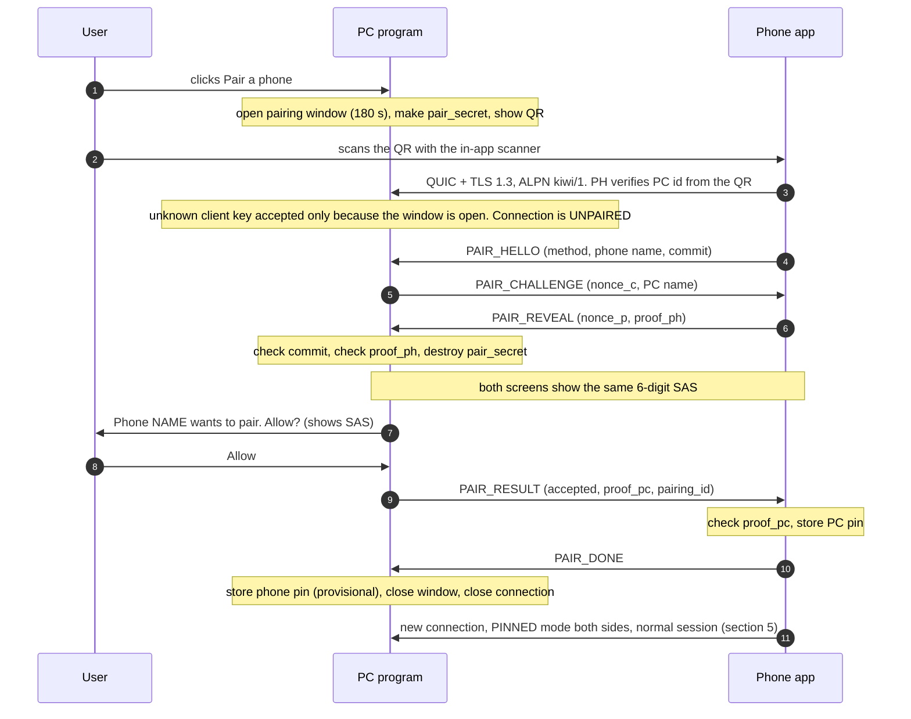

# Kiwi Transfer protocol specification: `kiwi/1`

Status: Draft 1, 2026-11-19, for Kiwi Transfer 1.0. Licence: Apache-2.0.
Companion documents: `docs/SPIKE-REPORT.md` (measurements this design relies on), `docs/THREAT-MODEL.md`.

Scope: an Android phone app and a Windows PC program that copy files between each other over a local link
(Wi-Fi LAN, phone hotspot, USB tethering). No cloud, no account, no telemetry, **no internet mode**: the two
devices only ever talk to each other directly, on the same IP link.

Contents: 0 Conventions - 1 Identities and transport security - 2 Pairing - 3 Weekly re-confirmation -
4 Discovery - 5 Session and streams - 6 File transfer - 7 Durable commit on the PC - 8 Final move -
9 Other features - 10 Update check, problem report, endpoint list - 11 Versioning and test vectors -
12 Decisions - 13 Open questions - Appendix A constants - Appendix B context strings.

---

## 0. Conventions

**Requirement words.** MUST, MUST NOT, SHOULD, SHOULD NOT, MAY are used as in RFC 2119 / RFC 8174.

**Roles.** `PH` is the phone (always the QUIC client). `PC` is the Windows program (always the QUIC server).
A **link** is one paired (PH, PC) couple. In a file transfer, the **sender** and the **receiver** are roles
that either device can take.

**Core and platform.** The **core** is the shared Rust library (`kiwi_core`, exposed through UniFFI). It
implements everything in this document that is not marked *(platform)*. The core MUST NOT assume Android or
Windows: it reaches the operating system only through adapter interfaces (key wrapping, media source, trash,
discovery results, clocks, durable storage). This keeps a later iOS client possible (see 11.4).

**Notation.**

| Notation | Meaning |
|---|---|
| `a \|\| b` | Byte-string concatenation. |
| `u8`, `u16be`, `u32be`, `u64be` | Unsigned integers, big-endian. |
| `BLAKE3(m)` | BLAKE3 hash, default mode, 32-byte output. |
| `KDF(ctx, m)` | BLAKE3 `derive_key` mode: context string `ctx` (ASCII, exactly as written, no terminator), key material `m`, 32-byte output. |
| `MAC(k, m)` | BLAKE3 `keyed_hash` mode with a 32-byte key `k`, 32-byte output. |
| `SIG(sk, m)` | Ed25519 signature (RFC 8032, pure Ed25519, no prehash, no context), 64 bytes. |
| `ct_eq(a, b)` | Constant-time comparison. All comparisons of MACs, proofs and commitments MUST use it. |
| `RAND(n)` | `n` bytes from the operating system CSPRNG. |

All context strings are listed in Appendix B. All named constants (`CHUNK`, `FM_DELAY`, ...) are in Appendix A.

**Time.** Wall-clock times on the wire are signed integers: milliseconds since 1970-01-01T00:00:00Z. Wall-clock
time is never used alone for a safety decision; see the *link clock* in 3.2.

---

## 1. Identities and transport security

### 1.1 Device identity key

1. Each installation has exactly one long-term **Ed25519** key pair, generated by the core with `RAND(32)` as
   the seed, on first start. It is never exported, never synchronised, never backed up.
2. `SPKI` is the DER encoding of the SubjectPublicKeyInfo for that key (RFC 8410). It is always exactly these
   44 bytes: `30 2a 30 05 06 03 2b 65 70 03 21 00 || public_key(32)`.
3. The **device id** is `ID = BLAKE3(SPKI)` (32 bytes). It is the value shown to users as a fingerprint
   (lowercase hex, groups of 4) and the value carried in the pairing QR.
4. A **pin** is the stored full `SPKI` (44 bytes) of a paired peer, with its `ID`. Pinning compares the full
   `SPKI`, not only the hash.
5. If the identity key cannot be loaded (blob missing, unwrap fails, see 1.6), the device MUST generate a
   new identity, MUST treat every existing pairing as void, and MUST tell the user that pairing is needed
   again. It MUST NOT silently keep old pins with a new key.

### 1.2 Certificate

TLS carries the key in a self-signed X.509 v3 certificate (decision D1: raw public keys, RFC 7250, are not
used in `kiwi/1`).

| Field | Value |
|---|---|
| Signature algorithm | Ed25519 (`1.3.101.112`), self-signed with the identity key. |
| Subject = Issuer | `CN=kiwi` (constant; MUST NOT contain a device or user name). |
| Serial number | Any positive integer up to 20 bytes. |
| Validity | `notBefore` at or before `20200101000000Z`; `notAfter` = `99991231235959Z`. |
| Extensions | None required. A `subjectAltName` MAY be present; it is ignored. |
| Size | At most 1024 bytes DER. |

The certificate MAY be regenerated at any time from the same key; only `SPKI` is meaningful. The chain sent in
TLS MUST contain exactly one certificate.

### 1.3 QUIC and TLS profile

| Item | Requirement |
|---|---|
| Transport | QUIC version 1 (RFC 9000) only, with TLS 1.3 (RFC 9001, RFC 8446). |
| ALPN | Exactly one protocol: `kiwi/1` (bytes `6b 69 77 69 2f 31`). No other value is offered or accepted. If ALPN does not match, the handshake MUST fail (`no_application_protocol`). There is no fallback of any kind (no TCP, no HTTP, no older protocol). |
| Authentication | Mutual. The server MUST request and require a client certificate. The server's `CertificateRequest` carries no CA names. |
| Signature scheme | `ed25519` (0x0807) only, for both `CertificateVerify` messages. |
| Key exchange | `x25519` MUST be supported and offered. Other groups offered by the TLS library MAY stay enabled. |
| Cipher suites | `TLS_AES_256_GCM_SHA384`, `TLS_AES_128_GCM_SHA256`, `TLS_CHACHA20_POLY1305_SHA256` (the ring provider's TLS 1.3 set). |
| 0-RTT | Disabled. The server MUST set its early-data limit to 0 and MUST reject early data. The client MUST NOT send early data. |
| Resumption | Disabled. The server MUST NOT send `NewSessionTicket`; the client MUST NOT offer a PSK. Every connection performs a full certificate handshake, so that unpairing takes effect at once (decision D12). |
| SNI | The client SHOULD NOT send SNI. If the library needs a name, it MUST be the constant `kiwi.invalid`. The server MUST ignore SNI. |
| QUIC datagrams | Not used. |
| Idle timeout | `max_idle_timeout` = 30 000 ms on both sides. |
| Keep-alive | While a session is in use, each side sends a QUIC PING after 10 s without sending. |
| Exporters | RFC 8446 section 7.5 exporter, 32 bytes, empty context, labels `EXPORTER-kiwi-1-pairing` and `EXPORTER-kiwi-1-session`. |

### 1.4 Verifier obligations (normative)

Both sides install a custom certificate verifier (rustls `ServerCertVerifier` on PH, `ClientCertVerifier` on
PC). The verifier works in one of two modes, fixed before the handshake starts:

- **PINNED mode** (every normal connection): the expected peer `SPKI` set is known in advance.
  PH expects exactly one `SPKI` (the PC it is dialling). PC expects any `SPKI` in its pin store.
- **PAIRING mode** (only as allowed in section 2): any well-formed Ed25519 `SPKI` is accepted and recorded
  as the *candidate*; nothing is pinned by the verifier itself.

In both modes the verifier MUST do all of the following, and MUST fail the handshake if any step fails:

1. **Certificate step** (`verify_server_cert` / `verify_client_cert`):
   a. The chain has exactly one certificate, at most 1024 bytes, and it parses as X.509.
   b. Its `SPKI` is exactly 44 bytes with the prefix in 1.1 (algorithm Ed25519, no parameters).
   c. PINNED mode: `SPKI` equals a pinned `SPKI` byte for byte. PAIRING mode: record `SPKI` as candidate.
   d. Names, validity dates, extensions, key usage and the certificate's self-signature are NOT evaluated
      (clocks on phones are unreliable and a self-signed validity period proves nothing).
2. **Handshake signature step** (`verify_tls13_signature`): verify the TLS 1.3 `CertificateVerify` signature
   over the handshake transcript with the public key from that same certificate, accepting only the scheme
   `ed25519`. This is the proof that the peer holds the private key.
   **The method MUST perform a real signature verification. It MUST NOT return success unconditionally,
   MUST NOT be a stub, and MUST NOT accept any other scheme.** A verifier that checks the pin but skips this
   step lets anyone who has seen the certificate impersonate the device.
3. `verify_tls12_signature` MUST always return an error. `supported_verify_schemes` MUST return exactly
   `[ED25519]`.
4. PC only: `client_auth_mandatory` is true. A connection without a client certificate MUST fail.
5. On failure the handshake is aborted with a fatal TLS alert. The alert code is not specified; peers MUST NOT
   depend on it.

Defence in depth: after the handshake, both sides also sign a session transcript bound to the TLS exporter
with the identity key (5.3). A verifier bug that skipped step 2 is therefore caught at the application layer.

Required negative tests (11.3): (a) correct pinned certificate presented by a peer that signs
`CertificateVerify` with a different key MUST fail; (b) unknown key in PINNED mode MUST fail; (c) RSA or
ECDSA certificate MUST fail; (d) two-certificate chain MUST fail; (e) ALPN `kiwi/2` or `h3` MUST fail.

### 1.5 Order of authentication

In TLS 1.3 the server authenticates first. PH MUST verify the PC pin before it sends its own certificate
(this is the normal TLS 1.3 flight order; the client aborts on a pin mismatch and its identity is not
revealed to a wrong server). The PC certificate is visible to any host on the link that starts a handshake;
see the threat model, residual risk R7.

### 1.6 Key storage

**Android** *(platform; the Android Keystore cannot hold Ed25519 keys before API 33 and minSdk is 24)*:

1. The Ed25519 seed is generated and used by the core. At rest it is stored only as a wrapped blob.
2. Wrapping key: an AES-256-GCM key in the Android Keystore, alias `kiwi_identity_wrap_v1`, purposes
   encrypt+decrypt, `setRandomizedEncryptionRequired(true)`, no user-authentication requirement (backup must
   run in the background). StrongBox is requested where present, with fallback to the TEE-backed Keystore.
3. Blob: `"KWK1" || iv(12) || ciphertext_and_tag`, with additional authenticated data
   `kiwi/1 identity seed` (ASCII). The IV is the one produced by the Keystore cipher.
4. Location: `Context.getNoBackupFilesDir()`. The manifest MUST set `android:allowBackup="false"` and MUST
   ship `dataExtractionRules` (API 31+) and `fullBackupContent` (API 30 and lower) that exclude every domain
   for both cloud backup and device-to-device transfer. The pin store and the phone ledger live in app-private
   storage under the same exclusion. Storage is credential-encrypted (the app is not direct-boot aware).
5. The unwrapped seed lives only in core memory, in a zeroize-on-drop buffer.
6. Stated limits: hardware backing protects the blob against offline extraction and against cloning through a
   backup or a copied data directory. It does not protect against code running inside the app's process or a
   rooted/compromised device, which can use or read the unwrapped seed. On devices without a hardware-backed
   Keystore the wrapping key is software-protected; the app records the security level
   (`KeyInfo`) in its diagnostic screen. Uninstalling the app destroys the wrapping key: the identity is gone
   and re-pairing is required.

**Windows** *(platform)*:

1. The seed is protected with DPAPI: `CryptProtectData`, CurrentUser scope (never
   `CRYPTPROTECT_LOCAL_MACHINE`), `CRYPTPROTECT_UI_FORBIDDEN`, optional-entropy = `kiwi/1 identity seed`
   (domain separation only; it is not a secret).
2. Location: `%LOCALAPPDATA%\FastKiwi\KiwiTransfer\` (the non-roaming profile), with the default per-user ACL.
3. Stated limits of DPAPI CurrentUser:
   - Any program running as the same Windows user can call `CryptUnprotectData` and obtain the seed. DPAPI has
     no per-application isolation.
   - Administrators, SYSTEM, and on domain-joined machines the domain DPAPI backup key, can recover it.
   - The DPAPI master key is derived from the user's logon credential: an account with an empty or weak
     password gives little protection against offline disk access unless the disk is encrypted (BitLocker).
   - There is no hardware binding and no user-presence check.
   - A local password reset by an administrator, a new Windows profile, or a Windows reinstall makes the blob
     undecryptable. Then rule 1.1(5) applies: new identity, re-pair.

---

## 2. Pairing (first link)

Pairing creates the two pins of a link. It is always started by a person at the PC. There is **no standing
pairing listener**: unknown keys are accepted only while a user-opened pairing window is open.

There are two methods. Both run the same message sequence.

| Method | Authentication comes from | When |
|---|---|---|
| `QR` (1) | The PC device id and a one-time secret carried in the QR, plus the Allow click on the PC. | Default. |
| `SAS` (2) | A 6-digit short authentication string compared by the user on both screens, protected by a commitment, plus confirmation on both devices. | When the camera cannot be used. |

There is no typed short-code PAKE in `kiwi/1` (no audited PAKE crate exists; spike section 5, decision D5).

### 2.1 Pairing window (PC)

1. The user clicks "Pair a phone". The PC opens a window of `PAIR_WINDOW` (default 180 s; configurable only
   within 120-300 s), measured with a monotonic clock. Only one window can be open at a time.
2. The PC generates `pair_secret = RAND(16)` (128 bits) and shows the QR (2.2). By default only method `QR`
   is accepted. If the user chooses "I can't scan", the window also accepts method `SAS` and the PC
   advertises `pm=1` in mDNS (section 4) until the window closes.
3. While the window is open, the PC verifier runs in PAIRING mode **for unknown keys only**: a client whose
   `SPKI` is pinned gets a normal session; a client whose `SPKI` is unknown gets an **UNPAIRED** connection.
   When no window is open, unknown keys fail the handshake.
4. The window closes, and `pair_secret` is destroyed, at the first of: timeout; user cancel; a valid
   `PAIR_REVEAL` proof (the secret is single use, whatever the user then answers); 3 failed attempts
   (bad proof, bad commitment, protocol error, or a declined SAS); program exit.
5. If no device is paired and no window is open, the PC MUST NOT bind any UDP socket and MUST NOT advertise.

An UNPAIRED connection is restricted: one bidirectional stream; only the messages `PAIR_*`, `ERROR`;
frames of at most `MAX_FRAME_UNPAIRED` (4096 bytes); no unidirectional streams; at most 2 UNPAIRED
connections at a time; `PAIR_HELLO` within 10 s of the handshake; `PAIR_REVEAL` within 10 s of
`PAIR_CHALLENGE`. An UNPAIRED connection is never upgraded: after pairing, both sides close it and PH
opens a new, normal connection.

### 2.2 QR code

Text content: the ASCII prefix `KIWI1:` followed by the RFC 4648 Base32 encoding (alphabet `A-Z2-7`,
upper case, no padding) of this payload. All characters fit the QR alphanumeric mode.

| Offset | Size | Field | Value |
|---|---|---|---|
| 0 | 1 | `qr_version` | `0x01` |
| 1 | 1 | `flags` | bit 0: `1` = the window also accepts method SAS. Other bits 0; a reader MUST reject unknown bits. |
| 2 | 32 | `pc_id` | `ID` of the PC. |
| 34 | 16 | `pair_secret` | One-time secret. |
| 50 | 2 | `port` | UDP port, `u16be`. |
| 52 | 1 | `n` | Number of addresses, 1 to 6. |
| 53 | ... | `addr[n]` | Each: `family` (`0x04` or `0x06`) then 4 or 16 address bytes. |

Rules:

- Addresses are the PC's unicast addresses on eligible interfaces only (4.4), IPv4 first. IPv6 link-local
  addresses are not put in the QR (no scope id can be carried).
- The QR carries no expiry time: the PC enforces the window with its own monotonic clock.
- A typical payload (two IPv4 addresses) is 63 bytes, 101 Base32 characters, QR version 6 at level M.
- PH MUST accept this content **only from its in-app scanner**. The app MUST NOT register a URI scheme,
  app link or intent filter that starts pairing, and MUST NOT accept a pairing payload from the clipboard,
  a file or another app. (A link on a web page must not be able to pair the phone with an attacker's PC.)
- PH applies the address filter of 4.4 to the QR addresses before dialling.

### 2.3 Derived values

Both sides compute, for the pairing connection they are on:

```
E_pair   = TLS exporter, label "EXPORTER-kiwi-1-pairing", empty context, 32 bytes
ID_ph    = BLAKE3(SPKI of the phone)      ID_pc = BLAKE3(SPKI of the PC)
           (own SPKI from the own key; peer SPKI from the certificate of THIS TLS connection)
commit   = KDF("kiwi/1 pairing commit",     E_pair || ID_ph || ID_pc || nonce_p)
TH       = KDF("kiwi/1 pairing transcript", E_pair || ID_ph || ID_pc || BLAKE3(m1) || BLAKE3(m2) || nonce_p)
SAS      = u64be( KDF("kiwi/1 pairing sas", TH)[0..8] ) mod 1000000      (shown as 6 digits, "482 913")
K_pair   = KDF("kiwi/1 pairing key", pair_secret)                        (method QR only)
proof_ph = MAC(K_pair, 0x01 || TH)                                       (method QR only)
proof_pc = MAC(K_pair, 0x02 || TH)                                       (method QR only)
```

`m1` is the exact payload bytes of the `PAIR_HELLO` frame and `m2` the exact payload bytes of the
`PAIR_CHALLENGE` frame (the CBOR envelope, without the 4-byte length prefix; see 5.1). `nonce_p = RAND(32)`
is chosen by PH; `nonce_c = RAND(32)` is chosen by PC and is inside `m2`. All inputs have fixed lengths.

### 2.4 Message sequence



Method SAS differs in three places (ASCII view):

```
PH                                              PC
 |  finds a PC with pm=1 (mDNS) or typed addr    |   window open, "I can't scan" chosen
 |== TLS: both verifiers in PAIRING mode =======>|   (signatures verified, nothing pinned yet)
 |-- PAIR_HELLO (method=2, name, commit) ------->|
 |<------------- PAIR_CHALLENGE (nonce_c, name) -|
 |-- PAIR_REVEAL (nonce_p) --------------------->|   check commit
 |  shows SAS + "Do the numbers match?"          |   shows SAS + "Phone NAME wants to pair - Allow?"
 |-- PAIR_CONFIRM (match=true) ----------------->|   user compared and tapped on the phone
 |                                               |   user compared and clicked Allow on the PC
 |<----------------- PAIR_RESULT (accepted, id) -|   PC pins (provisional)
 |  PH pins                                      |
 |-- PAIR_DONE --------------------------------->|
```

Processing rules:

1. **PH, start.** Method QR: PH dials the QR addresses with the verifier in PINNED mode for `pc_id`
   (the handshake fails unless the server key hashes to `pc_id`). Method SAS: PH dials with the verifier in
   PAIRING mode. In both cases PH then sends `PAIR_HELLO` with `commit`.
2. **PC, on `PAIR_HELLO`.** Reject (`E_NOT_PERMITTED`) if the method is not allowed by the window. Sanitise
   the phone name for display (5.8). Reply `PAIR_CHALLENGE` with a fresh `nonce_c`.
3. **PH, on `PAIR_CHALLENGE`.** Send `PAIR_REVEAL` with `nonce_p` and, for method QR, `proof_ph`.
4. **PC, on `PAIR_REVEAL`.** Recompute `commit` from `nonce_p`; if `ct_eq` fails, abort (`E_VERIFY`, counts
   as a failed attempt). Method QR: recompute `proof_ph`; if `ct_eq` fails, abort (failed attempt; the secret
   is not consumed). If it succeeds, the secret is consumed now. Then show the consent dialog:
   **"Phone <name> wants to pair - Allow?"** with the SAS. The PC MUST NOT pin, and MUST NOT show the dialog
   in method QR, before these checks pass.
5. **PH, after `PAIR_REVEAL`.** Show the SAS. Method QR: show "Check that the PC shows the same number, then
   click Allow there" (comparison is an extra check; authentication already comes from the QR). Method SAS:
   show "Do the numbers match?" with two buttons; send `PAIR_CONFIRM(match)`.
6. **PC, decision.** Method QR: on Allow, send `PAIR_RESULT(accepted)`. Method SAS: send
   `PAIR_RESULT(accepted)` only when it has both the local Allow click and `PAIR_CONFIRM(match=true)`. On
   Deny, timeout, or `match=false`: send `PAIR_RESULT(declined)`, close; on `match=false` also warn the user
   that someone on the network may be interfering.
7. **PH, on `PAIR_RESULT(accepted)`.** Method QR: verify `proof_pc` (`ct_eq`), else abort and pin nothing.
   Method SAS: require that the local user already tapped "match". Then store the PC pin with `pairing_id`,
   send `PAIR_DONE`, close, and reconnect normally.
8. **PC pin is provisional** until the first normal session from that phone passes `HELLO_AUTH` (5.3). If
   that does not happen within 10 minutes the PC MUST delete the provisional pin.
9. Each device pins **only after its own user-facing condition is met**: PC after the Allow click; PH after
   the QR proof (method QR) or the local "match" tap (method SAS). A confirmation received from the network
   is never a substitute for the local one.

### 2.5 Why the SAS cannot be ground (commitment scheme)

A man in the middle (M) holds two TLS connections, PH-M and M-PC, with different exporters and keys, and
wants the two 6-digit values to be equal. The SAS depends on `nonce_p` and `nonce_c`:

- Towards PC, M must send a `commit` (binding: it fixes M's `nonce_p'`) **before** it learns PC's `nonce_c`.
- Towards PH, M must send its `nonce_c'` **before** PH reveals `nonce_p` (hiding: `commit` reveals nothing
  about the 256-bit `nonce_p`).

Whatever the order, one of the two SAS values still depends on a random value M has not seen when M makes
its last choice. M therefore gets one guess per attempt: success probability 10^-6. The window allows 3
attempts. Requirements that make this hold: `nonce_p` and `nonce_c` are fresh `RAND(32)` per attempt; PC
MUST NOT send `nonce_c` before it has `commit`; PH MUST NOT send `nonce_p` before it has `nonce_c`; PC MUST
verify `commit`; neither side shows the SAS before `PAIR_REVEAL` has been sent/verified.

### 2.6 State created by pairing

Both sides store for the link: peer `SPKI` and `ID`, peer display name, `pairing_id` (16 random bytes chosen
by PC, sent in `PAIR_RESULT`), `confirm_epoch = 1`, confirmation age 0 (pairing counts as the first weekly
confirmation), `last_session_seq = 0`. Local policy limits: a PC accepts at most 8 paired phones, a phone at
most 4 paired PCs (configurable; not a wire limit).

### 2.7 Unpairing

- Either side can unpair at any time, without the other being present. The local effect is immediate:
  delete the pin and link state, close any connection with QUIC application code `3` (unpaired).
- If a session is open, the side that unpairs first sends `UNPAIR`; the peer answers `UNPAIR_ACK`, shows
  "unpaired by the other device", and deletes its pin.
- If the peer is offline it finds out at its next connection: the handshake fails (unknown key). A device
  MUST NOT delete a pin automatically because a handshake failed (that could be a network attacker or a
  transient fault). It marks the link "not accepted by the other device" and lets the user remove it.
- Unpairing never deletes a file on either device. For final move its effect is defined in 8.9
  (purges stop; items in the trash stay there until the user decides).
- Pairing the same two devices again creates a new link with a new `pairing_id`; no state is inherited.

---

## 3. Weekly session re-confirmation

Owner requirement: every 7 days a link must be re-confirmed with a 2-digit code shown in the PC program and
typed on the phone.

### 3.1 What it is, and what it is not

- It is a **presence and consent check**: it shows that a person holding the phone can also see the PC
  program's window, and it makes the user look at the PC program (where integrity alerts are shown) at
  least once a week.
- It is **not a secret and not authentication**. The channel is already mutually authenticated (section 1).
  A 2-digit code has 100 values; its strength comes only from the attempt limits and from the fact that a
  code exists only while it is displayed on the PC (3.4).
- It limits how long a stolen phone, or a copied phone identity, stays useful without access to the PC screen.

### 3.2 Link clock (rollback-resistant time)

Each device keeps, per installation, a persistent non-decreasing counter `LC` in seconds (the **link clock**):

1. While the process runs, `LC` advances with a monotonic clock that keeps counting during sleep
   *(platform: Android `SystemClock.elapsedRealtime`; Windows `QueryInterruptTime`/`GetTickCount64`)*.
2. A checkpoint `(LC, wall_time, boot_id, monotonic_reading)` is written durably at least every 5 minutes
   while running and at clean shutdown.
3. At start, with the last checkpoint:
   - same boot (`boot_id` unchanged *(platform: Android `Settings.Global.BOOT_COUNT`; Windows boot time)*):
     `LC += monotonic_now - monotonic_reading`;
   - otherwise `gap = wall_now - wall_time`. If `gap >= 0`: `LC += gap`. If `gap < 0` (the wall clock went
     backwards): `LC` is left unchanged and the persistent flag `clock_anomaly` is set.
4. A wall clock set forward makes `LC` jump forward (things expire early: fail closed). A wall clock set back
   is either detected (`clock_anomaly`) or, at worst, hides the time the device was off; rule 3.3(3) then
   corrects it from the other device.
5. `LC` values are local. Only **differences** of `LC` are ever sent or compared.

Each side also keeps per link: `confirm_epoch` (u64, the number of confirmations so far) and
`confirm_lc` (its own `LC` at the last confirmation). `confirm_age = LC - confirm_lc`.

### 3.3 Confirmation state (computed at every session start, 5.3)

Both sides send `confirm_epoch`, `confirm_age` and `clock_anomaly` in `HELLO`. Then, identically on both sides:

1. **Epoch agreement.** If `epoch_pc == epoch_ph`: agreed. If `epoch_pc == epoch_ph + 1` (the phone missed
   the last result): PH adopts `epoch_pc` and `confirm_age_pc`. Any other difference (one side lost or
   restored state): the link is `REQUIRED`.
2. **Anomaly.** If either side reports `clock_anomaly`: the link is `REQUIRED`.
3. **Age.** `age = max(confirm_age_ph, confirm_age_pc)`. Each side then moves its own `confirm_lc` back so
   that its `confirm_age` equals `age` (ages never decrease by talking to the peer).
4. The link is `CONFIRMED` if 1 and 2 hold and `age < CONFIRM_PERIOD` (604 800 s); otherwise `REQUIRED`.

During a long session each side re-evaluates with its own `LC` before every data-plane request; the PC
pushes `STATUS` when the state changes. A wall-clock timestamp is never an input to this decision.

### 3.4 Code exchange

Runs on the control stream of a normal session. The code never travels from PC to PH.

1. PH sends `RECONFIRM_BEGIN` (allowed at any time, also before expiry).
2. PC creates a challenge: `code` uniform in `00..99` (CSPRNG with rejection sampling), `challenge_id`,
   3 attempts. PC replies `RECONFIRM_CHALLENGE(state)`.
3. **Arming.** The PC accepts answers only while the challenge is *armed*: the code is being shown inside
   the PC program's own visible window, in an interactive, unlocked user session, and a person at the PC
   caused that window to be shown (opening the program, or clicking the "weekly number" notice). The code
   MUST NOT appear in a notification, a tooltip, a log or the lock screen. Arming starts a `RECONFIRM_TTL`
   (300 s, monotonic) timer. PC pushes `RECONFIRM_STATE` to PH when the challenge becomes armed or dies.
4. The user types the two digits on the phone. PH sends `RECONFIRM_ANSWER(challenge_id, code)`.
5. PC, if armed and not expired: on match, it durably stores `confirm_epoch += 1`, `confirm_lc = LC`,
   clears its `clock_anomaly`, then replies `RECONFIRM_RESULT(ok, new_epoch)`. PH stores the same
   (`confirm_lc = its own LC`, clears its `clock_anomaly`) and sends `RECONFIRM_ACK`.
   On mismatch: `attempts_left -= 1`, reply `RECONFIRM_RESULT(not ok, attempts_left)`.
6. Limits: 3 attempts per challenge. After the third wrong answer, or TTL expiry, the challenge is dead.
   A **new challenge after a failed one requires a click on the PC** ("Show a new number"), and the PC
   shows "A wrong number was entered 3 times from phone <name>". After 3 dead challenges in a row the link
   is locked for 15 minutes (PC monotonic time), doubling up to 24 hours; a success resets this.
   Answers to an unarmed, expired or unknown challenge are rejected (`E_STATE`) and consume nothing.
7. Honest strength statement: a person with the phone but without sight of the PC screen has at most 3
   guesses (3 %) per challenge that somebody at the PC armed, and each failure is displayed at the PC.

### 3.5 Effect of `REQUIRED`

While a link is `REQUIRED`:

| Area | Behaviour |
|---|---|
| Allowed messages | Session setup, `STATUS`, `PING`, `RECONFIRM_*`, `UNPAIR`, `BYE`. Every other request is refused with `E_CONFIRM_REQUIRED`. |
| Automatic backup | Paused. The phone shows a notification ("Weekly check needed to continue backup"). Nothing is queued for deletion. |
| Final move | No verification, no trashing, no purging (8.8). Purges of the app trash folder are **suspended**, not cancelled: retention keeps counting, deletion waits. |
| Deletion | **Nothing is deleted** on either device because a link expired. No file, ledger entry, pin or partial transfer is removed. |
| Transfers in progress | An item whose data stream is already open may finish and commit; no new item starts. |
| After re-confirmation | Everything resumes from where it stopped. No re-pairing is needed. |

Limit that cannot be removed: on Android 11+ the *system* trash deletes its items on its own schedule
(8.6). The app cannot suspend that; see 8.6(5) for the required warning.

### 3.6 Several paired devices

- Confirmation state, epoch, challenge and lockout are **per link**. Confirming one phone does nothing for
  another phone; a PC with three phones can show up to three numbers, each labelled with the phone's name.
- A code is bound to its link: an answer is checked only against the challenge of the link it arrives on.
- A phone paired with two PCs confirms each PC separately; one PC being expired does not pause the other.
- Final move for a folder targets exactly one PC (8.1); only that link's state matters for that folder.

---

## 4. Discovery

Discovery only produces **candidate addresses**. A candidate is never trusted: every candidate passes the
address filter (4.4) and then the TLS pin (1.4). A wrong or forged answer can only cause a failed attempt.

### 4.1 Service

| Item | Value |
|---|---|
| Mechanism | mDNS / DNS-SD (RFC 6762, RFC 6763). The PC advertises; the phone browses. The phone never advertises and never listens. |
| Service type | `_kiwixfer._udp.local.` |
| Instance name | 16 lowercase hex characters from `RAND(8)`. MUST NOT contain a device, user or host name. |
| SRV target | `k<same 16 hex>.local.` MUST NOT be the Windows host name. |
| SRV port | The PC's QUIC UDP port. |
| Rotation | A new random instance name at every program start, at every network change, and at least every 24 h. |
| Advertised when | The program runs and (at least one phone is paired, or a pairing window with SAS is open). |

### 4.2 TXT record

| Key | Value | Meaning |
|---|---|---|
| `v` | `1` | Protocol major version(s) supported, comma-separated decimal. |
| `h` | 16 lowercase hex characters | Hint: first 8 bytes of `MAC(KDF("kiwi/1 discovery hint", ID_pc), instance_name_ascii)`. Lets a paired phone recognise its PC without trial handshakes. Changes with every instance name, so a passive observer who does not know `ID_pc` cannot link two advertisements. |
| `pm` | `1` | Present only while a pairing window that accepts method SAS is open. |

No other key is sent. Readers MUST ignore unknown keys. A phone that gets no TXT data (resolver quirk) MAY
still try the candidate.

### 4.3 Phone behaviour

1. *(platform)* Android browses with `NsdManager`, only while it needs a PC (app in foreground, or a
   backup attempt is running), and passes results (instance name, addresses, port, TXT) to the core.
2. Candidate order for a paired PC: (a) the last address and port that worked, if still on-link;
   (b) mDNS instances whose `h` matches that PC; (c) mDNS instances without a usable `h`.
3. At most 3 addresses per instance are tried, 2 s each, IPv4 first. At most 8 instances per browse.
4. Candidates may also come from a pairing QR. All sources are treated the same.
5. *(platform)* The socket MUST be bound to the local (non-cellular, non-VPN) network that owns the on-link
   prefix. If the system would route the packet through a VPN or mobile data, the attempt MUST fail closed.

### 4.4 Address filter (both sides)

An address is acceptable only if it is **on-link**: it lies inside a connected prefix (address + prefix
length) of a local interface that is eligible. This is the rule that makes "no internet mode" a property of
the protocol and not only of the user interface.

- Eligible interface on the phone *(platform)*: Wi-Fi, Ethernet, USB tethering, the phone's own hotspot
  interface. Never cellular, never VPN.
- Eligible interface on the PC *(platform)*: an interface whose Windows network category is **Private**
  (`INetworkListManager`, `NLM_NETWORK_CATEGORY_PRIVATE`). Public and Domain networks are not eligible in 1.0.
- Always rejected: loopback, unspecified, multicast, broadcast, and any address outside every eligible
  on-link prefix. IPv6 link-local addresses are acceptable only with the scope of the interface they were
  learned on. Global IPv6 addresses are acceptable when on-link.
- The PC applies the same rule to the **source address** of every incoming packet before any other
  processing: a packet whose source is not on-link for the interface it arrived on is dropped silently
  (this also defeats a router port-forward).
- Both sides SHOULD set the IP TTL / IPv6 hop limit of their QUIC sockets to 1, so that a packet can never
  be forwarded by a router even if a rule above is implemented wrongly (open question Q9).

### 4.5 PC listener *(platform)*

1. One UDP socket per eligible unicast address (never `0.0.0.0` or `::`), re-evaluated on every network
   change notification. If no interface is eligible, the PC listens nowhere and tells the user why
   ("This network is set to Public in Windows").
2. Port: chosen once at first run (preferred `47474`; if busy, an OS-assigned port), stored, and reused.
   The phone always learns the port from the QR, mDNS or its cache; it never assumes it.
3. The installer adds one Windows Firewall rule: inbound UDP, this program only, Private profile only,
   remote address `LocalSubnet`. The built-in Windows mDNS rules are used as they are (spike section 4).
4. mDNS answers sent on an interface contain only that interface's addresses.

### 4.6 Hotspot and USB tethering

When the PC joins the phone's hotspot, or the phone shares its connection over USB, the two devices are on
one IP link and everything above applies unchanged: same discovery, same filter, same TLS. Transfers on that
link do not use mobile data. Windows usually classifies such a new network as Public; the user must set it
to Private (open question Q1). mDNS browsing by `NsdManager` on the phone's own tethering interfaces is not
verified (open question Q7); the cached address and the QR remain available as candidate sources.

### 4.7 Android local-network permission *(platform)*

The app declares `INTERNET`, `ACCESS_NETWORK_STATE`, `ACCESS_WIFI_STATE`, and the local-network permission
introduced for Android 17 (`ACCESS_LOCAL_NETWORK`, nearby-devices group). On systems that enforce it, the
permission is requested, with an explanation, before the first browse or dial; if it is refused, discovery
and transfer are unavailable and the app says so (it MUST NOT fall back to any other path). Exact behaviour
per API level is to be verified when the target SDK is fixed (open question Q8).

---

<!-- PART-2 -->
