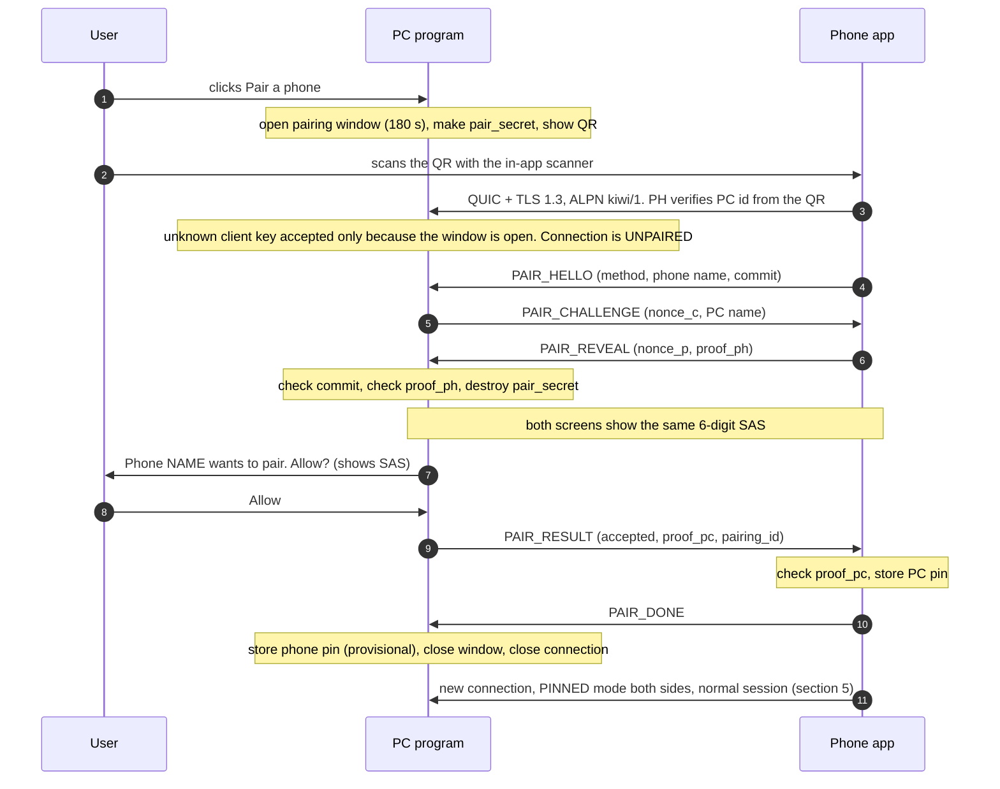
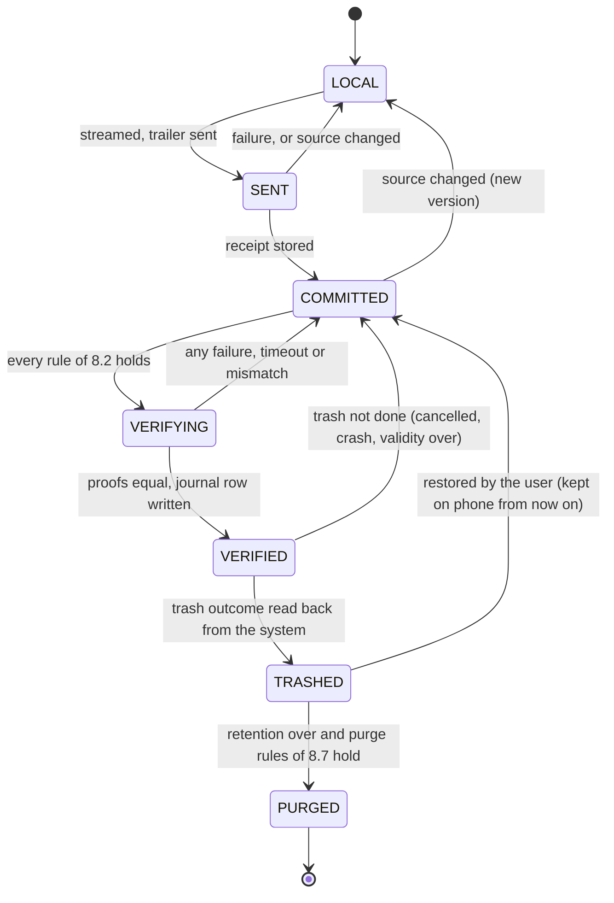

# Kiwi Transfer protocol specification: `kiwi/1`

Status: Draft 1, 2026-11-19, for Kiwi Transfer 1.0. Licence: Apache-2.0.
Companion documents: `docs/SPIKE-REPORT.md` (measurements this design relies on), `docs/THREAT-MODEL.md`.

Scope: an Android phone app and a Windows PC program that copy files between each other over a local link
(Wi-Fi LAN, phone hotspot, USB tethering). No cloud, no account, no telemetry, **no internet mode**: the two
devices only ever talk to each other directly, on the same IP link.

Contents: 0 Conventions - 1 Identities and transport security - 2 Pairing - 3 Weekly re-confirmation -
4 Discovery - 5 Session and streams - 6 File transfer - 7 Durable commit on the PC - 8 Final move -
9 Other features - 10 Update check, problem report, endpoint list - 11 Versioning and test vectors -
12 Decisions - 13 Open questions - Appendix A constants - Appendix B context strings.

---

## 0. Conventions

**Requirement words.** MUST, MUST NOT, SHOULD, SHOULD NOT, MAY are used as in RFC 2119 / RFC 8174.

**Roles.** `PH` is the phone (always the QUIC client). `PC` is the Windows program (always the QUIC server).
A **link** is one paired (PH, PC) couple. In a file transfer, the **sender** and the **receiver** are roles
that either device can take.

**Core and platform.** The **core** is the shared Rust library (`kiwi_core`, exposed through UniFFI). It
implements everything in this document that is not marked *(platform)*. The core MUST NOT assume Android or
Windows: it reaches the operating system only through adapter interfaces (key wrapping, media source, trash,
discovery results, clocks, durable storage). This keeps a later iOS client possible (see 11.4).

**Notation.**

| Notation | Meaning |
|---|---|
| `a \|\| b` | Byte-string concatenation. |
| `u8`, `u16be`, `u32be`, `u64be` | Unsigned integers, big-endian. |
| `BLAKE3(m)` | BLAKE3 hash, default mode, 32-byte output. |
| `KDF(ctx, m)` | BLAKE3 `derive_key` mode: context string `ctx` (ASCII, exactly as written, no terminator), key material `m`, 32-byte output. |
| `MAC(k, m)` | BLAKE3 `keyed_hash` mode with a 32-byte key `k`, 32-byte output. |
| `SIG(sk, m)` | Ed25519 signature (RFC 8032, pure Ed25519, no prehash, no context), 64 bytes. |
| `ct_eq(a, b)` | Constant-time comparison. All comparisons of MACs, proofs and commitments MUST use it. |
| `RAND(n)` | `n` bytes from the operating system CSPRNG. |

All context strings are listed in Appendix B. All named constants (`CHUNK`, `FM_DELAY`, ...) are in Appendix A.

**Time.** Wall-clock times on the wire are signed integers: milliseconds since 1970-01-01T00:00:00Z. Wall-clock
time is never used alone for a safety decision; see the *link clock* in 3.2.

---

## 1. Identities and transport security

### 1.1 Device identity key

1. Each installation has exactly one long-term **Ed25519** key pair, generated by the core with `RAND(32)` as
   the seed, on first start. It is never exported, never synchronised, never backed up.
2. `SPKI` is the DER encoding of the SubjectPublicKeyInfo for that key (RFC 8410). It is always exactly these
   44 bytes: `30 2a 30 05 06 03 2b 65 70 03 21 00 || public_key(32)`.
3. The **device id** is `ID = BLAKE3(SPKI)` (32 bytes). It is the value shown to users as a fingerprint
   (lowercase hex, groups of 4) and the value carried in the pairing QR.
4. A **pin** is the stored full `SPKI` (44 bytes) of a paired peer, with its `ID`. Pinning compares the full
   `SPKI`, not only the hash.
5. If the identity key cannot be loaded (blob missing, unwrap fails, see 1.6), the device MUST generate a
   new identity, MUST treat every existing pairing as void, and MUST tell the user that pairing is needed
   again. It MUST NOT silently keep old pins with a new key.

### 1.2 Certificate

TLS carries the key in a self-signed X.509 v3 certificate (decision D1: raw public keys, RFC 7250, are not
used in `kiwi/1`).

| Field | Value |
|---|---|
| Signature algorithm | Ed25519 (`1.3.101.112`), self-signed with the identity key. |
| Subject = Issuer | `CN=kiwi` (constant; MUST NOT contain a device or user name). |
| Serial number | Any positive integer up to 20 bytes. |
| Validity | `notBefore` at or before `20200101000000Z`; `notAfter` = `99991231235959Z`. |
| Extensions | None required. A `subjectAltName` MAY be present; it is ignored. |
| Size | At most 1024 bytes DER. |

The certificate MAY be regenerated at any time from the same key; only `SPKI` is meaningful. The chain sent in
TLS MUST contain exactly one certificate.

### 1.3 QUIC and TLS profile

| Item | Requirement |
|---|---|
| Transport | QUIC version 1 (RFC 9000) only, with TLS 1.3 (RFC 9001, RFC 8446). |
| ALPN | Exactly one protocol: `kiwi/1` (bytes `6b 69 77 69 2f 31`). No other value is offered or accepted. If ALPN does not match, the handshake MUST fail (`no_application_protocol`). There is no fallback of any kind (no TCP, no HTTP, no older protocol). |
| Authentication | Mutual. The server MUST request and require a client certificate. The server's `CertificateRequest` carries no CA names. |
| Signature scheme | `ed25519` (0x0807) only, for both `CertificateVerify` messages. |
| Key exchange | `x25519` MUST be supported and offered. Other groups offered by the TLS library MAY stay enabled. |
| Cipher suites | `TLS_AES_256_GCM_SHA384`, `TLS_AES_128_GCM_SHA256`, `TLS_CHACHA20_POLY1305_SHA256` (the ring provider's TLS 1.3 set). |
| 0-RTT | Disabled. The server MUST set its early-data limit to 0 and MUST reject early data. The client MUST NOT send early data. |
| Resumption | Disabled. The server MUST NOT send `NewSessionTicket`; the client MUST NOT offer a PSK. Every connection performs a full certificate handshake, so that unpairing takes effect at once (decision D12). |
| SNI | The client SHOULD NOT send SNI. If the library needs a name, it MUST be the constant `kiwi.invalid`. The server MUST ignore SNI. |
| QUIC datagrams | Not used. |
| Idle timeout | `max_idle_timeout` = 30 000 ms on both sides. |
| Keep-alive | While a session is in use, each side sends a QUIC PING after 10 s without sending. |
| Exporters | RFC 8446 section 7.5 exporter, 32 bytes, empty context, labels `EXPORTER-kiwi-1-pairing` and `EXPORTER-kiwi-1-session`. |

### 1.4 Verifier obligations (normative)

Both sides install a custom certificate verifier (rustls `ServerCertVerifier` on PH, `ClientCertVerifier` on
PC). The verifier works in one of two modes, fixed before the handshake starts:

- **PINNED mode** (every normal connection): the expected peer `SPKI` set is known in advance.
  PH expects exactly one `SPKI` (the PC it is dialling). PC expects any `SPKI` in its pin store.
- **PAIRING mode** (only as allowed in section 2): any well-formed Ed25519 `SPKI` is accepted and recorded
  as the *candidate*; nothing is pinned by the verifier itself.

In both modes the verifier MUST do all of the following, and MUST fail the handshake if any step fails:

1. **Certificate step** (`verify_server_cert` / `verify_client_cert`):
   a. The chain has exactly one certificate, at most 1024 bytes, and it parses as X.509.
   b. Its `SPKI` is exactly 44 bytes with the prefix in 1.1 (algorithm Ed25519, no parameters).
   c. PINNED mode: `SPKI` equals a pinned `SPKI` byte for byte. PAIRING mode: record `SPKI` as candidate.
   d. Names, validity dates, extensions, key usage and the certificate's self-signature are NOT evaluated
      (clocks on phones are unreliable and a self-signed validity period proves nothing).
2. **Handshake signature step** (`verify_tls13_signature`): verify the TLS 1.3 `CertificateVerify` signature
   over the handshake transcript with the public key from that same certificate, accepting only the scheme
   `ed25519`. This is the proof that the peer holds the private key.
   **The method MUST perform a real signature verification. It MUST NOT return success unconditionally,
   MUST NOT be a stub, and MUST NOT accept any other scheme.** A verifier that checks the pin but skips this
   step lets anyone who has seen the certificate impersonate the device.
3. `verify_tls12_signature` MUST always return an error. `supported_verify_schemes` MUST return exactly
   `[ED25519]`.
4. PC only: `client_auth_mandatory` is true. A connection without a client certificate MUST fail.
5. On failure the handshake is aborted with a fatal TLS alert. The alert code is not specified; peers MUST NOT
   depend on it.

Defence in depth: after the handshake, both sides also sign a session transcript bound to the TLS exporter
with the identity key (5.3). A verifier bug that skipped step 2 is therefore caught at the application layer.

Required negative tests (11.2): (a) correct pinned certificate presented by a peer that signs
`CertificateVerify` with a different key MUST fail; (b) unknown key in PINNED mode MUST fail; (c) RSA or
ECDSA certificate MUST fail; (d) two-certificate chain MUST fail; (e) ALPN `kiwi/2` or `h3` MUST fail.

### 1.5 Order of authentication

In TLS 1.3 the server authenticates first. PH MUST verify the PC pin before it sends its own certificate
(this is the normal TLS 1.3 flight order; the client aborts on a pin mismatch and its identity is not
revealed to a wrong server). The PC certificate is visible to any host on the link that starts a handshake;
see the threat model, residual risk R7.

### 1.6 Key storage

**Android** *(platform; the Android Keystore cannot hold Ed25519 keys before API 33 and minSdk is 24)*:

1. The Ed25519 seed is generated and used by the core. At rest it is stored only as a wrapped blob.
2. Wrapping key: an AES-256-GCM key in the Android Keystore, alias `kiwi_identity_wrap_v1`, purposes
   encrypt+decrypt, `setRandomizedEncryptionRequired(true)`, no user-authentication requirement (backup must
   run in the background). StrongBox is requested where present, with fallback to the TEE-backed Keystore.
3. Blob: `"KWK1" || iv(12) || ciphertext_and_tag`, with additional authenticated data
   `kiwi/1 identity seed` (ASCII). The IV is the one produced by the Keystore cipher.
4. Location: `Context.getNoBackupFilesDir()`. The manifest MUST set `android:allowBackup="false"` and MUST
   ship `dataExtractionRules` (API 31+) and `fullBackupContent` (API 30 and lower) that exclude every domain
   for both cloud backup and device-to-device transfer. The pin store and the phone ledger live in app-private
   storage under the same exclusion. Storage is credential-encrypted (the app is not direct-boot aware).
5. The unwrapped seed lives only in core memory, in a zeroize-on-drop buffer.
6. Stated limits: hardware backing protects the blob against offline extraction and against cloning through a
   backup or a copied data directory. It does not protect against code running inside the app's process or a
   rooted/compromised device, which can use or read the unwrapped seed. On devices without a hardware-backed
   Keystore the wrapping key is software-protected; the app records the security level
   (`KeyInfo`) in its diagnostic screen. Uninstalling the app destroys the wrapping key: the identity is gone
   and re-pairing is required.

**Windows** *(platform)*:

1. The seed is protected with DPAPI: `CryptProtectData`, CurrentUser scope (never
   `CRYPTPROTECT_LOCAL_MACHINE`), `CRYPTPROTECT_UI_FORBIDDEN`, optional-entropy = `kiwi/1 identity seed`
   (domain separation only; it is not a secret).
2. Location: `%LOCALAPPDATA%\FastKiwi\KiwiTransfer\` (the non-roaming profile), with the default per-user ACL.
3. Stated limits of DPAPI CurrentUser:
   - Any program running as the same Windows user can call `CryptUnprotectData` and obtain the seed. DPAPI has
     no per-application isolation.
   - Administrators, SYSTEM, and on domain-joined machines the domain DPAPI backup key, can recover it.
   - The DPAPI master key is derived from the user's logon credential: an account with an empty or weak
     password gives little protection against offline disk access unless the disk is encrypted (BitLocker).
   - There is no hardware binding and no user-presence check.
   - A local password reset by an administrator, a new Windows profile, or a Windows reinstall makes the blob
     undecryptable. Then rule 1.1(5) applies: new identity, re-pair.

---

## 2. Pairing (first link)

Pairing creates the two pins of a link. It is always started by a person at the PC. There is **no standing
pairing listener**: unknown keys are accepted only while a user-opened pairing window is open.

There are two methods. Both run the same message sequence.

| Method | Authentication comes from | When |
|---|---|---|
| `QR` (1) | The PC device id and a one-time secret carried in the QR, plus the Allow click on the PC. | Default. |
| `SAS` (2) | A 6-digit short authentication string compared by the user on both screens, protected by a commitment, plus confirmation on both devices. | When the camera cannot be used. |

There is no typed short-code PAKE in `kiwi/1` (no audited PAKE crate exists; spike section 5, decision D5).

### 2.1 Pairing window (PC)

1. The user clicks "Pair a phone". The PC opens a window of `PAIR_WINDOW` (default 180 s; configurable only
   within 120-300 s), measured with a monotonic clock. Only one window can be open at a time.
2. The PC generates `pair_secret = RAND(16)` (128 bits) and shows the QR (2.2). By default only method `QR`
   is accepted. If the user chooses "I can't scan", the window also accepts method `SAS` and the PC
   advertises `pm=1` in mDNS (section 4) until the window closes.
3. While the window is open, the PC verifier runs in PAIRING mode **for unknown keys only**: a client whose
   `SPKI` is pinned gets a normal session; a client whose `SPKI` is unknown gets an **UNPAIRED** connection.
   When no window is open, unknown keys fail the handshake.
4. The window closes, and `pair_secret` is destroyed, at the first of: timeout; user cancel; a valid
   `PAIR_REVEAL` proof (the secret is single use, whatever the user then answers); 3 failed attempts
   (bad proof, bad commitment, protocol error, or a declined SAS); program exit.
5. If no device is paired and no window is open, the PC MUST NOT bind any UDP socket and MUST NOT advertise.

An UNPAIRED connection is restricted: one bidirectional stream; only the messages `PAIR_*`, `ERROR`;
frames of at most `MAX_FRAME_UNPAIRED` (4096 bytes); no unidirectional streams; at most 2 UNPAIRED
connections at a time; `PAIR_HELLO` within 10 s of the handshake; `PAIR_REVEAL` within 10 s of
`PAIR_CHALLENGE`. An UNPAIRED connection is never upgraded: after pairing, both sides close it and PH
opens a new, normal connection.

### 2.2 QR code

Text content: the ASCII prefix `KIWI1:` followed by the RFC 4648 Base32 encoding (alphabet `A-Z2-7`,
upper case, no padding) of this payload. All characters fit the QR alphanumeric mode.

| Offset | Size | Field | Value |
|---|---|---|---|
| 0 | 1 | `qr_version` | `0x01` |
| 1 | 1 | `flags` | bit 0: `1` = the window also accepts method SAS. Other bits 0; a reader MUST reject unknown bits. |
| 2 | 32 | `pc_id` | `ID` of the PC. |
| 34 | 16 | `pair_secret` | One-time secret. |
| 50 | 2 | `port` | UDP port, `u16be`. |
| 52 | 1 | `n` | Number of addresses, 1 to 6. |
| 53 | ... | `addr[n]` | Each: `family` (`0x04` or `0x06`) then 4 or 16 address bytes. |

Rules:

- Addresses are the PC's unicast addresses on eligible interfaces only (4.4), IPv4 first. IPv6 link-local
  addresses are not put in the QR (no scope id can be carried).
- The QR carries no expiry time: the PC enforces the window with its own monotonic clock.
- A typical payload (two IPv4 addresses) is 63 bytes, 101 Base32 characters, 107 characters with the prefix: QR version 5 at level M.
- PH MUST accept this content **only from its in-app scanner**. The app MUST NOT register a URI scheme,
  app link or intent filter that starts pairing, and MUST NOT accept a pairing payload from the clipboard,
  a file or another app. (A link on a web page must not be able to pair the phone with an attacker's PC.)
- PH applies the address filter of 4.4 to the QR addresses before dialling.

### 2.3 Derived values

Both sides compute, for the pairing connection they are on:

```
E_pair   = TLS exporter, label "EXPORTER-kiwi-1-pairing", empty context, 32 bytes
ID_ph    = BLAKE3(SPKI of the phone)      ID_pc = BLAKE3(SPKI of the PC)
           (own SPKI from the own key; peer SPKI from the certificate of THIS TLS connection)
commit   = KDF("kiwi/1 pairing commit",     E_pair || ID_ph || ID_pc || nonce_p)
TH       = KDF("kiwi/1 pairing transcript", E_pair || ID_ph || ID_pc || BLAKE3(m1) || BLAKE3(m2) || nonce_p)
SAS      = u64be( KDF("kiwi/1 pairing sas", TH)[0..8] ) mod 1000000      (shown as 6 digits, "482 913")
K_pair   = KDF("kiwi/1 pairing key", pair_secret)                        (method QR only)
proof_ph = MAC(K_pair, 0x01 || TH)                                       (method QR only)
proof_pc = MAC(K_pair, 0x02 || TH)                                       (method QR only)
```

`m1` is the exact payload bytes of the `PAIR_HELLO` frame and `m2` the exact payload bytes of the
`PAIR_CHALLENGE` frame (the CBOR envelope, without the 4-byte length prefix; see 5.1). `nonce_p = RAND(32)`
is chosen by PH; `nonce_c = RAND(32)` is chosen by PC and is inside `m2`. All inputs have fixed lengths.

### 2.4 Message sequence



Method SAS differs in three places (ASCII view):

```
PH                                              PC
 |  finds a PC with pm=1 (mDNS) or typed addr    |   window open, "I can't scan" chosen
 |== TLS: both verifiers in PAIRING mode =======>|   (signatures verified, nothing pinned yet)
 |-- PAIR_HELLO (method=2, name, commit) ------->|
 |<------------- PAIR_CHALLENGE (nonce_c, name) -|
 |-- PAIR_REVEAL (nonce_p) --------------------->|   check commit
 |  shows SAS + "Do the numbers match?"          |   shows SAS + "Phone NAME wants to pair - Allow?"
 |-- PAIR_CONFIRM (match=true) ----------------->|   user compared and tapped on the phone
 |                                               |   user compared and clicked Allow on the PC
 |<----------------- PAIR_RESULT (accepted, id) -|   PC pins (provisional)
 |  PH pins                                      |
 |-- PAIR_DONE --------------------------------->|
```

Processing rules:

1. **PH, start.** Method QR: PH dials the QR addresses with the verifier in PINNED mode for `pc_id`
   (the handshake fails unless the server key hashes to `pc_id`). Method SAS: PH dials with the verifier in
   PAIRING mode. In both cases PH then sends `PAIR_HELLO` with `commit`.
2. **PC, on `PAIR_HELLO`.** Reject (`E_NOT_PERMITTED`) if the method is not allowed by the window. Sanitise
   the phone name for display (5.8). Reply `PAIR_CHALLENGE` with a fresh `nonce_c`.
3. **PH, on `PAIR_CHALLENGE`.** Send `PAIR_REVEAL` with `nonce_p` and, for method QR, `proof_ph`.
4. **PC, on `PAIR_REVEAL`.** Recompute `commit` from `nonce_p`; if `ct_eq` fails, abort (`E_VERIFY`, counts
   as a failed attempt). Method QR: recompute `proof_ph`; if `ct_eq` fails, abort (failed attempt; the secret
   is not consumed). If it succeeds, the secret is consumed now. Then show the consent dialog:
   **"Phone <name> wants to pair - Allow?"** with the SAS. The PC MUST NOT pin, and MUST NOT show the dialog
   in method QR, before these checks pass.
5. **PH, after `PAIR_REVEAL`.** Show the SAS. Method QR: show "Check that the PC shows the same number, then
   click Allow there" (comparison is an extra check; authentication already comes from the QR). Method SAS:
   show "Do the numbers match?" with two buttons; send `PAIR_CONFIRM(match)`.
6. **PC, decision.** Method QR: on Allow, send `PAIR_RESULT(accepted)`. Method SAS: send
   `PAIR_RESULT(accepted)` only when it has both the local Allow click and `PAIR_CONFIRM(match=true)`. On
   Deny, timeout, or `match=false`: send `PAIR_RESULT(declined)`, close; on `match=false` also warn the user
   that someone on the network may be interfering.
7. **PH, on `PAIR_RESULT(accepted)`.** Method QR: verify `proof_pc` (`ct_eq`), else abort and pin nothing.
   Method SAS: require that the local user already tapped "match". Then store the PC pin with `pairing_id`,
   send `PAIR_DONE`, close, and reconnect normally.
8. **PC pin is provisional** until the first normal session from that phone passes `HELLO_AUTH` (5.3). If
   that does not happen within 10 minutes the PC MUST delete the provisional pin.
9. Each device pins **only after its own user-facing condition is met**: PC after the Allow click; PH after
   the QR proof (method QR) or the local "match" tap (method SAS). A confirmation received from the network
   is never a substitute for the local one.

### 2.5 Why the SAS cannot be ground (commitment scheme)

A man in the middle (M) holds two TLS connections, PH-M and M-PC, with different exporters and keys, and
wants the two 6-digit values to be equal. The SAS depends on `nonce_p` and `nonce_c`:

- Towards PC, M must send a `commit` (binding: it fixes M's `nonce_p'`) **before** it learns PC's `nonce_c`.
- Towards PH, M must send its `nonce_c'` **before** PH reveals `nonce_p` (hiding: `commit` reveals nothing
  about the 256-bit `nonce_p`).

Whatever the order, one of the two SAS values still depends on a random value M has not seen when M makes
its last choice. M therefore gets one guess per attempt: success probability 10^-6. The window allows 3
attempts. Requirements that make this hold: `nonce_p` and `nonce_c` are fresh `RAND(32)` per attempt; PC
MUST NOT send `nonce_c` before it has `commit`; PH MUST NOT send `nonce_p` before it has `nonce_c`; PC MUST
verify `commit`; neither side shows the SAS before `PAIR_REVEAL` has been sent/verified.

### 2.6 State created by pairing

Both sides store for the link: peer `SPKI` and `ID`, peer display name, `pairing_id` (16 random bytes chosen
by PC, sent in `PAIR_RESULT`), `confirm_epoch = 1`, confirmation age 0 (pairing counts as the first weekly
confirmation), `last_session_seq = 0`. Local policy limits: a PC accepts at most 8 paired phones, a phone at
most 4 paired PCs (configurable; not a wire limit).

### 2.7 Unpairing

- Either side can unpair at any time, without the other being present. The local effect is immediate:
  delete the pin and link state, close any connection with QUIC application code `3` (unpaired).
- If a session is open, the side that unpairs first sends `UNPAIR`; the peer answers `UNPAIR_ACK`, shows
  "unpaired by the other device", and deletes its pin.
- If the peer is offline it finds out at its next connection: the handshake fails (unknown key). A device
  MUST NOT delete a pin automatically because a handshake failed (that could be a network attacker or a
  transient fault). It marks the link "not accepted by the other device" and lets the user remove it.
- Unpairing never deletes a file on either device. For final move its effect is defined in 8.10
  (purges stop; items in the trash stay there until the user decides).
- Pairing the same two devices again creates a new link with a new `pairing_id`; no state is inherited.

---

## 3. Weekly session re-confirmation

Owner requirement: every 7 days a link must be re-confirmed with a 2-digit code shown in the PC program and
typed on the phone.

### 3.1 What it is, and what it is not

- It is a **presence and consent check**: it shows that a person holding the phone can also see the PC
  program's window, and it makes the user look at the PC program (where integrity alerts are shown) at
  least once a week.
- It is **not a secret and not authentication**. The channel is already mutually authenticated (section 1).
  A 2-digit code has 100 values; its strength comes only from the attempt limits and from the fact that a
  code exists only while it is displayed on the PC (3.4).
- It limits how long a stolen phone, or a copied phone identity, stays useful without access to the PC screen.

### 3.2 Link clock (rollback-resistant time)

Each device keeps, per installation, a persistent non-decreasing counter `LC` in seconds (the **link clock**):

1. While the process runs, `LC` advances with a monotonic clock that keeps counting during sleep
   *(platform: Android `SystemClock.elapsedRealtime`; Windows `QueryInterruptTime`/`GetTickCount64`)*.
2. A checkpoint `(LC, wall_time, boot_id, monotonic_reading)` is written durably at least every 5 minutes
   while running and at clean shutdown.
3. At start, with the last checkpoint:
   - same boot (`boot_id` unchanged *(platform: Android `Settings.Global.BOOT_COUNT`; Windows boot time)*):
     `LC += monotonic_now - monotonic_reading`;
   - otherwise `gap = wall_now - wall_time`. If `gap >= 0`: `LC += gap`. If `gap < 0` (the wall clock went
     backwards): `LC` is left unchanged and the persistent flag `clock_anomaly` is set.
4. A wall clock set forward makes `LC` jump forward (things expire early: fail closed). A wall clock set back
   is either detected (`clock_anomaly`) or, at worst, hides the time the device was off; rule 3.3(3) then
   corrects it from the other device.
5. `LC` values are local. Only **differences** of `LC` are ever sent or compared.

Each side also keeps per link: `confirm_epoch` (u64, the number of confirmations so far) and
`confirm_lc` (its own `LC` at the last confirmation). `confirm_age = LC - confirm_lc`.

### 3.3 Confirmation state (computed at every session start, 5.3)

Both sides send `confirm_epoch`, `confirm_age` and `clock_anomaly` in `HELLO`. Then, identically on both sides:

1. **Epoch agreement.** If `epoch_pc == epoch_ph`: agreed. If `epoch_pc == epoch_ph + 1` (the phone missed
   the last result): PH adopts `epoch_pc` and `confirm_age_pc`. Any other difference (one side lost or
   restored state): the link is `REQUIRED`.
2. **Anomaly.** If either side reports `clock_anomaly`: the link is `REQUIRED`.
3. **Age.** `age = max(confirm_age_ph, confirm_age_pc)`. Each side then moves its own `confirm_lc` back so
   that its `confirm_age` equals `age` (ages never decrease by talking to the peer).
4. The link is `CONFIRMED` if 1 and 2 hold and `age < CONFIRM_PERIOD` (604 800 s); otherwise `REQUIRED`.

During a long session each side re-evaluates with its own `LC` before every data-plane request; the PC
pushes `STATUS` when the state changes. A wall-clock timestamp is never an input to this decision.

### 3.4 Code exchange

Runs on the control stream of a normal session. The code never travels from PC to PH.

1. PH sends `RECONFIRM_BEGIN` (allowed at any time, also before expiry).
2. PC creates a challenge: `code` uniform in `00..99` (CSPRNG with rejection sampling), `challenge_id`,
   3 attempts. PC replies `RECONFIRM_CHALLENGE(state)`.
3. **Arming.** The PC accepts answers only while the challenge is *armed*: the code is being shown inside
   the PC program's own visible window, in an interactive, unlocked user session, and a person at the PC
   caused that window to be shown (opening the program, or clicking the "weekly number" notice). The code
   MUST NOT appear in a notification, a tooltip, a log or the lock screen. Arming starts a `RECONFIRM_TTL`
   (300 s, monotonic) timer. PC pushes `RECONFIRM_STATE` to PH when the challenge becomes armed or dies.
4. The user types the two digits on the phone. PH sends `RECONFIRM_ANSWER(challenge_id, code)`.
5. PC, if armed and not expired: on match, it durably stores `confirm_epoch += 1`, `confirm_lc = LC`,
   clears its `clock_anomaly`, then replies `RECONFIRM_RESULT(ok, new_epoch)`. PH stores the same
   (`confirm_lc = its own LC`, clears its `clock_anomaly`) and sends `RECONFIRM_ACK`.
   On mismatch: `attempts_left -= 1`, reply `RECONFIRM_RESULT(not ok, attempts_left)`.
6. Limits: 3 attempts per challenge. After the third wrong answer, or TTL expiry, the challenge is dead.
   A **new challenge after a failed one requires a click on the PC** ("Show a new number"), and the PC
   shows "A wrong number was entered 3 times from phone <name>". After 3 dead challenges in a row the link
   is locked for 15 minutes (PC monotonic time), doubling up to 24 hours; a success resets this.
   Answers to an unarmed, expired or unknown challenge are rejected (`E_STATE`) and consume nothing.
7. Honest strength statement: a person with the phone but without sight of the PC screen has at most 3
   guesses (3 %) per challenge that somebody at the PC armed, and each failure is displayed at the PC.

### 3.5 Effect of `REQUIRED`

While a link is `REQUIRED`:

| Area | Behaviour |
|---|---|
| Allowed messages | Session setup, `STATUS`, `PING`, `RECONFIRM_*`, `UNPAIR`, `BYE`. Every other request is refused with `E_CONFIRM_REQUIRED`. |
| Automatic backup | Paused. The phone shows a notification ("Weekly check needed to continue backup"). Nothing is queued for deletion. |
| Final move | No verification, no trashing, no purging (8.8). Purges of the app trash folder are **suspended**, not cancelled: retention keeps counting, deletion waits. |
| Deletion | **Nothing is deleted** on either device because a link expired. No file, ledger entry, pin or partial transfer is removed. |
| Transfers in progress | An item whose data stream is already open may finish and commit; no new item starts. |
| After re-confirmation | Everything resumes from where it stopped. No re-pairing is needed. |

Limit that cannot be removed: on Android 11+ the *system* trash deletes its items on its own schedule
(8.6). The app cannot suspend that; 8.6 defines the warning the app must give instead.

### 3.6 Several paired devices

- Confirmation state, epoch, challenge and lockout are **per link**. Confirming one phone does nothing for
  another phone; a PC with three phones can show up to three numbers, each labelled with the phone's name.
- A code is bound to its link: an answer is checked only against the challenge of the link it arrives on.
- A phone paired with two PCs confirms each PC separately; one PC being expired does not pause the other.
- Final move for a folder targets exactly one PC (8.1); only that link's state matters for that folder.

---

## 4. Discovery

Discovery only produces **candidate addresses**. A candidate is never trusted: every candidate passes the
address filter (4.4) and then the TLS pin (1.4). A wrong or forged answer can only cause a failed attempt.

### 4.1 Service

| Item | Value |
|---|---|
| Mechanism | mDNS / DNS-SD (RFC 6762, RFC 6763). The PC advertises; the phone browses. The phone never advertises and never listens. |
| Service type | `_kiwixfer._udp.local.` |
| Instance name | 16 lowercase hex characters from `RAND(8)`. MUST NOT contain a device, user or host name. |
| SRV target | `k<same 16 hex>.local.` MUST NOT be the Windows host name. |
| SRV port | The PC's QUIC UDP port. |
| Rotation | A new random instance name at every program start, at every network change, and at least every 24 h. |
| Advertised when | The program runs and (at least one phone is paired, or a pairing window with SAS is open). |

### 4.2 TXT record

| Key | Value | Meaning |
|---|---|---|
| `v` | `1` | Protocol major version(s) supported, comma-separated decimal. |
| `h` | 16 lowercase hex characters | Hint: first 8 bytes of `MAC(KDF("kiwi/1 discovery hint", ID_pc), instance_name_ascii)`. Lets a paired phone recognise its PC without trial handshakes. Changes with every instance name, so a passive observer who does not know `ID_pc` cannot link two advertisements. |
| `pm` | `1` | Present only while a pairing window that accepts method SAS is open. |

No other key is sent. Readers MUST ignore unknown keys. A phone that gets no TXT data (resolver quirk) MAY
still try the candidate.

### 4.3 Phone behaviour

1. *(platform)* Android browses with `NsdManager`, only while it needs a PC (app in foreground, or a
   backup attempt is running), and passes results (instance name, addresses, port, TXT) to the core.
2. Candidate order for a paired PC: (a) the last address and port that worked, if still on-link;
   (b) mDNS instances whose `h` matches that PC; (c) mDNS instances without a usable `h`.
3. At most 3 addresses per instance are tried, 2 s each, IPv4 first. At most 8 instances per browse.
4. Candidates may also come from a pairing QR. All sources are treated the same.
5. *(platform)* The socket MUST be bound to the local (non-cellular, non-VPN) network that owns the on-link
   prefix. If the system would route the packet through a VPN or mobile data, the attempt MUST fail closed.

### 4.4 Address filter (both sides)

An address is acceptable only if it is **on-link**: it lies inside a connected prefix (address + prefix
length) of a local interface that is eligible. This is the rule that makes "no internet mode" a property of
the protocol and not only of the user interface.

- Eligible interface on the phone *(platform)*: Wi-Fi, Ethernet, USB tethering, the phone's own hotspot
  interface. Never cellular, never VPN.
- Eligible interface on the PC *(platform)*: an interface whose Windows network category is **Private**
  (`INetworkListManager`, `NLM_NETWORK_CATEGORY_PRIVATE`). Public and Domain networks are not eligible in 1.0.
- Always rejected: loopback, unspecified, multicast, broadcast, and any address outside every eligible
  on-link prefix. IPv6 link-local addresses are acceptable only with the scope of the interface they were
  learned on. Global IPv6 addresses are acceptable when on-link.
- The PC applies the same rule to the **source address** of every incoming packet before any other
  processing: a packet whose source is not on-link for the interface it arrived on is dropped silently
  (this also defeats a router port-forward).
- Both sides SHOULD set the IP TTL / IPv6 hop limit of their QUIC sockets to 1, so that a packet can never
  be forwarded by a router even if a rule above is implemented wrongly (open question Q9).

### 4.5 PC listener *(platform)*

1. One UDP socket per eligible unicast address (never `0.0.0.0` or `::`), re-evaluated on every network
   change notification. If no interface is eligible, the PC listens nowhere and tells the user why
   ("This network is set to Public in Windows").
2. Port: chosen once at first run (preferred `47474`; if busy, an OS-assigned port), stored, and reused.
   The phone always learns the port from the QR, mDNS or its cache; it never assumes it.
3. The installer adds one Windows Firewall rule: inbound UDP, this program only, Private profile only,
   remote address `LocalSubnet`. The built-in Windows mDNS rules are used as they are (spike section 4).
4. mDNS answers sent on an interface contain only that interface's addresses.

### 4.6 Hotspot and USB tethering

When the PC joins the phone's hotspot, or the phone shares its connection over USB, the two devices are on
one IP link and everything above applies unchanged: same discovery, same filter, same TLS. Transfers on that
link do not use mobile data. Windows usually classifies such a new network as Public; the user must set it
to Private (open question Q1). mDNS browsing by `NsdManager` on the phone's own tethering interfaces is not
verified (open question Q7); the cached address and the QR remain available as candidate sources.

### 4.7 Android local-network permission *(platform)*

The app declares `INTERNET`, `ACCESS_NETWORK_STATE`, `ACCESS_WIFI_STATE`, and the local-network permission
introduced for Android 17 (`ACCESS_LOCAL_NETWORK`, nearby-devices group). On systems that enforce it, the
permission is requested, with an explanation, before the first browse or dial; if it is refused, discovery
and transfer are unavailable and the app says so (it MUST NOT fall back to any other path). Exact behaviour
per API level is to be verified when the target SDK is fixed (open question Q8).

---

## 5. Session and streams

### 5.1 Framing

Every protocol message is one **frame**:

```
frame   = u32be(length) || payload          length = number of payload bytes, 1 .. MAX_FRAME
payload = one CBOR data item: the envelope  [ type, id, body ]
            type : unsigned integer   message type code (5.11)
            id   : unsigned integer   request correlation; 0 for notifications
            body : map with unsigned-integer keys
```

A frame longer than the limit that applies (`MAX_FRAME` = 262 144 bytes; `MAX_FRAME_UNPAIRED` = 4096 bytes on
UNPAIRED connections) is a protocol violation: the receiver closes the connection with code `6` without
reading the payload. Bytes after the CBOR item inside a payload are a violation (`E_MALFORMED`).

### 5.2 Encoding: CBOR, deterministic profile

Chosen encoding: **CBOR (RFC 8949)** with integer map keys (decision D7). Reasons: it is an IETF standard
with small independent implementations for Rust, Kotlin and Swift (needed for independent implementers and a
later iOS client); it has native byte strings (hashes, ids, proofs) and 64-bit integers; it has a defined
deterministic form, which hashed and signed transcripts need; it needs no code generator and no schema
compiler in the build (F-Droid reproducibility); unknown map keys can be skipped, which gives forward
compatibility. Rejected: Protocol Buffers (no canonical serialisation, code generation), JSON (no binary,
ambiguous numbers, larger), postcard/bincode (Rust-specific, not self-describing), MessagePack (no
standardised deterministic form).

Profile (normative):

1. Allowed: unsigned integers, negative integers, byte strings, text strings (valid UTF-8), arrays, maps
   whose keys are unsigned integers, and the simple values `false`, `true`, `null`.
2. Forbidden: floating point, tags, indefinite-length items, any other simple value, non-integer map keys,
   duplicate map keys, nesting deeper than 8.
3. Senders MUST use deterministic encoding (RFC 8949 section 4.2.1): shortest integer and length forms, map
   keys in ascending order.
4. Receivers MUST reject (`E_MALFORMED`) anything in rule 2 and any invalid UTF-8. Receivers SHOULD reject
   non-shortest forms and unsorted keys.
5. **Hashes and signatures are always computed over the bytes as received**, never over a re-encoding.
6. Unknown map keys in a known message MUST be ignored. A missing required key is `E_MALFORMED`.
7. Optional fields are omitted when absent; `null` is not used as "absent".

Common field types used in 5.11:

| Type | Encoding |
|---|---|
| `Hash`, `DeviceId`, `Nonce`, `Proof` | Byte string, exactly 32 bytes. |
| `Id16` | Byte string, exactly 16 bytes. |
| `ItemKey` | `Id16` chosen by the sender of an item; opaque to the receiver (6.2). |
| `Time` | Integer, milliseconds since the Unix epoch (may be negative). |
| `Path` | Array of 0 to 32 text strings (path components, 6.8). Never a string with separators. |
| `Name` | Text string, 1 to 1024 bytes of UTF-8. |

### 5.3 Session establishment

A normal connection (both verifiers in PINNED mode) carries exactly one session.

```
PH                                                         PC
 |== QUIC + TLS 1.3, ALPN kiwi/1, mutual pins ============>|
 |-- stream 0 (bidirectional, control) --------------------|
 |-- HELLO (h_ph) ---------------------------------------->|
 |<---------------------------------------- HELLO (h_pc) --|
 |-- HELLO_AUTH (sig_ph) --------------------------------->|   PC verifies sig_ph
 |<---------------------------------- HELLO_AUTH (sig_pc) -|   PH verifies sig_pc
 |                 session established                     |
```

1. PH opens the first client-initiated bidirectional stream. It is the **control stream** and stays open for
   the life of the connection. PH sends `HELLO`; PC answers `HELLO`.
2. Both compute, with `h_ph` and `h_pc` the exact payload bytes of the two `HELLO` frames:

   ```
   E_sess  = TLS exporter, label "EXPORTER-kiwi-1-session", empty context, 32 bytes
   TH_sess = KDF("kiwi/1 session transcript",
                 E_sess || ID_ph || ID_pc || u32be(len(h_ph)) || h_ph || u32be(len(h_pc)) || h_pc)
   sig_ph  = SIG(sk_ph, "kiwi/1 session auth" || 0x01 || TH_sess)
   sig_pc  = SIG(sk_pc, "kiwi/1 session auth" || 0x02 || TH_sess)
   ```

   The signed message starts with the ASCII bytes `kiwi/1 session auth`, so it can never be confused with a
   TLS 1.3 `CertificateVerify` input (which starts with 64 bytes `0x20`).
3. PH sends `HELLO_AUTH(sig_ph)`. PC verifies it with the **pinned** phone key, then sends
   `HELLO_AUTH(sig_pc)`. PH verifies it with the pinned PC key. A failed verification closes the connection
   with code `2`. This is the **signed transcript**: it covers the protocol version, the capability lists and
   every link counter in both `HELLO` messages, and binds them to this TLS connection.
4. Checks after authentication, in this order:
   a. `pairing_id` equal on both sides; otherwise close with code `3` (stale pairing).
   b. Version: `minor = min(minor_ph, minor_pc)` (11.1).
   c. Capabilities: the active set is the intersection of both `caps` lists. Capability `1` is mandatory.
   d. Session number: `session_seq = max(last_session_seq_ph, last_session_seq_pc) + 1`. Both sides store it
      durably **before** sending any data-plane request.
   e. Confirmation state (3.3).
   f. Each side compares the peer's `ledger_id` with the one it stored last time (8.10).
5. Deadlines: `HELLO` within 5 s of handshake completion; the whole exchange within 10 s; else close code `1`.
6. Before step 3 has succeeded, only `HELLO`, `HELLO_AUTH`, `ERROR` and `BYE` are accepted, and neither side
   may open a file, start a database transaction, accept a unidirectional stream, or show UI for the peer.

Capabilities:

| Id | Name | Meaning |
|---|---|---|
| 1 | `xfer` | Offers, data streams, receipts (section 6). Mandatory. |
| 2 | `send` | Ad-hoc sending in both directions (9.1). |
| 3 | `clipboard` | `CLIP` (9.2). |
| 4 | `browse` | `BROWSE`, `THUMB`, `FETCH` (9.3). |
| 5 | `restore` | Restore sources and `FETCH` with purpose restore (9.4). |
| 6 | `final_move` | `FM_*` (section 8). |
| 7 | `repair` | `REPAIR_REQUEST` (8.9). |

A request for a capability that is not active is answered with `E_UNSUPPORTED`.

### 5.4 Requests, responses, notifications, errors

- Both sides may send requests on the control stream. A request has `id > 0`, unique and increasing per
  sender per connection. The response carries the same `id` and the response type listed in 5.11, or `ERROR`.
- A notification has `id = 0` and gets no response.
- At most 32 requests may be outstanding per direction; more is `E_LIMIT`.
- An unknown message type with `id > 0` is answered with `ERROR(E_UNSUPPORTED)`; with `id = 0` it is ignored.
- A message that is not allowed in the current state is answered with `ERROR(E_STATE)`.

Error codes (`ERROR.code`, and every `code` field):

| Code | Name | Meaning |
|---|---|---|
| 1 | `E_UNSUPPORTED` | Unknown message, or capability not active. |
| 2 | `E_MALFORMED` | Violates 5.1 / 5.2 or a field rule. |
| 3 | `E_LIMIT` | A limit of 5.7 was exceeded. |
| 4 | `E_BUSY` | Try again later (`retry_after`). |
| 5 | `E_CONFIRM_REQUIRED` | The link needs the weekly check (3.5). |
| 6 | `E_NOT_PERMITTED` | Not allowed by local settings or by the user. |
| 7 | `E_QUOTA` | Per-peer quota reached (5.10). |
| 8 | `E_NO_SPACE` | Not enough free space. |
| 9 | `E_NAME` | A name or path cannot be accepted (6.8). |
| 10 | `E_VERIFY` | A hash, proof or commitment did not match. |
| 11 | `E_CHANGED` | The source changed while it was read. |
| 12 | `E_IO` | Local input/output error. |
| 13 | `E_CANCELLED` | Cancelled by a user or by the peer. |
| 14 | `E_DECLINED` | The user declined. |
| 15 | `E_NOT_FOUND` | Unknown id, key, handle or challenge. |
| 16 | `E_INTEGRITY_BLOCK` | Final moves are blocked by an integrity alert (8.9). |
| 17 | `E_FM_NOT_CAPABLE` | The destination does not qualify for final move (8.2). |
| 18 | `E_TOO_EARLY` | The final-move delay has not passed (8.5). |
| 19 | `E_STATE` | Message not valid in this state. |
| 20 | `E_RATE` | Rate limit (`retry_after`). |
| 21 | `E_EXPIRED` | Pairing window or challenge expired. |
| 22 | `E_ATTEMPTS` | No attempts left. |
| 23 | `E_INTERNAL` | Anything else. |

QUIC application close codes: `0` normal, `1` protocol violation or deadline, `2` session authentication
failed, `3` unpaired or stale pairing, `4` superseded by a newer connection from the same device, `5`
shutting down, `6` limit exceeded, `7` pairing finished.

### 5.5 Streams

| Stream | Opened by | Use |
|---|---|---|
| Bidirectional stream 0 | PH | Control stream. The only bidirectional stream. A second one is a violation (code `6`). |
| Unidirectional streams | The sender of a file | One file body per stream (6.4). At most `MAX_DATA_STREAMS` (4) open at a time per direction. |

No other stream type exists in `kiwi/1`. Small request/response data (listings, thumbnails, clipboard) travels
on the control stream.

### 5.6 Keep-alive and closing

- Transport keep-alive and idle timeout: 1.3. `PING`/`PONG` on the control stream are optional (liveness and
  round-trip display); a `PING` MUST be answered within 10 s.
- Orderly close: send `BYE(reason)`, finish or reset open data streams, close with code `0`.
- QUIC connection migration (the phone changing Wi-Fi access point) is allowed; the new path's addresses must
  pass 4.4, otherwise the connection is closed.

### 5.7 Limits

| Limit | Value |
|---|---|
| Control frame (`MAX_FRAME`) | 262 144 bytes |
| Frame on an UNPAIRED connection | 4 096 bytes |
| Bidirectional streams per connection | 1 |
| Open data streams per direction (`MAX_DATA_STREAMS`) | 4 |
| Connections per paired device | 1 (a new authenticated one supersedes the old one, close code `4`) |
| Sessions on a PC at one time | One per paired phone (at most 8 by default) |
| Outstanding requests per direction | 32 |
| Items per `OFFER`, `FM_VERIFY`, `FM_STATE`, `FETCH`, `REPAIR_REQUEST` | 500 |
| Open (unfinished) transfers per direction | 8 |
| Entries per `BROWSE_REPLY` | 200 |
| Outstanding `THUMB` requests | 8 |
| Thumbnail | 320 px longest edge, 65 536 bytes |
| Clipboard text | 65 536 bytes of UTF-8 |
| Display name of a device | 64 bytes of UTF-8 |
| `Name` / path component on the wire | 1 024 bytes; path depth 32 |
| Rates (per session) | `BROWSE` 20/s, `THUMB` 50/s, `CLIP` 1/s, `OFFER` 10/s; excess is `E_RATE` |

### 5.8 Peer-supplied text

Every string that comes from the peer (device names, file names, clipboard text, error details) is untrusted
data. Before display it is NFC-normalised and stripped of control characters (U+0000-U+001F, U+007F-U+009F)
and of bidirectional controls (U+061C, U+200E, U+200F, U+202A-U+202E, U+2066-U+2069); device names are cut
to 64 bytes at a character boundary. User interfaces MUST render such strings as plain text only (in the
WebView2 UI: `textContent`, never HTML). `ERROR.detail` is for logs only and MUST NOT contain file names,
paths, addresses or device names.

### 5.9 Denial-of-service protections (PC listener)

1. **Source filter first**: packets from addresses that are not on-link are dropped before parsing (4.4).
2. **QUIC Retry**: the PC answers every Initial packet that has no valid token with a Retry packet and keeps
   no connection state for it. Handshake state is created only for a validated source address.
3. **Handshake limits**: at most 16 handshakes in progress in total and 4 per source address; a token bucket
   of 8 handshakes, refilled at 1 per 5 s, per source address; handshake deadline 10 s.
4. **Unknown keys**: when no pairing window is open, an unknown client key is rejected inside the handshake
   at the certificate step, before any application object exists. After 5 such failures from one address in
   10 minutes, that address is ignored for 10 minutes.
5. **Nothing is allocated for a peer before its key is confirmed pinned**: until the handshake has completed
   with a pinned client key and `HELLO_AUTH` has verified, the PC holds only bounded QUIC/TLS state: no
   application buffers, file handles, database work or UI. RECOMMENDED implementation: initial transport
   parameters allow one bidirectional stream, zero unidirectional streams and a 64 KiB connection window;
   the PC raises them (4 unidirectional streams, larger windows) only after `HELLO_AUTH`.
6. **UNPAIRED connections** exist only inside a user-opened pairing window and are bounded by 2.1.
7. **Authenticated peers** are bounded by 5.7 and by the quota of 5.10.
8. The phone has no listener, so it has no inbound attack surface; it applies the same frame, item and rate
   limits to what a PC sends.

### 5.10 Per-peer disk quota

1. The PC accounts, per paired phone, all bytes it stores for that phone: committed files plus partial files.
2. Two limits apply; the smaller wins:
   - **Reserve** (always on): the PC refuses data that would bring the free space of the destination volume
     below `max(10 GiB, 5 % of the volume)`.
   - **Per-phone quota** (set by the PC user per phone; default: none).
3. The limits are checked when an `OFFER` arrives, using the declared sizes (items that do not fit are
   answered `declined` with `E_QUOTA` or `E_NO_SPACE`), and again while data arrives. A stream that delivers
   more bytes than the declared size is reset (`E_LIMIT`).
4. Partial files that have not progressed for 7 days are deleted and their bytes released.
5. `STATUS.roots[].free_bytes` and `quota_left` tell the phone what is left, so that it can stop offering.
6. The phone, when it receives, keeps at least 1 GiB of free space and answers `E_NO_SPACE` otherwise.

### 5.11 Message catalogue

Direction: `PH>PC`, `PC>PH`, or `both`. Kind: `req` (request), `resp` (response to the request named),
`note` (notification, `id = 0`), `stream` (first or last frame of a data stream). `R` = required,
`O` = optional.

| Code | Name | Direction | Kind |
|---|---|---|---|
| 0x01 | `HELLO` | both | note |
| 0x02 | `HELLO_AUTH` | both | note |
| 0x03 | `STATUS` | PC>PH | note |
| 0x04 | `PING` | both | req |
| 0x05 | `PONG` | both | resp to `PING` |
| 0x06 | `ERROR` | both | resp to any request, or note |
| 0x07 | `BYE` | both | note |
| 0x08 | `UNPAIR` | both | req |
| 0x09 | `UNPAIR_ACK` | both | resp to `UNPAIR` |
| 0x10 | `PAIR_HELLO` | PH>PC | note (UNPAIRED only) |
| 0x11 | `PAIR_CHALLENGE` | PC>PH | note (UNPAIRED only) |
| 0x12 | `PAIR_REVEAL` | PH>PC | note (UNPAIRED only) |
| 0x13 | `PAIR_CONFIRM` | PH>PC | note (UNPAIRED only) |
| 0x14 | `PAIR_RESULT` | PC>PH | note (UNPAIRED only) |
| 0x15 | `PAIR_DONE` | PH>PC | note (UNPAIRED only) |
| 0x20 | `RECONFIRM_BEGIN` | PH>PC | req |
| 0x21 | `RECONFIRM_CHALLENGE` | PC>PH | resp to `RECONFIRM_BEGIN` |
| 0x22 | `RECONFIRM_ANSWER` | PH>PC | req |
| 0x23 | `RECONFIRM_RESULT` | PC>PH | resp to `RECONFIRM_ANSWER` |
| 0x24 | `RECONFIRM_ACK` | PH>PC | note |
| 0x25 | `RECONFIRM_STATE` | PC>PH | note |
| 0x30 | `OFFER` | both | req |
| 0x31 | `OFFER_REPLY` | both | resp to `OFFER` |
| 0x32 | `ITEM_RESULT` | both | note |
| 0x33 | `XFER_CANCEL` | both | note |
| 0x34 | `XFER_END` | both | req |
| 0x35 | `XFER_END_ACK` | both | resp to `XFER_END` |
| 0x38 | `STREAM_HEADER` | both | stream |
| 0x39 | `STREAM_TRAILER` | both | stream |
| 0x40 | `FM_VERIFY` | PH>PC | req |
| 0x41 | `FM_VERIFY_RESULT` | PC>PH | resp to `FM_VERIFY` (one or more parts) |
| 0x42 | `FM_STATE` | PH>PC | req |
| 0x43 | `FM_STATE_ACK` | PC>PH | resp to `FM_STATE` |
| 0x44 | `REPAIR_REQUEST` | PC>PH | req |
| 0x45 | `REPAIR_REPLY` | PH>PC | resp to `REPAIR_REQUEST` |
| 0x50 | `BROWSE` | PH>PC | req |
| 0x51 | `BROWSE_REPLY` | PC>PH | resp to `BROWSE` |
| 0x52 | `THUMB` | PH>PC | req |
| 0x53 | `THUMB_REPLY` | PC>PH | resp to `THUMB` |
| 0x54 | `FETCH` | PH>PC | req |
| 0x55 | `FETCH_REPLY` | PC>PH | resp to `FETCH` |
| 0x60 | `CLIP` | both | req |
| 0x61 | `CLIP_ACK` | both | resp to `CLIP` |

Codes not listed are reserved. Field tables follow; the first column is the map key.

**`HELLO` (0x01)**

| Key | Field | Type | R/O | Notes |
|---|---|---|---|---|
| 0 | `minor` | uint | R | Highest protocol minor version supported. `0` in this document. |
| 1 | `app_version` | text | R | SemVer of the program, at most 32 bytes. Informational. |
| 2 | `platform` | uint | R | 1 Android, 2 Windows, 3 iOS (reserved). |
| 3 | `caps` | array of uint | R | Supported capability ids, ascending. |
| 4 | `device_name` | text | R | User-visible name, at most 64 bytes. Only ever sent inside the authenticated channel. |
| 5 | `pairing_id` | Id16 | R | From `PAIR_RESULT`. |
| 6 | `confirm_epoch` | uint | R | 3.2. |
| 7 | `confirm_age` | uint | R | Seconds on the sender's link clock since its last confirmation. |
| 8 | `clock_anomaly` | bool | R | 3.2. |
| 9 | `last_session_seq` | uint | R | Highest session number this side has stored for the link. |
| 10 | `ledger_id` | Id16 | R | Random id of this side's ledger database, created with the database (8.10). |
| 11 | `wall_time` | Time | R | Informational (display, diagnostics). Never used for a decision. |
| 12 | `status` | Status | O | PC only, R for PC. |
| 13 | `fm_in_use` | bool | O | PH only: at least one folder uses final move with this PC. The PC shows a permanent notice. |

**`Status`** (in `HELLO.status` and as the body of `STATUS` (0x03))

| Key | Field | Type | R/O | Notes |
|---|---|---|---|---|
| 0 | `integrity_block` | bool | R | 8.9. |
| 1 | `scan_seq` | uint | R | Number of completed full integrity scans. |
| 2 | `scan_age` | uint | R | Seconds (PC link clock) since the last completed full scan; if none has completed yet, since the first file was committed (`0` for an empty ledger). |
| 3 | `roots` | array of Root | R | Roots this phone may use. |
| 4 | `outbox` | uint | R | Number of items the PC is waiting to send to this phone (9.1). |
| 5 | `confirm_state` | uint | R | PC's view: 1 `CONFIRMED`, 2 `REQUIRED`. |
| 6 | `lock_remaining` | uint | O | Seconds of weekly-check lockout left (3.4). |

**`Root`**

| Key | Field | Type | R/O | Notes |
|---|---|---|---|---|
| 0 | `root_id` | uint | R | Stable per link. |
| 1 | `kind` | uint | R | 1 backup destination of this phone, 2 browse folder (read-only), 3 restore source (read-only, 9.4). |
| 2 | `label` | text | R | Display name chosen on the PC (not a path). |
| 3 | `fm_capable` | bool | R | Kind 1 only: the volume qualifies for final move now (8.2). |
| 4 | `fm_reason` | uint | O | Why not: 1 removable, 2 network, 3 file system, 4 cloud-synchronised folder, 5 unbuffered verify unavailable, 6 unknown. |
| 5 | `free_bytes` | uint | O | Kind 1: free space minus reserve. |
| 6 | `quota_left` | uint | O | Kind 1: bytes left in the per-phone quota, if one is set. |

**`HELLO_AUTH` (0x02)**: `0 sig` (byte string, 64 bytes, R).

**`PING` (0x04) / `PONG` (0x05)**: `0 nonce` (uint, R); `PONG` echoes it.

**`ERROR` (0x06)**: `0 code` (uint, R); `1 detail` (text, at most 256 bytes, O); `2 retry_after` (uint
seconds, O).

**`BYE` (0x07)**: `0 reason` (uint, R: 0 user closed, 1 going to background, 2 shutting down, 3 superseded).

**`UNPAIR` (0x08)**: empty body. **`UNPAIR_ACK` (0x09)**: empty body.

**`PAIR_HELLO` (0x10)**

| Key | Field | Type | R/O | Notes |
|---|---|---|---|---|
| 0 | `pair_version` | uint | R | `1`. |
| 1 | `method` | uint | R | 1 QR, 2 SAS. |
| 2 | `device_name` | text | R | At most 64 bytes. |
| 3 | `platform` | uint | R | As in `HELLO`. |
| 4 | `commit` | Hash | R | 2.3. |

**`PAIR_CHALLENGE` (0x11)**: `0 nonce_c` (Nonce, R); `1 device_name` (text, at most 64 bytes, R).

**`PAIR_REVEAL` (0x12)**: `0 nonce_p` (Nonce, R); `1 proof_ph` (Proof; R for method 1, absent for method 2).

**`PAIR_CONFIRM` (0x13)**: `0 match` (bool, R). Method 2 only.

**`PAIR_RESULT` (0x14)**

| Key | Field | Type | R/O | Notes |
|---|---|---|---|---|
| 0 | `accepted` | bool | R | |
| 1 | `code` | uint | O | When not accepted: `E_DECLINED`, `E_EXPIRED`, `E_ATTEMPTS`, `E_VERIFY`, `E_LIMIT` (too many paired devices). |
| 2 | `proof_pc` | Proof | O | R when accepted with method 1. |
| 3 | `pairing_id` | Id16 | O | R when accepted. |

**`PAIR_DONE` (0x15)**: empty body.

**`RECONFIRM_BEGIN` (0x20)**: empty body.

**`RECONFIRM_CHALLENGE` (0x21)** and **`RECONFIRM_STATE` (0x25)** (same body)

| Key | Field | Type | R/O | Notes |
|---|---|---|---|---|
| 0 | `challenge_id` | uint | R | |
| 1 | `state` | uint | R | 1 waiting for a person at the PC, 2 armed, 3 dead (attempts or time), 4 locked. |
| 2 | `attempts_left` | uint | R | |
| 3 | `ttl` | uint | O | Seconds left while armed. |
| 4 | `lock_remaining` | uint | O | Seconds, when locked. |

The code itself is never in any message from the PC.

**`RECONFIRM_ANSWER` (0x22)**: `0 challenge_id` (uint, R); `1 code` (uint 0..99, R).

**`RECONFIRM_RESULT` (0x23)**: `0 ok` (bool, R); `1 attempts_left` (uint, R); `2 new_epoch` (uint, R when ok);
`3 code` (uint, O: `E_ATTEMPTS`, `E_EXPIRED`, `E_STATE`, `E_NOT_FOUND`).

**`RECONFIRM_ACK` (0x24)**: `0 epoch` (uint, R).

**`OFFER` (0x30)**

| Key | Field | Type | R/O | Notes |
|---|---|---|---|---|
| 0 | `xfer_id` | uint | R | Chosen by the offering side; unique per connection and per offering side. |
| 1 | `purpose` | uint | R | 1 backup (PH>PC), 2 send (both), 3 fetch (PC>PH), 4 restore (PC>PH), 5 repair (PH>PC). |
| 2 | `items` | array of Item | R | 1 to 500. |
| 3 | `root_id` | uint | O | Purpose 1 and 5: destination root (kind 1). Default: the phone's first kind-1 root. |
| 4 | `total_items` | uint | O | For progress display when a job is split over several offers. |
| 5 | `total_bytes` | uint | O | Same. |

**`Item`**

| Key | Field | Type | R/O | Notes |
|---|---|---|---|---|
| 0 | `key` | ItemKey | R | 6.2. |
| 1 | `name` | Name | R | File name as the sender knows it. Untrusted; 6.8. |
| 2 | `path` | Path | O | Relative folder as components (album / folder). Untrusted; 6.8. |
| 3 | `size` | uint | R | Bytes. |
| 4 | `mtime` | Time | R | Last-modified time of the source. |
| 5 | `hash` | Hash | O | `BLAKE3` of the content, if the sender already knows it for exactly this version. |
| 6 | `mime` | text | O | At most 127 bytes. A hint only. |
| 7 | `media` | Media | O | Android MediaStore identity. |
| 8 | `flags` | uint | O | Bit 0 `redacted` (6.2); bit 1 `from_trash` (the bytes come from the phone's trash, purpose 5). |

**`Media`**

| Key | Field | Type | R/O | Notes |
|---|---|---|---|---|
| 0 | `volume` | text | R | MediaStore volume name (`external_primary`, or an SD-card volume id). |
| 1 | `media_id` | uint | R | MediaStore `_ID`. |
| 2 | `generation` | uint | O | `GENERATION_MODIFIED` (API 30+). |
| 3 | `date_taken` | Time | O | |
| 4 | `relative_path` | text | O | As reported by MediaStore. Informational; never used as a path by the receiver. |
| 5 | `bucket` | text | O | Album display name. |

**`OFFER_REPLY` (0x31)**: `0 xfer_id` (uint, R); `1 results` (array of OfferResult, R, same length and order
as `items`).

**`OfferResult`**

| Key | Field | Type | R/O | Notes |
|---|---|---|---|---|
| 0 | `action` | uint | R | 1 `send`, 2 `have`, 3 `need_hash`, 4 `declined`. |
| 1 | `resume_offset` | uint | O | Action 1: multiple of `CHUNK`; default 0. |
| 2 | `prefix_hash` | Hash | O | R when `resume_offset > 0` (6.7). |
| 3 | `receipt` | Receipt | O | R for action 2. |
| 4 | `code` | uint | O | R for action 4. |

**`Receipt`**

| Key | Field | Type | R/O | Notes |
|---|---|---|---|---|
| 0 | `hash` | Hash | R | Content hash the receiver vouches for. |
| 1 | `size` | uint | R | |
| 2 | `verify_level` | uint | R | 0 ledger entry plus existence check only; 1 buffered re-read after flush; 2 unbuffered re-read after flush on a volume that qualifies for final move (section 7). |
| 3 | `commit_seq` | uint | O | PC: per-link, strictly increasing commit number. R for PC receipts. |
| 4 | `session_seq` | uint | O | PC: session in which this receipt (at this level) was produced. R for PC receipts. |
| 5 | `ledger_id` | Id16 | O | PC ledger that holds the record. R for PC receipts. |
| 6 | `root_id` | uint | O | PC: root that holds the file. R for PC receipts. |

**`ITEM_RESULT` (0x32)**: `0 xfer_id` (uint, R); `1 key` (ItemKey, R); `2 committed` (bool, R);
`3 receipt` (Receipt, R when committed); `4 code` (uint, R when not committed). The PC also uses it, with the
original `xfer_id` or with `xfer_id = 0`, to upgrade an earlier receipt to a higher `verify_level` (6.3).

**`XFER_CANCEL` (0x33)**: `0 xfer_id` (uint, R); `1 key` (ItemKey, O: absent = the whole transfer);
`2 code` (uint, R).

**`XFER_END` (0x34)**: `0 xfer_id` (uint, R). Sent by the offering side when it has nothing more to send for
this transfer. **`XFER_END_ACK` (0x35)**: `0 xfer_id` (uint, R); `1 committed` (uint, R); `2 failed` (uint, R).
The ack is sent after every item of the transfer has had its `ITEM_RESULT`.

**`STREAM_HEADER` (0x38)** (first frame of a data stream; `id = 0`)

| Key | Field | Type | R/O | Notes |
|---|---|---|---|---|
| 0 | `xfer_id` | uint | R | |
| 1 | `key` | ItemKey | R | |
| 2 | `offset` | uint | R | Byte offset of the first record: 0, or the `resume_offset` granted. |
| 3 | `size` | uint | R | Total size the sender is about to deliver (must equal the offered size). |

**`STREAM_TRAILER` (0x39)** (last frame of a data stream; `id = 0`)

| Key | Field | Type | R/O | Notes |
|---|---|---|---|---|
| 0 | `size` | uint | R | Total bytes of the file as read in this pass. |
| 1 | `hash` | Hash | R | `BLAKE3` of the whole file as read in this pass (6.5). |
| 2 | `changed` | bool | R | True if the sender saw the source change (6.5). The receiver then discards the item. |

**`FM_VERIFY` (0x40)**

| Key | Field | Type | R/O | Notes |
|---|---|---|---|---|
| 0 | `batch_id` | uint | R | |
| 1 | `stage` | uint | R | 1 before trashing, 2 before purging / pre-expiry check. |
| 2 | `nonce` | Nonce | R | Fresh `RAND(32)` per batch. |
| 3 | `items` | array of FmItem | R | 1 to 500. |
| 4 | `min_age` | uint | O | Stage 2 before a purge: seconds that must have passed on the PC's link clock since the PC recorded these items as trashed; otherwise status 5 (8.7). |

**`FmItem`**: `0 key` (ItemKey, R); `1 hash` (Hash, R); `2 size` (uint, R); `3 commit_seq` (uint, R).

**`FM_VERIFY_RESULT` (0x41)**

| Key | Field | Type | R/O | Notes |
|---|---|---|---|---|
| 0 | `batch_id` | uint | R | |
| 1 | `results` | array of FmResult | R | Any subset of the batch, any order; each item appears exactly once over all parts. |
| 2 | `more` | bool | R | True if another part with the same `id` follows. |
| 3 | `ledger_id` | Id16 | R | |
| 4 | `integrity_block` | bool | R | |

**`FmResult`**: `0 key` (ItemKey, R); `1 status` (uint, R: 1 ok, 2 missing, 3 mismatch, 4 not capable,
5 too early, 6 unknown item, 7 read error, 8 blocked, 9 scan overdue); `2 proof` (Proof, R when status 1).

**`FM_STATE` (0x42)**: `0 events` (array of FmEvent, R, 1 to 500). **`FmEvent`**: `0 key` (ItemKey, R);
`1 hash` (Hash, R); `2 state` (uint, R: 1 trashed, 2 restored to the phone, 3 purged from the phone);
`3 session_seq` (uint, R: session in which it happened); `4 expires` (Time, O: when the trash is expected
to delete it; display only). **`FM_STATE_ACK` (0x43)**: `0 count` (uint, R).

**`REPAIR_REQUEST` (0x44)**: `0 items` (array of `{0 key (ItemKey, O), 1 hash (Hash, R), 2 size (uint, R)}`,
R). **`REPAIR_REPLY` (0x45)**: `0 available` (array of Hash, R: the items the phone still holds with exactly
that content; it then sends them in an `OFFER` with purpose 5); `1 unavailable` (array of Hash, R).

**`BROWSE` (0x50)**

| Key | Field | Type | R/O | Notes |
|---|---|---|---|---|
| 0 | `root_id` | uint | R | Kind 1 (own backup), 2 or 3. |
| 1 | `dir` | Id16 | O | Entry handle of a directory from an earlier reply in this session; absent = top of the root. |
| 2 | `cursor` | byte string | O | Opaque, from `next_cursor`; at most 64 bytes. |
| 3 | `limit` | uint | O | 1 to 200; default 200. |

**`BROWSE_REPLY` (0x51)**: `0 entries` (array of Entry, R); `1 next_cursor` (byte string, O).

**`Entry`**

| Key | Field | Type | R/O | Notes |
|---|---|---|---|---|
| 0 | `entry` | Id16 | R | Opaque handle, valid for this session only (9.3). |
| 1 | `name` | Name | R | Display name. Untrusted on the phone. |
| 2 | `kind` | uint | R | 1 directory, 2 file. |
| 3 | `size` | uint | O | Files. |
| 4 | `mtime` | Time | O | |
| 5 | `mime` | text | O | |
| 6 | `thumb` | bool | O | A thumbnail can be requested. |
| 7 | `hash` | Hash | O | Present for files the ledger knows (lets the phone skip files it already has). |

**`THUMB` (0x52)**: `0 entry` (Id16, R); `1 max_px` (uint, R, at most 320).
**`THUMB_REPLY` (0x53)**: `0 jpeg` (byte string, at most 65 536 bytes, R); `1 width` (uint, R);
`2 height` (uint, R).

**`FETCH` (0x54)**: `0 entries` (array of Id16, R, 1 to 500; files, or directories meaning "everything
below"); `1 purpose` (uint, R: 3 fetch, 4 restore). **`FETCH_REPLY` (0x55)**: `0 accepted` (bool, R);
`1 code` (uint, O); `2 total_items` (uint, O); `3 total_bytes` (uint, O). The PC then sends one or more
`OFFER`s with that purpose.

**`CLIP` (0x60)**: `0 kind` (uint, R: 1 text, 2 link); `1 text` (text, R, at most 65 536 bytes);
`2 sensitive` (bool, R). **`CLIP_ACK` (0x61)**: `0 shown` (bool, R: true = delivered to the receiver's UI).

---

## 6. File transfer

### 6.1 Flow

```
sender                                               receiver
  |-- OFFER (xfer_id, purpose, items) --------------->|   check names, space, quota, duplicates
  |<------------------- OFFER_REPLY (one per item) ---|   send / have / need_hash / declined
  |  for each item answered "send":                   |
  |== data stream: HEADER, records, end, TRAILER ====>|   verify every chunk; then commit
  |<-------------------------- ITEM_RESULT (receipt) -|   PC: section 7. Phone: 9.1
  |-- XFER_END -------------------------------------->|
  |<---------------------------------- XFER_END_ACK --|
```

The same flow is used in both directions and for every purpose. Only the purpose, the destination and the
consent rule differ (9.1).

### 6.2 Items and metadata

**Item key.** `key` identifies one version of one source file for this link. The sender MUST use the same
key for the same version in every session (resume depends on it) and MUST use a different key when the
size, the modification time or the MediaStore generation of the source changes. RECOMMENDED construction:
the first 16 bytes of `KDF("kiwi/1 item key", canonical local identity)` where the identity is, on Android,
`volume || media_id || size || mtime || generation`. The receiver treats it as opaque.

**Metadata carried** (all inside `Item`):

| Metadata | Field | What the receiver does with it |
|---|---|---|
| File name | `name` | Sanitised (6.8), then used as the stored name. |
| Folder / album | `path`, `media.bucket` | Sanitised components; used only if the receiver's folder layout uses them. |
| Size | `size` | Checked against the bytes received; quota. |
| Modification time | `mtime` | Stored in the ledger; set as the file's last-write time before the final flush (PC), best effort on the phone. |
| MediaStore identity | `media.volume`, `media.media_id`, `media.generation` | Stored in the ledger only. Lets the phone match the item later and lets a restore recreate albums. Never used as a path. |
| Capture time | `media.date_taken` | Ledger; may drive a year/month folder layout. |
| MIME type | `mime` | Hint for display only. The receiver never chooses how to open a file from it. |

**Content is opaque: EXIF and every other byte are untouched.** Neither side parses, edits, re-encodes,
strips, re-orders or "fixes" file content. The stored file is byte-identical to what the sender read, which
is what the hashes prove. Thumbnails (9.3) are separate, derived data and never replace a file.

**Original bytes on Android** *(platform)*: from API 29, Android removes location metadata from media bytes
unless the app holds `ACCESS_MEDIA_LOCATION` and opens the item with `MediaStore.setRequireOriginal`. The
sender MUST do both. If the permission is not granted, each affected item MUST carry the flag `redacted`.
A redacted item is a copy the user accepted, but it is not the original: it is never eligible for final
move (8.2), and the PC records the flag.

**Items the sender skips** *(platform, Android)*: `IS_PENDING = 1`; `IS_TRASHED = 1`; items modified less
than `SETTLE_TIME` (120 s) ago (still being written). They are picked up in a later round.

### 6.3 Offer, reply, deduplication

The receiver answers each item with one action:

| Action | Meaning | Rules |
|---|---|---|
| `send` | Send the content. | May grant a resume point (6.7). |
| `have` | The receiver already holds this content for this link. | Only if `hash` was offered, and the receiver has a ledger record **of this link** with the same `hash` and `size`, and the file is present now at the recorded path with the recorded size and modification time (a metadata check, no read). The receipt has `verify_level = 0`. |
| `need_hash` | A duplicate is likely. | Only if no `hash` was offered and the ledger of this link has a record of the same `size`. The sender hashes the file and offers it again, with `hash`, in a later `OFFER`. |
| `declined` | Not accepted. | With a code: `E_QUOTA`, `E_NO_SPACE`, `E_NAME`, `E_DECLINED`, `E_NOT_PERMITTED`, `E_LIMIT`. |

Rules:

1. **Deduplication is by content hash and is scoped to one link** (one phone's folder on one PC). The PC
   never satisfies one phone's item with another phone's file (decision D10).
2. A sender MAY cache hashes in its own ledger, keyed by the full version identity (volume, id, size, mtime,
   generation). A cached hash MUST be dropped when any of these changes. If an item was offered with `hash`
   and the streamed content hashes differently, the receiver treats it as `E_CHANGED`.
3. **The ledger is never trusted for deletion.** A `have` answer, or any receipt below level 2, only saves
   a re-send. It never makes an item eligible for final move. To upgrade, the PC re-reads the stored file
   from disk as in section 7, step 6; if the hash matches it sends `ITEM_RESULT` with a receipt of the level
   that section 7 allows for that volume (new `commit_seq`, current `session_seq`); if it does not match,
   that is an integrity alert (8.9) and the next offer of the item is answered `send`.
4. A level-2 receipt is only ever issued in the session in which the PC has just read those bytes back
   from the disk, unbuffered.
5. Consent: the PC accepts purposes 1, 2 and 5 from a `CONFIRMED` paired phone without a prompt. The phone
   shows an accept dialog for purpose 2 (9.1); purposes 3 and 4 were requested by the phone's own user.

### 6.4 Data stream format

One unidirectional stream per item, opened by the sender after `OFFER_REPLY`:

```
stream  = frame(STREAM_HEADER)  record*  end  frame(STREAM_TRAILER)  FIN
record  = u32be(n) || data (n bytes) || BLAKE3(data) (32 bytes)
            1 <= n <= CHUNK;  n == CHUNK for every record except the last one of the file
end     = u32be(0)
```

- `CHUNK` = 4 194 304 bytes (4 MiB), fixed in `kiwi/1`. Chunk `i` covers file bytes
  `[i * CHUNK, min((i + 1) * CHUNK, size))`. Records are in order, starting at chunk `offset / CHUNK`.
- **Hashes.** `chunk_hash[i] = BLAKE3(chunk i)`. `file_hash = BLAKE3(whole file)`. Both are plain BLAKE3
  hashes; the per-chunk hashes are independent and are not nodes of the file hash's internal tree
  (verified streaming in the Bao style is deferred, decision D8).
- An empty file has no record: header, end marker, trailer with `size = 0` and
  `hash = BLAKE3("")`.
- Cancelling: the sender resets the stream (`RESET_STREAM`, application error = an error code of 5.4) or
  sends `XFER_CANCEL`; the receiver uses `STOP_SENDING` and reports `ITEM_RESULT(committed=false)`.

### 6.5 Sender rules

1. Before opening the source, record its `size`, `mtime` and (Android, API 30+) `generation`.
2. Open the source once and read it sequentially, once. Every buffer that is read is handed, as the same
   bytes in memory, to three consumers: the stream, the chunk hasher and the file hasher.
   **The sender hashes exactly the bytes it streams.** It MUST NOT hash from a second read, a cached copy or
   a different file handle.
3. With a granted `resume_offset = R > 0`: the same single pass first reads `[0, R)`, feeding the file
   hasher and computing those chunk hashes, and checks them against `prefix_hash` (6.7). If the check
   fails, the sender starts a new pass from byte 0 with `offset = 0`.
4. After the last byte, and before sending the trailer, the sender re-checks the source: bytes read ==
   recorded `size`; the open handle's current size and modification time, and a fresh MediaStore query
   (`size`, `mtime`, `generation`, not pending, not trashed), all equal the values of rule 1. Any difference
   sets `changed = true`.
5. The trailer carries the `file_hash` of that pass. The sender stores `(key, file_hash)` in its ledger
   when the receipt arrives, not before.

### 6.6 Receiver rules

1. Check `STREAM_HEADER` against the offer and the reply (`xfer_id`, `key`, `size`, `offset` equal to 0 or
   to the granted resume point). Anything else: reset, `E_STATE`.
2. Verify each record's hash before the chunk counts as received. On a mismatch: stop the stream,
   discard that chunk, `ITEM_RESULT(E_VERIFY)`.
3. Never accept more than `size` bytes, a short non-final record, or a record after the final one.
4. At the trailer: if `changed`, or the sizes disagree, discard the item and its partial file entirely
   (`E_CHANGED`); it is not resumable.
5. Then commit: the PC follows section 7; the phone follows 9.1. The receipt is sent only after the commit.
6. A receiver never executes, opens, previews with an external program, or installs what it received.

### 6.7 Resume

1. The receiver keeps partial files across connections, keyed by `(link, key, size)`, with the list of
   chunk hashes it has verified.
2. When the same key is offered again, the receiver determines the valid prefix by **reading the partial
   file back from disk** and comparing each whole chunk with the recorded chunk hash (after a crash, written
   data may never have reached the disk). The valid prefix is the longest run of matching whole chunks.
3. It answers `send` with `resume_offset = k * CHUNK` and
   `prefix_hash = BLAKE3(chunk_hash[0] || chunk_hash[1] || ... || chunk_hash[k-1])`.
4. The sender applies 6.5(3). The final protection is unchanged: the whole stored file is hashed after the
   transfer and must equal the sender's `file_hash` (section 7, step 7).
5. A partial file is discarded when its key is offered with a different size, when the trailer says
   `changed`, when verification fails, or after 7 days without progress.

### 6.8 Name sanitisation

Names and paths from the peer are hostile input in both directions. The receiver, and only the receiver,
decides the stored name. `path` is an array of components, so no separator is ever interpreted.

**Step A, reject** (the item is answered `declined` with `E_NAME`): a component (of `path`, or `name`) that
is empty, is `.` or `..`, or contains U+0000 or `/`.

**Step B, clean each component** (common to both platforms, in this order):

1. Normalise to Unicode NFC.
2. Delete control characters U+0001-U+001F and U+007F-U+009F, bidirectional controls (U+061C, U+200E,
   U+200F, U+202A-U+202E, U+2066-U+2069), U+200B and U+FEFF.
3. Replace each of `< > : " \ | ? *` with `_`. (The colon rule removes NTFS alternate data stream syntax:
   `photo.jpg:x` becomes `photo.jpg_x`.)
4. Remove leading spaces, and trailing spaces and dots (repeat until none is left).
5. If nothing is left, reject as in step A.
6. Shorten to the platform limit (below) by cutting the stem (the part before the last `.`) and keeping the
   extension when the extension is at most 16 units long; never cut inside a code point or surrogate pair;
   then apply rule 4 again.

**Windows receiver, in addition:**

7. Limit for rule 6: 200 UTF-16 code units per component. At most 16 components in `path`.
8. Reserved device names: take the component up to its first `.`, drop trailing spaces, compare without
   regard to case with `CON`, `PRN`, `AUX`, `NUL`, `COM0`-`COM9`, `COM¹`, `COM²`, `COM³`, `LPT0`-`LPT9`,
   `LPT¹`, `LPT²`, `LPT³`, `CONIN$`, `CONOUT$`. On a match, prefix the component with `_`
   (`nul.tar.gz` becomes `_nul.tar.gz`).
9. Long paths: every file-system call uses an absolute extended-length path (`\\?\` prefix) built by the
   receiver from its canonical root and the cleaned components. No peer string is ever passed to an API
   that interprets `.`, `..`, separators, drive letters or device namespaces. The PC SHOULD tell the user
   when a stored path is longer than 259 characters (older programs cannot open it).
10. Case: NTFS and ReFS compare names without regard to case; two source names that differ only in case, or
    only in Unicode normalisation, collide and are handled by 6.9.
11. Junctions and symbolic links at the destination: the canonical root is resolved once when the user
    chooses it. Below the root, every existing directory on the way to the file, the temporary directory,
    and any existing object with the target name is opened with `FILE_FLAG_OPEN_REPARSE_POINT` and
    inspected; a reparse point of any kind (junction, symbolic link, mount point, cloud placeholder) is
    never followed. Directories are created one level at a time. Before the final rename, the resolved
    path of the open destination directory (`GetFinalPathNameByHandle`) must lie inside the canonical
    root. A violation fails the item with `E_NAME` and is reported to the PC user (somebody placed a link
    inside the destination folder).

**Android receiver, in addition** *(platform)*:

12. Limit for rule 6: 200 bytes of UTF-8 per component. At most 8 components in `path`.
13. A component that starts with `.` gets the prefix `_` (no hidden files, and `.nomedia` cannot be planted
    to hide a folder from the gallery).
14. The destination base folder is chosen by the phone, never by the peer: `Download/Kiwi Transfer/` for
    purposes 2 and 3; a "restored" folder under `DCIM/` or `Download/` for purpose 4 (9.4). `path` only
    adds sub-folders below that base.
15. API 29+: files are created through MediaStore with a relative path built from the cleaned components
    (`IS_PENDING = 1` until committed). API 24-28: files are created by path with create-exclusive and
    no-follow flags.

### 6.9 Collision policy: never overwrite

1. A receiver never opens an existing file for writing, never replaces one, and never deletes or renames
   an existing file to make room. No message of `kiwi/1` can make the peer overwrite, rename or delete a
   stored file.
2. Final names are created with create-new semantics only (PC: `MoveFileExW` without
   `MOVEFILE_REPLACE_EXISTING`; Android: MediaStore insert, or `O_EXCL`). "Already exists" is decided by
   the file system at that moment, so there is no check-then-write gap.
3. If the name exists, the receiver tries `stem (2).ext`, `stem (3).ext`, ... up to `(999)`, then fails
   with `E_NAME`.
4. PC, before using a suffix: if the ledger of this link already has a record with the same `hash` and
   `size`, the PC re-reads that existing file unbuffered. If it matches, the new temporary file is
   discarded and the receipt refers to the existing file (at the level section 7 allows for that volume: it
   was just read from disk). If it does
   not match or is missing, that is an integrity alert (8.9) and the new file is kept under the next free
   name (this repairs the damage).
5. The folder layout on the PC (year/month, per phone, custom) is a PC setting. The PC builds the folder
   from its own template and the item's metadata; the sender cannot choose a location.

---

## 7. Durable commit on the PC

Purpose: when the phone receives a receipt, the bytes are on the PC's disk, were read back from the disk
and matched, and the ledger knows them, even if the power fails one millisecond later. Measured on NTFS in
the spike (section 3): all four primitives work; the flush dominates the cost.

All paths are on the destination volume. Temporary files live in `<root>\.kiwi-tmp\` (same volume, so the
final rename is atomic).

| Step | Action | Must hold before continuing |
|---|---|---|
| 1 | Check space and quota (5.10). Create `<root>\.kiwi-tmp\<32 random hex>.part` with `CREATE_NEW`, no sharing. Insert a `partial` row in the ledger. | Created. |
| 2 | Receive records, verify each chunk hash (6.6), write. Append verified chunk hashes to the `partial` row. | Every chunk verified. |
| 3 | At the trailer: bytes written == offered `size` == `trailer.size`, and `changed` is false. | Else discard (`E_CHANGED`). |
| 4 | Set the last-write time to the item's `mtime` (`SetFileTime`). | |
| 5 | `FlushFileBuffers(handle)`, then close. | Returned success. A failure is `E_IO`; nothing is renamed. |
| 6 | Reopen read-only with `FILE_FLAG_NO_BUFFERING` (and `FILE_FLAG_SEQUENTIAL_SCAN`), read the whole file with a sector-aligned buffer (4 MiB), compute `disk_hash` and `disk_size`. | Read completed. |
| 7 | Compare: `disk_size == size` and `disk_hash == trailer.hash` (and `== Item.hash` if one was offered). | Equal. Else delete the temporary file and the `partial` row, `ITEM_RESULT(E_VERIFY)`. If every chunk hash had verified and the PC's own running hash of the received bytes equals `trailer.hash`, the disk returned different bytes than were written: raise an integrity alert (8.9). |
| 8 | Choose the final name (6.8, 6.9), create missing directories with the reparse checks. Write the intended final path and the verified hash into the `partial` row (durable). | Row committed. |
| 9 | `MoveFileExW(temp, final, MOVEFILE_WRITE_THROUGH)`. The flags are exactly `MOVEFILE_WRITE_THROUGH`: no `MOVEFILE_REPLACE_EXISTING` (never overwrite), no `MOVEFILE_COPY_ALLOWED` (a cross-volume copy would not be atomic). | Success. "Already exists": next name, back to step 8. |
| 10 | One ledger transaction: insert the file record, delete the `partial` row. | `COMMIT` returned success. |
| 11 | Send `ITEM_RESULT(committed, receipt)`. | Never before step 10. |

**Receipt level.** `verify_level = 2` if step 6 really ran with `FILE_FLAG_NO_BUFFERING` and the volume
qualifies for final move at that moment (8.2). If unbuffered access is not available (some file systems),
the PC re-reads through the cache and issues level 1; level 1 is never enough for final move.

**Ledger** *(PC)*: SQLite with `journal_mode = WAL` and `synchronous = FULL`, stored in
`%LOCALAPPDATA%\FastKiwi\KiwiTransfer\`. A file record holds at least: link, `key`, `hash`, `size`, `mtime`,
root and relative path, `commit_seq`, `session_seq`, `verify_level`, the PC link clock at commit, item
flags, `Media` identity, final-move state (8.3), and the sequence number of the last scan that verified it.
The database has a random `ledger_id` (Id16) created with it. At start the PC runs an integrity check on
the database; a failure is handled as ledger loss (8.10), and the damaged file is kept aside, not deleted.

**Crash recovery** (at program start, before the listener opens):

| Crash happened | Found at restart | Action |
|---|---|---|
| Before step 5 completes | `partial` row and a temporary file of unknown validity | Keep for resume; the valid prefix is found by re-reading (6.7). |
| Between steps 5 and 8 | Complete temporary file, `partial` row without a final path | Same as above: on the next offer the PC grants a resume point up to the last whole chunk; steps 3-11 run again. |
| Between steps 8 and 10 | `partial` row with a final path; the temporary file is gone and the final file exists, or the rename did not happen | If the final file exists: re-read it unbuffered; if its hash equals the hash stored in the row, finish step 10; if not, leave the file where it is (the PC never deletes a file at a final path), drop the row, and raise an integrity alert. If the temporary file still exists: redo from step 8. |
| After step 10, before the phone has the receipt | Committed record | Nothing. The phone offers the item again and gets `have` (level 0), then a level-2 receipt after the unbuffered re-read of 6.3(3). |

**Limits, stated plainly.** `FILE_FLAG_NO_BUFFERING` bypasses the Windows cache, not the drive's own cache.
`FlushFileBuffers` asks the drive to flush; a drive that acknowledges a flush it has not done can still
lose the data on power failure. This is one reason final move waits at least 24 hours and then makes the
PC read the file from the disk again (8.5).

---

## 8. Final move

Final move frees space on the phone by removing items whose copy on the PC has been verified. It is the
only feature that removes user data and it is **off by default**.

### 8.1 Principles and invariants

- It is off for every folder until the user turns it on for that folder on the phone, after the
  explanation screen and the acknowledgement checkbox. The phone reports `HELLO.fm_in_use`; the PC then
  shows a permanent notice that it holds the only copy of some of that phone's files.
- Two triggers, one state machine, no shortcut: (a) a folder in "Final move" mode (automatic), and
  (b) "Free up space" on items already backed up from "Copy" folders (the user confirms a count).
- A folder has exactly one final-move target PC. Other paired PCs play no part.

Invariants (normative; every rule below serves them):

| | Invariant |
|---|---|
| I1 | The phone never permanently deletes an item directly. An item leaves its place only by going to a trash. |
| I2 | Before an item goes to the trash, the PC copy has been verified twice from the disk: at commit (level-2 receipt) and again at least `FM_DELAY` (24 h) later, in a later session. |
| I3 | The second verification proves that the bytes the PC holds **now** equal the bytes the phone holds **now** (keyed proof with a fresh nonce). A ledger entry, a cached hash or an old receipt proves nothing. |
| I4 | Every doubt resolves to "do not delete": any error, timeout, mismatch, missing precondition, unknown state or crash leaves the item where it is. |
| I5 | An action is journaled durably before it is taken, and its real outcome is read back from the system afterwards, never assumed. |
| I6 | No message from the PC deletes anything on the phone. The phone decides from its own computation. |
| I7 | The PC never deletes, renames or modifies a committed file. `kiwi/1` has no message that asks it to. |

### 8.2 Eligibility

**Destination** (decided by the PC, reported as `Root.fm_capable`, re-evaluated at every session start and
before every verification). All must hold:

1. `GetDriveType` is `DRIVE_FIXED`. Not a network share, UNC path, mapped or substituted drive.
2. The storage bus (`IOCTL_STORAGE_QUERY_PROPERTY`) is not USB, IEEE 1394, SD, MMC, iSCSI or a file-backed
   virtual disk, and the device does not report removable media. (External USB disks report
   `DRIVE_FIXED`; the bus type is what excludes them.)
3. The file system is `NTFS` or `ReFS`.
4. The root is not inside a cloud-synchronised folder (OneDrive, Dropbox, Google Drive and similar: a
   cloud-files sync root, or cloud reparse/placeholder attributes). A sync client may replace local files
   with online-only placeholders or delete them, and it uploads them to a cloud.
5. Unbuffered reads (`FILE_FLAG_NO_BUFFERING`) work on the volume.
6. The volume identity (volume GUID) is the one recorded when the files were committed. If the root was
   moved or the volume replaced, final move stays off until a full integrity scan (8.9) has passed there.

A destination that fails any rule is copy-only: backups work as usual, final move is refused
(`fm_reason`, `E_FM_NOT_CAPABLE`).

**Item** (decided by the phone). All must hold:

1. The item is on the primary shared storage volume and is accessed through MediaStore with **full** media
   permission.
2. It is not in a copy-only class: anything reached through the Storage Access Framework; anything on a
   removable volume (SD card, USB storage); app-owned media folders (`Android/media/<package>/...`, which
   includes WhatsApp) and the legacy `WhatsApp/` tree. For these the phone UI offers "Copy" only.
3. It is not flagged `redacted`, not pending, not trashed.
4. The phone holds a level-2 receipt for it from the target PC; the receipt's `ledger_id` is the PC's
   current `ledger_id`; the receipt's root is `fm_capable` now.
5. The source is unchanged since that backup: `size`, `mtime` and `generation` equal the values stored with
   the receipt. (A changed item is a new version: it goes back to `LOCAL` and is backed up again.)
6. Delay, "by sequence, not by wall clock": the current `session_seq` is greater than the receipt's
   `session_seq`, **and** at least `FM_DELAY` has passed on the phone's link clock since the phone stored
   the receipt. (The PC applies the same test with its own link clock in 8.5.)
7. The link is `CONFIRMED` (section 3); the PC reports `integrity_block = false` and
   `scan_age <= SCAN_MAX_AGE` (14 days); the phone has no final-move block of its own (8.8).
8. The item was not restored from the trash by the user (restored items are kept on the phone until the
   user says otherwise).

### 8.3 States

Phone, per item version:



| State | Where the bytes are on the phone | Meaning |
|---|---|---|
| `LOCAL` | Original place | No usable receipt. |
| `SENT` | Original place | Streamed, receipt not yet stored. |
| `COMMITTED` | Original place | Receipt stored (any level). **Final state for "Copy" mode.** Only a level-2 receipt lets the item go further (8.2 item 4). |
| `VERIFYING` | Original place | Second verification running. |
| `VERIFIED` | Original place | Second verification passed in this process, at most `FM_VERIFY_VALIDITY` (900 s) ago. |
| `TRASHED` | Trash (system trash, or the app trash folder) | Recoverable by the user. |
| `PURGED` | Nowhere | The PC holds the only copy. |

PC, per stored file:

| State | Entered when | Notes |
|---|---|---|
| `PARTIAL` | Section 7, step 1 | Temporary file only. |
| `COMMITTED` | Section 7, step 10 | With its `verify_level`. |
| `REVERIFIED` | A stage-1 `FM_VERIFY` returned status 1 for it | Records session and PC link clock. |
| `SOLE_COPY` | `FM_STATE(trashed)` or `(purged)` received | Scanned first; shown as "only copy" in the PC program. Goes back to `COMMITTED` on `FM_STATE(restored)`. |
| `DAMAGED` | Missing, changed or unreadable (8.9) | Raises the integrity block. The file, if present, is left untouched. |
| `USER_REMOVED` | The PC user acknowledged a missing or changed file | Closes the alert for that file. |

### 8.4 Step 1: verified copy

This is the normal backup of sections 6 and 7. For final move it must end in a level-2 receipt (directly, or
by the upgrade of 6.3(3)). The phone stores, durably, with
the receipt: `key`, `hash`, `size`, `mtime`, `generation`, `commit_seq`, `session_seq`, `ledger_id`,
`root_id`, and its own link clock value.

### 8.5 Step 2: delayed second verification

```
PH                                                              PC
 |-- FM_VERIFY (stage 1, nonce, items) ------------------------>|
 |  for each item, one read pass over the local file:           |  for each item, checks, then one unbuffered
 |    local_hash  = BLAKE3(content)                             |  read pass over the stored file:
 |    local_proof = MAC(K_v, content)                           |    disk_hash = BLAKE3(content)
 |                                                              |    proof     = MAC(K_v, content)
 |<------------------ FM_VERIFY_RESULT (status, proof) parts ---|
 |  per item: ct_eq(local_proof, proof)                         |
```

```
K_v = KDF("kiwi/1 fm verify", nonce || ID_ph || ID_pc || u8(stage) || hash || u64be(size))
```

**PC, per item, in this order** (the first failing check gives the status):

| Check | Status if it fails |
|---|---|
| The link is `CONFIRMED` | Whole request: `ERROR(E_CONFIRM_REQUIRED)` |
| No integrity block | 8 blocked |
| `scan_age <= SCAN_MAX_AGE` | 9 scan overdue |
| A ledger record of this link exists with this `key`, `hash`, `size`, `commit_seq` | 6 unknown item |
| The record is level 2 and its root is `fm_capable` now | 4 not capable |
| Stage 1 only: current `session_seq` > the record's `session_seq`, and at least `FM_DELAY` on the PC link clock since the record reached level 2 | 5 too early |
| Stage 2 with `min_age`: at least `min_age` on the PC link clock since the PC recorded the item as trashed | 5 too early |
| The file opens (unbuffered) and reads to the end | 2 missing / 7 read error |
| `disk_hash == hash` and the size matches | 3 mismatch |
| (all passed) | 1 ok, with `proof` |

The PC MUST compute `proof` from the bytes of that read pass. It MUST NOT answer from the ledger, from a
cache, or from an earlier result. Statuses 2, 3 and 7 raise the integrity block (8.9). On status 1 the PC
records `REVERIFIED`.

**Phone, per item:**

1. Re-check the source metadata against the receipt (8.2 item 5).
2. One read pass: `local_hash` and `local_proof`. Re-check the metadata again after the pass.
3. Require `local_hash == hash` of the receipt. If not, the item is a new version: `LOCAL`.
4. Require PC status 1 and `ct_eq(local_proof, proof)`.
5. Only then: write a journal row (`key`, `hash`, batch, link clock, `session_seq`) with a durable commit,
   and enter `VERIFIED`.
6. Anything else: back to `COMMITTED`. If the PC returned status 2, 3 or 7, or returned status 1 with a
   proof that does not match while `local_hash` is correct, the phone sets its own final-move block for the
   link and alerts the user (8.8).

`VERIFIED` expires after `FM_VERIFY_VALIDITY` (900 s, monotonic) and does not survive the process: a
`VERIFIED` row found at start is resolved by reading the real state of the item (if it is in the trash:
`TRASHED`; otherwise `COMMITTED`, and the verification must be done again).

### 8.6 Step 3: move to the trash

Common rules:

1. Immediately before the trash call, re-check each item's metadata once more (size, mtime, generation,
   not pending, not already trashed). A changed item is dropped from the batch.
2. Order: journal "trashing batch B" durably, call the system, read the outcome back per item, journal
   `TRASHED` per item that really is in the trash. Items that are not, stay `COMMITTED`.
3. Batches hold at most 500 items.
4. The phone reports `FM_STATE(trashed)` to the PC, in this session or the next. The PC marks `SOLE_COPY`.
5. The final-move path contains no call that permanently deletes media before step 4 (8.7). On API 30+
   the app never calls `createDeleteRequest` and never asks for `MANAGE_MEDIA`.

**Android 11 and later (API 30+)** *(platform)*:

1. `MediaStore.createTrashRequest(resolver, uris, true)`, one request per batch. Android shows **its own
   dialog for each batch**; the user can refuse. Refusal or dismissal: nothing happens, items return to
   `COMMITTED`.
2. After `RESULT_OK`, the app queries every item including trashed ones and records as `TRASHED` only
   those with `IS_TRASHED = 1`, together with the system's `DATE_EXPIRES`.
3. Restore from the app: `createTrashRequest(..., false)` (system dialog), then `FM_STATE(restored)`.
4. Retention is **the system's** (normally 30 days) and the system deletes expired items by itself. The
   app cannot extend, suspend or shorten it. The "trash period" setting does not apply on API 30+.
5. Required warning: for every item in the system trash the app tries a stage-2 verification (8.7) between
   day 20 and the expiry date. If, 7 days before `DATE_EXPIRES`, and again 2 days before, no stage-2
   verification has succeeded since the item was trashed (PC unreachable, link `REQUIRED`, integrity block,
   mismatch), the app MUST notify the user that Android will remove the items on that date and that the PC
   copy could not be checked, with a one-tap restore.
6. When an expired item has disappeared, the app records `PURGED` and reports `FM_STATE(purged)`.

**Android 7 to 10 (API 24-29)** *(platform)*: a visible trash folder on shared storage, with path access
(`WRITE_EXTERNAL_STORAGE` on API 24-28; legacy external storage on API 29).

1. Location: `Kiwi Transfer Trash/` at the top of primary shared storage, visible in any file manager,
   containing `.nomedia` (so that trashed items leave the gallery) and a plain-text index
   (`kiwi-trash.json`: original path, hash, size, date) rewritten atomically after each batch. The index is
   for people and for a reinstalled app to *list* items; it is never an authority for deleting.
2. Each batch gets a new sub-directory, created with a create-exclusive `mkdir`; items keep their original
   relative path below it. The move is a single `rename` on the same file system. It MUST NOT fall back to
   copy-and-delete, and MUST NOT replace an existing file: the target is checked not to exist immediately
   before, and `renameat2(RENAME_NOREPLACE)` is used where the file system supports it.
3. Outcome read-back: the target exists with the expected size and the source path no longer exists. Then
   the media scanner is asked to re-scan both paths. `ContentResolver.delete` is never used in this flow
   (on these versions it deletes the underlying file).
4. Each `TRASHED` record stores: trash path, original path, `hash`, `size`, the `session_seq`, the phone
   link clock and the wall-clock time of trashing.
5. Restore: `rename` back to the original path if it is free, otherwise to `name (restored n).ext`;
   re-scan; `FM_STATE(restored)`.
6. Retention: default `TRASH_RETENTION` = 30 days (user setting, minimum 7 days), enforced by 8.7.

### 8.7 Step 4: purge (API 24-29), and the stage-2 check (all versions)

Stage 2 is the same exchange as 8.5 with `stage = 2`; the phone computes its side over the **trashed**
copy. It is used before every purge on API 24-29, and as the pre-expiry check on API 30+. On API 30+, if
Android does not let the app read an item that is in the system trash, the phone accepts PC status 1
without comparing proofs: that check only decides whether the user is warned, never whether something is
deleted (open question Q3).

An item in the app trash folder is permanently deleted only if **all** hold:

1. Time: at least the retention period has passed on the phone link clock since trashing, **and** by the
   phone's wall clock.
2. Sequence: the current `session_seq` is greater than the `session_seq` of trashing.
3. Second clock: the PC, with `min_age` = the retention period, does not answer "too early" (the PC's own
   link clock agrees that the period has passed since it recorded the item as trashed).
4. The stage-2 verification of this item succeeded in the current session, within `FM_VERIFY_VALIDITY`.
5. No block of 8.8 is active.

Order: journal "purging", unlink the file in the trash folder, read back, journal `PURGED`, send
`FM_STATE(purged)`. A crash in between is resolved from the real state: file still there means `TRASHED`.

If a condition fails, **nothing is deleted** and the item stays in the trash, for longer than 30 days if
necessary. There is no automatic exception for low storage. Version 1.0 has no in-app "empty the trash
now" that bypasses these rules.

After `PURGED` the PC holds the only copy. No protocol rule can protect that copy against the later loss of
the PC's disk; the application says so when final move is turned on and recommends a second copy.

### 8.8 Blocks

| Condition | New verification (stage 1) | Trashing | Purging (API 24-29) |
|---|---|---|---|
| Link `REQUIRED` (weekly check due, clock anomaly, epoch mismatch) | No | No | Suspended |
| PC not reachable | No | No | Suspended |
| PC reports `integrity_block` | No | No | Suspended |
| PC scan overdue (`scan_age > SCAN_MAX_AGE`) | No | No | Suspended |
| PC `ledger_id` differs from the receipts | No: receipts are void, items go back to `LOCAL` | No | Suspended until stage 2 passes against the new ledger |
| PC identity changed, or link unpaired | No | No | Suspended for good; the user decides (8.10) |
| Destination no longer `fm_capable` | No | No | Suspended |
| Media permission partial, or storage permission missing | No | No | Suspended |
| Phone ledger was reset | All items `LOCAL` | No | Found items are never purged automatically |
| Phone saw status 2, 3 or 7, or a proof mismatch | No, until the user has seen the alert and the PC reports a completed scan with no block | No | Suspended |

"Suspended" never cancels or deletes: the item waits. Blocks are re-evaluated at each session start and
before each batch.

### 8.9 PC integrity scan, and the rule that a mismatch blocks everything

1. **Scan.** The PC re-reads every committed file of every link from the disk, unbuffered, at low I/O
   priority, and compares `BLAKE3` and size with the ledger. `SOLE_COPY` files first. A full scan runs at
   least every `SCAN_PERIOD` (7 days) while the PC is on, and on demand ("Check now"). Each completed full
   scan increments `scan_seq`.
2. **Per file result.** OK; or *moved* (not at its path, but a file with the same size and hash exists
   elsewhere under the root: the ledger path is updated, result OK); or `DAMAGED`: missing, changed
   (hash or size differs), unreadable.
3. **Block.** Any `DAMAGED` result, from the scan or from any other check (section 7 step 7, crash recovery,
   6.9(4), an `FM_VERIFY` status 2, 3 or 7, a failed ledger integrity check), sets `integrity_block = true`.
   The flag is durable and **applies to all phones of that PC**: a damaged file means the disk or the
   folder is not trustworthy. The PC pushes `STATUS`, shows a persistent alert in its window and a Windows
   notification; each phone alerts its user at its next session.
4. **While blocked**: every `FM_VERIFY` item gets status 8, so no phone can trash or purge. **Normal copying
   continues.** Nothing is deleted on either side.
5. **Resolution, per file**: (a) *repair*: the PC sends `REPAIR_REQUEST`; if the phone still has exactly
   that content (in place or in its trash) it sends it with purpose 5, and it is committed as a new file
   through section 7 (the damaged file is left as it is and its record marked superseded); or (b) the PC
   user acknowledges the file as removed, changed on purpose, or lost.
6. **Clearing**: `integrity_block` returns to false only when no unresolved file remains, a full scan has
   completed after the last finding, and the PC user has clicked to resume final moves.
7. The PC shows, for each damaged file, where another copy is known to be (still on the phone, in the
   phone's trash with its expiry, or nowhere), from the `FM_STATE` events it has received.

### 8.10 Special situations

| Situation | Behaviour |
|---|---|
| **Partial media permission** (Android 14+ "selected photos") | Final move is suspended for the whole app: an item that disappears from view may only have been deselected. Copy continues for the visible items. Items already in the system trash are unaffected. |
| **Permission revoked** (Android stops the process) | At next start every `VERIFYING`/`VERIFIED` item returns to `COMMITTED`. No trashing. On API 24-29 the trash folder cannot be read: purge and restore wait, the app asks for the permission again. Nothing is deleted. |
| **Phone app reinstalled** | The wrapping key is gone, so the identity is new (1.6): the user pairs again and gets a **new link**. Nothing is inherited: every item is `LOCAL`. Offers are answered `have` where the PC user attached the old device folder to the new link (9.4), then upgraded to level 2 by a disk re-read, then the normal 24 h delay applies. A trash folder left by the old installation (API 24-29) is shown as "found items": restorable, never purged automatically. On API 30+ the system trash keeps its own schedule. |
| **Phone ledger lost** (identity intact) | New phone `ledger_id`. All items `LOCAL`; the trash folder becomes "found items". The PC, seeing the new `ledger_id`, keeps its files and marks final-move states of that link as unknown. |
| **PC ledger lost** (identity intact) | New PC `ledger_id`. The phone voids all receipts (`LOCAL`), suspends purges, and tells the user. The PC rebuilds its ledger by scanning and hashing its destination; items are then re-offered and deduplicated. Trashed items can be purged later only after a stage-2 verification against the rebuilt ledger. |
| **PC reinstalled, replaced, or its Windows profile reset** | The PC has a new identity: the phone's pin no longer matches and the link is dead. The phone alerts the user: items in its trash exist otherwise only on that PC, and it offers to restore them. Purges for that link never run. After pairing again (new link), nothing is eligible until the full flow has run again. |
| **Unpaired** (either side) | Same as the previous row for final move: no purge, restore offered. No file is deleted on either device. |
| **Destination moved or volume changed** | `fm_capable` false until a full scan passes at the new place (8.2 rule 6). |
| **Clock set back or forward** | 3.2: anomaly forces the weekly check; forward jumps are witnessed by the second device's clock (8.2 item 6, 8.7 item 3). |
| **User edits or deletes a phone item after backup** | An edited item is a new version (`LOCAL`). A deleted item is simply gone from the phone by the user's own action; the PC copy stays. |
| **User moves or deletes files on the PC** | Found by the scan (8.9): moved files are followed; deleted files raise the block until acknowledged. |

### 8.11 Failure points and guaranteed outcomes

"Nothing is deleted" means: no item leaves its place on the phone, no trashed item is purged by the app,
and no committed file is touched on the PC.

| # | Failure point | Detected by | Guaranteed outcome |
|---|---|---|---|
| 1 | Phone read error while streaming | Sender I/O error | Stream reset; item stays `LOCAL`. Nothing is deleted. |
| 2 | Source changes while it is streamed | 6.5(4): `changed` in the trailer | PC discards the data; item `LOCAL`. Nothing is deleted. |
| 3 | A chunk is corrupted in memory or transit | Per-chunk hash (6.6) | Item fails with `E_VERIFY`; retried. Nothing is deleted. |
| 4 | Connection lost during transfer | QUIC timeout | Partial kept for resume; no receipt. Nothing is deleted. |
| 5 | PC crash or power loss before the flush | No ledger record; crash recovery | Partial re-verified from disk and resumed; no receipt. Nothing is deleted. |
| 6 | `FlushFileBuffers` fails, or disk full | API error | `E_IO` / `E_NO_SPACE`; no rename, no receipt. Nothing is deleted. |
| 7 | The disk returns different bytes than were written | Unbuffered re-read (section 7, step 7) | Temporary file removed, `E_VERIFY`, integrity block raised. Nothing is deleted. |
| 8 | Final name already exists | Create-new rename | Next free name. No overwrite. Nothing is deleted. |
| 9 | A junction or link was planted in the destination | Reparse checks (6.8) | Item fails with `E_NAME`, PC user alerted. Nothing is deleted. |
| 10 | PC crash after the rename, before the ledger write | Intent row in the ledger (section 7) | Re-read and adopted, or left alone with an alert. No receipt was sent. Nothing is deleted. |
| 11 | Ledger write fails | SQLite error | No receipt. Nothing is deleted. |
| 12 | Receipt lost (connection drops after the commit) | Phone has no receipt | Item `SENT`; re-offered; `have`, then level 2 after a disk re-read. Nothing is deleted. |
| 13 | Phone crash after receiving the receipt, before storing it | Phone has no receipt | Same as 12. Nothing is deleted. |
| 14 | Destination is removable, a share, exFAT, or cloud-synchronised | 8.2 destination rules | Copy only; `E_FM_NOT_CAPABLE`. Nothing is deleted. |
| 15 | Item is on SD card, behind SAF, or in an app-owned folder (WhatsApp) | 8.2 item rule 2 | Copy only. Nothing is deleted. |
| 16 | Location metadata was withheld by Android | `redacted` flag | Never eligible. Nothing is deleted. |
| 17 | Less than 24 h, or the same session | 8.2 item 6 and the PC's "too early" | Verification refused. Nothing is deleted. |
| 18 | Weekly check due, or clock anomaly | 3.3 | `E_CONFIRM_REQUIRED`; verification, trashing and purging stop. Nothing is deleted. |
| 19 | PC file missing at the second verification | Status 2 | Block raised; item `COMMITTED`; user alerted. Nothing is deleted. |
| 20 | PC file changed on disk (bit rot, another program) | Status 3, or the scan | Block raised on all links; repair offered from the phone. Nothing is deleted. |
| 21 | PC answers from a stale ledger (implementation fault) | Keyed proof needs the real bytes | Proof mismatch; phone blocks final move. Nothing is deleted. |
| 22 | Phone item edited since the backup | Metadata checks and `local_hash` | New version, backed up again. Nothing is deleted. |
| 23 | Connection lost during verification | Timeout | Items `COMMITTED`. Nothing is deleted. |
| 24 | Phone crash between `VERIFIED` and the trash call | Journal row; real state read at start | Back to `COMMITTED`; verification repeated later. Nothing is deleted. |
| 25 | User refuses or dismisses the Android trash dialog | Activity result, then read-back | Items `COMMITTED`. Nothing is deleted. |
| 26 | The trash request succeeds for only some items | Per-item read-back | Only items really in the trash are `TRASHED`; the rest `COMMITTED`. Nothing is deleted. |
| 27 | Move to the trash folder fails (API 24-29) | `rename` error; read-back | Item stays in place. No copy-and-delete fallback. Nothing is deleted. |
| 28 | Media permission becomes partial, or is revoked | Permission check at start and before each batch | Final move suspended. Nothing is deleted. |
| 29 | PC unreachable during the retention period | No session | Purge suspended (API 24-29); warning before system expiry (API 30+). Nothing is deleted by the app. |
| 30 | PC ledger lost | `ledger_id` changed | Receipts void; purges suspended; user told. Nothing is deleted. |
| 31 | PC reinstalled or replaced | Pin mismatch | Link dead; restore from trash offered; purges never run. Nothing is deleted. |
| 32 | Phone app reinstalled or phone ledger lost | New identity or new `ledger_id` | New link or reset states; old trash folder listed, never purged automatically. Nothing is deleted. |
| 33 | Integrity scan finds a problem with any file | 8.9 | All final moves on that PC blocked; user alerted; copying continues. Nothing is deleted. |
| 34 | Phone crash during a purge | Journal row; real state read at start | File still present: `TRASHED`; absent: `PURGED`. No other item is affected. |
| 35 | Unpairing while items are in the trash | Link state | Purge never runs for that link; restore offered. Nothing is deleted. |

Two cases where data can be lost, stated honestly (see the threat model, section 5):

| # | Case | Why the protocol cannot prevent it |
|---|---|---|
| A | **Android 11+ system trash expires** while the PC copy could not be re-checked. | The operating system deletes expired trash by itself; the app can only warn and offer restore (8.6, API 30+ rule 5). By then the PC copy had passed two disk verifications. |
| B | **The PC's disk fails, or its files are destroyed, after the phone copy is purged.** | After the purge the PC holds the only copy. The weekly scan can detect damage but cannot undo it. The user is told to keep a second copy. |

---

## 9. Other features

All features of this section need a `CONFIRMED` link and the matching capability.

### 9.1 Sending files (PC to phone, and phone to PC)

**PC to phone.**

1. The PC user chooses files and a phone. With an open session the PC sends `OFFER` (purpose 2) at once.
   Without one, the PC keeps a reference to the files in an **outbox** for up to 7 days (not a copy) and
   reports the count in `STATUS.outbox`. Because the phone never listens (decision D3) and there is no push
   service, delivery happens when the phone next opens a session; the PC program says "Open Kiwi Transfer
   on your phone".
2. The phone shows a dialog: "<PC name> wants to send N files", with cleaned names, sizes and the save
   folder. Accept or Decline, for the whole offer. Decline answers every item `declined` (`E_DECLINED`).
   There is no automatic accept in 1.0. The dialog is only shown while the app is in the foreground.
3. `Item.name` is the base name only; `path` is absent. The PC as sender follows 6.5 (one read, hash what
   is streamed, re-check size and modification time).
4. Phone commit *(platform)*: write into a pending MediaStore entry (API 29+) or a temporary name (API
   24-28) under `Download/Kiwi Transfer/`; verify every chunk; `fsync`; read the whole file back and compare
   its `BLAKE3` with `trailer.hash`; publish with create-new semantics (6.9); record it in the phone ledger;
   send `ITEM_RESULT` with a level-1 receipt.
5. **Never auto-open.** The phone does not open, preview with another app, or install a received file by
   itself. "Open" is a user tap and goes through the system chooser. The app never asks the system to
   install a received APK.

**Phone to PC** ("Send to PC" in the share sheet): `OFFER` with purpose 2. The PC accepts without a prompt
from a `CONFIRMED` phone, stores the files in that phone's "sent files" folder through the full commit of
section 7, and lists them in its history. Shared content without a name or date gets a generated name and
the current time. The PC never opens the files.

### 9.2 Clipboard text and links

1. **Manual only.** Text is sent only by an explicit user action on the sending device, each time. There
   is no clipboard monitoring, no synchronisation and no background reading.
2. `CLIP(kind, text, sensitive)`: `kind` 1 text, 2 link (the sender believes the text is one URL; the
   receiver decides for itself). At most 65 536 bytes; at most one per second.
3. Receiver: shows "Text from <peer>". The text goes to the system clipboard only when the user taps
   "Copy". `CLIP_ACK(shown)` reports that it reached the user interface, not that it was copied.
4. **Links are never opened automatically.** An "Open" button appears only if the whole text parses as one
   `http` or `https` URL; the full URL is shown (a non-ASCII host also in its punycode form) and the
   default browser is started only by the tap. Any other scheme (`intent:`, `file:`, `javascript:`, app
   schemes) is shown as plain text only.
5. **Sensitive flag.** The sender sets it when the source marked the content as sensitive (Android
   `EXTRA_IS_SENSITIVE`; Windows clipboard-history exclusion formats) or the user ticked "sensitive".
   With the flag, the receiver: shows no content preview in notifications or lists; copies with the
   platform's sensitive markers (Android 13+ `EXTRA_IS_SENSITIVE`; Windows: excluded from clipboard history
   and cloud clipboard); keeps the text in memory only and drops it after 2 minutes or at session end.
6. With or without the flag, clipboard content is never written to a log, to history (only "text received,
   N characters") or to a problem report.

### 9.3 Browsing the PC from the phone (read-only)

1. **Chosen folders only.** The PC user decides which folders each phone may see (roots of kind 2).
   Default: none. A phone can always browse its own backup folder (kind 1).
2. **Handles, not paths.** The phone never sends a path. `BROWSE` names a root and, below it, an `entry`
   handle taken from an earlier reply. Handles are random 16-byte values that the PC maps to canonical
   paths in a per-session table; an unknown handle is `E_NOT_FOUND`. Path traversal is therefore not
   expressible.
3. The PC lists a directory but omits: hidden and system entries; reparse points of any kind (junctions,
   symbolic links, mount points); online-only cloud placeholder files (reading them would start a download
   from the internet); the temporary directory; anything whose resolved path is outside the root.
4. **Read-only.** No message can create, change, rename or delete anything in a browse root.
5. **Thumbnails** (`THUMB`): made by the PC with the Windows imaging components, as JPEG, longest edge at
   most 320 px, at most 65 536 bytes, with all metadata removed (no location in thumbnails). The PC limits
   its own work: image and video types only, source at most 256 MiB and 100 megapixels, 5 s per thumbnail,
   8 at a time. The phone checks the byte size and the JPEG header dimensions (at most 320 x 320) before
   decoding, and keeps thumbnails only in its cache directory (cleared on unpair).
6. **Fetching** (`FETCH`, purpose 3): the PC answers with `OFFER`s of purpose 3; the phone stores the files
   as in 9.1(4). The user asked for them, so there is no accept dialog; the phone still enforces its free
   space rule.

### 9.4 Full restore to a new phone

1. A new phone has a new identity. It pairs like any phone and gets a **new link**.
2. On the PC, the user explicitly attaches an existing backup to the new link ("This phone replaces
   <old phone>"). This is consent given at the PC; a phone cannot request it. Effects: the old backup is
   offered to the new link as a root of kind 3 (restore source, read-only), and the PC may adopt the old
   folder as the new link's destination by copying the ledger records to the new link with
   `verify_level = 0` (so later backups deduplicate; nothing becomes eligible for final move by this).
3. The phone sends `FETCH` (purpose 4) for the root or for chosen entries. The PC sends `OFFER`s of purpose
   4, at most 500 items each, with `hash`, `path`, `mtime` and `media` from the ledger. The phone answers
   `have` for content it already holds (same hash), `send` otherwise. Resume works as in 6.7.
4. The PC as sender hashes what it streams (6.5). If the streamed hash differs from the ledger hash, the
   item fails (`E_CHANGED`) and the PC raises an integrity alert: the stored file is damaged.
5. Phone commit as in 9.1(4), into a "restored" folder (media under `DCIM/`, other files under
   `Download/`), with album sub-folders from the cleaned `path`. Modification times are restored where the
   platform allows; capture dates are inside the untouched files.
6. Restored items are entered in the phone ledger with their hash and a level-0 receipt: they are not
   uploaded again, and they become eligible for final move only through the complete flow of section 8.
7. The dialog on the PC offers to unpair the old phone (a lost phone should not stay paired).

### 9.5 Rules for the surfaces around the protocol *(platform)*

These are not wire rules, but the threat model relies on them:

1. Android exported components: the launcher activity and the share target, nothing else. No exported
   service, receiver or provider; pending intents are immutable; `usesCleartextTraffic` is false.
2. Items shared into the app ("Send to PC") are read only through the content resolver with the sharing
   app's grant. `file:` URIs, and URIs that resolve to the app's own provider or private directories, are
   refused (another app must not be able to make Kiwi Transfer send its own private files).
3. Buttons that give consent (turn on final move, "numbers match", accept files, free up space) ignore
   touches while another window covers the app (protection against overlays).
4. Notifications show counts and device names, never file names, and use private lock-screen visibility.
5. The PC window (WebView2) loads only the program's own local files, blocks navigation and requests to any
   remote origin, uses a content security policy without inline script, and receives peer text only as
   plain text (5.8). The native host accepts a small, typed set of UI commands.
6. The weekly code, the pairing QR and the SAS are shown only inside the program's own window (3.4).

---

## 10. Update check, problem report, and the complete endpoint list

### 10.1 Update check

Builds distributed through a store (F-Droid, Google Play) compile this feature out: the store updates the
app. For direct downloads:

1. **Request.** `GET https://api.github.com/repos/<owner>/<repo>/releases/latest` (owner and repository are
   constants in the program; open question Q5). Headers: `Accept: application/vnd.github+json`,
   `User-Agent: KiwiTransfer` (a constant: no version, no operating system, no identifier). No cookie, no
   token, no query parameter, no body. HTTPS with the platform trust store. Redirects are not followed.
   The response is capped at 1 MiB.
2. **What is disclosed.** GitHub sees the public IP address, the time, and that some Kiwi Transfer program
   asked. Nothing about files, devices, the installed version or the user.
3. **When.** When the user taps "Check for updates"; and, if the automatic check is enabled, at most once
   per 24 hours while the program is open.
4. **Result.** The tag (`vX.Y.Z`, SemVer) is compared with the installed version. Release notes are shown
   as plain text (at most 4 KiB).
5. **Download**, only after "Update now": the release manifest `kiwi-release.json`, its signature
   `kiwi-release.json.sig`, and the asset for this platform. URLs must be HTTPS on `github.com` under
   `/<owner>/<repo>/releases/download/`; redirects are followed only to GitHub's own asset hosts
   (`objects.githubusercontent.com`, `release-assets.githubusercontent.com`).
6. **Verification.** All of the following, before anything is installed or run:
   a. `kiwi-release.json.sig` is a valid detached Ed25519 signature (RFC 8032) over the exact bytes of
      `kiwi-release.json`, under one of the release public keys compiled into the program (an active key
      and a reserve key for rotation). The release keys are used for nothing else.
   b. The manifest's `version` equals the tag and is greater than the installed version (no downgrade).
   c. The downloaded asset's size, SHA-256 and BLAKE3 equal the manifest entry for its file name.
   d. Android: the system installer also enforces that the APK is signed with the same certificate as the
      installed app. Windows: there is no Authenticode signature in 1.0 (certificates cost money and the
      project uses free tools only), so (a)-(c) are the whole check.
7. A failed check deletes the download and tells the user; the program never offers to "install anyway".

Manifest:

```json
{
  "schema": 1,
  "version": "1.1.0",
  "protocol": { "major": 1, "minor": 0 },
  "assets": {
    "KiwiTransfer-1.1.0-arm64-v8a.apk": { "size": 8812345, "sha256": "<hex>", "blake3": "<hex>" },
    "KiwiTransfer-1.1.0-x64-setup.exe": { "size": 24117248, "sha256": "<hex>", "blake3": "<hex>" }
  }
}
```

The first installation cannot be checked by the program itself; releases therefore also publish the
manifest, its signature and build provenance for manual checking.

### 10.2 Problem report

1. Only when the user asks. The program builds a plain-text report and shows **all of it** before anything
   leaves the device.
2. The program hands the text to the user's own mail program (`mailto:` / Android `ACTION_SENDTO`), or the
   user copies it. The user sends it. **The program itself opens no network connection for a report.**
   There is no crash reporter and no analytics library in the program.
3. Allowed content: program version; platform, OS version, CPU type, memory class; number of paired
   devices; number of folders per mode; last error codes; and, if the user leaves the switch on, the last
   40 lines of the diagnostic log.
4. Never included: file names, paths, album names, device names, Wi-Fi names, IP or MAC addresses, device
   ids or fingerprints, keys, pairing or weekly codes, clipboard text, hashes of user files.
5. Diagnostic log: off by default, stored locally only, at most 1 MiB. The logging interface accepts only
   allow-listed value types (numbers, enumerations, durations, error codes), so that a name or address
   cannot be logged by mistake.

### 10.3 Every network endpoint the programs may contact

| # | Endpoint | Protocol | When | Which program |
|---|---|---|---|---|
| 1 | The paired device, at an on-link address (4.4) | QUIC over UDP; port from QR, mDNS or cache | Pairing and sessions | Both |
| 2 | `224.0.0.251:5353` and `[ff02::fb]:5353` (link-local multicast) | mDNS | Discovery | PC advertises; phone browses |
| 3 | `api.github.com`, TCP 443 | HTTPS | Update check (10.1) | Both, direct-download builds only |
| 4 | `github.com`, then GitHub asset hosts, TCP 443 | HTTPS | Update download after the user's tap | Both, direct-download builds only |

Nothing else. In particular there is no analytics, crash reporting, advertising, push service, time
server, connectivity check, remote configuration, web font or web script, link preview, relay, STUN or
TURN server, and no DNS lookup other than for rows 3 and 4. Rows 1 and 2 never leave the local link.

Things the project does not control, stated for honesty: the address `fastkiwi.app/transfer` shown during
onboarding is opened by the user in a browser, not fetched by the app; a problem report travels through
the user's mail program; Android and Windows make their own connections; the WebView2 runtime that draws
the PC window is a Microsoft component with its own update and reputation services. The PC program loads
only its own local files into WebView2, blocks every navigation and request to a remote origin, and
switches off the runtime's optional network features where its API allows (open question Q12).

---

## 11. Versioning, compatibility, test vectors

### 11.1 Versioning rules

1. **Major version = ALPN token.** A change that an existing implementation would misunderstand needs a new
   token (`kiwi/2`). A later program may offer several tokens; TLS selects one and the selection is covered
   by the handshake, so it cannot be downgraded by an attacker. Version 1.0 offers `kiwi/1` only.
2. **Minor version** = `HELLO.minor`; the session uses the smaller of the two. A minor version may add:
   message types, optional fields, capability ids, error codes, values of enumerations.
3. Receiver rules that make this safe: unknown map keys are ignored; an unknown request gets
   `E_UNSUPPORTED`; an unknown error code is treated as `E_INTERNAL`; an unknown enumeration value in a
   reply means "failed" for that item. The safe reading of anything unknown is always "do not delete".
4. **Capabilities** gate features. A feature is used only if both sides listed it.
5. Pairing has its own versions (`qr_version`, `pair_version`). An unknown value is refused with a message
   asking the user to update.
6. Within major version 1, safety constants may only become stricter (`FM_DELAY`, `CONFIRM_PERIOD`, attempt
   limits, trash retention minimum).
7. Program versions follow SemVer and are independent of the protocol version. Promise: any 1.x phone app
   works with any 1.y PC program.
8. Message codes `0x70`-`0x7F` are for experiments and never appear in a release. All other unlisted codes
   are reserved.
9. Every context string contains `kiwi/1`; a new major version uses new strings, so hashes, proofs and
   signatures never carry over between majors.

### 11.2 Test vectors

Structure only; **the byte values are produced by the reference implementation** (the core) with a
deterministic generator and fixed seeds, and are committed under `docs/test-vectors/kiwi-1/`. A second
implementation conforms when it reproduces every expected value and rejects every negative case.

File format: JSON, one file per suite:

```json
{ "schema": 1, "protocol": "kiwi/1", "suite": "pairing",
  "vectors": [ { "name": "qr-basic", "input": { "nonce_p": "<hex>" }, "expect": { "sas": "482913" } } ] }
```

Byte strings are lowercase hex. Test file content is generated, not stored: `content(seed, size)` = the
first `size` bytes of the BLAKE3 extended output of `KDF`-mode hashing with context `kiwi/1 test content`
over the 8-byte big-endian `seed`.

| Suite | Inputs | Expected |
|---|---|---|
| `identity` | Seed | Public key, `SPKI` (44 bytes), device id, display fingerprint, one valid certificate. |
| `qr` | `pc_id`, `pair_secret`, port, addresses, flags | Payload bytes and QR text. Negative: wrong prefix, unknown flag bit, truncated, `n = 0`, `n = 7`, bad Base32. |
| `pairing` | `E_pair`, `ID_ph`, `ID_pc`, `m1`, `m2`, `nonce_p`, `pair_secret` | `commit`, `TH`, `SAS`, `K_pair`, `proof_ph`, `proof_pc`. Negative: altered nonce. |
| `session` | `E_sess`, ids, `h_ph`, `h_pc`, both seeds | `TH_sess`, `sig_ph`, `sig_pc` (Ed25519 is deterministic). |
| `discovery` | `ID_pc`, instance name | `h`. |
| `cbor` | One example per message type | Exact frame bytes. Negative list: float, tag, indefinite length, duplicate key, non-minimal integer, unsorted keys, trailing bytes, depth 9, oversize length. |
| `chunks` | `content(seed, size)` for sizes 0, 1, `CHUNK - 1`, `CHUNK`, `CHUNK + 1`, `3 * CHUNK` | Chunk hashes, file hash, `prefix_hash` for each `k`, BLAKE3 of the complete data-stream bytes. |
| `fm-proof` | Nonce, ids, stage, size, `content(seed, size)` | `K_v`, `proof`. |
| `names-windows`, `names-android` | Components such as `..`, `a/b`, `CON`, `nul.txt`, `COM¹`, `x.`, `x `, `a:b`, a name with U+202E, decomposed (NFD) names, 300-unit names, a cut that would split a surrogate pair, `.nomedia` | Cleaned component, or "reject". |
| `collision` | Existing names and an incoming name | Chosen final name. |
| `link-clock` | Sequences of checkpoints (wall time, boot id, monotonic reading) | `LC` after each step, anomaly flag. |
| `confirm-state` | Pairs of (`epoch`, `age`, `anomaly`) | State, adopted epoch and age. |
| `tls-negative` | The five handshakes of 1.4 | Each must fail. |

### 11.3 Conformance tests beyond vectors

Every row of the failure table in 8.11 is an automated test in the reference implementation (fault
injection at the named point, then the assertion "nothing is deleted"). The integration suite also covers:
resume after a kill at every step of section 7; a planted junction; two files that differ only in case; a
pairing with a wrong QR secret; SAS mismatch; weekly code attempts and lockout; quota and reserve.

### 11.4 Platform independence (iOS later)

iPhone support is deferred, not cancelled. To keep it possible:

- The wire protocol has no field that only Android can fill: `Media` is optional and `platform = 3` is
  reserved for iOS.
- The core reaches the system only through adapters: `KeyWrap` (wrap/unwrap the identity seed),
  `Storage` (durable database, no-backup location), `Clock` (monotonic time including sleep, boot id, wall
  time), `MediaSource` (enumerate, open original bytes, re-check metadata), `Trash` (trash, read back,
  restore, purge; a flag says whether retention is system-managed), `Discovery` (candidates in),
  `NetworkPolicy` (eligible interfaces, on-link prefixes, socket binding), `Prompts` (pairing consent, SAS,
  accept dialog).
- The phone is always the QUIC client and never listens, which fits iOS background rules.
- The trash model of API 30+ (system dialog, system-managed 30-day retention, warn before expiry) is the
  model an iOS client would use with the Photos "Recently Deleted" album.

---

## 12. Decisions

Each line: the choice, then the alternative that was not taken and why.

| # | Decision | Instead of | Reason |
|---|---|---|---|
| D1 | Self-signed X.509 certificate carrying the Ed25519 key | Raw public keys (RFC 7250) | Measured working in the spike with rustls 0.23; raw-key support is newer and uneven across TLS stacks (matters for iOS). Only `SPKI` is evaluated, so the result is the same. |
| D2 | Device id = BLAKE3 of the 44-byte `SPKI`; pin = full `SPKI` | SHA-256; pinning the hash only | One hash function in the whole protocol; matches the spike. |
| D3 | Phone is always the QUIC client, PC always the server | Either side may listen | Android (and iOS) background limits; one firewall rule; the phone has no inbound attack surface. Cost: PC-to-phone sending waits for the phone to connect. |
| D4 | One ALPN and one listener; pairing gated by a user-opened window | A separate pairing port or ALPN | No standing pairing listener; fewer states to get wrong. UNPAIRED connections are never upgraded. |
| D5 | QR with a one-time 128-bit secret, plus a 6-digit SAS with commitment | A typed short code with a PAKE | No audited PAKE crate exists (spike section 5). |
| D6 | The SAS is always shown; comparing it is mandatory only without the QR | SAS only as a hidden fallback | Matches the approved screens; one message sequence for both methods. |
| D7 | CBOR, deterministic, integer keys, length-prefixed frames | Protobuf, JSON, postcard, MessagePack | See 5.2. |
| D8 | Fixed 4 MiB chunks with independent BLAKE3 chunk hashes, plus a whole-file BLAKE3 | BLAKE3 verified streaming (Bao) | No stable, audited Bao crate; 4 MiB matches the unbuffered verify buffer of the spike. |
| D9 | The file hash is computed in the same pass that streams the bytes; pre-hashing only on `need_hash` | Always hash first, then send | No double read of large videos, and "hash exactly what was streamed". |
| D10 | Deduplication per link only | Across all phones of a PC | One phone's sole copy must not depend on another phone's folder. |
| D11 | Never overwrite; `name (n).ext`; create-new rename | Replace when the hash differs; ask the user | No destructive write can be triggered from the network. |
| D12 | No TLS session tickets or resumption (and no 0-RTT) | Resumption without 0-RTT | Unpairing must take effect on the next connection; resumption would skip the pin check. |
| D13 | QUIC Retry for every new connection | Retry only under load | One extra round trip on a LAN is negligible; simpler and deterministic. |
| D14 | Weekly check measured by a link clock (monotonic, the larger of both devices) and an epoch counter | Wall-clock timestamps | Wall clocks can be set back. |
| D15 | A weekly code exists only while a person at the PC is shown it; 3 attempts; a new code needs a PC click | Code always available to guess | Makes a 2-digit code a sound presence check. |
| D16 | An expired weekly check pauses every data-plane request | Pausing only final move | The brief asks that automatic backup pauses. See open question Q2. |
| D17 | Second verification by a keyed proof computed on both sides with a fresh nonce | The PC stating "hash matches" | Makes "never trust the ledger" a property of the protocol: the PC cannot pass without reading the bytes. |
| D18 | Trash, never direct deletion; a third verification before purge; no `MANAGE_MEDIA`, no `createDeleteRequest` | Silent deletion | The user keeps an undo and sees the system dialog. |
| D19 | An integrity problem blocks final moves for all phones of that PC | Per file or per phone | A damaged file suggests a failing disk. |
| D20 | Browse by opaque handles | Relative path strings | Traversal cannot be expressed. |
| D21 | Thumbnails and listings on the control stream | Extra stream types | Fewer stream states; 64 KiB cap keeps head-of-line delay small. |
| D22 | Update: detached Ed25519 signature over a manifest, verified by the core | minisign format; Sigstore; Authenticode | No new cryptographic code (the core already has Ed25519); free tools only. |
| D23 | Problem report through the user's mail program | An HTTPS endpoint | The program sends nothing; the user sees everything. |
| D24 | "LAN only" enforced by an on-link address rule (and hop limit 1) | Trusting the UI or private address ranges | Works for IPv6 and odd subnets; defeats port-forwarding. |
| D25 | No deep link or URI scheme for pairing | `kiwi://pair?...` | A web page must not be able to start a pairing. |
| D26 | PC ledger in the user's local application data, not in the destination folder | Next to the files | Users browse and reorganise the destination. Ledger loss is handled by 8.10. |
| D27 | ring as the TLS crypto provider; X25519 | aws-lc-rs with a hybrid post-quantum group | Smaller, no cmake (spike section 1). See open question Q10. |
| D28 | No in-app "empty trash now" in 1.0 | A manual purge that bypasses the checks | Every deletion by the app follows 8.7. A file manager remains available to the user. |

---

## 13. Open questions

Flagged for the manager; nothing below was guessed into the normative text beyond the stated default.

| # | Question | Default written in this document |
|---|---|---|
| Q1 | Windows marks most new networks (home Wi-Fi, phone hotspot, USB tethering) as **Public**. With "Private profile only", many users cannot connect until they change the network type in Windows Settings (which may need administrator rights). How should the PC program guide this, and is Private-only final? | Private only; the program explains and opens the Windows settings page. |
| Q2 | Scope of an expired weekly check. The brief says automatic backup pauses; the approved screens say the code is asked "before final moves" and "normal copying continues". | Everything on the data plane pauses (D16). Narrowing it to final move is a one-line change in 3.5. |
| Q3 | Android 11+ system trash: retention is fixed by the system, cannot be suspended, and the "trash period" setting cannot apply. Is the warning-and-restore rule (8.6) acceptable, and should the setting be hidden on those versions? Also to verify on a device: whether the app can list trashed items it does not own. | As written in 8.6. |
| Q4 | Default destination: the design uses the largest fixed drive. If that folder is inside OneDrive or another sync client, final move is refused (8.2) and files are uploaded to a cloud by that client. Should the PC warn, or refuse such a destination even for copying? | Copy allowed with a warning; final move refused. |
| Q5 | Release signing: who holds the Ed25519 release keys, where (offline or CI secret), and how the reserve key is kept. Repository owner/name for the update check. Support e-mail address for reports. Is the automatic update check on or off by default? | Not decided; automatic check assumed on, at most daily. |
| Q6 | "Allowed Wi-Fi networks" (advanced setting): reading the Wi-Fi name on Android needs the location permission. Alternative without it: treat a network as allowed when a paired PC answers on it. | Not specified in `kiwi/1` (local policy). |
| Q7 | Does `NsdManager` find the PC when the phone itself is the hotspot or shares over USB? Not tested (no device in the spike). Fallbacks: cached address, QR, or mDNS from the core. | Candidates from any source are accepted (4.3). |
| Q8 | Android 17 local-network permission: exact name, group and behaviour at the chosen target SDK. | 4.7, to be verified. |
| Q9 | Hop limit 1 on QUIC sockets breaks routed home networks (some mesh systems in router mode). Keep as SHOULD, make it a setting, or drop? Also: confirm that UDP port 47474 is unassigned and unblocked. | SHOULD; port 47474 preferred, any port accepted. |
| Q10 | Post-quantum key exchange (X25519MLKEM768) needs aws-lc-rs (larger library, cmake). Traffic recorded on the LAN today could be decrypted by a future quantum computer. | Not in 1.0. |
| Q11 | PC-to-phone sending when the phone app is closed: there is no push without a cloud. Is "open the app on your phone" acceptable, or is a foreground service wanted? | Outbox, delivered at the next session. |
| Q12 | WebView2: which runtime network features (SmartScreen, autofill, updates) can and should be disabled, and how to word "nothing else leaves the device" given the runtime is Microsoft's. | 10.3 note. |
| Q13 | Android 10 (API 29): the trash folder relies on legacy external storage; the spike could not verify this on a device. If it does not work, Android 10 becomes copy-only. | Assumed to work. |
| Q14 | Batch size for `createTrashRequest` (500 items per system dialog) must be verified on devices. | 500. |
| Q15 | Should the PC user have to approve final move per phone (a PC-side switch), in addition to the notice? | Notice only. |
| Q16 | Mark-of-the-Web on files received by the PC: none (current), or on executable and script types from "Send to PC". | None. |
| Q17 | Limits: 8 phones per PC, 4 PCs per phone; one final-move target PC per folder. | As written. |

---

## Appendix A. Constants

| Name | Value | Used in |
|---|---|---|
| `ALPN` | `kiwi/1` | 1.3 |
| `MAX_FRAME` | 262 144 bytes | 5.1 |
| `MAX_FRAME_UNPAIRED` | 4 096 bytes | 2.1 |
| `MAX_DATA_STREAMS` | 4 per direction | 5.5 |
| `CHUNK` | 4 194 304 bytes | 6.4 |
| `PAIR_WINDOW` | 180 s (allowed 120-300 s) | 2.1 |
| `PAIR_SECRET_LEN` | 16 bytes | 2.1 |
| Pairing attempts per window | 3 | 2.1 |
| Provisional pin lifetime | 600 s | 2.4 |
| `CONFIRM_PERIOD` | 604 800 s (7 days) | 3.3 |
| `RECONFIRM_TTL` | 300 s | 3.4 |
| Weekly code attempts | 3 per challenge; lock 900 s doubling to 86 400 s after 3 dead challenges | 3.4 |
| Link clock checkpoint | Every 300 s at most | 3.2 |
| `SETTLE_TIME` | 120 s | 6.2 |
| Partial file lifetime | 7 days without progress | 5.10, 6.7 |
| `FM_DELAY` | 86 400 s (24 h) | 8.2, 8.5 |
| `FM_VERIFY_VALIDITY` | 900 s | 8.5 |
| Final-move batch | 500 items | 8.6 |
| `TRASH_RETENTION` | 2 592 000 s (30 days); minimum 604 800 s | 8.6, 8.7 |
| `SCAN_PERIOD` | 604 800 s (7 days) | 8.9 |
| `SCAN_MAX_AGE` | 1 209 600 s (14 days) | 8.2, 8.5 |
| Idle timeout / keep-alive | 30 s / 10 s | 1.3 |
| Outbox lifetime | 7 days | 9.1 |
| Preferred UDP port | 47474 | 4.5 |

## Appendix B. Context strings and labels

Exactly these ASCII strings, without quotes and without a terminator.

| Use | String |
|---|---|
| TLS exporter label, pairing | `EXPORTER-kiwi-1-pairing` |
| TLS exporter label, session | `EXPORTER-kiwi-1-session` |
| `KDF` context | `kiwi/1 pairing commit` |
| `KDF` context | `kiwi/1 pairing transcript` |
| `KDF` context | `kiwi/1 pairing sas` |
| `KDF` context | `kiwi/1 pairing key` |
| `KDF` context | `kiwi/1 session transcript` |
| `KDF` context | `kiwi/1 discovery hint` |
| `KDF` context | `kiwi/1 item key` |
| `KDF` context | `kiwi/1 fm verify` |
| `KDF` context (tests only) | `kiwi/1 test content` |
| Signature prefix | `kiwi/1 session auth` followed by one role byte (`0x01` phone, `0x02` PC) |
| `MAC` prefix bytes | `0x01` for `proof_ph`, `0x02` for `proof_pc` |
| Key-wrap associated data / DPAPI entropy | `kiwi/1 identity seed` |
