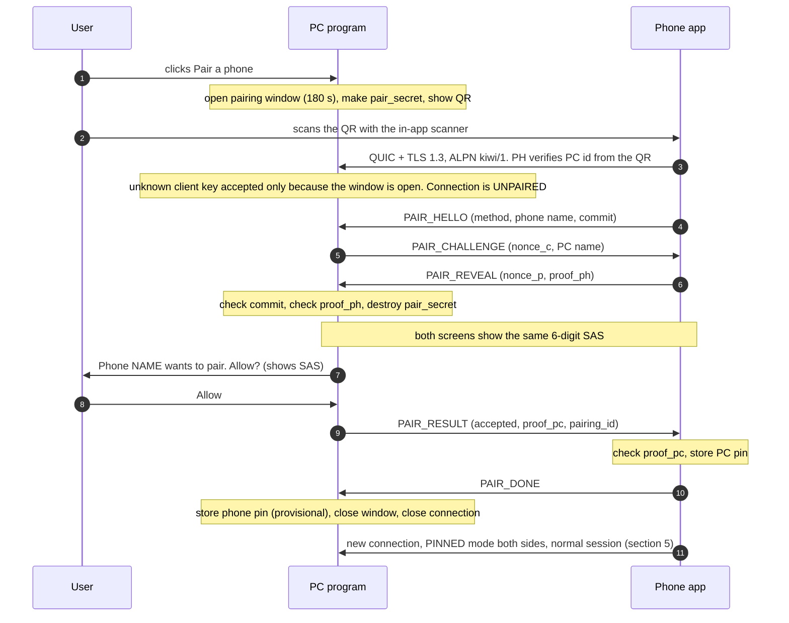

# Kiwi Transfer protocol specification: `kiwi/1`

Status: Draft 1, 2026-11-19, for Kiwi Transfer 1.0. Licence: Apache-2.0.
Companion documents: `docs/SPIKE-REPORT.md` (measurements this design relies on), `docs/THREAT-MODEL.md`.

Scope: an Android phone app and a Windows PC program that copy files between each other over a local link
(Wi-Fi LAN, phone hotspot, USB tethering). No cloud, no account, no telemetry, **no internet mode**: the two
devices only ever talk to each other directly, on the same IP link.

Contents: 0 Conventions - 1 Identities and transport security - 2 Pairing - 3 Weekly re-confirmation -
4 Discovery - 5 Session and streams - 6 File transfer - 7 Durable commit on the PC - 8 Final move -
9 Other features - 10 Update check, problem report, endpoint list - 11 Versioning and test vectors -
12 Decisions - 13 Open questions - Appendix A constants - Appendix B context strings.

---

## 0. Conventions

**Requirement words.** MUST, MUST NOT, SHOULD, SHOULD NOT, MAY are used as in RFC 2119 / RFC 8174.

**Roles.** `PH` is the phone (always the QUIC client). `PC` is the Windows program (always the QUIC server).
A **link** is one paired (PH, PC) couple. In a file transfer, the **sender** and the **receiver** are roles
that either device can take.

**Core and platform.** The **core** is the shared Rust library (`kiwi_core`, exposed through UniFFI). It
implements everything in this document that is not marked *(platform)*. The core MUST NOT assume Android or
Windows: it reaches the operating system only through adapter interfaces (key wrapping, media source, trash,
discovery results, clocks, durable storage). This keeps a later iOS client possible (see 11.4).

**Notation.**

| Notation | Meaning |
|---|---|
| `a \|\| b` | Byte-string concatenation. |
| `u8`, `u16be`, `u32be`, `u64be` | Unsigned integers, big-endian. |
| `BLAKE3(m)` | BLAKE3 hash, default mode, 32-byte output. |
| `KDF(ctx, m)` | BLAKE3 `derive_key` mode: context string `ctx` (ASCII, exactly as written, no terminator), key material `m`, 32-byte output. |
| `MAC(k, m)` | BLAKE3 `keyed_hash` mode with a 32-byte key `k`, 32-byte output. |
| `SIG(sk, m)` | Ed25519 signature (RFC 8032, pure Ed25519, no prehash, no context), 64 bytes. |
| `ct_eq(a, b)` | Constant-time comparison. All comparisons of MACs, proofs and commitments MUST use it. |
| `RAND(n)` | `n` bytes from the operating system CSPRNG. |

All context strings are listed in Appendix B. All named constants (`CHUNK`, `FM_DELAY`, ...) are in Appendix A.

**Time.** Wall-clock times on the wire are signed integers: milliseconds since 1970-01-01T00:00:00Z. Wall-clock
time is never used alone for a safety decision; see the *link clock* in 3.2.

---

## 1. Identities and transport security

### 1.1 Device identity key

1. Each installation has exactly one long-term **Ed25519** key pair, generated by the core with `RAND(32)` as
   the seed, on first start. It is never exported, never synchronised, never backed up.
2. `SPKI` is the DER encoding of the SubjectPublicKeyInfo for that key (RFC 8410). It is always exactly these
   44 bytes: `30 2a 30 05 06 03 2b 65 70 03 21 00 || public_key(32)`.
3. The **device id** is `ID = BLAKE3(SPKI)` (32 bytes). It is the value shown to users as a fingerprint
   (lowercase hex, groups of 4) and the value carried in the pairing QR.
4. A **pin** is the stored full `SPKI` (44 bytes) of a paired peer, with its `ID`. Pinning compares the full
   `SPKI`, not only the hash.
5. If the identity key cannot be loaded (blob missing, unwrap fails, see 1.6), the device MUST generate a
   new identity, MUST treat every existing pairing as void, and MUST tell the user that pairing is needed
   again. It MUST NOT silently keep old pins with a new key.

### 1.2 Certificate

TLS carries the key in a self-signed X.509 v3 certificate (decision D1: raw public keys, RFC 7250, are not
used in `kiwi/1`).

| Field | Value |
|---|---|
| Signature algorithm | Ed25519 (`1.3.101.112`), self-signed with the identity key. |
| Subject = Issuer | `CN=kiwi` (constant; MUST NOT contain a device or user name). |
| Serial number | Any positive integer up to 20 bytes. |
| Validity | `notBefore` at or before `20200101000000Z`; `notAfter` = `99991231235959Z`. |
| Extensions | None required. A `subjectAltName` MAY be present; it is ignored. |
| Size | At most 1024 bytes DER. |

The certificate MAY be regenerated at any time from the same key; only `SPKI` is meaningful. The chain sent in
TLS MUST contain exactly one certificate.

### 1.3 QUIC and TLS profile

| Item | Requirement |
|---|---|
| Transport | QUIC version 1 (RFC 9000) only, with TLS 1.3 (RFC 9001, RFC 8446). |
| ALPN | Exactly one protocol: `kiwi/1` (bytes `6b 69 77 69 2f 31`). No other value is offered or accepted. If ALPN does not match, the handshake MUST fail (`no_application_protocol`). There is no fallback of any kind (no TCP, no HTTP, no older protocol). |
| Authentication | Mutual. The server MUST request and require a client certificate. The server's `CertificateRequest` carries no CA names. |
| Signature scheme | `ed25519` (0x0807) only, for both `CertificateVerify` messages. |
| Key exchange | `x25519` MUST be supported and offered. Other groups offered by the TLS library MAY stay enabled. |
| Cipher suites | `TLS_AES_256_GCM_SHA384`, `TLS_AES_128_GCM_SHA256`, `TLS_CHACHA20_POLY1305_SHA256` (the ring provider's TLS 1.3 set). |
| 0-RTT | Disabled. The server MUST set its early-data limit to 0 and MUST reject early data. The client MUST NOT send early data. |
| Resumption | Disabled. The server MUST NOT send `NewSessionTicket`; the client MUST NOT offer a PSK. Every connection performs a full certificate handshake, so that unpairing takes effect at once (decision D12). |
| SNI | The client SHOULD NOT send SNI. If the library needs a name, it MUST be the constant `kiwi.invalid`. The server MUST ignore SNI. |
| QUIC datagrams | Not used. |
| Idle timeout | `max_idle_timeout` = 30 000 ms on both sides. |
| Keep-alive | While a session is in use, each side sends a QUIC PING after 10 s without sending. |
| Exporters | RFC 8446 section 7.5 exporter, 32 bytes, empty context, labels `EXPORTER-kiwi-1-pairing` and `EXPORTER-kiwi-1-session`. |

### 1.4 Verifier obligations (normative)

Both sides install a custom certificate verifier (rustls `ServerCertVerifier` on PH, `ClientCertVerifier` on
PC). The verifier works in one of two modes, fixed before the handshake starts:

- **PINNED mode** (every normal connection): the expected peer `SPKI` set is known in advance.
  PH expects exactly one `SPKI` (the PC it is dialling). PC expects any `SPKI` in its pin store.
- **PAIRING mode** (only as allowed in section 2): any well-formed Ed25519 `SPKI` is accepted and recorded
  as the *candidate*; nothing is pinned by the verifier itself.

In both modes the verifier MUST do all of the following, and MUST fail the handshake if any step fails:

1. **Certificate step** (`verify_server_cert` / `verify_client_cert`):
   a. The chain has exactly one certificate, at most 1024 bytes, and it parses as X.509.
   b. Its `SPKI` is exactly 44 bytes with the prefix in 1.1 (algorithm Ed25519, no parameters).
   c. PINNED mode: `SPKI` equals a pinned `SPKI` byte for byte. PAIRING mode: record `SPKI` as candidate.
   d. Names, validity dates, extensions, key usage and the certificate's self-signature are NOT evaluated
      (clocks on phones are unreliable and a self-signed validity period proves nothing).
2. **Handshake signature step** (`verify_tls13_signature`): verify the TLS 1.3 `CertificateVerify` signature
   over the handshake transcript with the public key from that same certificate, accepting only the scheme
   `ed25519`. This is the proof that the peer holds the private key.
   **The method MUST perform a real signature verification. It MUST NOT return success unconditionally,
   MUST NOT be a stub, and MUST NOT accept any other scheme.** A verifier that checks the pin but skips this
   step lets anyone who has seen the certificate impersonate the device.
3. `verify_tls12_signature` MUST always return an error. `supported_verify_schemes` MUST return exactly
   `[ED25519]`.
4. PC only: `client_auth_mandatory` is true. A connection without a client certificate MUST fail.
5. On failure the handshake is aborted with a fatal TLS alert. The alert code is not specified; peers MUST NOT
   depend on it.

Defence in depth: after the handshake, both sides also sign a session transcript bound to the TLS exporter
with the identity key (5.3). A verifier bug that skipped step 2 is therefore caught at the application layer.

Required negative tests (11.3): (a) correct pinned certificate presented by a peer that signs
`CertificateVerify` with a different key MUST fail; (b) unknown key in PINNED mode MUST fail; (c) RSA or
ECDSA certificate MUST fail; (d) two-certificate chain MUST fail; (e) ALPN `kiwi/2` or `h3` MUST fail.

### 1.5 Order of authentication

In TLS 1.3 the server authenticates first. PH MUST verify the PC pin before it sends its own certificate
(this is the normal TLS 1.3 flight order; the client aborts on a pin mismatch and its identity is not
revealed to a wrong server). The PC certificate is visible to any host on the link that starts a handshake;
see the threat model, residual risk R7.

### 1.6 Key storage

**Android** *(platform; the Android Keystore cannot hold Ed25519 keys before API 33 and minSdk is 24)*:

1. The Ed25519 seed is generated and used by the core. At rest it is stored only as a wrapped blob.
2. Wrapping key: an AES-256-GCM key in the Android Keystore, alias `kiwi_identity_wrap_v1`, purposes
   encrypt+decrypt, `setRandomizedEncryptionRequired(true)`, no user-authentication requirement (backup must
   run in the background). StrongBox is requested where present, with fallback to the TEE-backed Keystore.
3. Blob: `"KWK1" || iv(12) || ciphertext_and_tag`, with additional authenticated data
   `kiwi/1 identity seed` (ASCII). The IV is the one produced by the Keystore cipher.
4. Location: `Context.getNoBackupFilesDir()`. The manifest MUST set `android:allowBackup="false"` and MUST
   ship `dataExtractionRules` (API 31+) and `fullBackupContent` (API 30 and lower) that exclude every domain
   for both cloud backup and device-to-device transfer. The pin store and the phone ledger live in app-private
   storage under the same exclusion. Storage is credential-encrypted (the app is not direct-boot aware).
5. The unwrapped seed lives only in core memory, in a zeroize-on-drop buffer.
6. Stated limits: hardware backing protects the blob against offline extraction and against cloning through a
   backup or a copied data directory. It does not protect against code running inside the app's process or a
   rooted/compromised device, which can use or read the unwrapped seed. On devices without a hardware-backed
   Keystore the wrapping key is software-protected; the app records the security level
   (`KeyInfo`) in its diagnostic screen. Uninstalling the app destroys the wrapping key: the identity is gone
   and re-pairing is required.

**Windows** *(platform)*:

1. The seed is protected with DPAPI: `CryptProtectData`, CurrentUser scope (never
   `CRYPTPROTECT_LOCAL_MACHINE`), `CRYPTPROTECT_UI_FORBIDDEN`, optional-entropy = `kiwi/1 identity seed`
   (domain separation only; it is not a secret).
2. Location: `%LOCALAPPDATA%\FastKiwi\KiwiTransfer\` (the non-roaming profile), with the default per-user ACL.
3. Stated limits of DPAPI CurrentUser:
   - Any program running as the same Windows user can call `CryptUnprotectData` and obtain the seed. DPAPI has
     no per-application isolation.
   - Administrators, SYSTEM, and on domain-joined machines the domain DPAPI backup key, can recover it.
   - The DPAPI master key is derived from the user's logon credential: an account with an empty or weak
     password gives little protection against offline disk access unless the disk is encrypted (BitLocker).
   - There is no hardware binding and no user-presence check.
   - A local password reset by an administrator, a new Windows profile, or a Windows reinstall makes the blob
     undecryptable. Then rule 1.1(5) applies: new identity, re-pair.

---

## 2. Pairing (first link)

Pairing creates the two pins of a link. It is always started by a person at the PC. There is **no standing
pairing listener**: unknown keys are accepted only while a user-opened pairing window is open.

There are two methods. Both run the same message sequence.

| Method | Authentication comes from | When |
|---|---|---|
| `QR` (1) | The PC device id and a one-time secret carried in the QR, plus the Allow click on the PC. | Default. |
| `SAS` (2) | A 6-digit short authentication string compared by the user on both screens, protected by a commitment, plus confirmation on both devices. | When the camera cannot be used. |

There is no typed short-code PAKE in `kiwi/1` (no audited PAKE crate exists; spike section 5, decision D5).

### 2.1 Pairing window (PC)

1. The user clicks "Pair a phone". The PC opens a window of `PAIR_WINDOW` (default 180 s; configurable only
   within 120-300 s), measured with a monotonic clock. Only one window can be open at a time.
2. The PC generates `pair_secret = RAND(16)` (128 bits) and shows the QR (2.2). By default only method `QR`
   is accepted. If the user chooses "I can't scan", the window also accepts method `SAS` and the PC
   advertises `pm=1` in mDNS (section 4) until the window closes.
3. While the window is open, the PC verifier runs in PAIRING mode **for unknown keys only**: a client whose
   `SPKI` is pinned gets a normal session; a client whose `SPKI` is unknown gets an **UNPAIRED** connection.
   When no window is open, unknown keys fail the handshake.
4. The window closes, and `pair_secret` is destroyed, at the first of: timeout; user cancel; a valid
   `PAIR_REVEAL` proof (the secret is single use, whatever the user then answers); 3 failed attempts
   (bad proof, bad commitment, protocol error, or a declined SAS); program exit.
5. If no device is paired and no window is open, the PC MUST NOT bind any UDP socket and MUST NOT advertise.

An UNPAIRED connection is restricted: one bidirectional stream; only the messages `PAIR_*`, `ERROR`;
frames of at most `MAX_FRAME_UNPAIRED` (4096 bytes); no unidirectional streams; at most 2 UNPAIRED
connections at a time; `PAIR_HELLO` within 10 s of the handshake; `PAIR_REVEAL` within 10 s of
`PAIR_CHALLENGE`. An UNPAIRED connection is never upgraded: after pairing, both sides close it and PH
opens a new, normal connection.

### 2.2 QR code

Text content: the ASCII prefix `KIWI1:` followed by the RFC 4648 Base32 encoding (alphabet `A-Z2-7`,
upper case, no padding) of this payload. All characters fit the QR alphanumeric mode.

| Offset | Size | Field | Value |
|---|---|---|---|
| 0 | 1 | `qr_version` | `0x01` |
| 1 | 1 | `flags` | bit 0: `1` = the window also accepts method SAS. Other bits 0; a reader MUST reject unknown bits. |
| 2 | 32 | `pc_id` | `ID` of the PC. |
| 34 | 16 | `pair_secret` | One-time secret. |
| 50 | 2 | `port` | UDP port, `u16be`. |
| 52 | 1 | `n` | Number of addresses, 1 to 6. |
| 53 | ... | `addr[n]` | Each: `family` (`0x04` or `0x06`) then 4 or 16 address bytes. |

Rules:

- Addresses are the PC's unicast addresses on eligible interfaces only (4.4), IPv4 first. IPv6 link-local
  addresses are not put in the QR (no scope id can be carried).
- The QR carries no expiry time: the PC enforces the window with its own monotonic clock.
- A typical payload (two IPv4 addresses) is 63 bytes, 101 Base32 characters, QR version 6 at level M.
- PH MUST accept this content **only from its in-app scanner**. The app MUST NOT register a URI scheme,
  app link or intent filter that starts pairing, and MUST NOT accept a pairing payload from the clipboard,
  a file or another app. (A link on a web page must not be able to pair the phone with an attacker's PC.)
- PH applies the address filter of 4.4 to the QR addresses before dialling.

### 2.3 Derived values

Both sides compute, for the pairing connection they are on:

```
E_pair   = TLS exporter, label "EXPORTER-kiwi-1-pairing", empty context, 32 bytes
ID_ph    = BLAKE3(SPKI of the phone)      ID_pc = BLAKE3(SPKI of the PC)
           (own SPKI from the own key; peer SPKI from the certificate of THIS TLS connection)
commit   = KDF("kiwi/1 pairing commit",     E_pair || ID_ph || ID_pc || nonce_p)
TH       = KDF("kiwi/1 pairing transcript", E_pair || ID_ph || ID_pc || BLAKE3(m1) || BLAKE3(m2) || nonce_p)
SAS      = u64be( KDF("kiwi/1 pairing sas", TH)[0..8] ) mod 1000000      (shown as 6 digits, "482 913")
K_pair   = KDF("kiwi/1 pairing key", pair_secret)                        (method QR only)
proof_ph = MAC(K_pair, 0x01 || TH)                                       (method QR only)
proof_pc = MAC(K_pair, 0x02 || TH)                                       (method QR only)
```

`m1` is the exact payload bytes of the `PAIR_HELLO` frame and `m2` the exact payload bytes of the
`PAIR_CHALLENGE` frame (the CBOR envelope, without the 4-byte length prefix; see 5.1). `nonce_p = RAND(32)`
is chosen by PH; `nonce_c = RAND(32)` is chosen by PC and is inside `m2`. All inputs have fixed lengths.

### 2.4 Message sequence



Method SAS differs in three places (ASCII view):

```
PH                                              PC
 |  finds a PC with pm=1 (mDNS) or typed addr    |   window open, "I can't scan" chosen
 |== TLS: both verifiers in PAIRING mode =======>|   (signatures verified, nothing pinned yet)
 |-- PAIR_HELLO (method=2, name, commit) ------->|
 |<------------- PAIR_CHALLENGE (nonce_c, name) -|
 |-- PAIR_REVEAL (nonce_p) --------------------->|   check commit
 |  shows SAS + "Do the numbers match?"          |   shows SAS + "Phone NAME wants to pair - Allow?"
 |-- PAIR_CONFIRM (match=true) ----------------->|   user compared and tapped on the phone
 |                                               |   user compared and clicked Allow on the PC
 |<----------------- PAIR_RESULT (accepted, id) -|   PC pins (provisional)
 |  PH pins                                      |
 |-- PAIR_DONE --------------------------------->|
```

Processing rules:

1. **PH, start.** Method QR: PH dials the QR addresses with the verifier in PINNED mode for `pc_id`
   (the handshake fails unless the server key hashes to `pc_id`). Method SAS: PH dials with the verifier in
   PAIRING mode. In both cases PH then sends `PAIR_HELLO` with `commit`.
2. **PC, on `PAIR_HELLO`.** Reject (`E_NOT_PERMITTED`) if the method is not allowed by the window. Sanitise
   the phone name for display (5.8). Reply `PAIR_CHALLENGE` with a fresh `nonce_c`.
3. **PH, on `PAIR_CHALLENGE`.** Send `PAIR_REVEAL` with `nonce_p` and, for method QR, `proof_ph`.
4. **PC, on `PAIR_REVEAL`.** Recompute `commit` from `nonce_p`; if `ct_eq` fails, abort (`E_VERIFY`, counts
   as a failed attempt). Method QR: recompute `proof_ph`; if `ct_eq` fails, abort (failed attempt; the secret
   is not consumed). If it succeeds, the secret is consumed now. Then show the consent dialog:
   **"Phone <name> wants to pair - Allow?"** with the SAS. The PC MUST NOT pin, and MUST NOT show the dialog
   in method QR, before these checks pass.
5. **PH, after `PAIR_REVEAL`.** Show the SAS. Method QR: show "Check that the PC shows the same number, then
   click Allow there" (comparison is an extra check; authentication already comes from the QR). Method SAS:
   show "Do the numbers match?" with two buttons; send `PAIR_CONFIRM(match)`.
6. **PC, decision.** Method QR: on Allow, send `PAIR_RESULT(accepted)`. Method SAS: send
   `PAIR_RESULT(accepted)` only when it has both the local Allow click and `PAIR_CONFIRM(match=true)`. On
   Deny, timeout, or `match=false`: send `PAIR_RESULT(declined)`, close; on `match=false` also warn the user
   that someone on the network may be interfering.
7. **PH, on `PAIR_RESULT(accepted)`.** Method QR: verify `proof_pc` (`ct_eq`), else abort and pin nothing.
   Method SAS: require that the local user already tapped "match". Then store the PC pin with `pairing_id`,
   send `PAIR_DONE`, close, and reconnect normally.
8. **PC pin is provisional** until the first normal session from that phone passes `HELLO_AUTH` (5.3). If
   that does not happen within 10 minutes the PC MUST delete the provisional pin.
9. Each device pins **only after its own user-facing condition is met**: PC after the Allow click; PH after
   the QR proof (method QR) or the local "match" tap (method SAS). A confirmation received from the network
   is never a substitute for the local one.

### 2.5 Why the SAS cannot be ground (commitment scheme)

A man in the middle (M) holds two TLS connections, PH-M and M-PC, with different exporters and keys, and
wants the two 6-digit values to be equal. The SAS depends on `nonce_p` and `nonce_c`:

- Towards PC, M must send a `commit` (binding: it fixes M's `nonce_p'`) **before** it learns PC's `nonce_c`.
- Towards PH, M must send its `nonce_c'` **before** PH reveals `nonce_p` (hiding: `commit` reveals nothing
  about the 256-bit `nonce_p`).

Whatever the order, one of the two SAS values still depends on a random value M has not seen when M makes
its last choice. M therefore gets one guess per attempt: success probability 10^-6. The window allows 3
attempts. Requirements that make this hold: `nonce_p` and `nonce_c` are fresh `RAND(32)` per attempt; PC
MUST NOT send `nonce_c` before it has `commit`; PH MUST NOT send `nonce_p` before it has `nonce_c`; PC MUST
verify `commit`; neither side shows the SAS before `PAIR_REVEAL` has been sent/verified.

### 2.6 State created by pairing

Both sides store for the link: peer `SPKI` and `ID`, peer display name, `pairing_id` (16 random bytes chosen
by PC, sent in `PAIR_RESULT`), `confirm_epoch = 1`, confirmation age 0 (pairing counts as the first weekly
confirmation), `last_session_seq = 0`. Local policy limits: a PC accepts at most 8 paired phones, a phone at
most 4 paired PCs (configurable; not a wire limit).

### 2.7 Unpairing

- Either side can unpair at any time, without the other being present. The local effect is immediate:
  delete the pin and link state, close any connection with QUIC application code `3` (unpaired).
- If a session is open, the side that unpairs first sends `UNPAIR`; the peer answers `UNPAIR_ACK`, shows
  "unpaired by the other device", and deletes its pin.
- If the peer is offline it finds out at its next connection: the handshake fails (unknown key). A device
  MUST NOT delete a pin automatically because a handshake failed (that could be a network attacker or a
  transient fault). It marks the link "not accepted by the other device" and lets the user remove it.
- Unpairing never deletes a file on either device. For final move its effect is defined in 8.9
  (purges stop; items in the trash stay there until the user decides).
- Pairing the same two devices again creates a new link with a new `pairing_id`; no state is inherited.

---

## 3. Weekly session re-confirmation

Owner requirement: every 7 days a link must be re-confirmed with a 2-digit code shown in the PC program and
typed on the phone.

### 3.1 What it is, and what it is not

- It is a **presence and consent check**: it shows that a person holding the phone can also see the PC
  program's window, and it makes the user look at the PC program (where integrity alerts are shown) at
  least once a week.
- It is **not a secret and not authentication**. The channel is already mutually authenticated (section 1).
  A 2-digit code has 100 values; its strength comes only from the attempt limits and from the fact that a
  code exists only while it is displayed on the PC (3.4).
- It limits how long a stolen phone, or a copied phone identity, stays useful without access to the PC screen.

### 3.2 Link clock (rollback-resistant time)

Each device keeps, per installation, a persistent non-decreasing counter `LC` in seconds (the **link clock**):

1. While the process runs, `LC` advances with a monotonic clock that keeps counting during sleep
   *(platform: Android `SystemClock.elapsedRealtime`; Windows `QueryInterruptTime`/`GetTickCount64`)*.
2. A checkpoint `(LC, wall_time, boot_id, monotonic_reading)` is written durably at least every 5 minutes
   while running and at clean shutdown.
3. At start, with the last checkpoint:
   - same boot (`boot_id` unchanged *(platform: Android `Settings.Global.BOOT_COUNT`; Windows boot time)*):
     `LC += monotonic_now - monotonic_reading`;
   - otherwise `gap = wall_now - wall_time`. If `gap >= 0`: `LC += gap`. If `gap < 0` (the wall clock went
     backwards): `LC` is left unchanged and the persistent flag `clock_anomaly` is set.
4. A wall clock set forward makes `LC` jump forward (things expire early: fail closed). A wall clock set back
   is either detected (`clock_anomaly`) or, at worst, hides the time the device was off; rule 3.3(3) then
   corrects it from the other device.
5. `LC` values are local. Only **differences** of `LC` are ever sent or compared.

Each side also keeps per link: `confirm_epoch` (u64, the number of confirmations so far) and
`confirm_lc` (its own `LC` at the last confirmation). `confirm_age = LC - confirm_lc`.

### 3.3 Confirmation state (computed at every session start, 5.3)

Both sides send `confirm_epoch`, `confirm_age` and `clock_anomaly` in `HELLO`. Then, identically on both sides:

1. **Epoch agreement.** If `epoch_pc == epoch_ph`: agreed. If `epoch_pc == epoch_ph + 1` (the phone missed
   the last result): PH adopts `epoch_pc` and `confirm_age_pc`. Any other difference (one side lost or
   restored state): the link is `REQUIRED`.
2. **Anomaly.** If either side reports `clock_anomaly`: the link is `REQUIRED`.
3. **Age.** `age = max(confirm_age_ph, confirm_age_pc)`. Each side then moves its own `confirm_lc` back so
   that its `confirm_age` equals `age` (ages never decrease by talking to the peer).
4. The link is `CONFIRMED` if 1 and 2 hold and `age < CONFIRM_PERIOD` (604 800 s); otherwise `REQUIRED`.

During a long session each side re-evaluates with its own `LC` before every data-plane request; the PC
pushes `STATUS` when the state changes. A wall-clock timestamp is never an input to this decision.

### 3.4 Code exchange

Runs on the control stream of a normal session. The code never travels from PC to PH.

1. PH sends `RECONFIRM_BEGIN` (allowed at any time, also before expiry).
2. PC creates a challenge: `code` uniform in `00..99` (CSPRNG with rejection sampling), `challenge_id`,
   3 attempts. PC replies `RECONFIRM_CHALLENGE(state)`.
3. **Arming.** The PC accepts answers only while the challenge is *armed*: the code is being shown inside
   the PC program's own visible window, in an interactive, unlocked user session, and a person at the PC
   caused that window to be shown (opening the program, or clicking the "weekly number" notice). The code
   MUST NOT appear in a notification, a tooltip, a log or the lock screen. Arming starts a `RECONFIRM_TTL`
   (300 s, monotonic) timer. PC pushes `RECONFIRM_STATE` to PH when the challenge becomes armed or dies.
4. The user types the two digits on the phone. PH sends `RECONFIRM_ANSWER(challenge_id, code)`.
5. PC, if armed and not expired: on match, it durably stores `confirm_epoch += 1`, `confirm_lc = LC`,
   clears its `clock_anomaly`, then replies `RECONFIRM_RESULT(ok, new_epoch)`. PH stores the same
   (`confirm_lc = its own LC`, clears its `clock_anomaly`) and sends `RECONFIRM_ACK`.
   On mismatch: `attempts_left -= 1`, reply `RECONFIRM_RESULT(not ok, attempts_left)`.
6. Limits: 3 attempts per challenge. After the third wrong answer, or TTL expiry, the challenge is dead.
   A **new challenge after a failed one requires a click on the PC** ("Show a new number"), and the PC
   shows "A wrong number was entered 3 times from phone <name>". After 3 dead challenges in a row the link
   is locked for 15 minutes (PC monotonic time), doubling up to 24 hours; a success resets this.
   Answers to an unarmed, expired or unknown challenge are rejected (`E_STATE`) and consume nothing.
7. Honest strength statement: a person with the phone but without sight of the PC screen has at most 3
   guesses (3 %) per challenge that somebody at the PC armed, and each failure is displayed at the PC.

### 3.5 Effect of `REQUIRED`

While a link is `REQUIRED`:

| Area | Behaviour |
|---|---|
| Allowed messages | Session setup, `STATUS`, `PING`, `RECONFIRM_*`, `UNPAIR`, `BYE`. Every other request is refused with `E_CONFIRM_REQUIRED`. |
| Automatic backup | Paused. The phone shows a notification ("Weekly check needed to continue backup"). Nothing is queued for deletion. |
| Final move | No verification, no trashing, no purging (8.8). Purges of the app trash folder are **suspended**, not cancelled: retention keeps counting, deletion waits. |
| Deletion | **Nothing is deleted** on either device because a link expired. No file, ledger entry, pin or partial transfer is removed. |
| Transfers in progress | An item whose data stream is already open may finish and commit; no new item starts. |
| After re-confirmation | Everything resumes from where it stopped. No re-pairing is needed. |

Limit that cannot be removed: on Android 11+ the *system* trash deletes its items on its own schedule
(8.6). The app cannot suspend that; see 8.6(5) for the required warning.

### 3.6 Several paired devices

- Confirmation state, epoch, challenge and lockout are **per link**. Confirming one phone does nothing for
  another phone; a PC with three phones can show up to three numbers, each labelled with the phone's name.
- A code is bound to its link: an answer is checked only against the challenge of the link it arrives on.
- A phone paired with two PCs confirms each PC separately; one PC being expired does not pause the other.
- Final move for a folder targets exactly one PC (8.1); only that link's state matters for that folder.

---

## 4. Discovery

Discovery only produces **candidate addresses**. A candidate is never trusted: every candidate passes the
address filter (4.4) and then the TLS pin (1.4). A wrong or forged answer can only cause a failed attempt.

### 4.1 Service

| Item | Value |
|---|---|
| Mechanism | mDNS / DNS-SD (RFC 6762, RFC 6763). The PC advertises; the phone browses. The phone never advertises and never listens. |
| Service type | `_kiwixfer._udp.local.` |
| Instance name | 16 lowercase hex characters from `RAND(8)`. MUST NOT contain a device, user or host name. |
| SRV target | `k<same 16 hex>.local.` MUST NOT be the Windows host name. |
| SRV port | The PC's QUIC UDP port. |
| Rotation | A new random instance name at every program start, at every network change, and at least every 24 h. |
| Advertised when | The program runs and (at least one phone is paired, or a pairing window with SAS is open). |

### 4.2 TXT record

| Key | Value | Meaning |
|---|---|---|
| `v` | `1` | Protocol major version(s) supported, comma-separated decimal. |
| `h` | 16 lowercase hex characters | Hint: first 8 bytes of `MAC(KDF("kiwi/1 discovery hint", ID_pc), instance_name_ascii)`. Lets a paired phone recognise its PC without trial handshakes. Changes with every instance name, so a passive observer who does not know `ID_pc` cannot link two advertisements. |
| `pm` | `1` | Present only while a pairing window that accepts method SAS is open. |

No other key is sent. Readers MUST ignore unknown keys. A phone that gets no TXT data (resolver quirk) MAY
still try the candidate.

### 4.3 Phone behaviour

1. *(platform)* Android browses with `NsdManager`, only while it needs a PC (app in foreground, or a
   backup attempt is running), and passes results (instance name, addresses, port, TXT) to the core.
2. Candidate order for a paired PC: (a) the last address and port that worked, if still on-link;
   (b) mDNS instances whose `h` matches that PC; (c) mDNS instances without a usable `h`.
3. At most 3 addresses per instance are tried, 2 s each, IPv4 first. At most 8 instances per browse.
4. Candidates may also come from a pairing QR. All sources are treated the same.
5. *(platform)* The socket MUST be bound to the local (non-cellular, non-VPN) network that owns the on-link
   prefix. If the system would route the packet through a VPN or mobile data, the attempt MUST fail closed.

### 4.4 Address filter (both sides)

An address is acceptable only if it is **on-link**: it lies inside a connected prefix (address + prefix
length) of a local interface that is eligible. This is the rule that makes "no internet mode" a property of
the protocol and not only of the user interface.

- Eligible interface on the phone *(platform)*: Wi-Fi, Ethernet, USB tethering, the phone's own hotspot
  interface. Never cellular, never VPN.
- Eligible interface on the PC *(platform)*: an interface whose Windows network category is **Private**
  (`INetworkListManager`, `NLM_NETWORK_CATEGORY_PRIVATE`). Public and Domain networks are not eligible in 1.0.
- Always rejected: loopback, unspecified, multicast, broadcast, and any address outside every eligible
  on-link prefix. IPv6 link-local addresses are acceptable only with the scope of the interface they were
  learned on. Global IPv6 addresses are acceptable when on-link.
- The PC applies the same rule to the **source address** of every incoming packet before any other
  processing: a packet whose source is not on-link for the interface it arrived on is dropped silently
  (this also defeats a router port-forward).
- Both sides SHOULD set the IP TTL / IPv6 hop limit of their QUIC sockets to 1, so that a packet can never
  be forwarded by a router even if a rule above is implemented wrongly (open question Q9).

### 4.5 PC listener *(platform)*

1. One UDP socket per eligible unicast address (never `0.0.0.0` or `::`), re-evaluated on every network
   change notification. If no interface is eligible, the PC listens nowhere and tells the user why
   ("This network is set to Public in Windows").
2. Port: chosen once at first run (preferred `47474`; if busy, an OS-assigned port), stored, and reused.
   The phone always learns the port from the QR, mDNS or its cache; it never assumes it.
3. The installer adds one Windows Firewall rule: inbound UDP, this program only, Private profile only,
   remote address `LocalSubnet`. The built-in Windows mDNS rules are used as they are (spike section 4).
4. mDNS answers sent on an interface contain only that interface's addresses.

### 4.6 Hotspot and USB tethering

When the PC joins the phone's hotspot, or the phone shares its connection over USB, the two devices are on
one IP link and everything above applies unchanged: same discovery, same filter, same TLS. Transfers on that
link do not use mobile data. Windows usually classifies such a new network as Public; the user must set it
to Private (open question Q1). mDNS browsing by `NsdManager` on the phone's own tethering interfaces is not
verified (open question Q7); the cached address and the QR remain available as candidate sources.

### 4.7 Android local-network permission *(platform)*

The app declares `INTERNET`, `ACCESS_NETWORK_STATE`, `ACCESS_WIFI_STATE`, and the local-network permission
introduced for Android 17 (`ACCESS_LOCAL_NETWORK`, nearby-devices group). On systems that enforce it, the
permission is requested, with an explanation, before the first browse or dial; if it is refused, discovery
and transfer are unavailable and the app says so (it MUST NOT fall back to any other path). Exact behaviour
per API level is to be verified when the target SDK is fixed (open question Q8).

---

## 5. Session and streams

### 5.1 Framing

Every protocol message is one **frame**:

```
frame   = u32be(length) || payload          length = number of payload bytes, 1 .. MAX_FRAME
payload = one CBOR data item: the envelope  [ type, id, body ]
            type : unsigned integer   message type code (5.11)
            id   : unsigned integer   request correlation; 0 for notifications
            body : map with unsigned-integer keys
```

A frame longer than the limit that applies (`MAX_FRAME` = 262 144 bytes; `MAX_FRAME_UNPAIRED` = 4096 bytes on
UNPAIRED connections) is a protocol violation: the receiver closes the connection with code `6` without
reading the payload. Bytes after the CBOR item inside a payload are a violation (`E_MALFORMED`).

### 5.2 Encoding: CBOR, deterministic profile

Chosen encoding: **CBOR (RFC 8949)** with integer map keys (decision D7). Reasons: it is an IETF standard
with small independent implementations for Rust, Kotlin and Swift (needed for independent implementers and a
later iOS client); it has native byte strings (hashes, ids, proofs) and 64-bit integers; it has a defined
deterministic form, which hashed and signed transcripts need; it needs no code generator and no schema
compiler in the build (F-Droid reproducibility); unknown map keys can be skipped, which gives forward
compatibility. Rejected: Protocol Buffers (no canonical serialisation, code generation), JSON (no binary,
ambiguous numbers, larger), postcard/bincode (Rust-specific, not self-describing), MessagePack (no
standardised deterministic form).

Profile (normative):

1. Allowed: unsigned integers, negative integers, byte strings, text strings (valid UTF-8), arrays, maps
   whose keys are unsigned integers, and the simple values `false`, `true`, `null`.
2. Forbidden: floating point, tags, indefinite-length items, any other simple value, non-integer map keys,
   duplicate map keys, nesting deeper than 8.
3. Senders MUST use deterministic encoding (RFC 8949 section 4.2.1): shortest integer and length forms, map
   keys in ascending order.
4. Receivers MUST reject (`E_MALFORMED`) anything in rule 2 and any invalid UTF-8. Receivers SHOULD reject
   non-shortest forms and unsorted keys.
5. **Hashes and signatures are always computed over the bytes as received**, never over a re-encoding.
6. Unknown map keys in a known message MUST be ignored. A missing required key is `E_MALFORMED`.
7. Optional fields are omitted when absent; `null` is not used as "absent".

Common field types used in 5.11:

| Type | Encoding |
|---|---|
| `Hash`, `DeviceId`, `Nonce`, `Proof` | Byte string, exactly 32 bytes. |
| `Id16` | Byte string, exactly 16 bytes. |
| `ItemKey` | `Id16` chosen by the sender of an item; opaque to the receiver (6.2). |
| `Time` | Integer, milliseconds since the Unix epoch (may be negative). |
| `Path` | Array of 0 to 32 text strings (path components, 6.8). Never a string with separators. |
| `Name` | Text string, 1 to 1024 bytes of UTF-8. |

### 5.3 Session establishment

A normal connection (both verifiers in PINNED mode) carries exactly one session.

```
PH                                                         PC
 |== QUIC + TLS 1.3, ALPN kiwi/1, mutual pins ============>|
 |-- stream 0 (bidirectional, control) --------------------|
 |-- HELLO (h_ph) ---------------------------------------->|
 |<---------------------------------------- HELLO (h_pc) --|
 |-- HELLO_AUTH (sig_ph) --------------------------------->|   PC verifies sig_ph
 |<---------------------------------- HELLO_AUTH (sig_pc) -|   PH verifies sig_pc
 |                 session established                     |
```

1. PH opens the first client-initiated bidirectional stream. It is the **control stream** and stays open for
   the life of the connection. PH sends `HELLO`; PC answers `HELLO`.
2. Both compute, with `h_ph` and `h_pc` the exact payload bytes of the two `HELLO` frames:

   ```
   E_sess  = TLS exporter, label "EXPORTER-kiwi-1-session", empty context, 32 bytes
   TH_sess = KDF("kiwi/1 session transcript",
                 E_sess || ID_ph || ID_pc || u32be(len(h_ph)) || h_ph || u32be(len(h_pc)) || h_pc)
   sig_ph  = SIG(sk_ph, "kiwi/1 session auth" || 0x01 || TH_sess)
   sig_pc  = SIG(sk_pc, "kiwi/1 session auth" || 0x02 || TH_sess)
   ```

   The signed message starts with the ASCII bytes `kiwi/1 session auth`, so it can never be confused with a
   TLS 1.3 `CertificateVerify` input (which starts with 64 bytes `0x20`).
3. PH sends `HELLO_AUTH(sig_ph)`. PC verifies it with the **pinned** phone key, then sends
   `HELLO_AUTH(sig_pc)`. PH verifies it with the pinned PC key. A failed verification closes the connection
   with code `2`. This is the **signed transcript**: it covers the protocol version, the capability lists and
   every link counter in both `HELLO` messages, and binds them to this TLS connection.
4. Checks after authentication, in this order:
   a. `pairing_id` equal on both sides; otherwise close with code `3` (stale pairing).
   b. Version: `minor = min(minor_ph, minor_pc)` (11.1).
   c. Capabilities: the active set is the intersection of both `caps` lists. Capability `1` is mandatory.
   d. Session number: `session_seq = max(last_session_seq_ph, last_session_seq_pc) + 1`. Both sides store it
      durably **before** sending any data-plane request.
   e. Confirmation state (3.3).
   f. Each side compares the peer's `ledger_id` with the one it stored last time (8.10).
5. Deadlines: `HELLO` within 5 s of handshake completion; the whole exchange within 10 s; else close code `1`.
6. Before step 3 has succeeded, only `HELLO`, `HELLO_AUTH`, `ERROR` and `BYE` are accepted, and neither side
   may open a file, start a database transaction, accept a unidirectional stream, or show UI for the peer.

Capabilities:

| Id | Name | Meaning |
|---|---|---|
| 1 | `xfer` | Offers, data streams, receipts (section 6). Mandatory. |
| 2 | `send` | Ad-hoc sending in both directions (9.1). |
| 3 | `clipboard` | `CLIP` (9.2). |
| 4 | `browse` | `BROWSE`, `THUMB`, `FETCH` (9.3). |
| 5 | `restore` | Restore sources and `FETCH` with purpose restore (9.4). |
| 6 | `final_move` | `FM_*` (section 8). |
| 7 | `repair` | `REPAIR_REQUEST` (8.9). |

A request for a capability that is not active is answered with `E_UNSUPPORTED`.

### 5.4 Requests, responses, notifications, errors

- Both sides may send requests on the control stream. A request has `id > 0`, unique and increasing per
  sender per connection. The response carries the same `id` and the response type listed in 5.11, or `ERROR`.
- A notification has `id = 0` and gets no response.
- At most 32 requests may be outstanding per direction; more is `E_LIMIT`.
- An unknown message type with `id > 0` is answered with `ERROR(E_UNSUPPORTED)`; with `id = 0` it is ignored.
- A message that is not allowed in the current state is answered with `ERROR(E_STATE)`.

Error codes (`ERROR.code`, and every `code` field):

| Code | Name | Meaning |
|---|---|---|
| 1 | `E_UNSUPPORTED` | Unknown message, or capability not active. |
| 2 | `E_MALFORMED` | Violates 5.1 / 5.2 or a field rule. |
| 3 | `E_LIMIT` | A limit of 5.7 was exceeded. |
| 4 | `E_BUSY` | Try again later (`retry_after`). |
| 5 | `E_CONFIRM_REQUIRED` | The link needs the weekly check (3.5). |
| 6 | `E_NOT_PERMITTED` | Not allowed by local settings or by the user. |
| 7 | `E_QUOTA` | Per-peer quota reached (5.10). |
| 8 | `E_NO_SPACE` | Not enough free space. |
| 9 | `E_NAME` | A name or path cannot be accepted (6.8). |
| 10 | `E_VERIFY` | A hash, proof or commitment did not match. |
| 11 | `E_CHANGED` | The source changed while it was read. |
| 12 | `E_IO` | Local input/output error. |
| 13 | `E_CANCELLED` | Cancelled by a user or by the peer. |
| 14 | `E_DECLINED` | The user declined. |
| 15 | `E_NOT_FOUND` | Unknown id, key, handle or challenge. |
| 16 | `E_INTEGRITY_BLOCK` | Final moves are blocked by an integrity alert (8.9). |
| 17 | `E_FM_NOT_CAPABLE` | The destination does not qualify for final move (8.2). |
| 18 | `E_TOO_EARLY` | The final-move delay has not passed (8.5). |
| 19 | `E_STATE` | Message not valid in this state. |
| 20 | `E_RATE` | Rate limit (`retry_after`). |
| 21 | `E_EXPIRED` | Pairing window or challenge expired. |
| 22 | `E_ATTEMPTS` | No attempts left. |
| 23 | `E_INTERNAL` | Anything else. |

QUIC application close codes: `0` normal, `1` protocol violation or deadline, `2` session authentication
failed, `3` unpaired or stale pairing, `4` superseded by a newer connection from the same device, `5`
shutting down, `6` limit exceeded, `7` pairing finished.

### 5.5 Streams

| Stream | Opened by | Use |
|---|---|---|
| Bidirectional stream 0 | PH | Control stream. The only bidirectional stream. A second one is a violation (code `6`). |
| Unidirectional streams | The sender of a file | One file body per stream (6.4). At most `MAX_DATA_STREAMS` (4) open at a time per direction. |

No other stream type exists in `kiwi/1`. Small request/response data (listings, thumbnails, clipboard) travels
on the control stream.

### 5.6 Keep-alive and closing

- Transport keep-alive and idle timeout: 1.3. `PING`/`PONG` on the control stream are optional (liveness and
  round-trip display); a `PING` MUST be answered within 10 s.
- Orderly close: send `BYE(reason)`, finish or reset open data streams, close with code `0`.
- QUIC connection migration (the phone changing Wi-Fi access point) is allowed; the new path's addresses must
  pass 4.4, otherwise the connection is closed.

### 5.7 Limits

| Limit | Value |
|---|---|
| Control frame (`MAX_FRAME`) | 262 144 bytes |
| Frame on an UNPAIRED connection | 4 096 bytes |
| Bidirectional streams per connection | 1 |
| Open data streams per direction (`MAX_DATA_STREAMS`) | 4 |
| Connections per paired device | 1 (a new authenticated one supersedes the old one, close code `4`) |
| Sessions on a PC at one time | One per paired phone (at most 8 by default) |
| Outstanding requests per direction | 32 |
| Items per `OFFER`, `FM_VERIFY`, `FM_STATE`, `FETCH`, `REPAIR_REQUEST` | 500 |
| Open (unfinished) transfers per direction | 8 |
| Entries per `BROWSE_REPLY` | 200 |
| Outstanding `THUMB` requests | 8 |
| Thumbnail | 320 px longest edge, 65 536 bytes |
| Clipboard text | 65 536 bytes of UTF-8 |
| Display name of a device | 64 bytes of UTF-8 |
| `Name` / path component on the wire | 1 024 bytes; path depth 32 |
| Rates (per session) | `BROWSE` 20/s, `THUMB` 50/s, `CLIP` 1/s, `OFFER` 10/s; excess is `E_RATE` |

### 5.8 Peer-supplied text

Every string that comes from the peer (device names, file names, clipboard text, error details) is untrusted
data. Before display it is NFC-normalised and stripped of control characters (U+0000-U+001F, U+007F-U+009F)
and of bidirectional controls (U+061C, U+200E, U+200F, U+202A-U+202E, U+2066-U+2069); device names are cut
to 64 bytes at a character boundary. User interfaces MUST render such strings as plain text only (in the
WebView2 UI: `textContent`, never HTML). `ERROR.detail` is for logs only and MUST NOT contain file names,
paths, addresses or device names.

### 5.9 Denial-of-service protections (PC listener)

1. **Source filter first**: packets from addresses that are not on-link are dropped before parsing (4.4).
2. **QUIC Retry**: the PC answers every Initial packet that has no valid token with a Retry packet and keeps
   no connection state for it. Handshake state is created only for a validated source address.
3. **Handshake limits**: at most 16 handshakes in progress in total and 4 per source address; a token bucket
   of 8 handshakes, refilled at 1 per 5 s, per source address; handshake deadline 10 s.
4. **Unknown keys**: when no pairing window is open, an unknown client key is rejected inside the handshake
   at the certificate step, before any application object exists. After 5 such failures from one address in
   10 minutes, that address is ignored for 10 minutes.
5. **Nothing is allocated for a peer before its key is confirmed pinned**: until the handshake has completed
   with a pinned client key and `HELLO_AUTH` has verified, the PC holds only bounded QUIC/TLS state: no
   application buffers, file handles, database work or UI. RECOMMENDED implementation: initial transport
   parameters allow one bidirectional stream, zero unidirectional streams and a 64 KiB connection window;
   the PC raises them (4 unidirectional streams, larger windows) only after `HELLO_AUTH`.
6. **UNPAIRED connections** exist only inside a user-opened pairing window and are bounded by 2.1.
7. **Authenticated peers** are bounded by 5.7 and by the quota of 5.10.
8. The phone has no listener, so it has no inbound attack surface; it applies the same frame, item and rate
   limits to what a PC sends.

### 5.10 Per-peer disk quota

1. The PC accounts, per paired phone, all bytes it stores for that phone: committed files plus partial files.
2. Two limits apply; the smaller wins:
   - **Reserve** (always on): the PC refuses data that would bring the free space of the destination volume
     below `max(10 GiB, 5 % of the volume)`.
   - **Per-phone quota** (set by the PC user per phone; default: none).
3. The limits are checked when an `OFFER` arrives, using the declared sizes (items that do not fit are
   answered `declined` with `E_QUOTA` or `E_NO_SPACE`), and again while data arrives. A stream that delivers
   more bytes than the declared size is reset (`E_LIMIT`).
4. Partial files that have not progressed for 7 days are deleted and their bytes released.
5. `STATUS.roots[].free_bytes` and `quota_left` tell the phone what is left, so that it can stop offering.
6. The phone, when it receives, keeps at least 1 GiB of free space and answers `E_NO_SPACE` otherwise.

### 5.11 Message catalogue

Direction: `PH>PC`, `PC>PH`, or `both`. Kind: `req` (request), `resp` (response to the request named),
`note` (notification, `id = 0`), `stream` (first or last frame of a data stream). `R` = required,
`O` = optional.

| Code | Name | Direction | Kind |
|---|---|---|---|
| 0x01 | `HELLO` | both | note |
| 0x02 | `HELLO_AUTH` | both | note |
| 0x03 | `STATUS` | PC>PH | note |
| 0x04 | `PING` | both | req |
| 0x05 | `PONG` | both | resp to `PING` |
| 0x06 | `ERROR` | both | resp to any request, or note |
| 0x07 | `BYE` | both | note |
| 0x08 | `UNPAIR` | both | req |
| 0x09 | `UNPAIR_ACK` | both | resp to `UNPAIR` |
| 0x10 | `PAIR_HELLO` | PH>PC | note (UNPAIRED only) |
| 0x11 | `PAIR_CHALLENGE` | PC>PH | note (UNPAIRED only) |
| 0x12 | `PAIR_REVEAL` | PH>PC | note (UNPAIRED only) |
| 0x13 | `PAIR_CONFIRM` | PH>PC | note (UNPAIRED only) |
| 0x14 | `PAIR_RESULT` | PC>PH | note (UNPAIRED only) |
| 0x15 | `PAIR_DONE` | PH>PC | note (UNPAIRED only) |
| 0x20 | `RECONFIRM_BEGIN` | PH>PC | req |
| 0x21 | `RECONFIRM_CHALLENGE` | PC>PH | resp to `RECONFIRM_BEGIN` |
| 0x22 | `RECONFIRM_ANSWER` | PH>PC | req |
| 0x23 | `RECONFIRM_RESULT` | PC>PH | resp to `RECONFIRM_ANSWER` |
| 0x24 | `RECONFIRM_ACK` | PH>PC | note |
| 0x25 | `RECONFIRM_STATE` | PC>PH | note |
| 0x30 | `OFFER` | both | req |
| 0x31 | `OFFER_REPLY` | both | resp to `OFFER` |
| 0x32 | `ITEM_RESULT` | both | note |
| 0x33 | `XFER_CANCEL` | both | note |
| 0x34 | `XFER_END` | both | req |
| 0x35 | `XFER_END_ACK` | both | resp to `XFER_END` |
| 0x38 | `STREAM_HEADER` | both | stream |
| 0x39 | `STREAM_TRAILER` | both | stream |
| 0x40 | `FM_VERIFY` | PH>PC | req |
| 0x41 | `FM_VERIFY_RESULT` | PC>PH | resp to `FM_VERIFY` (one or more parts) |
| 0x42 | `FM_STATE` | PH>PC | req |
| 0x43 | `FM_STATE_ACK` | PC>PH | resp to `FM_STATE` |
| 0x44 | `REPAIR_REQUEST` | PC>PH | req |
| 0x45 | `REPAIR_REPLY` | PH>PC | resp to `REPAIR_REQUEST` |
| 0x50 | `BROWSE` | PH>PC | req |
| 0x51 | `BROWSE_REPLY` | PC>PH | resp to `BROWSE` |
| 0x52 | `THUMB` | PH>PC | req |
| 0x53 | `THUMB_REPLY` | PC>PH | resp to `THUMB` |
| 0x54 | `FETCH` | PH>PC | req |
| 0x55 | `FETCH_REPLY` | PC>PH | resp to `FETCH` |
| 0x60 | `CLIP` | both | req |
| 0x61 | `CLIP_ACK` | both | resp to `CLIP` |

Codes not listed are reserved. Field tables follow; the first column is the map key.

**`HELLO` (0x01)**

| Key | Field | Type | R/O | Notes |
|---|---|---|---|---|
| 0 | `minor` | uint | R | Highest protocol minor version supported. `0` in this document. |
| 1 | `app_version` | text | R | SemVer of the program, at most 32 bytes. Informational. |
| 2 | `platform` | uint | R | 1 Android, 2 Windows, 3 iOS (reserved). |
| 3 | `caps` | array of uint | R | Supported capability ids, ascending. |
| 4 | `device_name` | text | R | User-visible name, at most 64 bytes. Only ever sent inside the authenticated channel. |
| 5 | `pairing_id` | Id16 | R | From `PAIR_RESULT`. |
| 6 | `confirm_epoch` | uint | R | 3.2. |
| 7 | `confirm_age` | uint | R | Seconds on the sender's link clock since its last confirmation. |
| 8 | `clock_anomaly` | bool | R | 3.2. |
| 9 | `last_session_seq` | uint | R | Highest session number this side has stored for the link. |
| 10 | `ledger_id` | Id16 | R | Random id of this side's ledger database, created with the database (8.10). |
| 11 | `wall_time` | Time | R | Informational (display, diagnostics). Never used for a decision. |
| 12 | `status` | Status | O | PC only, R for PC. |
| 13 | `fm_in_use` | bool | O | PH only: at least one folder uses final move with this PC. The PC shows a permanent notice. |

**`Status`** (in `HELLO.status` and as the body of `STATUS` (0x03))

| Key | Field | Type | R/O | Notes |
|---|---|---|---|---|
| 0 | `integrity_block` | bool | R | 8.9. |
| 1 | `scan_seq` | uint | R | Number of completed full integrity scans. |
| 2 | `scan_age` | uint | R | Seconds (PC link clock) since the last completed full scan; `0` if none yet and the ledger is empty. |
| 3 | `roots` | array of Root | R | Roots this phone may use. |
| 4 | `outbox` | uint | R | Number of items the PC is waiting to send to this phone (9.1). |
| 5 | `confirm_state` | uint | R | PC's view: 1 `CONFIRMED`, 2 `REQUIRED`. |
| 6 | `lock_remaining` | uint | O | Seconds of weekly-check lockout left (3.4). |

**`Root`**

| Key | Field | Type | R/O | Notes |
|---|---|---|---|---|
| 0 | `root_id` | uint | R | Stable per link. |
| 1 | `kind` | uint | R | 1 backup destination of this phone, 2 browse folder (read-only), 3 restore source (read-only, 9.4). |
| 2 | `label` | text | R | Display name chosen on the PC (not a path). |
| 3 | `fm_capable` | bool | R | Kind 1 only: the volume qualifies for final move now (8.2). |
| 4 | `fm_reason` | uint | O | Why not: 1 removable, 2 network, 3 file system, 4 cloud-synchronised folder, 5 unbuffered verify unavailable, 6 unknown. |
| 5 | `free_bytes` | uint | O | Kind 1: free space minus reserve. |
| 6 | `quota_left` | uint | O | Kind 1: bytes left in the per-phone quota, if one is set. |

**`HELLO_AUTH` (0x02)**: `0 sig` (byte string, 64 bytes, R).

**`PING` (0x04) / `PONG` (0x05)**: `0 nonce` (uint, R); `PONG` echoes it.

**`ERROR` (0x06)**: `0 code` (uint, R); `1 detail` (text, at most 256 bytes, O); `2 retry_after` (uint
seconds, O).

**`BYE` (0x07)**: `0 reason` (uint, R: 0 user closed, 1 going to background, 2 shutting down, 3 superseded).

**`UNPAIR` (0x08)**: empty body. **`UNPAIR_ACK` (0x09)**: empty body.

**`PAIR_HELLO` (0x10)**

| Key | Field | Type | R/O | Notes |
|---|---|---|---|---|
| 0 | `pair_version` | uint | R | `1`. |
| 1 | `method` | uint | R | 1 QR, 2 SAS. |
| 2 | `device_name` | text | R | At most 64 bytes. |
| 3 | `platform` | uint | R | As in `HELLO`. |
| 4 | `commit` | Hash | R | 2.3. |

**`PAIR_CHALLENGE` (0x11)**: `0 nonce_c` (Nonce, R); `1 device_name` (text, at most 64 bytes, R).

**`PAIR_REVEAL` (0x12)**: `0 nonce_p` (Nonce, R); `1 proof_ph` (Proof; R for method 1, absent for method 2).

**`PAIR_CONFIRM` (0x13)**: `0 match` (bool, R). Method 2 only.

**`PAIR_RESULT` (0x14)**

| Key | Field | Type | R/O | Notes |
|---|---|---|---|---|
| 0 | `accepted` | bool | R | |
| 1 | `code` | uint | O | When not accepted: `E_DECLINED`, `E_EXPIRED`, `E_ATTEMPTS`, `E_VERIFY`, `E_LIMIT` (too many paired devices). |
| 2 | `proof_pc` | Proof | O | R when accepted with method 1. |
| 3 | `pairing_id` | Id16 | O | R when accepted. |

**`PAIR_DONE` (0x15)**: empty body.

**`RECONFIRM_BEGIN` (0x20)**: empty body.

**`RECONFIRM_CHALLENGE` (0x21)** and **`RECONFIRM_STATE` (0x25)** (same body)

| Key | Field | Type | R/O | Notes |
|---|---|---|---|---|
| 0 | `challenge_id` | uint | R | |
| 1 | `state` | uint | R | 1 waiting for a person at the PC, 2 armed, 3 dead (attempts or time), 4 locked. |
| 2 | `attempts_left` | uint | R | |
| 3 | `ttl` | uint | O | Seconds left while armed. |
| 4 | `lock_remaining` | uint | O | Seconds, when locked. |

The code itself is never in any message from the PC.

**`RECONFIRM_ANSWER` (0x22)**: `0 challenge_id` (uint, R); `1 code` (uint 0..99, R).

**`RECONFIRM_RESULT` (0x23)**: `0 ok` (bool, R); `1 attempts_left` (uint, R); `2 new_epoch` (uint, R when ok);
`3 code` (uint, O: `E_ATTEMPTS`, `E_EXPIRED`, `E_STATE`, `E_NOT_FOUND`).

**`RECONFIRM_ACK` (0x24)**: `0 epoch` (uint, R).

**`OFFER` (0x30)**

| Key | Field | Type | R/O | Notes |
|---|---|---|---|---|
| 0 | `xfer_id` | uint | R | Chosen by the offering side; unique per connection and per offering side. |
| 1 | `purpose` | uint | R | 1 backup (PH>PC), 2 send (both), 3 fetch (PC>PH), 4 restore (PC>PH), 5 repair (PH>PC). |
| 2 | `items` | array of Item | R | 1 to 500. |
| 3 | `root_id` | uint | O | Purpose 1 and 5: destination root (kind 1). Default: the phone's first kind-1 root. |
| 4 | `total_items` | uint | O | For progress display when a job is split over several offers. |
| 5 | `total_bytes` | uint | O | Same. |

**`Item`**

| Key | Field | Type | R/O | Notes |
|---|---|---|---|---|
| 0 | `key` | ItemKey | R | 6.2. |
| 1 | `name` | Name | R | File name as the sender knows it. Untrusted; 6.8. |
| 2 | `path` | Path | O | Relative folder as components (album / folder). Untrusted; 6.8. |
| 3 | `size` | uint | R | Bytes. |
| 4 | `mtime` | Time | R | Last-modified time of the source. |
| 5 | `hash` | Hash | O | `BLAKE3` of the content, if the sender already knows it for exactly this version. |
| 6 | `mime` | text | O | At most 127 bytes. A hint only. |
| 7 | `media` | Media | O | Android MediaStore identity. |
| 8 | `flags` | uint | O | Bit 0 `redacted` (6.2); bit 1 `from_trash` (the bytes come from the phone's trash, purpose 5). |

**`Media`**

| Key | Field | Type | R/O | Notes |
|---|---|---|---|---|
| 0 | `volume` | text | R | MediaStore volume name (`external_primary`, or an SD-card volume id). |
| 1 | `media_id` | uint | R | MediaStore `_ID`. |
| 2 | `generation` | uint | O | `GENERATION_MODIFIED` (API 30+). |
| 3 | `date_taken` | Time | O | |
| 4 | `relative_path` | text | O | As reported by MediaStore. Informational; never used as a path by the receiver. |
| 5 | `bucket` | text | O | Album display name. |

**`OFFER_REPLY` (0x31)**: `0 xfer_id` (uint, R); `1 results` (array of OfferResult, R, same length and order
as `items`).

**`OfferResult`**

| Key | Field | Type | R/O | Notes |
|---|---|---|---|---|
| 0 | `action` | uint | R | 1 `send`, 2 `have`, 3 `need_hash`, 4 `declined`. |
| 1 | `resume_offset` | uint | O | Action 1: multiple of `CHUNK`; default 0. |
| 2 | `prefix_hash` | Hash | O | R when `resume_offset > 0` (6.7). |
| 3 | `receipt` | Receipt | O | R for action 2. |
| 4 | `code` | uint | O | R for action 4. |

**`Receipt`**

| Key | Field | Type | R/O | Notes |
|---|---|---|---|---|
| 0 | `hash` | Hash | R | Content hash the receiver vouches for. |
| 1 | `size` | uint | R | |
| 2 | `verify_level` | uint | R | 0 ledger entry plus existence check only; 1 buffered re-read after flush; 2 unbuffered re-read after flush on a volume that qualifies for final move (section 7). |
| 3 | `commit_seq` | uint | O | PC: per-link, strictly increasing commit number. R for PC receipts. |
| 4 | `session_seq` | uint | O | PC: session in which this receipt (at this level) was produced. R for PC receipts. |
| 5 | `ledger_id` | Id16 | O | PC ledger that holds the record. R for PC receipts. |
| 6 | `root_id` | uint | O | PC: root that holds the file. R for PC receipts. |

**`ITEM_RESULT` (0x32)**: `0 xfer_id` (uint, R); `1 key` (ItemKey, R); `2 committed` (bool, R);
`3 receipt` (Receipt, R when committed); `4 code` (uint, R when not committed). The PC also uses it, with the
original `xfer_id` or with `xfer_id = 0`, to upgrade an earlier receipt to a higher `verify_level` (6.3).

**`XFER_CANCEL` (0x33)**: `0 xfer_id` (uint, R); `1 key` (ItemKey, O: absent = the whole transfer);
`2 code` (uint, R).

**`XFER_END` (0x34)**: `0 xfer_id` (uint, R). Sent by the offering side when it has nothing more to send for
this transfer. **`XFER_END_ACK` (0x35)**: `0 xfer_id` (uint, R); `1 committed` (uint, R); `2 failed` (uint, R).
The ack is sent after every item of the transfer has had its `ITEM_RESULT`.

**`STREAM_HEADER` (0x38)** (first frame of a data stream; `id = 0`)

| Key | Field | Type | R/O | Notes |
|---|---|---|---|---|
| 0 | `xfer_id` | uint | R | |
| 1 | `key` | ItemKey | R | |
| 2 | `offset` | uint | R | Byte offset of the first record: 0, or the `resume_offset` granted. |
| 3 | `size` | uint | R | Total size the sender is about to deliver (must equal the offered size). |

**`STREAM_TRAILER` (0x39)** (last frame of a data stream; `id = 0`)

| Key | Field | Type | R/O | Notes |
|---|---|---|---|---|
| 0 | `size` | uint | R | Total bytes of the file as read in this pass. |
| 1 | `hash` | Hash | R | `BLAKE3` of the whole file as read in this pass (6.5). |
| 2 | `changed` | bool | R | True if the sender saw the source change (6.5). The receiver then discards the item. |

**`FM_VERIFY` (0x40)**

| Key | Field | Type | R/O | Notes |
|---|---|---|---|---|
| 0 | `batch_id` | uint | R | |
| 1 | `stage` | uint | R | 1 before trashing, 2 before purging / pre-expiry check. |
| 2 | `nonce` | Nonce | R | Fresh `RAND(32)` per batch. |
| 3 | `items` | array of FmItem | R | 1 to 500. |

**`FmItem`**: `0 key` (ItemKey, R); `1 hash` (Hash, R); `2 size` (uint, R); `3 commit_seq` (uint, R).

**`FM_VERIFY_RESULT` (0x41)**

| Key | Field | Type | R/O | Notes |
|---|---|---|---|---|
| 0 | `batch_id` | uint | R | |
| 1 | `results` | array of FmResult | R | Any subset of the batch, any order; each item appears exactly once over all parts. |
| 2 | `more` | bool | R | True if another part with the same `id` follows. |
| 3 | `ledger_id` | Id16 | R | |
| 4 | `integrity_block` | bool | R | |

**`FmResult`**: `0 key` (ItemKey, R); `1 status` (uint, R: 1 ok, 2 missing, 3 mismatch, 4 not capable,
5 too early, 6 unknown item, 7 read error, 8 blocked, 9 scan overdue); `2 proof` (Proof, R when status 1).

**`FM_STATE` (0x42)**: `0 events` (array of FmEvent, R, 1 to 500). **`FmEvent`**: `0 key` (ItemKey, R);
`1 hash` (Hash, R); `2 state` (uint, R: 1 trashed, 2 restored to the phone, 3 purged from the phone);
`3 session_seq` (uint, R: session in which it happened). **`FM_STATE_ACK` (0x43)**: `0 count` (uint, R).

**`REPAIR_REQUEST` (0x44)**: `0 items` (array of `{0 key (ItemKey, O), 1 hash (Hash, R), 2 size (uint, R)}`,
R). **`REPAIR_REPLY` (0x45)**: `0 available` (array of Hash, R: the items the phone still holds with exactly
that content; it then sends them in an `OFFER` with purpose 5); `1 unavailable` (array of Hash, R).

**`BROWSE` (0x50)**

| Key | Field | Type | R/O | Notes |
|---|---|---|---|---|
| 0 | `root_id` | uint | R | Kind 1 (own backup), 2 or 3. |
| 1 | `dir` | Id16 | O | Entry handle of a directory from an earlier reply in this session; absent = top of the root. |
| 2 | `cursor` | byte string | O | Opaque, from `next_cursor`; at most 64 bytes. |
| 3 | `limit` | uint | O | 1 to 200; default 200. |

**`BROWSE_REPLY` (0x51)**: `0 entries` (array of Entry, R); `1 next_cursor` (byte string, O).

**`Entry`**

| Key | Field | Type | R/O | Notes |
|---|---|---|---|---|
| 0 | `entry` | Id16 | R | Opaque handle, valid for this session only (9.3). |
| 1 | `name` | Name | R | Display name. Untrusted on the phone. |
| 2 | `kind` | uint | R | 1 directory, 2 file. |
| 3 | `size` | uint | O | Files. |
| 4 | `mtime` | Time | O | |
| 5 | `mime` | text | O | |
| 6 | `thumb` | bool | O | A thumbnail can be requested. |
| 7 | `hash` | Hash | O | Present for files the ledger knows (lets the phone skip files it already has). |

**`THUMB` (0x52)**: `0 entry` (Id16, R); `1 max_px` (uint, R, at most 320).
**`THUMB_REPLY` (0x53)**: `0 jpeg` (byte string, at most 65 536 bytes, R); `1 width` (uint, R);
`2 height` (uint, R).

**`FETCH` (0x54)**: `0 entries` (array of Id16, R, 1 to 500; files, or directories meaning "everything
below"); `1 purpose` (uint, R: 3 fetch, 4 restore). **`FETCH_REPLY` (0x55)**: `0 accepted` (bool, R);
`1 code` (uint, O); `2 total_items` (uint, O); `3 total_bytes` (uint, O). The PC then sends one or more
`OFFER`s with that purpose.

**`CLIP` (0x60)**: `0 kind` (uint, R: 1 text, 2 link); `1 text` (text, R, at most 65 536 bytes);
`2 sensitive` (bool, R). **`CLIP_ACK` (0x61)**: `0 shown` (bool, R: true = delivered to the receiver's UI).

---

## 6. File transfer

### 6.1 Flow

```
sender                                               receiver
  |-- OFFER (xfer_id, purpose, items) --------------->|   check names, space, quota, duplicates
  |<------------------- OFFER_REPLY (one per item) ---|   send / have / need_hash / declined
  |  for each item answered "send":                   |
  |== data stream: HEADER, records, end, TRAILER ====>|   verify every chunk; then commit
  |<-------------------------- ITEM_RESULT (receipt) -|   PC: section 7. Phone: 9.1
  |-- XFER_END -------------------------------------->|
  |<---------------------------------- XFER_END_ACK --|
```

The same flow is used in both directions and for every purpose. Only the purpose, the destination and the
consent rule differ (9.1).

### 6.2 Items and metadata

**Item key.** `key` identifies one version of one source file for this link. The sender MUST use the same
key for the same version in every session (resume depends on it) and MUST use a different key when the
size, the modification time or the MediaStore generation of the source changes. RECOMMENDED construction:
the first 16 bytes of `KDF("kiwi/1 item key", canonical local identity)` where the identity is, on Android,
`volume || media_id || size || mtime || generation`. The receiver treats it as opaque.

**Metadata carried** (all inside `Item`):

| Metadata | Field | What the receiver does with it |
|---|---|---|
| File name | `name` | Sanitised (6.8), then used as the stored name. |
| Folder / album | `path`, `media.bucket` | Sanitised components; used only if the receiver's folder layout uses them. |
| Size | `size` | Checked against the bytes received; quota. |
| Modification time | `mtime` | Stored in the ledger; set as the file's last-write time before the final flush (PC), best effort on the phone. |
| MediaStore identity | `media.volume`, `media.media_id`, `media.generation` | Stored in the ledger only. Lets the phone match the item later and lets a restore recreate albums. Never used as a path. |
| Capture time | `media.date_taken` | Ledger; may drive a year/month folder layout. |
| MIME type | `mime` | Hint for display only. The receiver never chooses how to open a file from it. |

**Content is opaque: EXIF and every other byte are untouched.** Neither side parses, edits, re-encodes,
strips, re-orders or "fixes" file content. The stored file is byte-identical to what the sender read, which
is what the hashes prove. Thumbnails (9.3) are separate, derived data and never replace a file.

**Original bytes on Android** *(platform)*: from API 29, Android removes location metadata from media bytes
unless the app holds `ACCESS_MEDIA_LOCATION` and opens the item with `MediaStore.setRequireOriginal`. The
sender MUST do both. If the permission is not granted, each affected item MUST carry the flag `redacted`.
A redacted item is a copy the user accepted, but it is not the original: it is never eligible for final
move (8.2), and the PC records the flag.

**Items the sender skips** *(platform, Android)*: `IS_PENDING = 1`; `IS_TRASHED = 1`; items modified less
than `SETTLE_TIME` (120 s) ago (still being written). They are picked up in a later round.

### 6.3 Offer, reply, deduplication

The receiver answers each item with one action:

| Action | Meaning | Rules |
|---|---|---|
| `send` | Send the content. | May grant a resume point (6.7). |
| `have` | The receiver already holds this content for this link. | Only if `hash` was offered, and the receiver has a ledger record **of this link** with the same `hash` and `size`, and the file is present now at the recorded path with the recorded size and modification time (a metadata check, no read). The receipt has `verify_level = 0`. |
| `need_hash` | A duplicate is likely. | Only if no `hash` was offered and the ledger of this link has a record of the same `size`. The sender hashes the file and offers it again, with `hash`, in a later `OFFER`. |
| `declined` | Not accepted. | With a code: `E_QUOTA`, `E_NO_SPACE`, `E_NAME`, `E_DECLINED`, `E_NOT_PERMITTED`, `E_LIMIT`. |

Rules:

1. **Deduplication is by content hash and is scoped to one link** (one phone's folder on one PC). The PC
   never satisfies one phone's item with another phone's file (decision D10).
2. A sender MAY cache hashes in its own ledger, keyed by the full version identity (volume, id, size, mtime,
   generation). A cached hash MUST be dropped when any of these changes. If an item was offered with `hash`
   and the streamed content hashes differently, the receiver treats it as `E_CHANGED`.
3. **The ledger is never trusted for deletion.** A `have` answer, or any receipt below level 2, only saves
   a re-send. It never makes an item eligible for final move. To upgrade, the PC re-reads the stored file
   unbuffered from disk; if the hash matches it sends `ITEM_RESULT` with a level-2 receipt (new
   `commit_seq`, current `session_seq`); if it does not match, that is an integrity alert (8.9) and the
   next offer of the item is answered `send`.
4. A level-2 receipt is only ever issued in the session in which the PC has just read those bytes back
   from the disk, unbuffered.
5. Consent: the PC accepts purposes 1, 2 and 5 from a `CONFIRMED` paired phone without a prompt. The phone
   shows an accept dialog for purpose 2 (9.1); purposes 3 and 4 were requested by the phone's own user.

### 6.4 Data stream format

One unidirectional stream per item, opened by the sender after `OFFER_REPLY`:

```
stream  = frame(STREAM_HEADER)  record*  end  frame(STREAM_TRAILER)  FIN
record  = u32be(n) || data (n bytes) || BLAKE3(data) (32 bytes)
            1 <= n <= CHUNK;  n == CHUNK for every record except the last one of the file
end     = u32be(0)
```

- `CHUNK` = 4 194 304 bytes (4 MiB), fixed in `kiwi/1`. Chunk `i` covers file bytes
  `[i * CHUNK, min((i + 1) * CHUNK, size))`. Records are in order, starting at chunk `offset / CHUNK`.
- **Hashes.** `chunk_hash[i] = BLAKE3(chunk i)`. `file_hash = BLAKE3(whole file)`. Both are plain BLAKE3
  hashes; the per-chunk hashes are independent and are not nodes of the file hash's internal tree
  (verified streaming in the Bao style is deferred, decision D8).
- An empty file has no record: header, end marker, trailer with `size = 0` and
  `hash = BLAKE3("")`.
- Cancelling: the sender resets the stream (`RESET_STREAM`, application error = an error code of 5.4) or
  sends `XFER_CANCEL`; the receiver uses `STOP_SENDING` and reports `ITEM_RESULT(committed=false)`.

### 6.5 Sender rules

1. Before opening the source, record its `size`, `mtime` and (Android, API 30+) `generation`.
2. Open the source once and read it sequentially, once. Every buffer that is read is handed, as the same
   bytes in memory, to three consumers: the stream, the chunk hasher and the file hasher.
   **The sender hashes exactly the bytes it streams.** It MUST NOT hash from a second read, a cached copy or
   a different file handle.
3. With a granted `resume_offset = R > 0`: the same single pass first reads `[0, R)`, feeding the file
   hasher and computing those chunk hashes, and checks them against `prefix_hash` (6.7). If the check
   fails, the sender starts a new pass from byte 0 with `offset = 0`.
4. After the last byte, and before sending the trailer, the sender re-checks the source: bytes read ==
   recorded `size`; the open handle's current size and modification time, and a fresh MediaStore query
   (`size`, `mtime`, `generation`, not pending, not trashed), all equal the values of rule 1. Any difference
   sets `changed = true`.
5. The trailer carries the `file_hash` of that pass. The sender stores `(key, file_hash)` in its ledger
   when the receipt arrives, not before.

### 6.6 Receiver rules

1. Check `STREAM_HEADER` against the offer and the reply (`xfer_id`, `key`, `size`, `offset` equal to 0 or
   to the granted resume point). Anything else: reset, `E_STATE`.
2. Verify each record's hash before the chunk counts as received. On a mismatch: stop the stream,
   discard that chunk, `ITEM_RESULT(E_VERIFY)`.
3. Never accept more than `size` bytes, a short non-final record, or a record after the final one.
4. At the trailer: if `changed`, or the sizes disagree, discard the item and its partial file entirely
   (`E_CHANGED`); it is not resumable.
5. Then commit: the PC follows section 7; the phone follows 9.1. The receipt is sent only after the commit.
6. A receiver never executes, opens, previews with an external program, or installs what it received.

### 6.7 Resume

1. The receiver keeps partial files across connections, keyed by `(link, key, size)`, with the list of
   chunk hashes it has verified.
2. When the same key is offered again, the receiver determines the valid prefix by **reading the partial
   file back from disk** and comparing each whole chunk with the recorded chunk hash (after a crash, written
   data may never have reached the disk). The valid prefix is the longest run of matching whole chunks.
3. It answers `send` with `resume_offset = k * CHUNK` and
   `prefix_hash = BLAKE3(chunk_hash[0] || chunk_hash[1] || ... || chunk_hash[k-1])`.
4. The sender applies 6.5(3). The final protection is unchanged: the whole stored file is hashed after the
   transfer and must equal the sender's `file_hash` (section 7, step 7).
5. A partial file is discarded when its key is offered with a different size, when the trailer says
   `changed`, when verification fails, or after 7 days without progress.

### 6.8 Name sanitisation

Names and paths from the peer are hostile input in both directions. The receiver, and only the receiver,
decides the stored name. `path` is an array of components, so no separator is ever interpreted.

**Step A, reject** (the item is answered `declined` with `E_NAME`): a component (of `path`, or `name`) that
is empty, is `.` or `..`, or contains U+0000 or `/`.

**Step B, clean each component** (common to both platforms, in this order):

1. Normalise to Unicode NFC.
2. Delete control characters U+0001-U+001F and U+007F-U+009F, bidirectional controls (U+061C, U+200E,
   U+200F, U+202A-U+202E, U+2066-U+2069), U+200B and U+FEFF.
3. Replace each of `< > : " \ | ? *` with `_`. (The colon rule removes NTFS alternate data stream syntax:
   `photo.jpg:x` becomes `photo.jpg_x`.)
4. Remove leading spaces, and trailing spaces and dots (repeat until none is left).
5. If nothing is left, reject as in step A.
6. Shorten to the platform limit (below) by cutting the stem (the part before the last `.`) and keeping the
   extension when the extension is at most 16 units long; never cut inside a code point or surrogate pair;
   then apply rule 4 again.

**Windows receiver, in addition:**

7. Limit for rule 6: 200 UTF-16 code units per component. At most 16 components in `path`.
8. Reserved device names: take the component up to its first `.`, drop trailing spaces, compare without
   regard to case with `CON`, `PRN`, `AUX`, `NUL`, `COM0`-`COM9`, `COM¹`, `COM²`, `COM³`, `LPT0`-`LPT9`,
   `LPT¹`, `LPT²`, `LPT³`, `CONIN$`, `CONOUT$`. On a match, prefix the component with `_`
   (`nul.tar.gz` becomes `_nul.tar.gz`).
9. Long paths: every file-system call uses an absolute extended-length path (`\\?\` prefix) built by the
   receiver from its canonical root and the cleaned components. No peer string is ever passed to an API
   that interprets `.`, `..`, separators, drive letters or device namespaces. The PC SHOULD tell the user
   when a stored path is longer than 259 characters (older programs cannot open it).
10. Case: NTFS and ReFS compare names without regard to case; two source names that differ only in case, or
    only in Unicode normalisation, collide and are handled by 6.9.
11. Junctions and symbolic links at the destination: the canonical root is resolved once when the user
    chooses it. Below the root, every existing directory on the way to the file, the temporary directory,
    and any existing object with the target name is opened with `FILE_FLAG_OPEN_REPARSE_POINT` and
    inspected; a reparse point of any kind (junction, symbolic link, mount point, cloud placeholder) is
    never followed. Directories are created one level at a time. Before the final rename, the resolved
    path of the open destination directory (`GetFinalPathNameByHandle`) must lie inside the canonical
    root. A violation fails the item with `E_NAME` and is reported to the PC user (somebody placed a link
    inside the destination folder).

**Android receiver, in addition** *(platform)*:

12. Limit for rule 6: 200 bytes of UTF-8 per component. At most 8 components in `path`.
13. A component that starts with `.` gets the prefix `_` (no hidden files, and `.nomedia` cannot be planted
    to hide a folder from the gallery).
14. The destination base folder is chosen by the phone, never by the peer: `Download/Kiwi Transfer/` for
    purposes 2 and 3; a "restored" folder under `DCIM/` or `Download/` for purpose 4 (9.4). `path` only
    adds sub-folders below that base.
15. API 29+: files are created through MediaStore with a relative path built from the cleaned components
    (`IS_PENDING = 1` until committed). API 24-28: files are created by path with create-exclusive and
    no-follow flags.

### 6.9 Collision policy: never overwrite

1. A receiver never opens an existing file for writing, never replaces one, and never deletes or renames
   an existing file to make room. No message of `kiwi/1` can make the peer overwrite, rename or delete a
   stored file.
2. Final names are created with create-new semantics only (PC: `MoveFileExW` without
   `MOVEFILE_REPLACE_EXISTING`; Android: MediaStore insert, or `O_EXCL`). "Already exists" is decided by
   the file system at that moment, so there is no check-then-write gap.
3. If the name exists, the receiver tries `stem (2).ext`, `stem (3).ext`, ... up to `(999)`, then fails
   with `E_NAME`.
4. PC, before using a suffix: if the ledger of this link already has a record with the same `hash` and
   `size`, the PC re-reads that existing file unbuffered. If it matches, the new temporary file is
   discarded and the receipt refers to the existing file (level 2: it was just read from disk). If it does
   not match or is missing, that is an integrity alert (8.9) and the new file is kept under the next free
   name (this repairs the damage).
5. The folder layout on the PC (year/month, per phone, custom) is a PC setting. The PC builds the folder
   from its own template and the item's metadata; the sender cannot choose a location.

---

## 7. Durable commit on the PC

Purpose: when the phone receives a receipt, the bytes are on the PC's disk, were read back from the disk
and matched, and the ledger knows them, even if the power fails one millisecond later. Measured on NTFS in
the spike (section 3): all four primitives work; the flush dominates the cost.

All paths are on the destination volume. Temporary files live in `<root>\.kiwi-tmp\` (same volume, so the
final rename is atomic).

| Step | Action | Must hold before continuing |
|---|---|---|
| 1 | Check space and quota (5.10). Create `<root>\.kiwi-tmp\<32 random hex>.part` with `CREATE_NEW`, no sharing. Insert a `partial` row in the ledger. | Created. |
| 2 | Receive records, verify each chunk hash (6.6), write. Append verified chunk hashes to the `partial` row. | Every chunk verified. |
| 3 | At the trailer: bytes written == offered `size` == `trailer.size`, and `changed` is false. | Else discard (`E_CHANGED`). |
| 4 | Set the last-write time to the item's `mtime` (`SetFileTime`). | |
| 5 | `FlushFileBuffers(handle)`, then close. | Returned success. A failure is `E_IO`; nothing is renamed. |
| 6 | Reopen read-only with `FILE_FLAG_NO_BUFFERING` (and `FILE_FLAG_SEQUENTIAL_SCAN`), read the whole file with a sector-aligned buffer (4 MiB), compute `disk_hash` and `disk_size`. | Read completed. |
| 7 | Compare: `disk_size == size` and `disk_hash == trailer.hash` (and `== Item.hash` if one was offered). | Equal. Else delete the temporary file and the `partial` row, `ITEM_RESULT(E_VERIFY)`. If every chunk hash had verified and the PC's own running hash of the received bytes equals `trailer.hash`, the disk returned different bytes than were written: raise an integrity alert (8.9). |
| 8 | Choose the final name (6.8, 6.9), create missing directories with the reparse checks. Write the intended final path and the verified hash into the `partial` row (durable). | Row committed. |
| 9 | `MoveFileExW(temp, final, MOVEFILE_WRITE_THROUGH)`. The flags are exactly `MOVEFILE_WRITE_THROUGH`: no `MOVEFILE_REPLACE_EXISTING` (never overwrite), no `MOVEFILE_COPY_ALLOWED` (a cross-volume copy would not be atomic). | Success. "Already exists": next name, back to step 8. |
| 10 | One ledger transaction: insert the file record, delete the `partial` row. | `COMMIT` returned success. |
| 11 | Send `ITEM_RESULT(committed, receipt)`. | Never before step 10. |

**Receipt level.** `verify_level = 2` if step 6 really ran with `FILE_FLAG_NO_BUFFERING` and the volume
qualifies for final move at that moment (8.2). If unbuffered access is not available (some file systems),
the PC re-reads through the cache and issues level 1; level 1 is never enough for final move.

**Ledger** *(PC)*: SQLite with `journal_mode = WAL` and `synchronous = FULL`, stored in
`%LOCALAPPDATA%\FastKiwi\KiwiTransfer\`. A file record holds at least: link, `key`, `hash`, `size`, `mtime`,
root and relative path, `commit_seq`, `session_seq`, `verify_level`, the PC link clock at commit, item
flags, `Media` identity, final-move state (8.3), and the sequence number of the last scan that verified it.
The database has a random `ledger_id` (Id16) created with it. At start the PC runs an integrity check on
the database; a failure is handled as ledger loss (8.10), and the damaged file is kept aside, not deleted.

**Crash recovery** (at program start, before the listener opens):

| Crash happened | Found at restart | Action |
|---|---|---|
| Before step 5 completes | `partial` row and a temporary file of unknown validity | Keep for resume; the valid prefix is found by re-reading (6.7). |
| Between steps 5 and 8 | Complete temporary file, `partial` row without a final path | Same as above: on the next offer the PC grants a resume point up to the last whole chunk; steps 3-11 run again. |
| Between steps 8 and 10 | `partial` row with a final path; the temporary file is gone and the final file exists, or the rename did not happen | If the final file exists: re-read it unbuffered; if its hash equals the hash stored in the row, finish step 10; if not, leave the file where it is (the PC never deletes a file at a final path), drop the row, and raise an integrity alert. If the temporary file still exists: redo from step 8. |
| After step 10, before the phone has the receipt | Committed record | Nothing. The phone offers the item again and gets `have` (level 0), then a level-2 receipt after the unbuffered re-read of 6.3(3). |

**Limits, stated plainly.** `FILE_FLAG_NO_BUFFERING` bypasses the Windows cache, not the drive's own cache.
`FlushFileBuffers` asks the drive to flush; a drive that acknowledges a flush it has not done can still
lose the data on power failure. This is one reason final move waits at least 24 hours and then makes the
PC read the file from the disk again (8.5).

---

<!-- PART-2C -->
